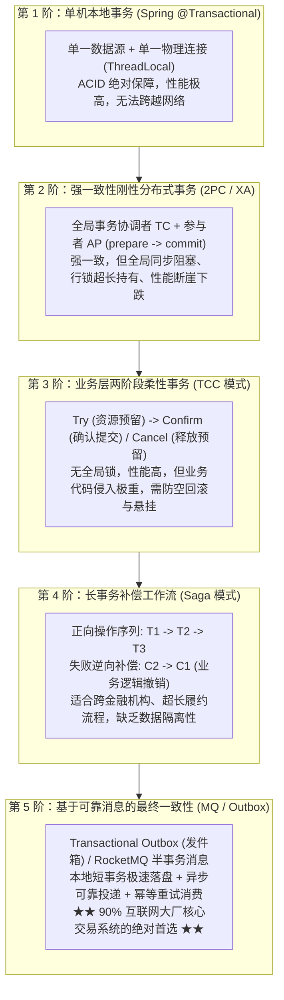
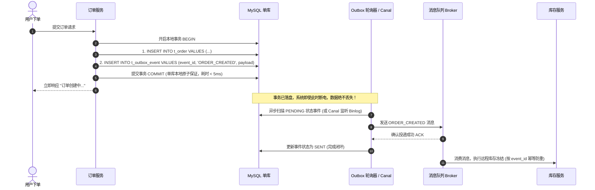
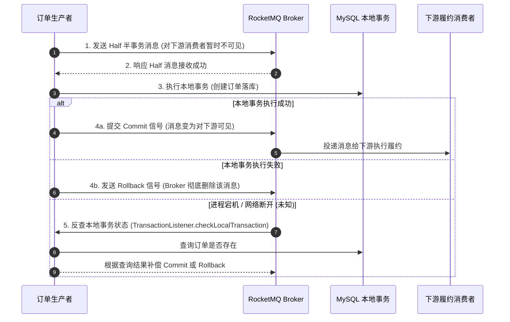

# 从 Spring 事务到分布式一致性：从单机 ACID 到分布式 BASE 的终极演进

> **关联基础**：[[20-Java后端/04-Spring生态/03-Spring事务管理|Spring事务]]、[[20-Java后端/07-分布式与微服务/01-CAP定理与BASE理论|CAP与BASE]]、[[20-Java后端/07-分布式与微服务/03-分布式事务-2PC-TCC-Saga|分布式事务2PC-TCC-Saga]]、[[20-Java后端/07-分布式与微服务/04-分布式事务Seata与最终一致性|Seata与最终一致性]]

---

## 1. 为什么事务会成为分布式架构的噩梦？（第一性原理）

### 1.1 单机 ACID 的舒适区
在单体单库架构下，事务保证是极其纯粹和廉价的：
- **原子性（A）与持久性（D）**：依赖 InnoDB 存储引擎的 **Undo Log（回滚日志）** 与 **Redo Log（重做日志 WAL）**。
- **隔离性（I）**：依赖锁（Record Lock / Next-Key Lock）与 **MVCC 快照读**。
- **一致性（C）**：通过同一个操作系统内核的 TCP Socket、同一个 `java.sql.Connection`，Spring 只需要在执行前 `setAutoCommit(false)`，执行后 `commit()` 或 `rollback()`，一切轻松搞定。

### 1.2 走向分布式：CAP 定理下的必然妥协
一旦业务扩张，单库拆成微服务，调用跨越了网络：
> **“网络是不可靠的（Network is Unreliable）！”**
- 扣减库存是在库存微服务（机房 A），生成订单是在订单微服务（机房 B），扣款是在微信支付（外部渠道）。
- 任何一次远程 RPC 或 HTTP 都有三种可能的结果：**成功、失败、以及最致命的“超时（未知）”**！
- 根据 **CAP 定理与 BASE 理论**，在发生网络分区（P）时，我们几乎无法在保证高可用性（A）的同时实现严苛的强一致性（C）。**我们必须从单机的“强一致性（ACID）”妥协并蜕变为“最终一致性（BASE）”**！

---

## 2. 事务一致性演进五重阶梯全景图



---

## 3. 五大模式深度对决与横向对比

| 维度 | 单机本地事务 | XA / 2PC (如 Atomikos) | TCC (Try-Confirm-Cancel) | Saga 补偿工作流 | 本地发件箱 Outbox / MQ |
| :--- | :--- | :--- | :--- | :--- | :--- |
| **一致性级别** | 刚性强一致 (ACID) | 刚性强一致 (ACID) | 柔性最终一致 (BASE) | 柔性最终一致 (BASE) | 柔性最终一致 (BASE) |
| **并发吞吐性能** | 极高 (微秒/毫秒级) | 极低 (长锁表与网络RTT) | 高 (短本地事务) | 高 (异步解耦) | **极高 (完全异步，百万级)** |
| **业务代码侵入** | 零侵入 (注解驱动) | 零侵入 (中间件代理) | **极重 (每个操作写3个接口)** | 中等 (编写补偿接口) | 极轻 (写事件表/发消息) |
| **隔离性保障** | 数据库原生保障 | 数据库原生保障 | 业务层预占隔离 (冻结态) | **无隔离性 (脏读风险)** | 业务可见性延迟 |
| **适用经典场景** | 单库内部多表联动 | 银行跨库核心资金划转 | 核心账户余额、物理库存扣减 | 超长电商履约、跨企业对公结算 | **绝大多数电商下单、通知、异步流转** |

---

## 4. 工业级主流实战架构：两大最终一致性落地规范

### 4.1 方案 A：本地事务发件箱模式（Transactional Outbox）
这是彻底消灭跨系统分布式事务、保证单库高性能的黄金架构：



---

### 4.2 方案 B：RocketMQ 半事务消息（Two-Phase Commit in MQ）
若不想在数据库建发件箱表，可借助 RocketMQ 提供的内置半事务机制：



---

## 5. 大厂 30 秒面试绝杀（高频追问 3 连击）

### Q1：为什么分布式微服务中，绝对禁止把调用外部 RPC 或第三方支付接口包在 `@Transactional` 方法内？
> **答题标杆**：
> 1. **数据库长事务与连接池耗尽**：一旦方法加上 `@Transactional`，Spring 在方法入口就会向 HikariCP 借出数据库连接，并持有该连接直到方法完全退出。外部网络调用（RPC/HTTP）充满不确定性，一旦网络抖动或下游卡顿 3 秒，数据库连接就被无意义地硬霸占 3 秒。并发只需几十个请求，微服务的**数据库连接池就会瞬间被打满枯竭，引发整个应用雪崩**。
> 2. **事务无法回滚外部副作用**：如果在远程 RPC 成功后，后续本地代码抛出异常触发 Spring 事务回滚，本地数据库的数据固然回滚了，但**远端系统已经执行完成的扣款、发货等动作根本无法自动撤销**，当场造成严重的数据不一致！
> 3. **正确设计**：遵循“**短事务原则**”——远程调用一律挪到 `@Transactional` 方法之外执行，或通过事务发件箱异步解耦。

---

### Q2：TCC 模式中的“空回滚”和“业务悬挂”是什么？在生产中如何彻底规避？
> **答题标杆**：
> 1. **空回滚（Empty Rollback）**：
>    - **现象**：由于网络丢包或拥堵，第一阶段 Try 请求尚未到达参与者，分布式事务协调者已判定超时，直接向参与者下发 Cancel 回滚指令。参与者在根本没有执行过 Try 的情况下，直接收到了 Cancel 指令。
>    - **规避**：在 Cancel 接口中必须判断该全局事务是否曾经执行过 Try。若从未执行过 Try，直接返回成功，且**绝不执行任何资金或库存的退还操作**。
> 2. **业务悬挂（Suspended Execution）**：
>    - **现象**：在发生空回滚之后，那个因为网络延迟被严重滞留的 Try 请求终于慢悠悠到达了参与者！如果代码没有防备，盲目执行 Try 预留了资源，由于 Cancel 已经执行过了，后续**再也没有任何指令来释放这部分预留资源**，导致该资源永久被锁死“悬挂”！
> 3. **规避铁律**：引入一张**本地事务分支记录表**。执行 Cancel 时插入一条状态为 `CANCELLED` 的标记；执行 Try 之前，必须先检查该事务 ID 是否已经存在 Cancel 记录，若已存在则直接拒绝执行 Try，彻底杜绝悬挂。

---

### Q3：Seata AT 模式在什么情况下会发生性能瓶颈甚至死锁？
> **答题标杆**：
> 1. **全局锁竞争瓶颈**：Seata AT 模式在一阶段本地事务提交前，必须向 TC（事务协调器）注册并获取**全局锁（Global Lock）**。在高并发修改同一热点记录（如爆款库存）时，大量分支事务在 TC 处排队争抢全局锁，导致本地数据库行锁持有时间被网络往返放大数十倍，严重制约吞吐量。
> 2. **死锁成因**：
>    - 分支事务 A 持有了本地数据库行锁，尝试向 TC 获取全局锁；
>    - 与此同时，一个未接入 Seata 的普通本地事务 B（或另一个全局事务），已经占有了该记录的全局锁，却正在尝试获取本地数据库行锁；
>    - 两者形成**跨本地与全局资源的交叉死锁环**，必须等待 Seata 全局锁重试超时（默认数秒）才能解开，造成系统长时间卡顿。

---

## 6. 一分钟复盘记忆卡

```text
======================= 事务演进通关口诀 =======================
单机ACID靠引擎，Undo回滚Redo生。
网络无常常超时，CAP定理BASE迎；
刚性XA两阶段，长锁表时性断层；
TCC预留分三步，防悬防空幂等行；
Saga长河逆向退，隔离欠佳有脏影；
发件箱表Outbox走，本地短事零锁惊；
事务消息半阶段，反查状态定乾坤；
分步递进抓本质，大厂架构稳如城！
======================================================================
```
