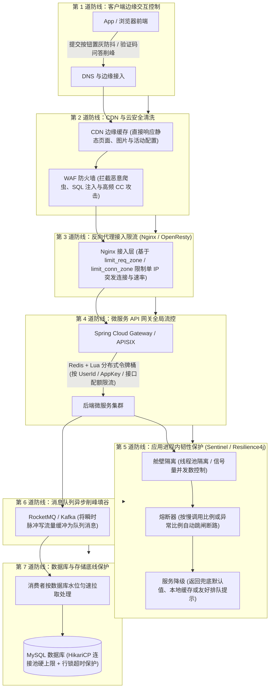
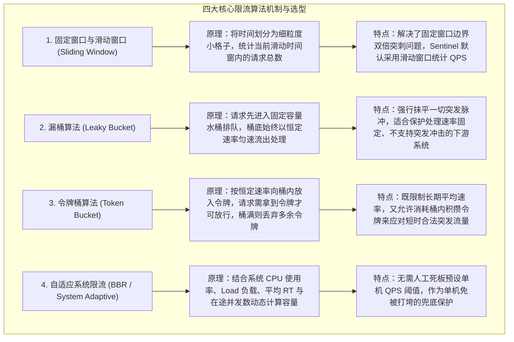

# 高并发系统的流量保护链路：限流、熔断、降级与舱壁隔离的纵深防御

> **关联基础**：[[../08-系统设计/01-高并发架构设计|高并发架构]]、[[../08-系统设计/02-高可用架构设计|高可用架构]]、[[../07-分布式与微服务/06-限流-熔断-降级|限流熔断降级]]

---

## 1. 为什么需要全链路流量保护？（排队论与雪崩成因）

### 1.1 利特尔法则（Little's Law）揭示的雪崩真相
在分布式系统中，整个调用链路的承载上限取决于最脆弱的那个下游组件（如关系型数据库或第三方外部接口）。
根据排队论中的**利特尔法则**：在一个稳定系统中，系统内部同时处于处理中的在途请求数（并发数 $L$），等于请求到达速率（吞吐量 $\lambda$，即 QPS）乘以单个请求的平均响应耗时（$W$）：
$$L = \lambda \times W$$

假设订单服务平时的请求速率 $\lambda = 500\text{ QPS}$，下游库存或积分接口的正常响应耗时 $W = 10\text{ ms} = 0.01\text{ s}$，那么平时只需要 $L = 500 \times 0.01 = 5$ 个并发工作线程就能轻松应对。
然而，一旦某个非核心下游接口因为网络抖动或慢 SQL，响应耗时从 $10\text{ ms}$ 恶化到了 $2\text{ s}$（增长 200 倍）：
- 为了处理相同的 $500\text{ QPS}$ 流量，系统内部积压的在途请求数会迅速飙升至 $L = 500 \times 2 = 1000$ 个；
- Tomcat 默认的 200 个工作线程在不到半秒内就会被全部挂起占满；
- 紧接着，该服务上原本完全健康的其他接口也因为拿不到空闲线程而全部卡死，故障顺着调用链向上游层层传染，最终引发**全站级联雪崩（Cascading Failure）**。

因此，高并发流量保护的核心目标是：**当流量超出系统容量时，在入口处快速拒绝超额请求（限流）；当下游依赖变慢或报错时，迅速切断调用并隔离资源耗尽风险（舱壁隔离、熔断与降级）**。

---

## 2. 全链路流量防护“七道防线”拓扑图



---

## 3. 四大核心限流算法机制与适用场景对比

不同的业务场景对“突发流量”的容忍度不同，需针对性选择限流算法：



### 3.1 生产实战：Redis + Lua 分布式令牌桶限流脚本

单机限流器（如 Guava `RateLimiter`）只能控制单个 Pod 的速率。在 API 网关层若需对整个集群实施全局配额限流，可使用 Redis + Lua 脚本保证“计算补充令牌”与“扣减令牌”的原子性，并直接使用 Redis 服务端时钟（`redis.call('TIME')`）消除不同应用机器之间的时钟偏差：

```lua
-- KEYS[1]: 限流桶 Key (如 rate:limit:order_create)
-- ARGV[1]: 桶最大容量 capacity
-- ARGV[2]: 每秒生成令牌速率 rate
-- ARGV[3]: 本次请求需要消耗的令牌数 requested
local capacity = tonumber(ARGV[1])
local rate = tonumber(ARGV[2])
local requested = tonumber(ARGV[3])

-- 1. 获取 Redis 服务端统一时间戳（毫秒），避免多台应用服务器时钟不一致
local clock = redis.call('TIME')
local now = tonumber(clock[1]) * 1000 + math.floor(tonumber(clock[2]) / 1000)

-- 2. 读取上次更新时间与剩余令牌数（首次访问则初始化为满桶）
local bucket = redis.call('HMGET', KEYS[1], 'last_time', 'tokens')
local last = tonumber(bucket[1]) or now
local tokens = tonumber(bucket[2]) or capacity

-- 3. 根据时间差按比例补充令牌，上限不超过桶容量 capacity
local elapsed = math.max(0, now - last)
tokens = math.min(capacity, tokens + (elapsed * rate / 1000))

-- 4. 判断令牌是否充足并执行扣减
local allowed = 0
if tokens >= requested then
    tokens = tokens - requested
    allowed = 1
end

-- 5. 更新桶状态并设置自动过期时间（装满两桶的时间），防止冷门 Key 常驻内存
redis.call('HSET', KEYS[1], 'last_time', now, 'tokens', tokens)
redis.call('PEXPIRE', KEYS[1], math.ceil((capacity / rate) * 2000))
return allowed
```

---

## 4. 舱壁隔离与慢调用熔断：Sentinel 生产落地

### 4.1 舱壁隔离（Bulkhead）：线程池隔离 vs 信号量隔离
“舱壁隔离”源于轮船的防水隔舱设计——即使一个隔舱进水，也不会导致整艘船沉没。在微服务中，为了防止某个慢下游耗尽全部 Tomcat 工作线程，主要有两种隔离手段：

| 对比维度 | 线程池隔离（Hystrix 默认 / 自定义业务池） | 信号量/并发数隔离（Sentinel 默认） |
| :--- | :--- | :--- |
| **实现机制** | 为每个下游服务分配独立的 `ThreadPoolExecutor`，调用在独立子线程中执行 | 不创建新线程，仍在当前调用线程执行，仅通过原子计数器限制同时在途的请求数 |
| **核心优势** | 隔离性极强，支持排队缓冲；当下游彻底卡死时，主线程可在超时后直接放弃等待返回 | 无线程切换与上下文复制开销，极度轻量，不会因为下游过多导致 JVM 线程数爆炸 |
| **局限与适用** | 存在线程上下文切换成本（需配合 TTL 传 `TraceId`）；适合少量耗时波动大的外部第三方接口 | 适合高频内部 RPC 调用及网关层并发数控制（需配合底层 HTTP/RPC 客户端的 Socket 超时） |

### 4.2 Sentinel 慢调用比例熔断器状态机与配置

熔断器（Circuit Breaker）包含三个状态：
1. **`CLOSED`（闭合正常态）**：请求正常放行，同时滑动窗口持续统计慢调用比例或异常比例。
2. **`OPEN`（打开跳闸态）**：当最近一个统计窗口内的请求数达到最小阈值（如 20 次），且慢调用（RT > 500ms）比例超过 50% 时，熔断器跳闸变为 `OPEN`。在接下来的熔断时长（如 10 秒）内，所有对该下游的调用不再发起真实网络请求，直接微秒级触发本地 `Fallback` 降级方法，给下游留出喘息恢复的时间。
3. **`HALF_OPEN`（半开探测态）**：熔断时长到期后，进入 `HALF_OPEN` 状态，放行**第一个**探测请求去调用下游：若该请求响应正常且未超时，熔断器自动恢复为 `CLOSED`；若依然慢或报错，则重新回到 `OPEN` 状态继续熔断。

```java
@Configuration
public class SentinelCircuitBreakerConfig {

    @PostConstruct
    public void initDegradeRules() {
        List<DegradeRule> rules = new ArrayList<>();
        DegradeRule slowCallRule = new DegradeRule("recommendProductRpc")
                // 1. 熔断策略：慢调用比例 (SLOW_REQUEST_RATIO)
                .setGrade(CircuitBreakerStrategy.SLOW_REQUEST_RATIO.getType())
                // 2. 慢调用阈值：响应时间超过 500ms 即判定为慢调用
                .setCount(500)
                // 3. 触发熔断比例：慢调用占比达到 50% (0.5)
                .setSlowRatioThreshold(0.5)
                // 4. 熔断窗口时长：跳闸后持续 10 秒快速失败走降级
                .setTimeWindow(10)
                // 5. 最小请求数保护：统计周期内至少有 20 个请求才触发比例计算，防止低峰期误熔断
                .setMinRequestAmount(20)
                // 6. 统计滑动窗口时长：1000ms (1秒)
                .setStatIntervalMs(1000);

        rules.add(slowCallRule);
        DegradeRuleManager.loadRules(rules);
    }
}
```

---

## 5. 面试高频追问解析

> [!question]- Q1：令牌桶（Token Bucket）和漏桶（Leaky Bucket）的核心区别是什么？在工程中分别怎么选？
> 1. **对突发流量的处理方式完全不同**：
>    - **漏桶（Leaky Bucket）**重点在于**控制流出速率恒定**：无论入口瞬间涌入多少请求，都必须先进入桶内缓冲，并以固定不变的速率（如严格的每 10ms 放行 1 个）向下游流出。它 completely 抹平了突发流量。
>    - **令牌桶（Token Bucket）**重点在于**限制平均速率的同时允许适度突发**：系统按恒定速率（如每秒 100 个）往桶里放令牌，桶容量为 200。如果前两秒没有请求，桶里就攒满了 200 个令牌；当第 3 秒突然瞬间涌入 200 个请求时，令牌桶允许这 200 个请求在 1 毫秒内全部拿到令牌立即通过，无需排队等待。
> 2. **工程选型**：
>    - 面向用户的 **API 网关与微服务入口限流**，一律优先选择**令牌桶**（因为真实互联网流量天然具有脉冲突发性，令牌桶体验更好）；
>    - 当我方需要调用一个**下游处理能力极其脆弱、或者按严格固定频率收费/限额的外部第三方系统**（如银行老旧接口、外部短信网关）时，在客户端出口处选择**漏桶**进行平滑整形。

> [!question]- Q2：“限流”、“熔断”和“降级”这三个概念经常一起出现，它们的触发条件和作用位置有什么本质区别？
> 1. **限流（Rate Limiting）——防上游流量冲垮自己**：
>    部署在**服务端入口**，监控的是**上游发来的请求速率（QPS）或并发数**。当外部流量超过本服务预设的承载上限时，直接拒绝多余请求（返回 429 或排队提示），保护本服务不被冲垮。
> 2. **熔断（Circuit Breaking）——防下游故障拖死自己**：
>    部署在**客户端调用出口**，监控的是**下游依赖服务的响应耗时（慢调用比例）或异常率**。当某个下游服务半死不活时，主动切断对它的远程调用（快速失败），防止本服务的线程和连接被下游拖死。
> 3. **降级（Degradation / Fallback）——故障或高压下的有损兜底策略**：
>    是限流或熔断触发后的**业务兜底动作**（也可以在大促前通过配置开关主动关闭非核心功能，如关闭商品评价、推荐列表改读静态缓存），遵循“丢车保帅”原则，牺牲非核心边缘体验以确保核心下单支付链路畅通。

> [!question]- Q3：使用 Redis + Lua 做网关分布式限流时，如果某个爆款活动导致限流 Key 本身达到了几十万 QPS，成为 Redis 单点热点瓶颈怎么办？
> 当单个限流 Key 的访问频率过高时，直接每次请求都访问一次 Redis 会造成该分片网卡和 CPU 饱和。可通过**“本地批量预取令牌 + 降级兜底”**优化：
> 1. **网关节点批量申请令牌（Batch Token Acquisition）**：网关实例不在每次收到请求时都调一次 Redis，而是每次向 Redis 批量申请一批令牌（如一次申请 100 个令牌）缓存在网关本地内存中，本地直接通过 `AtomicInteger` 扣减；消耗完后再向 Redis 申请下一批，直接将 Redis 的访问压力降低 99%。
> 2. **Redis 故障自动降级为单机限流（Fail-Open to Local RateLimiter）**：如果 Redis 集群发生网络抖动或超时，网关切勿因限流组件报错而阻塞全部正常业务，而是自动捕获异常并切换为本地 Guava / Sentinel 单机令牌桶（按 `全局配额 / 网关节点数` 限流），实现高可用兜底。

---

## 6. 核心要点复盘清单

- **雪崩第一定律（利特尔法则 $L = \lambda \times W$）**：下游耗时 $W$ 放大百倍，会导致在途并发请求数 $L$ 放大百倍，迅速耗尽线程池引发级联雪崩。
- **七层纵深防护**：前端防抖与验证码 -> CDN 缓存与 WAF -> Nginx 连接限流 -> API 网关分布式令牌桶 -> 应用内舱壁隔离与慢调用熔断 -> MQ 削峰 -> 数据库连接池上限保护。
- **令牌桶 vs 漏桶**：令牌桶限制平均速率且允许消耗存量令牌应对突发流量（适合 API 入口）；漏桶恒定速率流出，抹平一切突发（适合保护脆弱下游出口）。
- **熔断三态循环**：`CLOSED`（正常放行并统计慢调用/异常率） -> `OPEN`（超阈值跳闸，快速失败走 Fallback） -> `HALF_OPEN`（冷却期满放行单次探测请求，成功则闭合恢复，失败则继续熔断）。
