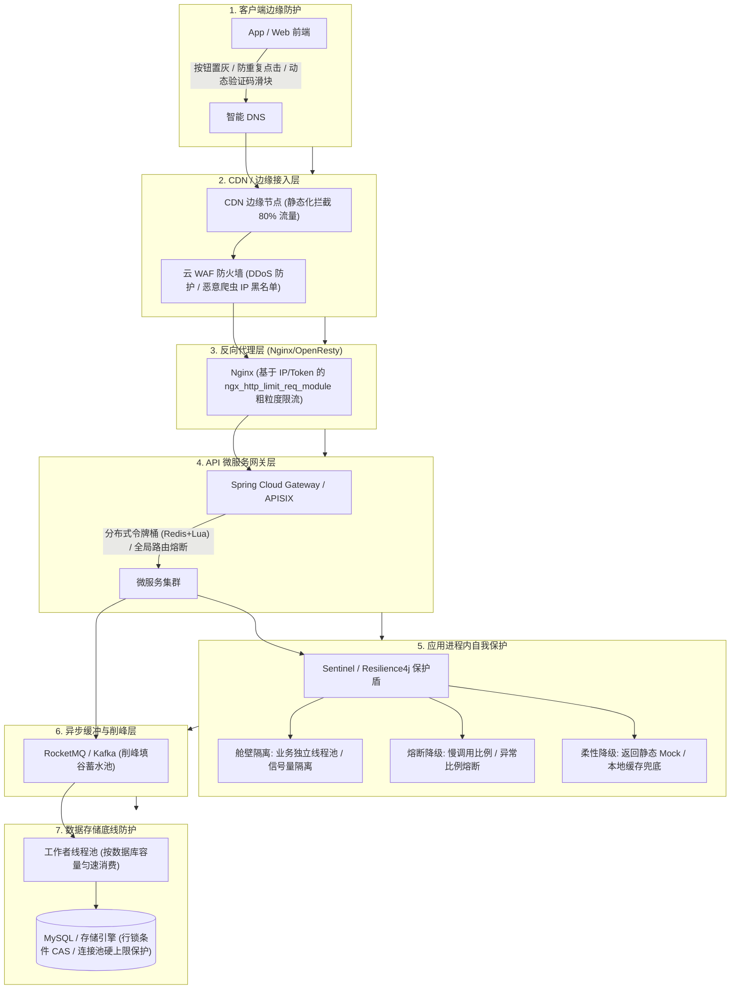
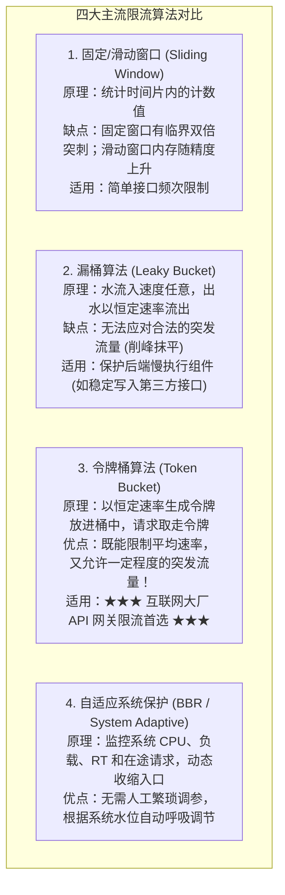

# 高并发系统的流量保护链路：限流、熔断、降级与舱壁的纵深防御

> **关联基础**：[[20-Java后端/08-系统设计/01-高并发架构设计|高并发架构]]、[[20-Java后端/08-系统设计/02-高可用架构设计|高可用架构]]、[[20-Java后端/07-分布式与微服务/09-微服务限流熔断降级|限流熔断降级]]

---

## 1. 为什么需要全链路流量保护？（第一性原理）

### 1.1 木桶理论与级联雪崩效应
任何高并发系统无论架构多么庞大，其处理能力永远受制于**整个链路中最脆弱的那个短板组件**（通常是关系型数据库的单行行锁、或者某个慢下游第三方接口）。

根据利特尔法则（$L = \lambda \times W$），当下游服务因故延迟从 $10\text{ms}$ 恶化到 $1\text{s}$（增加 100 倍）时：
- 为了维持相同的 QPS，系统内部在途堆积的并发请求数将瞬间暴涨 100 倍；
- Web 容器线程池、数据库连接池、内存缓冲区在几秒钟内被全部吞噬殆尽；
- 故障逆调用链路向上蔓延传播，导致原本健康的业务也无法获取线程，最终引发**全系统级联雪崩（Cascading System Collapse）**！

> **核心哲学**：**“与其被不可控的流量洪峰彻底打垮，不如在门槛处有尊严地主动拦截过载流量，保全核心生命线！”**

---

## 2. 全链路流量防护“七道防火墙”拓扑图



---

## 3. 四大核心限流算法深度解剖与选型



### 3.1 生产级 Redis + Lua 令牌桶分布式限流脚本

单机限流（如 Guava RateLimiter）无法限制跨节点的集群总流量，必须使用 Redis + Lua 保证分布式原子性：

```lua
-- KEYS[1]: 令牌桶 Key (如 "rate_limit:order_create")
-- ARGV[1]: 桶的最大容量 (Capacity)
-- ARGV[2]: 每秒生成的令牌速率 (Rate)
-- ARGV[3]: 当前时间戳 (毫秒)
-- ARGV[4]: 本次请求期望获取的令牌数 (通常为 1)

local bucketKey = KEYS[1]
local capacity = tonumber(ARGV[1])
local rate = tonumber(ARGV[2])
local now = tonumber(ARGV[3])
local requested = tonumber(ARGV[4])

-- 获取当前桶中保存的上次更新时间与剩余令牌数
local bucket = redis.call('HMGET', bucketKey, 'last_time', 'tokens')
local lastTime = tonumber(bucket[1])
local currentTokens = tonumber(bucket[2])

if not lastTime then
    -- 首次访问：初始化满桶
    currentTokens = capacity
    lastTime = now
else
    -- 计算两次请求之间生成的增量令牌数
    local delta = math.max(0, now - lastTime)
    local generatedTokens = math.floor((delta / 1000) * rate)
    currentTokens = math.min(capacity, currentTokens + generatedTokens)
    lastTime = now
end

-- 判定令牌是否足够
if currentTokens >= requested then
    currentTokens = currentTokens - requested
    redis.call('HMSET', bucketKey, 'last_time', lastTime, 'tokens', currentTokens)
    redis.call('EXPIRE', bucketKey, math.ceil(capacity / rate) * 2)
    return 1 -- 放行 (Allowed)
else
    return 0 -- 限流拦截 (Rejected)
end
```

---

## 4. 熔断与舱壁隔离：Sentinel 生产级落地

### 4.1 舱壁隔离（Bulkhead）：线程池隔离 vs 信号量隔离
- **线程池隔离（Hystrix 默认）**：
  - 机制：每个下游依赖分配独立的线程池，调用在子线程异步执行。
  - 优点：支持硬超时强行中断、天然物理隔离。
  - 缺点：上下文切换开销大，CPU 额外损耗 5%~10%。
- **信号量隔离（Sentinel 默认）**：
  - 机制：仅仅使用原子计数器（`AtomicInteger`），进入加 1，离开减 1。
  - 优点：**零线程上下文切换，纳秒级判定，极高吞吐**。
  - 缺点：无法在子线程内部强行杀死卡死的慢 SQL。

### 4.2 Sentinel 慢调用比例熔断配置实战

当接口响应变慢时（而非完全报错），更容易拖垮系统。**基于慢调用比例熔断是现代微服务的最优解**：

```java
@Configuration
public class SentinelRuleConfig {

    @PostConstruct
    public void initDegradeRules() {
        List<DegradeRule> rules = new ArrayList<>();
        DegradeRule rule = new DegradeRule("payment_api")
                // 1. 熔断策略：慢调用比例 (SLOW_REQUEST_RATIO)
                .setGrade(CircuitBreakerStrategy.SLOW_REQUEST_RATIO.getType())
                // 2. 慢调用判定阈值：RT 超过 500ms 算作慢调用
                .setCount(500)
                // 3. 熔断阈值：慢调用比例达到 50%
                .setSlowRatioThreshold(0.5)
                // 4. 熔断持续时间：开启熔断 10 秒 (期间快速失败走 fallback)
                .setTimeWindow(10)
                // 5. 最小请求数：统计窗口内至少要有 20 次请求才触发判断
                .setMinRequestAmount(20)
                // 6. 滑动窗口统计时长：统计最近 1000ms 的请求
                .setStatIntervalMs(1000);

        rules.add(rule);
        DegradeRuleManager.loadRules(rules);
    }
}
```

---

## 5. 大厂 30 秒面试绝杀（高频追问 3 连击）

### Q1：令牌桶（Token Bucket）和漏桶（Leaky Bucket）到底有什么本质区别？各适用于什么业务场景？
> **答题标杆**：
> 1. **核心机制差异**：
>    - **漏桶（Leaky Bucket）**：水流入速率随意，但**出水速率严格恒定**。无论外部流量如何突发，漏桶都将其强行拉平成平稳恒定的输出，**绝对不允许任何突发流量突破**。
>    - **令牌桶（Token Bucket）**：以恒定速率向桶中注入令牌。当外部来了一波瞬时突发脉冲时，只要桶里预存的令牌足够，**允许请求瞬间将积攒的令牌全部取走**，从而平稳承载这一小段突发脉冲。
> 2. **场景选型**：
>    - 漏桶适合**保护下游极端脆弱且无法承受波动的系统**（如旧核心系统、写外部受配额限制的第三方支付回调）；
>    - 令牌桶是**绝大多数互联网 API 网关和微服务限流的标配**，因为它兼顾了限制平均吞吐和对合法用户正常突发流量的友好兼容。

---

### Q2：阿里 Sentinel 为什么弃用了 Netflix Hystrix 的线程池隔离模型，而主推基于滑动窗口的信号量限流？
> **答题标杆**：
> 1. **Hystrix 线程池隔离的致命代价**：每个被保护的方法都在子线程中执行，涉及大量的线程排队、上下文切换（Context Switch）、ThreadLocal 变量跨线程丢失、以及线程池本身内存资源的巨大消耗。在超高并发（数十万 QPS）下，线程池自身的调度开销成为系统的瓶颈。
> 2. **Sentinel 的轻量级哲学**：采用**基于 LeapArray 滑动窗口的无锁高性能计数器（信号量模型）**，请求在当前调用线程内直接完成计数校验与放行。零上下文切换，GC 压力极小，单节点支持百万级 QPS 的高吞吐限流，同时通过系统自适应保护规则动态感知 CPU 负载，达到了极致的性能与防护平衡。

---

### Q3：分布式限流使用 Redis + Lua 脚本，如果各个服务器节点与 Redis 服务器的时钟不一致，会导致限流不准甚至失效吗？
> **答题标杆**：
> 1. **时钟偏差隐患**：如果 Lua 脚本中的当前时间戳参数是由每个应用客户端通过 `System.currentTimeMillis()` 传入的，在分布式集群出现 NTP 时钟漂移（Clock Skew）时，会导致两台机器计算出的增量令牌数出现剧烈跳跃或倒退，引发限流失准。
> 2. **破局解法——以 Redis 服务端时间为统一基准**：在 Lua 脚本内部直接调用 Redis 自带的 `redis.call('TIME')` 命令！该命令直接返回 Redis 单机 Master 节点的当前秒数与微秒数，完全摆脱对客户端服务器本地时钟的依赖，**保证了全集群分布式限流时钟源的绝对全局单调递增**。

---

## 6. 一分钟复盘记忆卡

```text
======================= 流量保护全链路通关口诀 =======================
木桶短板决定限，雪崩只因在途填。
七道防线层层设，边缘CDN拦八成；
Nginx粗筛网关卡，动态令牌桶为尊；
滑动窗口看比例，慢调用起熔断跟；
舱壁隔离线程稳，信号极速开销轻；
柔性降级Mock备，削峰填谷MQ囤；
纵深防御大厦立，流量狂飙若等闲！
======================================================================
```
