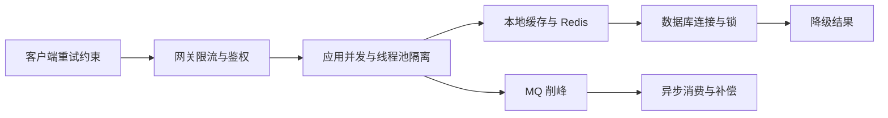
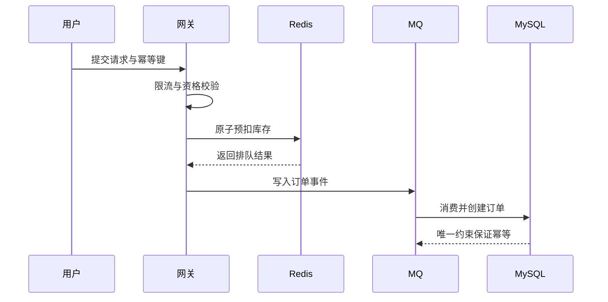

# 高并发系统的流量保护链路

> [!abstract] 一句话总结
> 高并发设计不是把线程和缓存调大，而是让每一层都知道自己的容量，并在超载前完成限流、排队、隔离、降级和恢复。

## 保护链路



## 容量必须逐层对齐

| 层次 | 关键容量 | 过载表现 | 保护动作 |
| --- | --- | --- | --- |
| 网关 | QPS、并发数、租户额度 | 大量请求进入应用 | 限流、配额、快速失败 |
| Web/业务线程池 | 活跃线程、队列、任务耗时 | 线程与队列耗尽 | 有界队列、隔离、拒绝、超时 |
| Redis | QPS、热 Key、连接数、带宽 | 超时、单分片打满 | 本地缓存、Key 拆分、请求合并 |
| MySQL | 连接数、TPS、锁等待、IO | 连接池等待、慢 SQL、死锁 | 索引、批量、短事务、写入削峰 |
| MQ | 生产速率、消费速率、积压 | 延迟持续增长 | 扩消费者、降采样、暂停非核心流量 |
| 下游服务 | 并发额度、P99、错误率 | 重试风暴和级联故障 | 熔断、舱壁、退避、降级 |

## 为什么“池越大越好”是错的

若数据库连接池是 30，查询线程池设置 300，只会产生更多等待线程和超时。线程池、连接池和下游额度应通过 Little's Law 与压测估算，并保留突发余量：

```text
并发数约等于吞吐量 × 平均响应时间
```

响应时间升高时，并发占用会同步上升，因此超时和熔断本身就是容量保护机制。

## 缓存与数据库的连接

[[20-Java后端/05-数据库与存储/07-缓存穿透-击穿-雪崩|缓存故障]] 的本质，是缓存失效后瞬时回源量超过数据库容量。治理顺序是：

1. 对非法和不存在数据做边界控制，防穿透。
2. 热点 Key 失效时做请求合并、互斥重建或逻辑过期，防击穿。
3. 过期时间加入抖动并分批预热，防雪崩。
4. 数据库侧仍需连接池、索引、超时和只读降级，不能只相信缓存。

## 同步还是异步

- 用户必须立即得到最终结果的动作，保持同步但缩短链路，并设置明确超时。
- 可延迟处理的通知、统计、索引构建和非核心写入可进入 MQ。
- 库存扣减、支付等核心状态不能只靠“丢进队列”，仍需状态机、幂等和补偿。
- 进程内线程池不能替代可靠消息；进程崩溃时内存任务可能丢失。

## 秒杀场景串联



对应学习：[[20-Java后端/08-系统设计/04-秒杀系统设计]]、[[20-Java后端/09-项目实战/01-项目-高并发秒杀系统]]。

## 过载排障顺序

1. 判断入口流量异常还是下游延迟导致并发堆积。
2. 看线程池、连接池和 MQ 是否排队，定位第一个达到容量上限的节点。
3. 检查重试是否放大流量，熔断是否真正生效。
4. 临时降级非核心功能，保护核心写路径和恢复通道。
5. 恢复后用容量模型和压测修正限流阈值，而不是只扩机器。

## 关联笔记

- [[20-Java后端/08-系统设计/01-高并发架构设计]]
- [[20-Java后端/08-系统设计/02-高可用架构设计]]
- [[20-Java后端/07-分布式与微服务/06-限流-熔断-降级]]
- [[06-线程池-CompletableFuture-MQ异步链路]]

## 参考资料

- [Resilience4j Documentation](https://resilience4j.readme.io/docs)
- [Redis Documentation](https://redis.io/docs/latest/)
- [Apache Kafka Operations](https://kafka.apache.org/documentation/#operations)

