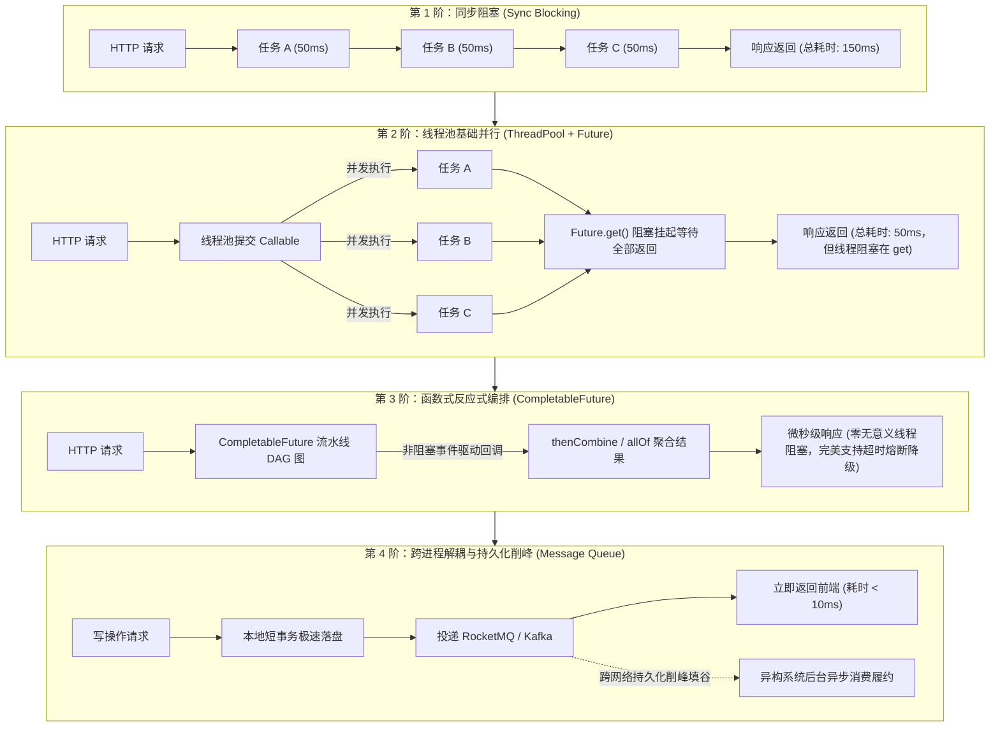

# 线程池、CompletableFuture 与 MQ 异步链路：从进程内并发编排到跨服务异步削峰

> **关联基础**：[[../03-并发编程/07-线程池原理与参数|线程池架构]]、[[../03-并发编程/09-CompletableFuture异步编程|CompletableFuture]]、[[../06-中间件/01-Kafka原理与应用|Kafka核心]]

---

## 1. 为什么需要异步？（第一性原理与架构演进）

### 1.1 核心矛盾：用户体验与 I/O 阻塞的对立
在传统同步阻塞模型下，一个接口需要调用 5 个下游服务（例如商品详情页需要查询：①商品信息 20ms、②实时库存 30ms、③会员优惠券 40ms、④用户风控 20ms、⑤个性化推荐 50ms）：
- **同步串行执行**：总耗时为各步骤累加：$20 + 30 + 40 + 20 + 50 = 160\text{ms}$。
- **并发异步编排**：各任务并行执行，总耗时取决于最慢的分支（木桶短板）：$\max(20, 30, 40, 20, 50) = 50\text{ms}$，**响应速度瞬间提升 300%**！

### 1.2 异步技术的四重演进阶梯



---

## 2. 三大异步模式全维度对比矩阵

| 比较维度 | 传统线程池 (`ThreadPoolExecutor`) | 异步编排 (`CompletableFuture`) | 消息中间件 (`RocketMQ / Kafka`) |
| :--- | :--- | :--- | :--- |
| **空间范围** | 纯单进程、单 JVM 内存内部 | 纯单进程、单 JVM 内存内部 | **跨服务器、跨数据中心、跨网络** |
| **生命周期与可靠性** | 进程崩溃或重启，内存队列数据**瞬间永久丢失** | 进程崩溃或重启，任务**瞬间丢失** | **磁盘顺序写（CommitLog）持久化，具备金融级容灾** |
| **执行模式** | 适合独立、无复杂依赖的背景任务 | 适合复杂的 **DAG 有向无环图** 依赖编排与结果聚合 | 适合发布-订阅（Pub-Sub）、广播通知、削峰填谷 |
| **结果交互** | 需调用阻塞的 `Future.get()` | 丰富的非阻塞流式回调（`thenApply/thenCombine`） | 异步消费，通常不直接等待结果（走轮询/WebSocket） |
| **系统解耦度** | 强代码耦合（共享内存和类对象） | 强代码耦合（函数接口） | **极高（彻底解耦语言、服务与部署版本）** |

---

## 3. 生产级实战：高性能商品详情页并行聚合引擎

在千万级电商中，如何用 `CompletableFuture` 搭建一个**高容错、防雪崩、带超时与降级**的聚合服务？

```java
@Service
@RequiredArgsConstructor
@Slf4j
public class ProductDetailAggregationService {

    // 严禁使用 ForkJoinPool.commonPool()！必须使用业务隔离的独立线程池
    @Qualifier("productDetailExecutor")
    private final ExecutorService executor;

    private final ProductClient productClient;
    private final StockClient stockClient;
    private final PromotionClient promotionClient;
    private final RecommendationClient recommendationClient;

    public ProductDetailPageVO getProductDetailPage(Long productId, Long userId) {
        long startTime = System.currentTimeMillis();

        // 1. 异步任务 A：商品基础信息 (核心依赖，失败不可接受)
        CompletableFuture<ProductDTO> productFuture = CompletableFuture
                .supplyAsync(() -> productClient.getProduct(productId), executor)
                .orTimeout(500, TimeUnit.MILLISECONDS); // 超时控制：最多等待 500ms

        // 2. 异步任务 B：实时库存 (核心依赖)
        CompletableFuture<Integer> stockFuture = CompletableFuture
                .supplyAsync(() -> stockClient.getAvailableStock(productId), executor)
                .orTimeout(300, TimeUnit.MILLISECONDS)
                .exceptionally(ex -> {
                    log.warn("库存服务超时或异常，降级显示暂存库存: {}", ex.getMessage());
                    return 0; // 柔性降级：返回默认 0
                });

        // 3. 异步任务 C：用户优惠券 (依赖用户身份，弱依赖)
        CompletableFuture<List<CouponDTO>> couponFuture = CompletableFuture
                .supplyAsync(() -> promotionClient.getUserCoupons(userId, productId), executor)
                .orTimeout(200, TimeUnit.MILLISECONDS)
                .exceptionally(ex -> {
                    log.warn("优惠券接口超时，优雅降级为空列表");
                    return Collections.emptyList();
                });

        // 4. 异步任务 D：个性化推荐列表 (弱依赖)
        CompletableFuture<List<ProductDTO>> recommendFuture = CompletableFuture
                .supplyAsync(() -> recommendationClient.getRecommendProducts(userId), executor)
                .orTimeout(200, TimeUnit.MILLISECONDS)
                .exceptionally(ex -> Collections.emptyList());

        // 5. 创建多任务聚合栅栏（非阻塞编排，瞬间返回聚合 Future）
        CompletableFuture<Void> allOfFuture = CompletableFuture.allOf(
                productFuture, stockFuture, couponFuture, recommendFuture
        );

        try {
            // 最多等待 600ms 获取全量聚合结果
            allOfFuture.get(600, TimeUnit.MILLISECONDS);

            ProductDTO product = productFuture.join();
            Integer stock = stockFuture.join();
            List<CouponDTO> coupons = couponFuture.join();
            List<ProductDTO> recommends = recommendFuture.join();

            log.info("商品详情聚合完成，耗时: {}ms", System.currentTimeMillis() - startTime);

            return ProductDetailPageVO.builder()
                    .product(product)
                    .availableStock(stock)
                    .coupons(coupons)
                    .recommendations(recommends)
                    .build();

        } catch (Exception e) {
            log.error("聚合商品详情严重超时或异常", e);
            throw new BusinessException("系统繁忙，请稍后刷新");
        }
    }
}
```

---

## 4. 异步链路三大致命陷阱与生产踩坑 SOP

### 4.1 陷阱一：默认使用 `ForkJoinPool.commonPool()` 引发全服停摆
- **案发现场**：`CompletableFuture.supplyAsync(() -> ...)` 如果不传自定义 Executor，默认使用 JVM 全局唯一的 `ForkJoinPool.commonPool()`。
- **致命后果**：该公共池的线程数等于 `CPU Cores - 1`（如 8 核机器只有 7 个线程）。如果有同事写了一个耗时的慢 HTTP 调用或查数据库任务提交进去，7 个线程被全部挂起阻塞。整个 JVM 内部所有的并行流（`parallelStream`）和其他业务全部陷入停滞，**一个非核心接口拖死全服务**！
- **防御铁律**：**所有 `CompletableFuture` 异步调用，必须强制传入显式声明的业务自定义线程池！**

### 4.2 陷阱二：ThreadLocal 与 MDC 链路 TraceId 在子线程悄然丢失
- **案发现场**：在主线程记录了请求日志 `MDC.put("traceId", "abc")`。进入 `supplyAsync` 异步子线程后，发现打出的日志 TraceId 全是 `null`，排查故障链路彻底中断。
- **防御手段**：
  1. 使用阿里巴巴开源的 `TransmittableThreadLocal`（TTL）；
  2. 使用 `TtlExecutors.getTtlExecutorService(executor)` 对线程池进行装饰，任务入队时自动抓取父线程上下文，执行时自动还原。

### 4.3 陷阱三：在异步线程内尝试参与父线程的 Spring 事务
- **案发现场**：开发者在 `@Transactional` 主方法内，试图用 `CompletableFuture.runAsync()` 去更新另一张表，认为即使子线程报错，主方法也能一并回滚。
- **致命现实**：Spring 的声明式事务是基于 `ThreadLocal` 绑定 `Connection` 的。子线程拥有自己独立的调用栈和线程上下文，根本拿不到父线程绑定的数据库连接！子线程操作要么是在新的独立事务中提交，要么根本没有事务保护；**父线程回滚，子线程已经落盘的数据绝对不会跟着回滚**！
- **防御铁律**：**跨线程操作严禁假设共享本地事务，必须遵循跨系统一致性（如 Transactional Outbox 或 MQ）！**

---

## 5. 大厂 30 秒面试绝杀（高频追问 3 连击）

### Q1：既然 `CompletableFuture` 和线程池在单机上并发执行这么快，为什么架构设计中还要引入笨重的 RocketMQ / Kafka？
> **答题标杆**：
> 1. **内存易失性 vs 磁盘持久化（可靠性本质）**：线程池的任务队列是驻留在 JVM 堆内存中的。一旦云主机重启、发布升级或发生 OOM 崩溃，**内存队列中堆积的成千上万个任务瞬间灰飞烟灭**！而 MQ 消息会被 WAL 顺序刷入磁盘（甚至多副本 Raft 同步），提供金融级的容灾保障。
> 2. **无界堆积与容量瓶颈**：单机内存有限，线程池队列一旦设大容易 OOM，设小了会触发拒绝策略（丢弃请求）。MQ Broker 具备数以亿计的消息堆积能力，是真正具备“时间换空间”的海绵蓄水池。
> 3. **跨系统解耦与水平扩缩容**：`CompletableFuture` 无法跨越网络调用另一个微服务。MQ 能彻底切断上下游系统的网络与生命周期耦合，下游消费集群可以根据队列堆积情况随时弹性水平扩容 100 台机器，这是单机线程池绝不可能做到的。

---

### Q2：`CompletableFuture.get()` 和 `CompletableFuture.join()` 有什么区别？为什么现代编码推荐用 `join()`？
> **答题标杆**：
> 1. **异常抛出类型的区别**：
>    - `get()` 声明抛出受检查异常（Checked Exception）：`InterruptedException` 和 `ExecutionException`，调用方必须强制在代码中用繁琐的 `try-catch` 包裹或在方法签名抛出，代码可读性差；
>    - `join()` 抛出的是未受检异常（Unchecked Exception）：`CompletionException`，代码更加清爽，符合现代函数式与 Lambda 编程规范。
> 2. **超时机制**：`get()` 提供了重载方法 `get(long timeout, TimeUnit unit)` 支持设定等待上限，而 `join()` 原生不支持传入超时时间（但可在前期结合 `orTimeout()` 链式调用优雅实现）。

---

### Q3：`thenApply`、`thenCompose` 和 `thenCombine` 的使用场景有什么本质区别？
> **答题标杆**：
> 1. **`thenApply`（转换结果）**：接收上一步的结果，在当前流中进行函数转换并返回新值（类似 Stream 的 `map`），操作是串行的（如 `String -> Integer`）。
> 2. **`thenCompose`（扁平化连接）**：上一步的执行结果本身用来作为参数，去触发**另一个返回新的 CompletableFuture 的异步任务**，并将其“打平”（类似 Stream 的 `flatMap`），常用于有先后因果依赖的异步流水线（如查到 userId 后，根据 userId 异步查其订单）。
> 3. **`thenCombine`（双分支合并）**：两个**完全独立并发运行**的 CompletableFuture，在两者都执行完毕后，由一个 BiFunction 函数将两个独立结果聚合成一个新对象（如并发查用户信息和查优惠券，最后聚合成 VO）。

---

## 6. 一分钟复盘记忆卡

```text
======================= 异步全链路通关口诀 =======================
单机串行耗时加，异步并行绽春花。
线程池底需定制，公共Common莫乱抓；
CompletableFuture立神功，流式编排无阻塞；
组合聚合allOf候，超时降级异常掐；
MDC透传TTL护，事务莫跨线程拔；
内存易失有极限，削峰填谷MQ踏；
由内而外层层推，异步链路定天下！
======================================================================
```
