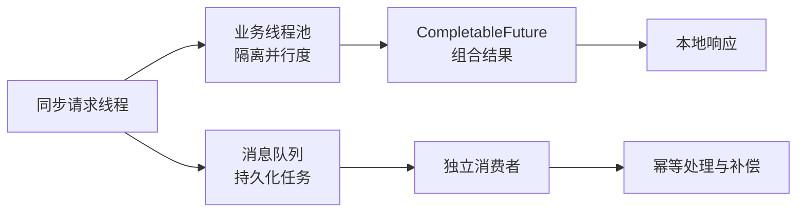
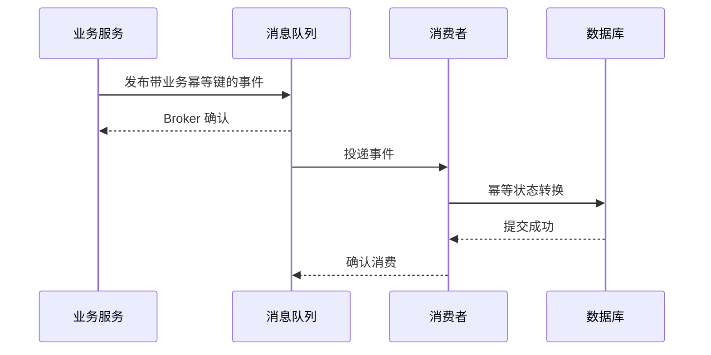

# 线程池、CompletableFuture 与 MQ 异步链路

> [!abstract] 一句话总结
> 线程池管理进程内并行度，CompletableFuture 编排结果依赖，MQ 提供跨进程持久异步；三者解决的问题不同，不能互相替代。

## 三层异步模型



## 能力边界

| 机制 | 生命周期 | 可靠性 | 主要用途 | 典型风险 |
| --- | --- | --- | --- | --- |
| 线程池 | 当前进程 | 进程崩溃可能丢任务 | 控制并发、隔离资源 | 无界队列、拒绝失控、上下文丢失 |
| CompletableFuture | 当前进程 | 依赖线程池和进程存活 | 并行调用、依赖编排、结果聚合 | 公共池污染、异常遗漏、无超时 |
| MQ | 跨进程、可持久 | 取决于确认、复制和重试配置 | 削峰、解耦、事件传播 | 重复、乱序、积压、毒消息 |

## 一条安全的进程内异步链路

```java
CompletableFuture<User> userFuture = CompletableFuture
    .supplyAsync(() -> userClient.load(id), ioPool)
    .orTimeout(300, TimeUnit.MILLISECONDS);

CompletableFuture<List<Order>> orderFuture = CompletableFuture
    .supplyAsync(() -> orderClient.list(id), ioPool)
    .orTimeout(500, TimeUnit.MILLISECONDS);

Profile profile = userFuture
    .thenCombine(orderFuture, Profile::new)
    .exceptionally(ex -> fallback(id, ex))
    .join();
```

必须显式回答：使用哪个线程池、总超时是多少、单分支失败是否降级、Trace 和安全上下文如何传播、请求取消后任务是否继续。

## 线程池参数如何传导到业务

[[20-Java后端/03-并发编程/07-线程池原理与参数|线程池]] 的队列长度不是孤立参数：

```text
预计排队时间约等于 队列中的任务数 ÷ 实际完成速率
```

若排队时间已经超过请求剩余超时，继续入队只会制造无效工作。此时应拒绝、降级或转持久队列，而不是无限扩容。

## 何时转 MQ

适合 MQ：

- 用户不需要等待最终完成，例如通知、日志处理、搜索索引和报表。
- 任务必须跨进程保存并支持重试。
- 生产速度短时高于消费速度，需要削峰。
- 多个下游订阅同一业务事件。

不应直接转 MQ：

- 调用方必须立刻得到强一致结果。
- 没有幂等键、状态机、失败队列和对账机制。
- 只是为了隐藏慢 SQL，却没有解决根因。

## 从提交到消费的可靠性



消息通常按至少一次处理来设计。消费者先完成业务提交再确认；重复投递依靠唯一约束、消费记录或状态版本安全吸收，详见 [[20-Java后端/06-中间件/03-消息可靠性-顺序-幂等]]。

## 统一观测字段

- `executor.name`、active、queue、reject、task.duration
- `future.branch`、timeout、fallback、cancel
- `messaging.system`、topic、partition、offset、consumer.group、lag
- 业务幂等键、traceId 和消息事件 ID

## 关联笔记

- [[20-Java后端/03-并发编程/09-CompletableFuture异步编程]]
- [[20-Java后端/06-中间件/01-Kafka原理与应用]]
- [[20-Java后端/06-中间件/02-RocketMQ原理]]
- [[04-从Spring事务到分布式一致性]]

## 参考资料

- [Java SE CompletableFuture](https://docs.oracle.com/en/java/javase/21/docs/api/java.base/java/util/concurrent/CompletableFuture.html)
- [Java SE ThreadPoolExecutor](https://docs.oracle.com/en/java/javase/21/docs/api/java.base/java/util/concurrent/ThreadPoolExecutor.html)
- [Apache Kafka Design](https://kafka.apache.org/documentation/#design)

