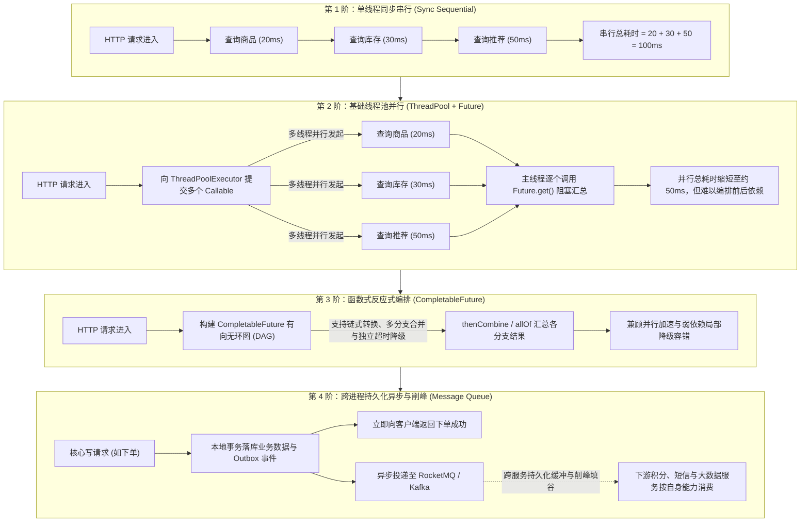

# 线程池、CompletableFuture 与 MQ 异步链路：从进程内并行编排到跨服务削峰

> **关联基础**：[[../03-并发编程/07-线程池原理与参数|线程池架构]]、[[../03-并发编程/09-CompletableFuture异步编程|CompletableFuture]]、[[../06-中间件/01-消息队列基础与核心问题处理|消息队列与核心问题]]、[[../06-中间件/05-Kafka架构原理与实战手册|Kafka架构原理]]

---

## 1. 为什么需要异步与并行编排？（业务痛点与演进脉络）

### 1.1 同步串行调用的延迟叠加痛点
在微服务架构中，一个聚合页面（例如电商商品详情页）通常需要同时组装来自多个下游微服务的数据：①商品基础信息（20ms）、②实时库存状态（30ms）、③用户可用优惠券（40ms）、④店铺评分信息（20ms）、⑤猜你喜欢推荐列表（50ms）。
- **如果采用同步串行调用**：主线程必须等上一个接口返回后才能发起下一个请求，总响应耗时等于所有步骤之和：$20 + 30 + 40 + 20 + 50 = 160\text{ ms}$。
- **如果采用进程内多线程并行调用**：由于这 5 个查询互不依赖，将它们同时提交给线程池并行发起远程请求，总耗时即可逼近最慢的那个分支（约 $\max(20, 30, 40, 20, 50) = 50\text{ ms}$），响应速度直接提升 3 倍以上。
- **如果涉及跨服务非核心写操作**：例如用户下单成功后需要发送短信、增加积分、更新推荐画像，这些操作不需要在下单主线程里等待结果，通过消息队列（MQ）持久化异步解耦，既能缩短主接口耗时，又能削峰填谷。

### 1.2 异步技术的四重演进阶梯



---

## 2. 三大异步技术选型对比矩阵

在实际研发中，何时用普通线程池、何时用 `CompletableFuture`、何时必须上 MQ？可按以下维度区分：

| 评估维度 | 线程池 (`ThreadPoolExecutor` / `@Async`) | 异步编排 (`CompletableFuture`) | 消息队列 (`RocketMQ` / `Kafka`) |
| :--- | :--- | :--- | :--- |
| **作用边界** | 单 JVM 进程内存内部 | 单 JVM 进程内存内部 | **跨进程、跨微服务、跨机房** |
| **数据可靠性** | 内存态（若 JVM 重启或宕机，队列中未执行的任务会丢失） | 内存态（用于单次请求周期内的并发调用与结果聚合） | **磁盘持久化 + 多副本高可用（支持失败重试与死信队列）** |
| **核心优势** | 简单直接，适合触发无需等待返回值的轻量后台任务 | 支持复杂的 **DAG 依赖编排**（串行接力、并行合并、全量栅栏）与单分支降级 | **彻底解耦上下游服务，具备千万级消息堆积与削峰填谷能力** |
| **结果获取方式** | 不关心结果，或通过 `Future.get()` 阻塞获取 | `thenApply` / `thenCompose` / `thenCombine` / `allOf` | 异步事件驱动，无需调用方同步等待（必要时通过回调或状态轮询通知） |
| **典型适用场景** | 异步写本地操作审计日志、触发本地缓存刷新 | **聚合接口并行查询多下游（商品详情页、首页大盘）** | **订单履约分发、支付成功通知、秒杀流量削峰、日志收集** |

---

## 3. 生产级实战：基于 `CompletableFuture` 的商品详情页并行聚合

在构建高并发聚合查询接口时，不能简单地开启异步任务然后无限期 `join()`，必须同时做好三件事：
1. **使用自定义有界线程池**：隔离不同业务的线程资源；
2. **区分核心依赖与弱依赖**：商品主体与实时库存是核心依赖（失败则整体报错），而优惠券与推荐列表是弱依赖（超时或报错时通过 `exceptionally` 优雅降级为空列表，不影响用户看商品和下单）；
3. **设置单分支超时（`orTimeout`）与整体外层超时**：防止慢分支拖慢整个接口。

```java
@Service
@RequiredArgsConstructor
@Slf4j
public class ProductDetailAggregationService {

    // 注入专门用于商品详情聚合的自定义有界线程池
    @Qualifier("productDetailExecutor")
    private final ExecutorService productDetailExecutor;

    private final ProductRpcClient productClient;
    private final StockRpcClient stockClient;
    private final PromotionRpcClient promotionClient;
    private final RecommendRpcClient recommendClient;

    public ProductDetailVO getProductDetail(Long productId, Long userId) {
        long startMs = System.currentTimeMillis();

        // 1. 异步分支 A：查询商品基础信息（核心依赖，超时上限 500ms）
        CompletableFuture<ProductDTO> productFuture = CompletableFuture
                .supplyAsync(() -> productClient.getProductById(productId), productDetailExecutor)
                .orTimeout(500, TimeUnit.MILLISECONDS);

        // 2. 异步分支 B：查询实时可售库存（核心依赖，超时上限 300ms）
        CompletableFuture<Integer> stockFuture = CompletableFuture
                .supplyAsync(() -> stockClient.getAvailableStock(productId), productDetailExecutor)
                .orTimeout(300, TimeUnit.MILLISECONDS);

        // 3. 异步分支 C：查询用户可用优惠券（弱依赖，超过 200ms 或报错时自动降级为空列表）
        CompletableFuture<List<CouponDTO>> couponFuture = CompletableFuture
                .supplyAsync(() -> promotionClient.listUserCoupons(userId, productId), productDetailExecutor)
                .orTimeout(200, TimeUnit.MILLISECONDS)
                .exceptionally(ex -> {
                    log.warn("查询优惠券超时或异常，触发降级返回空列表, userId={}", userId, ex);
                    return Collections.emptyList();
                });

        // 4. 异步分支 D：查询猜你喜欢推荐商品（弱依赖，超时或异常降级为空列表）
        CompletableFuture<List<ProductDTO>> recommendFuture = CompletableFuture
                .supplyAsync(() -> recommendClient.getRecommendations(userId, productId), productDetailExecutor)
                .orTimeout(200, TimeUnit.MILLISECONDS)
                .exceptionally(ex -> Collections.emptyList());

        // 5. 使用 allOf 组合全部异步分支，等待全部完成（或触发各自超时降级）
        CompletableFuture<Void> allDoneFuture = CompletableFuture.allOf(
                productFuture, stockFuture, couponFuture, recommendFuture
        );

        try {
            // 总等待上限 550ms
            allDoneFuture.get(550, TimeUnit.MILLISECONDS);

            // 此时所有子 Future 均已完成，调用 join() 立即取出结果组装 VO
            ProductDetailVO vo = ProductDetailVO.builder()
                    .product(productFuture.join())
                    .availableStock(stockFuture.join())
                    .coupons(couponFuture.join())
                    .recommendations(recommendFuture.join())
                    .build();

            log.info("商品详情并行聚合完成, productId={}, 耗时={}ms",
                    productId, System.currentTimeMillis() - startMs);
            return vo;
        } catch (InterruptedException e) {
            Thread.currentThread().interrupt();
            throw new BusinessException("请求被中断");
        } catch (ExecutionException | TimeoutException e) {
            log.error("商品详情核心依赖调用失败, productId={}", productId, e);
            throw new BusinessException("商品信息加载繁忙，请稍后重试");
        }
    }
}
```

> **工程细节补充**：JDK 9 引入的 `orTimeout()` 会在超时到达时让 `CompletableFuture` 立即以 `TimeoutException` 结束，从而释放主线程；但为了防止工作线程继续在底层 Socket 上空等，下游 Feign / HTTP 客户端自身也应配置匹配的 `connectTimeout` 与 `readTimeout`（例如 300ms~500ms）。

---

## 4. 异步链路三大高频生产陷阱与规避规范

### 4.1 陷阱一：不传自定义线程池，默认共用 `ForkJoinPool.commonPool()`
- **问题成因**：当调用 `CompletableFuture.supplyAsync(() -> ...)` 不传第二个 `Executor` 参数时，JDK 默认会将任务提交到全 JVM 唯一的公共线程池 `ForkJoinPool.commonPool()`。该池的默认工作线程数仅为 `CPU核心数 - 1`（例如在 4 核容器里只有 3 个线程），原本是为纯 CPU 密集型计算设计的。
- **严重后果**：如果业务代码在 `supplyAsync` 中执行了阻塞型网络 I/O（如 RPC 调用或查数据库），一旦某个慢接口卡住，只需寥寥几个并发请求就会把 `commonPool` 的几个线程全部堵死，导致整个 JVM 内所有使用默认 `CompletableFuture` 或并行流（`parallelStream()`）的模块全部停摆。
- **规避规范**：凡是涉及远程调用或 I/O 操作的 `CompletableFuture`，**必须显式传入自定义的、按业务隔离的有界 `ThreadPoolExecutor`**。

### 4.2 陷阱二：父子线程切换导致 MDC `TraceId` 与上下文丢失
- **问题成因**：日志框架的 MDC（`TraceId`）、Spring Security 的登录用户身份通常存储在普通的 `ThreadLocal` 中。当主线程把任务交给线程池里的工作线程执行时，工作线程拥有自己独立的 `ThreadLocalMap`，拿不到主线程的数据，导致异步日志没有 `TraceId`。
- **规避规范**：为自定义 `ThreadPoolTaskExecutor` 配置统一的 **`TaskDecorator`（任务装饰器）**，或者使用阿里的 `TransmittableThreadLocal`（TTL）：

```java
public class MdcTaskDecorator implements TaskDecorator {
    @Override
    public Runnable decorate(Runnable runnable) {
        // 1. 在父线程提交任务时，抓取当前线程的 MDC 上下文副本
        Map<String, String> contextMap = MDC.getCopyOfContextMap();
        return () -> {
            try {
                // 2. 在子线程开始执行前，将上下文注入子线程
                if (contextMap != null) {
                    MDC.setContextMap(contextMap);
                }
                runnable.run();
            } finally {
                // 3. 子线程执行完毕后必须清理，防止线程归还池中后污染下次任务
                MDC.clear();
            }
        };
    }
}
```

### 4.3 陷阱三：线程池父子任务共用同一个池引发“线程饥饿死锁”
- **问题成因**：假设自定义线程池的核心与最大线程数都设为 5，队列设为有界队列。现在同时进来 5 个外层任务占满了全部 5 个工作线程，而每个外层任务在执行过程中，又向**同一个线程池**提交了内层子任务，并调用 `subFuture.join()` 等待子任务完成。
- **死锁现场**：5 个工作线程全部阻塞在 `join()` 上等待子任务执行，而子任务躺在队列里苦苦等待这 5 个工作线程空闲出来——双方互相等待，形成永久的**线程池饥饿死锁（Thread Pool Starvation Deadlock）**。
- **规避规范**：具有父子嵌套等待关系的异步任务，**外层任务池与内层子任务池必须物理隔离**，切勿向同一个固定大小的线程池提交子任务并同步阻塞等待。

---

## 5. 面试高频追问解析

> [!question]- Q1：既然 `CompletableFuture` 配合线程池在进程内并发这么快，为什么做写操作解耦时还要引入 RocketMQ / Kafka？
> 进程内异步（线程池 / `CompletableFuture`）与消息中间件（MQ）解决的是完全不同层面的问题：
> 1. **数据持久性与进程崩溃恢复**：线程池的任务队列保存在 JVM 堆内存中。一旦应用发生重启、发布或 OOM 崩溃，内存队列中尚未执行的任务（比如“给刚付款的用户发优惠券”）就会彻底丢失。而 MQ 将消息持久化在磁盘并同步给多副本，即使消费者宕机重启，消息依然安全保留并支持重新消费。
> 2. **缓冲容量与削峰能力**：单机内存队列如果设得太大（如 100 万）会直接撑爆堆内存引发 OOM；设得太小则会在流量洪峰时触发拒绝报错。而 RocketMQ / Kafka 依托磁盘顺序写，可以轻松堆积数千万甚至上亿条消息，让下游按自身数据库能承受的速率匀速消费。
> 3. **故障隔离与重试死信机制**：使用 MQ 后，下游服务如果发生故障，只需积压在 Broker 等待修复后自动重放（配合指数退避重试与死信队列 DLQ），完全不会占用上游订单服务的任何线程资源。

> [!question]- Q2：`CompletableFuture` 中的 `thenApply`、`thenCompose` 和 `thenCombine` 分别在什么场景下使用？
> 这三个方法对应了异步函数式编排的三种基本拓扑结构：
> 1. **`thenApply`（同步转换，类似 `Stream.map`）**：
>    当上一步异步任务拿到结果后，紧接着在内存中对结果做一次简单的转换计算（返回值是普通对象 `U`，而不是新的 `CompletableFuture`）。例如：异步查出 `OrderDTO` 后，用 `thenApply` 提取出其中的订单金额 `BigDecimal`。
> 2. **`thenCompose`（异步串联接力，类似 `Stream.flatMap`）**：
>    当第二个异步任务必须把**第一个异步任务的结果作为入参**，且第二个任务自身也返回一个新的 `CompletableFuture<U>` 时，使用 `thenCompose` 将两步串联并“打平”为一个 `CompletableFuture<U>`。例如：先异步调用用户服务查出用户的收获地址 ID，再拿这个地址 ID 异步调用物流服务计算运费。
> 3. **`thenCombine`（双路并行合并）**：
>    当两个异步任务**互不依赖、可以同时并行发起**，并在两者都执行完成后将两个结果合并为一个新结果时使用。例如：同时并行查询商品价格与会员折扣率，两者都返回后在 `thenCombine` 的 `BiFunction` 中计算出最终折后价。

> [!question]- Q3：`CompletableFuture.get()` 和 `CompletableFuture.join()` 有什么区别？
> 两者的核心功能都是阻塞当前调用线程，等待异步任务完成并返回结果，主要区别在于**异常签名设计与超时参数**：
> 1. **编译期异常检查不同**：
>    - `get()` 实现自 `Future` 接口，方法签名显式抛出了受检异常（Checked Exception）：`throws InterruptedException, ExecutionException`。调用时必须在代码里写 `try-catch` 或在方法签名上继续向上声明抛出。
>    - `join()` 是 `CompletableFuture` 新增的方法，它不会抛出受检异常，而是将底层异常包装为未受检的运行时异常 `CompletionException`（`RuntimeException` 的子类）抛出。因此在 Lambda 表达式或 `Stream` 流中非常适合直接使用 `join()`，代码更加简洁。
> 2. **超时重载方法不同**：`get(long timeout, TimeUnit unit)` 原生支持传入阻塞等待的超时时间，而 `join()` 没有带超时参数的重载（若使用 `join()`，通常在构建阶段链式调用 `.orTimeout(timeout, unit)` 来控制超时）。

---

## 6. 核心要点复盘清单

- **并行聚合提速**：对互不依赖的多下游只读查询，使用 `CompletableFuture.supplyAsync(..., customExecutor)` + `allOf` 并行发起，将串行累加耗时压缩至最慢单分支耗时。
- **弱依赖优雅降级**：非核心分支链式追加 `.orTimeout(200, MILLISECONDS).exceptionally(ex -> emptyDefault)`，确保边缘服务抖动不影响核心主体展示。
- **线程池三大铁律**：严禁将阻塞 I/O 任务交给默认的 `ForkJoinPool.commonPool()`；严禁父子嵌套任务共用同一个固定线程池引发饥饿死锁；必须通过 `TaskDecorator` 或 TTL 传递并在 `finally` 中清理 MDC `TraceId`。
- **进程内异步 vs MQ**：单次请求内的并发查询加速用 `CompletableFuture`；跨服务解耦、要求高可靠不丢数据、需要削峰填谷的写操作后置流程用 RocketMQ / Kafka。
