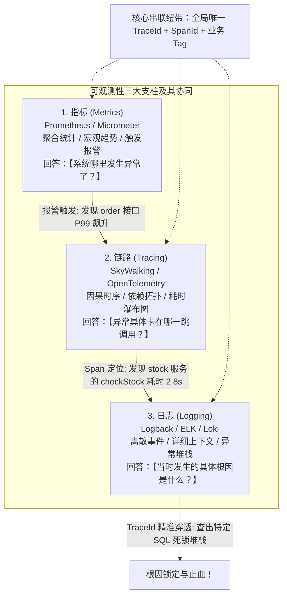
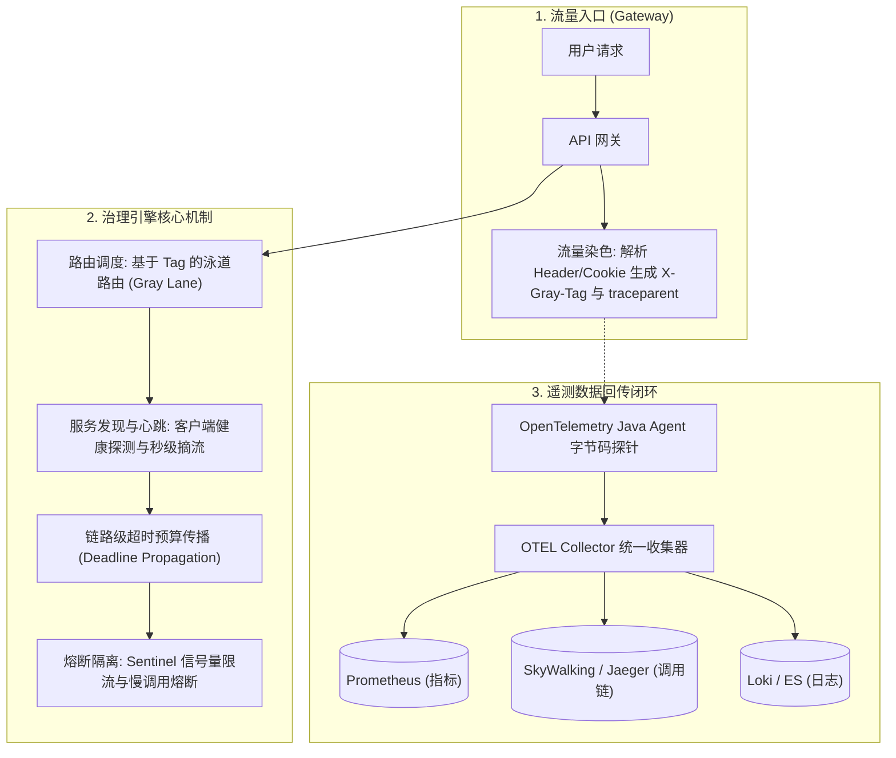

# 微服务治理与可观测性全链路：从三位一体可观测到全链路灰度治理

> **关联基础**：[[20-Java后端/07-分布式与微服务/08-微服务注册发现与配置中心|注册发现]]、[[20-Java后端/07-分布式与微服务/09-微服务限流熔断降级|限流熔断]]、[[20-Java后端/09-项目实战/04-项目-微服务治理脚手架|微服务脚手架]]

---

## 1. 为什么需要现代可观测性？（第一性原理）

### 1.1 传统监控 vs 现代可观测性（Observability）
- **传统监控（Monitoring）**：只回答 **“系统现在是否活着？”**（例如：CPU 是否超过 80%？HTTP 状态码是不是 200？）。它面向的是已知的故障模式（Known-Unknowns）。
- **可观测性（Observability）**：根据系统的**外部输出（Telemetry 遥测数据）**，推断出系统**内部任意未知的内部运行状态（Unknown-Unknowns）**。它回答的是：**“系统为什么在特定的用户 ID 下、特定的版本分支上、响应时间慢了 350ms？具体卡在哪个 RPC 的哪个 SQL 上？”**

### 1.2 可观测性三大支柱（The Three Pillars）的融合纽带



---

## 2. 全链路上下文传播规范：W3C TraceContext

跨服务、跨语言（Java/Go/Python）、跨通信协议（HTTP/gRPC/Kafka）传递链路追踪标识时，业界遵循国际标准 **W3C TraceContext**：

```text
HTTP/1.1 200 OK
traceparent: 00-4bf92f3577b34da6a3ce929d0e0e4736-00f067aa0ba902b7-01
tracestate: congo=t61rcWkgMzE,rojo=00f067aa0ba902b7
```

### 2.1 `traceparent` 字段四段格式深度解剖
$$00 - 4\text{bf92f3577b34da6a3ce929d0e0e4736} - 00\text{f067aa0ba902b7} - 01$$
1. **`00`（Version，2个十六进制字符）**：当前规范版本号，目前固定为 `00`。
2. **`4bf92f...`（Trace ID，32个十六进制字符，16字节）**：全局唯一的分布式追踪 ID。从入口网关发起，整条调用树上所有微服务共享同一个 Trace ID。
3. **`00f067...`（Parent ID / Span ID，16个十六进制字符，8字节）**：当前操作的直接父 Span ID。
4. **`01`（Trace Flags，2个十六进制字符，8位位图）**：
   - `01` 代表当前请求**已被命中采样（Sampled）**，下游微服务必须采集其详细性能数据并上报；
   - `00` 代表未被采样，下游仅透传上下文，不上报存储，**极大保护后端存储资源**。

---

## 3. 全链路微服务治理核心架构体系



### 3.1 核心治理机制一：链路级超时预算（Deadline Propagation）
- **传统超时的致命弊端**：网关配了 3 秒超时，订单配了 2 秒超时，库存配了 2 秒超时。当请求在网关排队 2.5 秒后才到达订单服务时，订单服务依然傻乎乎地去调用库存（此时用户早已在前端超时离开了），**导致大量无用算力被浪费在注定超时的请求上**！
- **Deadline 传播治理**：
  - 网关设定总生存期（如 `Deadline = now() + 3000ms`），并将其通过 Header 沿调用链向下透传；
  - 每一跳微服务在发起下游调用前，先计算：$\text{剩余时间} = \text{Deadline} - \text{当前时间}$；
  - 若发现剩余时间仅剩 10ms，**当场主动短路放弃调用**，立即返回超时响应，彻底阻断无效算力消耗！

### 3.2 核心治理机制二：自适应采样率控制（Adaptive Sampling）
如果全量采集每个请求的 Trace，在 10 万 QPS 下，每天将产生上百 TB 的垃圾链路日志，直接把存储打爆！
- **头部采样（Head-based Sampling）**：在网关入口以 1% 的固定概率掷骰子决定是否采集。缺点：可能会漏掉那 0.01% 最关键的偶发超时或报错请求。
- **尾部采样（Tail-based Sampling，大厂标配）**：
  - 在应用端或 OTEL Collector 内存缓冲区中暂时保留最近 30 秒的全量链路；
  - 当整条调用链路结束时，如果发现**响应时间超过 1s（慢调用）或者 HTTP 状态码 >= 500（报错）**，则**100% 强制持久化该条链路**；
  - 对于那些几十毫秒正常完成的平淡请求，仅保留 0.1% 采样。**用 5% 的存储成本抓住了 100% 的生产故障现场**！

---

## 4. 大厂 30 秒面试绝杀（高频追问 3 连击）

### Q1：Prometheus 为什么坚决采用 Pull（拉）模式采集指标，而不是像多数监控一样采用 Push（推）模式？
> **答题标杆**：
> 1. **中心化流量保护与防被冲垮**：如果是 Push 模式，当业务集群发生突发流量扩容到上万台实例时，所有实例疯狂向监控中心推送数据，会直接把监控服务端打爆瘫痪（监控系统比业务先死）。Pull 模式由 Prometheus 服务端掌控节奏，**根据自身的承载力按固定频率（如 15s）匀速拉取**，具备天然的自保能力。
> 2. **天然的服务存活性探测（Liveness）**：在 Pull 模式下，如果某实例宕机或网络中断，Prometheus 只要在拉取时连接超时，就能**立即主动判定该节点处于 DOWN 状态**；而 Push 模式下，监控中心收不到数据，根本无法区分“该实例是挂了，还是仅仅没有业务请求产生”。
> 3. **简化客户端实现**：客户端微服务只需通过 HTTP 端口暴露一个简单的文本端点（如 `/actuator/prometheus`），内部零缓冲队列、零网络重试逻辑，极为轻量稳定。

---

### Q2：微服务做金丝雀灰度发布时，如果下游某中间层服务根本没有部署灰度实例，请求会报错吗？如何解决？
> **答题标杆**：
> 1. **痛点**：在深层微服务链路（网关 -> A -> B -> C）中，通常只有被修改的 A 服务和 C 服务部署了灰度版本（v2.0），中间的 B 服务没有改动，只有基准版本（v1.0）。
> 2. **泳道降级与回退机制（Lane Fallback）**：
>    - 客户端负载均衡器在根据灰度标签 `X-Gray-Tag: v2.0` 筛选 B 的实例时，发现候选列表为空；
>    - 触发**泳道回退策略**：自动降级回退去调用 B 的基准版本（v1.0）；
>    - **关键闭环**：B 服务虽然是 v1.0，但它的拦截器**必须把请求头中的 `X-Gray-Tag: v2.0` 忠实地继续向下游 C 透传**！
>    - 当 B 调用 C 时，负载均衡器再次识别到该标签，请求重新精准命中 C 的灰度版本（v2.0），从而实现**跨无改动节点的平滑穿透灰度闭环**。

---

### Q3：为什么日志记录中不能把 `TraceId` 随便作为一个普通的 Prometheus Metrics 标签（Tag/Label）记录？
> **答题标杆**：
> 1. **致命危害：时间序列基数爆炸（Cardinality Explosion）**！
> 2. **底层原理**：Prometheus 的 TSDB 时序数据库是为每个唯一的“指标名 + Label键值对组合”分配一条独立的时间序列（TimeSeries）。
> 3. **爆炸推导**：`TraceId` 是全局唯一的，每次请求都会生成一个全新字符串。如果把 `TraceId` 作为 Label 放入 Metric 中，系统每产生 1 亿次请求，就会在 Prometheus 内存中硬创建 1 亿条全新的时序索引，**导致 Prometheus 的倒排索引与内存瞬间被撑爆并当场 OOM 崩溃**！
> 4. **铁律规范**：Metrics 的 Label 必须是**低基数枚举值**（如 `status_code: 200/500`、`method: GET/POST`、`env: prod`）；高基数的唯一标识只能存入 Tracing 和 Logging 中。

---

## 5. 一分钟复盘记忆卡

```text
======================= 治理与可观测性通关口诀 =======================
三位一体看系统，指标报警趋势融。
链路因果拓扑绘，日志详情查真凶；
TraceId穿透全链路，W3C规范四段通；
采样控制避暴涨，尾部自适应抓异动；
超时预算沿途减，短路断念算力松；
泳道染色灰度切，未见灰度基线通；
Label基数莫膨胀，时序内存不遭痛；
治测合一大架构，云原生上展雄风！
======================================================================
```
