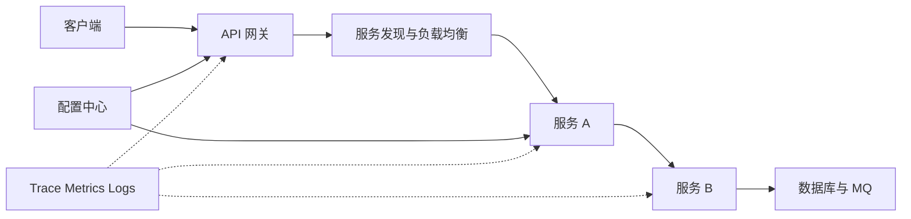
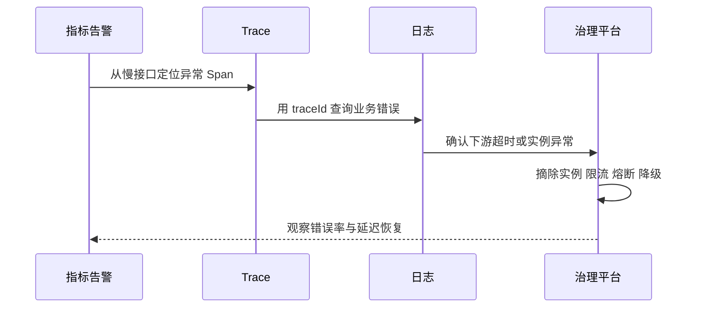

# 微服务治理与可观测性全链路

> [!abstract] 一句话总结
> 微服务治理负责让调用在变化和故障中保持可控，可观测性负责证明请求经过了哪里、为什么慢、为什么失败以及治理策略是否有效。

## 服务调用全景

## 治理组件如何协作

| 组件 | 解决的问题 | 关键失败方式 | 对应笔记 |
| --- | --- | --- | --- |
| 注册中心 | 服务实例发现与健康状态 | 陈旧实例、网络分区、心跳误判 | [[20-Java后端/06-中间件/04-注册中心-Nacos]] |
| 配置中心 | 动态配置与环境隔离 | 错误配置扩散、回滚困难 | [[20-Java后端/06-中间件/05-配置中心]] |
| 网关 | 统一入口、认证、路由和配额 | 单点瓶颈、规则错误 | [[20-Java后端/06-中间件/06-API网关]] |
| 负载均衡 | 在健康实例间分流 | 热点、慢实例、重试偏斜 | [[20-Java后端/07-分布式与微服务/07-服务治理与负载均衡]] |
| 超时与熔断 | 限制失败占用并阻断级联 | 阈值不当、半开恢复抖动 | [[20-Java后端/07-分布式与微服务/06-限流-熔断-降级]] |
| 链路追踪 | 还原跨服务执行路径 | 采样不足、上下文断裂、标签爆炸 | [[20-Java后端/07-分布式与微服务/08-链路追踪]] |

## 超时、重试和熔断必须联动

1. 上游总超时必须大于下游单次超时，但要为自身处理和返回预留预算。
2. 重试只适用于可重试错误和幂等操作，并使用指数退避与抖动。
3. 多层同时重试会指数放大流量，通常只保留一层主重试策略。
4. 熔断打开后应返回明确降级结果，而不是把压力转移到另一个无保护依赖。
5. 半开阶段限制探测并发，确认下游恢复后再逐步放量。

## 三类可观测信号

| 信号 | 最擅长回答 | 典型字段 |
| --- | --- | --- |
| Metrics | 系统是否异常、趋势如何 | QPS、P50/P95/P99、错误率、饱和度 |
| Trace | 单次请求慢在哪里、跨了哪些服务 | traceId、span、parent、status、duration |
| Logs | 具体业务上下文和异常细节 | traceId、业务键、错误码、状态变化 |

不要把业务高基数字段直接做指标标签；用户 ID、订单 ID 更适合放日志或 Trace 属性并受采样与隐私规则控制。

## 一次故障的完整闭环

## 发布与配置治理

- 配置变更必须有作用域、校验、审批、灰度和一键回滚。
- 服务发布要观察新旧版本的错误率、P99 和资源使用，不能只看实例存活。
- Trace 和日志应带版本、实例、机房等标签，才能区分代码问题与局部基础设施问题。

## 关联笔记

- [[20-Java后端/04-Spring生态/08-SpringCloud组件概览]]
- [[20-Java后端/07-分布式与微服务/_index|分布式与微服务索引]]
- [[02-一次Java请求的全链路]]
- [[08-线上故障排查全链路]]

## 参考资料

- [Spring Cloud Documentation](https://spring.io/projects/spring-cloud)
- [OpenTelemetry Documentation](https://opentelemetry.io/docs/)
- [Micrometer Tracing](https://docs.micrometer.io/tracing/reference/)

