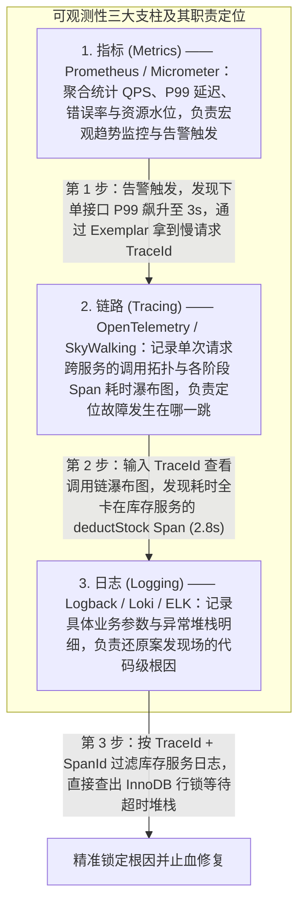
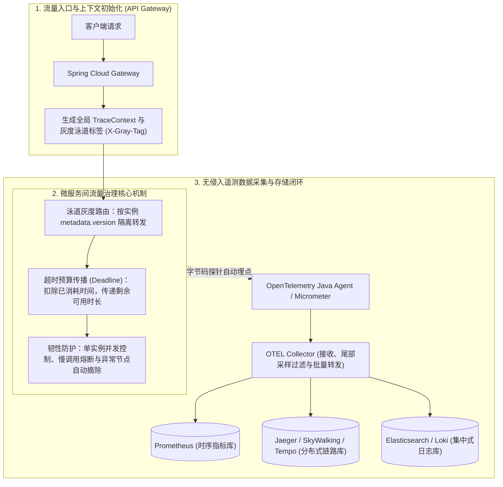

# 微服务治理与可观测性全链路：从指标、链路、日志融合到流量治理

> **关联基础**：[[../07-分布式与微服务/07-服务治理与负载均衡|注册发现]]、[[../07-分布式与微服务/06-限流-熔断-降级|限流熔断]]、[[../09-项目实战/04-项目-微服务治理脚手架|微服务脚手架]]

---

## 1. 为什么需要现代可观测性？（从单机监控到全链路洞察）

### 1.1 传统监控与现代可观测性的演进
在单体应用时代，运维人员只需要盯着一台服务器的 CPU、内存和错误日志即可定位绝大多数问题。但在微服务架构下，一次外部请求往往要跨越网关、认证、订单、库存、支付、缓存和消息队列等十几个节点：
- **传统监控（Monitoring）**告诉我们**“系统出问题了”**（例如：订单接口 P99 延迟从 50ms 飙升到了 3000ms，或者 HTTP 5xx 告警触发）。
- **可观测性（Observability）**帮助我们快速回答**“为什么出问题、具体卡在哪个节点的哪一行代码”**。它通过统一的上下文标识（`TraceId` / `SpanId`），将分散在各个容器中的指标、调用链和日志串联成一个有机的诊断闭环。

### 1.2 可观测性三大支柱（Metrics、Tracing、Logging）的排障协同

当线上发生故障时，工程师按照 **“看指标发现异常 -> 查链路锁定慢节点 -> 搜日志定位根因代码”** 的标准三步法排查：



---

## 2. 全链路追踪上下文传播标准：W3C TraceContext

早期不同监控工具各自使用私有的请求头（如 Zipkin 的 `X-B3-TraceId`、SkyWalking 的 `sw8`），跨异构组件时经常无法互通。如今云原生与 OpenTelemetry 生态统一采用 **W3C TraceContext** 国际标准，通过 HTTP 请求头中的 `traceparent` 字段在全链路传递追踪上下文：

```text
GET /api/v1/orders HTTP/1.1
Host: order-service.internal
traceparent: 00-4bf92f3577b34da6a3ce929d0e0e4736-00f067aa0ba902b7-01
```

### 2.1 `traceparent` 四段式结构解析
$$00 - 4\text{bf92f3577b34da6a3ce929d0e0e4736} - 00\text{f067aa0ba902b7} - 01$$

1. **`00`（Version，2 位十六进制，1 字节）**：协议版本号，当前标准固定为 `00`。
2. **`4bf92f3577b34da6a3ce929d0e0e4736`（Trace ID，32 位十六进制，16 字节）**：**全局唯一链路 ID**。请求在进入网关的第一刻生成，之后无论经过多少个微服务、线程池或消息队列，该 `Trace ID` 始终保持不变，用于将整棵调用树串联起来。
3. **`00f067aa0ba902b7`（Parent Span ID，16 位十六进制，8 字节）**：**上游调用方当前操作单元的 Span ID**。下游服务收到请求后，会生成一个新的本地 `Span ID`，并将请求头里的这个值记录为自己的 `parentSpanId`，从而还原出完整的父子调用层级与先后顺序。
4. **`01`（Trace Flags，2 位十六进制，1 字节）**：采样标志位。`01`（最低比特位为 1）代表上游建议对该链路进行采样记录（Sampled），`00` 代表不采样。

---

## 3. 微服务治理与遥测收集全景架构



### 3.1 核心治理机制一：链路级超时预算传播（Deadline Propagation）
在多层微服务调用链（如 `Gateway -> Order -> Promotion -> Coupon`）中，如果每一层都各自死板地配置固定的“超时 3 秒”，会出现一个严重的资源浪费问题：
- 假设网关给整条链路分配的总超时预算是 **3 秒**；
- 请求在 `Order` 服务因为 GC 或排队已经消耗了 **2.5 秒**，此时距离网关断开只剩 **0.5 秒**；
- 如果 `Order` 调用 `Promotion` 时依然按照固定配置等待 2 秒，那么即使 `Promotion` 花了 1.5 秒算出了结果，网关早在 1 秒前就已经给客户端返回 504 超时了，后续所有下游执行的 SQL 和 CPU 计算全部是无效做功。

**Deadline（截止时间/剩余超时预算）传播机制**完美解决了这一痛点：
1. 网关在入口处在请求头中写入本次请求的绝对截止时间戳（或剩余毫秒数预算 `X-Timeout-Remaining: 3000`）；
2. 每经过一跳服务，框架自动扣除当前已经流逝的时间（如已耗时 2500ms，剩余预算变为 500ms）；
3. 发起下一跳 RPC 调用时，客户端取 `min(本地接口配置超时, 剩余链路预算)` 作为本次 Socket 读取超时；一旦发现剩余预算已经小于或等于 0，直接放弃发起远程调用并立即快速失败（Fail-Fast），避免在已经超时的请求上继续消耗下游资源。

### 3.2 核心治理机制二：头部采样 vs 尾部采样（Sampling Strategy）
在高并发生产环境中，如果对 100% 的请求都采集并持久化完整的调用链 Span 明细，网络带宽与存储成本将极其高昂。为此，链路追踪系统通常结合两种采样策略：
1. **头部采样（Head-based Sampling）**：
   - **机制**：在请求刚进入网关生成第一个 Span 时，直接按固定概率（如 1% 抽样）决定是否将 `Trace Flags` 置为 `01`。
   - **优缺点**：实现极简单、开销极低；但如果那 99% 未被采样的请求在调用链最深处的数据库节点突然报错了，整条调用链因为一开始没采样而被丢弃，导致偶发故障难以复现。
2. **尾部采样（Tail-based Sampling）**：
   - **机制**：应用侧先将 Span 统一发往中间层的 **OTEL Collector** 缓冲池；Collector 等待整条链路的所有 Span 到齐后，根据最终执行结果决定去留——**凡是包含 Error 异常或总耗时超过阈值（慢调用）的链路 100% 全量保留**，而对于完全正常的普通请求则只按 1% 抽样落盘。
   - **优势**：既把存储成本降低了 90% 以上，又确保线上每一次报错和慢请求都能查到完整的调用链现场。

---

## 4. 面试高频追问解析

> [!question]- Q1：既然 `TraceId` 查问题这么好用，为什么在 Prometheus 指标监控（Metrics）中严禁把 `TraceId` 或 `userId` 作为一个普通的标签（Label）打进去？如果希望能从指标跳到链路该怎么做？
> 1. **高基数爆炸（High Cardinality Explosion）灾难**：
>    Prometheus 等时序数据库（TSDB）在底层会为**每一组不同的 Label 键值对组合**创建一条独立的时间序列（Time Series）索引并常驻内存。正常的 Label（如 `service="order"`、`status="200"`、`method="POST"`）取值数量是有限且固定的（几十到几百种组合）。而 `TraceId` 是每次请求都完全不同的随机字符串，`userId` 也有数千万个——一旦将它们作为普通 Label 写入指标，Prometheus 内存中每秒都会新增成千上万条全新的时间序列，几分钟内就会直接把 Prometheus 服务端内存撑爆（OOM）。
> 2. **正确做法：使用 Exemplars（示例样本关联）**：
>    Prometheus 与 OpenTelemetry 专门设计了 **Exemplar** 机制。在统计 Histogram（直方图，如接口耗时分布桶）指标时，指标本身的 Label 依然只保留低基数的服务名和接口名，但系统会在耗时分桶的边缘顺带挂载一两个代表性的慢请求 `TraceId`（作为附加元数据而非索引维度）。这样在 Grafana 上看到 P99 延迟尖刺时，直接点击波峰上的小圆点（Exemplar），就能一键跳转到对应的 SkyWalking / Tempo 调用链页面，兼顾了极低的内存开销与丝滑的排障体验。

> [!question]- Q2：Prometheus 为什么默认设计成服务端主动拉取（Pull 模式），而不是让成百上千个微服务自己往监控中心推（Push 模式）？
> Pull（拉取）模式在云原生监控场景下有三大显著优势：
> 1. **天然保护监控中心不被流量打垮**：在 Push 模式下，如果线上突发故障或大促流量翻倍，上千个微服务实例同时高频向监控中心推送指标，很容易引发监控中心自身的网络拥塞甚至雪崩（最需要监控的时候监控先挂了）。而 Pull 模式由 Prometheus Server 完全掌控拉取节奏（如固定每 15 秒抓取一次），负载极其平稳可控。
> 2. **自带实例存活健康检查**：因为 Prometheus 主动按服务发现列表去抓取各实例的 `/actuator/prometheus` 端点，一旦某个实例网络不通或进程挂掉，Prometheus 立即能通过内置的 `up == 0` 指标感知并发出宕机告警。
> 3. **客户端极度轻量**：业务微服务无需配置监控服务端地址、重试队列和背压缓冲，只需在本地内存累加计数器并暴露一个只读 HTTP 端点即可（对于执行完即销毁的短生命周期定时批处理任务，则可配合官方的 `Pushgateway` 中转）。

> [!question]- Q3：Java Agent（如 SkyWalking Agent 或 OpenTelemetry Agent）是如何在不修改一行源码的情况下，自动采集所有 HTTP、RPC 和 SQL 耗时的？
> 它基于 JDK 提供的 **`Instrumentation`（Java Agent 机制） + ByteBuddy / ASM 字节码增强技术**：
> 1. **启动挂载（`premain`）**：在 JVM 启动命令中添加 `-javaagent:/path/to/opentelemetry-javaagent.jar` 后，JVM 会在主程序 `main` 方法执行前先运行 Agent 的 `premain` 入口，并注册自定义的 `ClassFileTransformer`。
> 2. **类加载期字节码拦截织入**：当类加载器加载 Spring MVC 的 `DispatcherServlet`、OpenFeign 的客户端、或者 MySQL JDBC 的 `PreparedStatement` 等目标类时，Agent 会在内存中自动拦截其 `.class` 字节码，在核心执行方法的前后动态织入“开启 Span、注入/提取 `traceparent` 请求头、记录耗时与异常、关闭 Span”的字节码指令。
> 3. **应用无感知**：对于业务开发者而言，业务工程甚至不需要引入任何监控 SDK 的 Maven 依赖，即可自动获得覆盖 Web、RPC、DB、Redis 和 MQ 的全链路追踪能力。

---

## 5. 核心要点复盘清单

- **可观测性三步排障法**：通过 **Metrics（指标）** 发现异常趋势并触发告警 -> 借助 **Exemplar / TraceId** 跳转至 **Tracing（调用链瀑布图）** 锁定慢服务或报错节点 -> 带着 `TraceId` 在 **Logging（日志中心）** 检索出具体的异常堆栈与入参。
- **W3C `traceparent` 标准**：`版本(00)-全局TraceId(32位)-父SpanId(16位)-采样标志(01)`，实现跨网关、RPC 与异构语言的标准传播。
- **高基数防御铁律**：严禁将 `TraceId`、`userId`、`orderNo` 等无限取值的字段作为 Prometheus 的普通 `Label`，统一使用 `Exemplar` 关联指标与链路。
- **链路韧性双翼**：通过**超时预算传播（Deadline Propagation）**避免在已超时的请求上继续浪费下游资源；通过**尾部采样（Tail-based Sampling）**实现 100% 留存异常/慢调用链路的同时大幅降低存储成本。
