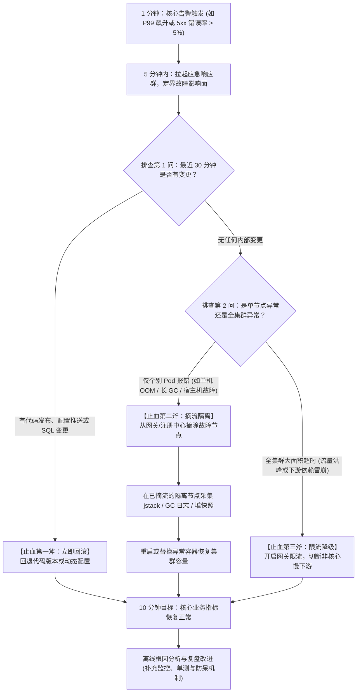
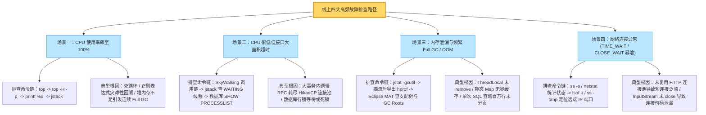
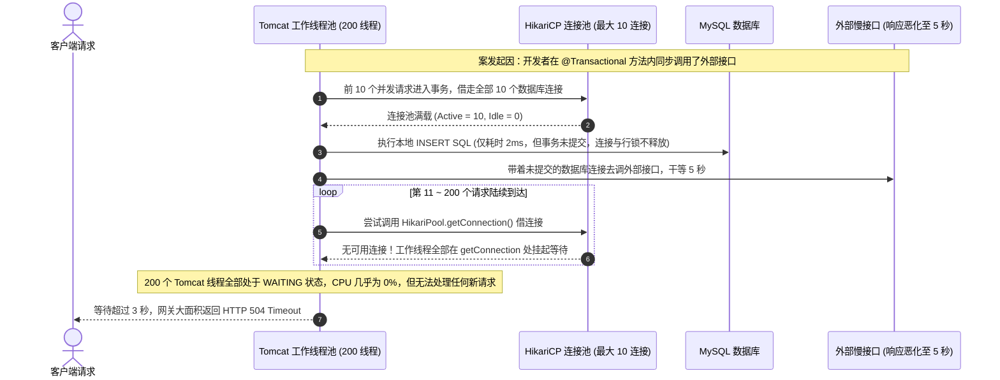

# 线上故障排查全链路：从告警定界、应急止血到根因定位

> **关联基础**：[[../02-JVM/08-常用工具-jstat-jmap-jstack-Arthas|JVM排障SOP]]、[[../09-项目实战/05-项目-JVM故障排查演练|JVM排障演练]]、[[02-一次Java请求的全链路|请求全链路]]

---

## 1. 生产故障应急第一准则：先止血恢复业务，再深挖根因

当线上核心交易链路突发大面积报错或超时告警时，最忌讳的是让用户在前台一直报错等待，而工程师在线上机器里慢条斯理地翻日志、猜代码。
大型互联网团队普遍遵循 **“1-5-10” 应急响应目标** 与 **“止血三板斧”**：
- **1 分钟感知发现**：依托 Prometheus 指标（HTTP 5xx 比例、P99 延迟、核心业务下单成功率下跌）自动触发电话与群组告警。
- **5 分钟响应定界**：值班工程师到位，迅速完成两个核心判断——**① 最近 30 分钟内是否有代码发布、配置变更或数据库 DDL？② 故障是仅发生在单台机器还是全集群共性暴发？**
- **10 分钟止血恢复**：按定界结果果断执行**回滚（Rollback）、摘流隔离（Isolate）或限流降级（Degrade）**，先让线上核心业务恢复正常，同时保留隔离节点的堆栈现场供事后复盘（Post-Mortem）。



---

## 2. 线上四大高频故障场景与排查路径图谱

线上 90% 以上的 Java 服务突发故障，都可以归入以下四个经典场景：



---

## 3. 深度实战剖析：为什么“CPU 和内存都很正常，但所有接口却全部超时卡死”？

在面试与生产排障中，比“CPU 100%”更让人困惑的是：**监控大盘显示服务器 CPU 利用率不到 10%，老年代内存也很充裕，没有任何 Full GC，但外部请求进来全部报 504 Timeout**。
这说明工作线程并没有在高速运算，而是**全部处于挂起等待（`WAITING` / `TIMED_WAITING` / `BLOCKED`）状态**。最典型的罪魁祸首就是 **“长事务嵌套慢 RPC 导致数据库连接池耗尽”**。

### 3.1 故障传导时序还原



### 3.2 三步锁定真凶实操命令
1. **第一步：抓取 `jstack` 统计线程阻塞在哪里**
   ```bash
   # 导出线程堆栈并统计处于等待借出数据库连接状态的线程数量
   jcmd <PID> Thread.print > thread_dump.txt
   grep -c "com.zaxxer.hikari.pool.HikariPool.getConnection" thread_dump.txt
   ```
   如果发现有 180 多个线程都卡在 `HikariPool.getConnection`，说明这 180 个线程只是“受害者”，真正的元凶是**那 10 个已经借走了连接却迟迟不归还的线程**。
2. **第二步：在 `thread_dump.txt` 中找出那 10 个正在等待网络 I/O 的线程**
   搜索包含 `SocketInputStream.socketRead0` 或 `HttpClient` 调用栈的业务线程，即可一眼看到它们在 `@Transactional` 方法内部卡在了哪个第三方 HTTP/RPC 接口调用上。
3. **第三步：排查数据库侧是否存在慢 SQL 或未提交的睡眠事务**
   如果应用侧没有调外部 RPC，而是卡在 SQL 执行上，立即登录 MySQL 排查：
   ```sql
   -- 1. 查看当前正在执行且耗时超过 5 秒的活跃慢查询
   SELECT id, user, host, db, command, time, state, info
   FROM information_schema.processlist
   WHERE command != 'Sleep' AND time > 5
   ORDER BY time DESC;

   -- 2. 查看是否存在行锁阻塞等待链（找出谁堵住了谁）
   SELECT * FROM sys.innodb_lock_waits;

   -- 3. 查看长时间未提交的事务（注意：有些连接状态虽然是 Sleep，但开启了事务未 commit 仍在持锁！）
   SELECT trx_mysql_thread_id, trx_started, trx_state, trx_tables_locked, trx_query
   FROM information_schema.innodb_trx;
   ```

---

## 4. 生产排障高频命令速查手册

### 4.1 Linux 操作系统与网络诊断
```bash
# 1. 查看系统平均负载 (Load Average) 与 CPU 各项占比 (us用户态 / sy内核态 / wa磁盘I/O等待)
uptime
top -b -n 1 | head -n 15

# 2. 查看磁盘 I/O 吞吐与等待延迟 (重点关注 await 平均每次 I/O 耗时与 %util)
iostat -xz 1 3

# 3. 极速统计当前机器 TCP 连接各状态数量 (比 netstat 快得多，重点看 ESTAB / TIME-WAIT / CLOSE-WAIT)
ss -s
netstat -n | awk '/^tcp/ {++S[$NF]} END {for(a in S) print a, S[a]}'

# 4. 查看处于 CLOSE_WAIT 状态的连接究竟连着哪个远端 IP:Port 以及归属哪个进程
ss -tanp | grep CLOSE-WAIT
```

### 4.2 JVM 内存与 GC 实时诊断
```bash
# 1. 每 1000ms 打印一次 GC 统计 (观察 O 老年代占比、M 元空间占比、YGC/FGC 次数与 GCT 总耗时)
jstat -gcutil <PID> 1000 10

# 2. 查看堆内对象实例数量与占用字节数排名前 25 的类 (定位哪类对象暴增)
jcmd <PID> GC.class_histogram | head -n 25

# 3. 在已摘流隔离的节点上导出二进制堆转储快照 (供 MAT 离线分析)
jcmd <PID> GC.heap_dump /var/log/jvm/heap.hprof

# 4. 查看 JVM 实际生效的启动参数与系统属性
jcmd <PID> VM.flags
```

---

## 5. 面试高频追问解析

> [!question]- Q1：线上服务器监控报警显示出现了几千个 `CLOSE_WAIT` 状态的 TCP 连接，甚至导致 `Too many open files` 报错，这是什么原因造成的？如何根治？
> 1. **TCP 四次挥手原理还原**：
>    当通信对端（例如下游 HTTP 服务端、Redis 或数据库连接）因为超时或主动关闭连接，向我方发送了第一次挥手的 `FIN` 包后，我方操作系统内核会自动回复第二次挥手的 `ACK` 包，此时我方该 Socket 连接就进入了 **`CLOSE_WAIT`（等待本地应用关闭）** 状态。
>    按照标准流程，接下来我方的 Java 应用程序应当感知到流结束，调用 `socket.close()`（或 `response.close()`）发出第三次挥手的 `FIN` 包，连接才能释放。
> 2. **为什么会卡在 `CLOSE_WAIT`**：
>    根本原因是**对端已经主动关了连接，但我方 Java 代码在收到响应或发生异常后，没有在 `finally` 块中正确调用 `close()` 关闭输入输出流或释放连接句柄**！因此第三次挥手的 `FIN` 永远发不出去，该连接句柄（File Descriptor）就一直僵死在 `CLOSE_WAIT` 状态，直到占满操作系统的文件描述符上限。
> 3. **排查与修复**：
>    执行 `ss -tanp | grep CLOSE-WAIT` 找到这些连接对应的远端 IP 和端口（确定是调哪个第三方 HTTP 服务还是哪个中间件产生的），然后检查项目中对应的 `CloseableHttpClient` / `OkHttp` 调用代码，使用 `try-with-resources` 语法确保 `CloseableHttpResponse` 或 `InputStream` 在任何异常分支下都 100% 被关闭。

> [!question]- Q2：如果是 `TIME_WAIT` 状态的连接暴增到几万个，又是什么原因？跟 `CLOSE_WAIT` 有什么区别？
> 1. **核心区别**：
>    - **`CLOSE_WAIT` 过多是被动关闭方（未调 `close()`）的代码 Bug**，必须改代码修复资源泄漏；
>    - **`TIME_WAIT` 过多则是主动关闭方在完成四次挥手后，正常等待 `2MSL`（通常 60 秒）冷却期的表现**。
> 2. **常见成因与解决**：
>    线上出现大量 `TIME_WAIT`，通常是因为我方应用在高频调用某个下游接口（如 HTTP 接口或 Redis）时，**没有使用连接池复用长连接（Keep-Alive），而是每次请求都 `new` 一个客户端建立短连接，用完立刻主动 `close()`**。在高并发下每秒新建并关闭几千个连接，就会积压几万个处于 `TIME_WAIT` 冷却期的端口。
>    **根治手段**：将短连接改造为带有连接池和 HTTP `Keep-Alive` 长连接复用的客户端（如配置好 `PoolingHttpClientConnectionManager`），从源头消灭高频建连与断连。

> [!question]- Q3：当 MySQL 数据库 CPU 突然飙到 100%，或者大量请求被某条慢 SQL 锁死时，线上如何紧急止血？`KILL QUERY` 和 `KILL CONNECTION` 有什么区别？
> 1. **紧急止血步骤**：
>    首先在应用网关层对触发该慢 SQL 的接口执行限流或降级，防止新的慢查询继续涌入；同时登录数据库执行 `SHOW PROCESSLIST` 和查询 `information_schema.innodb_trx`，找到正在全表扫描耗尽 CPU 的慢查询会话 ID，或者长期持有行锁不提交的阻塞源头会话 ID，执行 `KILL` 命令释放资源。
> 2. **`KILL QUERY <id>` vs `KILL CONNECTION <id>`（默认 `KILL <id>`）的关键区别**：
>    - **`KILL QUERY <id>`**：只终止该连接当前正在执行的那一条 SQL 语句，但**保持该数据库连接不断开**。注意：如果这个连接正处于一个未提交的手动事务中，之前语句已经持有的 InnoDB 行锁**并不会因为 `KILL QUERY` 而释放**！
>    - **`KILL [CONNECTION] <id>`**：直接断开该数据库连接，并强制触发该连接上未完成事务的**回滚（Rollback）**，彻底释放其持有的所有行锁。因此，当排查发现某个处于 `Sleep` 状态的连接一直持有未提交事务阻塞了全表更新时，必须使用 `KILL <trx_mysql_thread_id>` 彻底断开该会话才能解开死局。

---

## 6. 核心要点复盘清单

- **应急响应 1-5-10 与三板斧**：1 分钟告警感知 -> 5 分钟定界（查近期变更、判单机还是全局） -> 10 分钟止血恢复（有变更先**回滚**、单节点坏先**摘流**、全集群过载先**限流降级**）。
- **CPU 高 vs CPU 低超时**：CPU 100% 用 `top -H` + `jstack` 找 `RUNNABLE` 热点线程；CPU 很低但大面积超时，用 `jstack` 查 `WAITING` 线程（重点关注 HikariCP 连接池耗尽、慢 RPC 阻塞与数据库锁等待）。
- **`CLOSE_WAIT` vs `TIME_WAIT`**：`CLOSE_WAIT` 堆积是因为对端已关但我方代码漏调 `close()`（资源泄漏 Bug）；`TIME_WAIT` 堆积是因为高频使用短连接且主动关闭（需改用连接池开启长连接复用）。
- **数据库锁紧急排障**：联查 `processlist`、`sys.innodb_lock_waits` 与 `information_schema.innodb_trx`，警惕处于 `Sleep` 状态但未提交事务的持锁连接。
