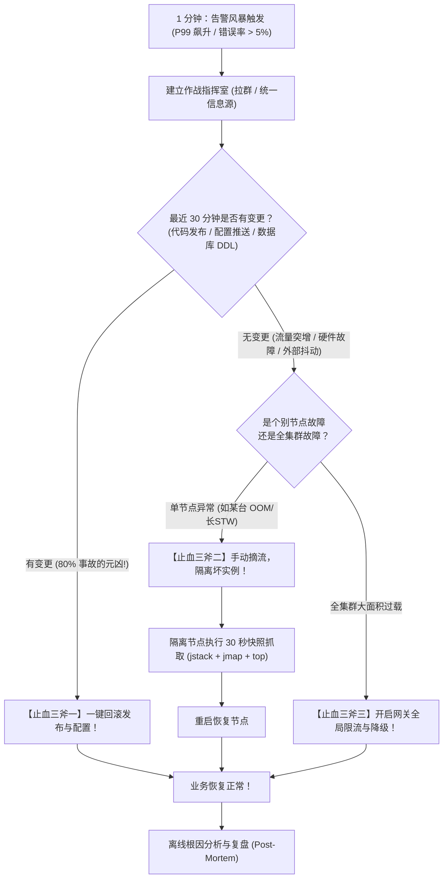
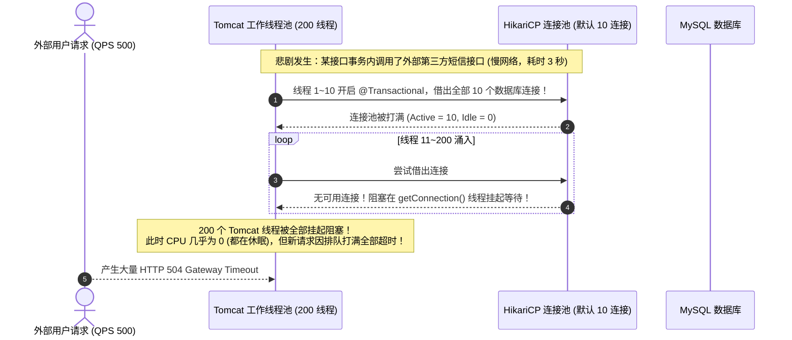

# 线上故障排查全链路：从告警风暴到分钟级根因锁定的军工级 SOP

> **关联基础**：[[../02-JVM/08-常用工具-jstat-jmap-jstack-Arthas|JVM排障SOP]]、[[../09-项目实战/05-项目-JVM故障排查演练|JVM排障演练]]、[[02-一次Java请求的全链路|请求全链路]]

---

## 1. 生产故障应急第一准则：1-5-10 黄金止血法则

当线上突发大面积告警、甚至高管微信群疯狂震动时，初级工程师往往慌乱地“上机器看日志、看代码、猜原因”；而**高级架构师的第一反应永远是：【先止血保业务，再离线查根因】**！

大厂 SRE 奉行的最高信条——**“1-5-10 故障响应原则”**：
- **1 分钟发现**：监控系统通过 P99 延迟、HTTP 5xx 错误率或死信队列积压自动发出 P0/P1 告警；
- **5 分钟响应与定界**：值班工程师接入会议室，快速判定影响面，并在 5 分钟内执行**标准止血动作**；
- **10 分钟恢复业务**：通过切流、降级、重启、回滚等预案，确保用户端核心功能在 10 分钟内恢复正常！



---

## 2. 四大经典线上战役排障排查链

```mermaid
mindmap
  root((线上排障四大战役))
    战役一: CPU 100% 狂飙
      排查链: top -> top -H -p -> printf %x -> jstack | grep
      定位点: 死循环 / 正则回溯 / 极端频繁GC
    战役二: 接口全线超时变慢
      排查链: APM 瀑布图 -> HikariCP Active 连接 -> MySQL SHOW PROCESSLIST
      定位点: 慢 SQL 占满连接池 / 事务内包含耗时 HTTP / 行锁死锁
    战役三: 内存泄露与频繁 Full GC
      排查链: jstat -gcutil -> MAT 支配树 -> GC Roots 强引用链
      定位点: ThreadLocal 未 remove / 静态无界缓存
    战役四: 网络连接状态异常
      排查链: netstat -n | awk '/^tcp/ {++S[$NF]} END {for(a in S) print a, S[a]}'
      定位点: TIME_WAIT 暴增 (短连接) / CLOSE_WAIT 泄漏 (未 close 资源)
```

---

## 3. 战役二深度实战：CPU 正常但接口大面积超时的“幽灵排查”

这是大厂最容易掉坑的高频场景：**服务器 CPU 利用率仅 10%，内存也很充裕，但所有用户接口全部超时报错！**

### 3.1 真实根因推演链



### 3.2 诊断实操命令链
1. **导出线程栈观察阻塞点**：
   ```bash
   jcmd <PID> Thread.print -l > thread_dump.txt
   grep -C 5 "com.zaxxer.hikari.pool.HikariPool.getConnection" thread_dump.txt | wc -l
   # 若发现上百个线程卡在 HikariPool.getConnection()，直接实锤数据库连接池枯竭！
   ```
2. **直捣数据库排查持有连接的元凶**：
   ```sql
   -- 登录 MySQL，查看当前所有正在执行超过 5 秒的慢查询
   SELECT id, user, host, db, command, time, state, info 
   FROM information_schema.processlist 
   WHERE command != 'Sleep' AND time > 5 
   ORDER BY time DESC;

   -- 查看当前是否存在行锁等待阻塞链
   SELECT * FROM sys.innodb_lock_waits;
   ```

---

## 4. 生产排障军工级瑞士军刀命令速查

### 4.1 Linux 操作系统层
```bash
# 1. 宏观 CPU 与负载分析 (看 1/5/15 分钟 load average 是否远超 CPU 核数)
uptime
top -b -n 1 | head -n 20

# 2. 磁盘 I/O 瓶颈排查 (看 %util 是否持续接近 100%，await 是否高)
iostat -x 1 3

# 3. 统计全系统 TCP 连接状态分布
netstat -n | awk '/^tcp/ {++S[$NF]} END {for(a in S) print a, S[a]}'
# 重点关注 TIME_WAIT、CLOSE_WAIT、ESTABLISHED 数量

# 4. 查看是否有端口被占满或文件句柄泄漏
lsof -p <PID> | wc -l
ulimit -n
```

### 4.2 JVM 性能与内存诊断层
```bash
# 1. 实时动态观察 GC 停顿与各代内存占用比率 (每秒刷新一次，观察 YGC/FGC 频次与耗时)
jstat -gcutil <PID> 1000 10

# 2. 安全生成堆内存转储 Dump (注意：大堆必须先摘流！)
jmap -dump:live,format=b,file=/tmp/heap.hprof <PID>

# 3. 查看堆内存活对象直方图 (按占用字节数降序排列前 20 名)
jcmd <PID> GC.class_histogram | head -n 25

# 4. 查看元空间类加载器统计 (排查 Metaspace 泄漏)
jcmd <PID> VM.classloader_stats
```

---

## 5. 大厂 30 秒面试绝杀（高频追问 3 连击）

### Q1：线上服务器 `CLOSE_WAIT` 状态连接大量积压（达到几千个），根本原因是什么？怎么解决？
> **答题标杆**：
> 1. **状态机根本成因**：在 TCP 四次挥手协议中，`CLOSE_WAIT` 发生在**被动关闭端**。当对方（客户端）向服务端发送了 `FIN` 包，服务端内核会自动回送一个 `ACK`，此时服务端连接便进入 `CLOSE_WAIT` 状态。它在等待服务端的**应用层进程调用 `socket.close()` 显式关闭连接**。
> 2. **代码级元凶**：应用层代码存在**连接泄漏 Bug**——创建了 HTTPClient、JDBC 连接或 Socket 之后，在异常分支中**漏掉了 `finally { socket.close(); }`**，导致被动关闭端一直未向对方发送最后的 `FIN` 报文，该连接便会永久僵死在 `CLOSE_WAIT` 状态，直到耗尽 Linux 文件句柄上限（`Too many open files`）。
> 3. **解决方案**：使用 `lsof -p <pid>` 找到泄漏的文件句柄对应的类和端口，在代码中全面使用 `try-with-resources` 或确保在 `finally` 块中显式执行 `close()`。

---

### Q2：面对突发的线上 P0 重大事故，排查的第一准则是什么？为什么绝对不能在原机器上慢吞吞查原因？
> **答题标杆**：
> 1. **第一准则：止血恢复高于一切（Restore Before Investigate）**！
> 2. **商业代价视角**：对于电商或金融核心交易，系统瘫痪每持续 1 分钟，造成的直接 GMV 损失和声誉损害是不可承受的。工程师的第一职责是**遏制影响半径、恢复服务可用性**。
> 3. **科学 SOP 闭环**：
>    - **第一步（止血）**：立即执行标准化止损动作——有发布立即回滚，单节点坏死立即从网关摘流，全集群过载立即降级边缘业务；
>    - **第二步（存证）**：在隔离的坏节点上以脚本方式在 30 秒内快速抓取现场快照（`jstack`、`jmap dump`、GC 日志）；
>    - **第三步（重启）**：现场保存完毕后，立即重启或拉起新 Pod，迅速恢复集群容量；
>    - **第四步（离线复盘）**：拉取快照文件在离线演练环境中用 MAT、Arthas 深入解剖，产出防复发措施。

---

### Q3：数据库 CPU 100%，整个系统全线卡死，如何在不重启 MySQL 的前提下，在 10 秒内安全杀死导致阻塞的慢 SQL？
> **答题标杆**：
> 1. **闪电定位线程 ID**：
>    ```sql
>    SELECT id, user, host, time, state, info 
>    FROM information_schema.processlist 
>    WHERE command != 'Sleep' AND time > 10 
>    ORDER BY time DESC LIMIT 5;
>    ```
> 2. **精准点杀**：找到执行时间超长（`time > 10`）且正在做全表扫描的查询语句，记录其 `id`（如 48291），立即执行：
>    ```sql
>    KILL QUERY 48291; -- 仅终止正在执行的 SQL 查询，不切断物理客户端连接
>    -- 若无法响应，再执行 KILL 48291; (强制杀掉该会话连接)
>    ```
> 3. **批量清理脚本**：若存在大量相同慢 SQL 涌入，利用 SQL 拼接批量 KILL 脚本：
>    ```sql
>    SELECT CONCAT('KILL ', id, ';') 
>    FROM information_schema.processlist 
>    WHERE time > 30 AND user = 'app_user';
>    ```
>    将输出结果批量复制粘贴执行，10 秒内瞬间释放数据库 CPU 资源！

---

## 6. 一分钟复盘记忆卡

```text
======================= 线上故障排查通关口诀 =======================
线上报警莫慌神，1-5-10 法则遵。
先查变更回滚快，单节点崩摘流巡；
止血高于查根因，快照保存重启存；
CPU狂飙查nid，正则死循栈中寻；
时延拉长大面积，连接池满锁等真；
CLOSE_WAIT泄漏防，finally里close紧；
KILL QUERY杀慢查，十秒自愈定乾坤！
======================================================================
```
