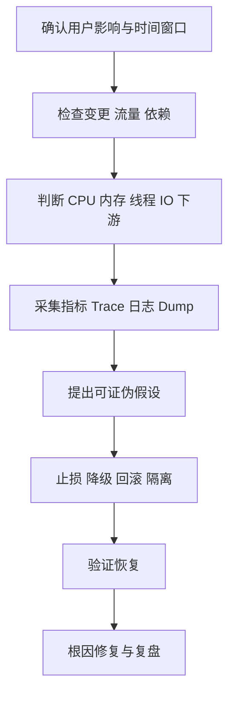

# 线上故障排查全链路

> [!abstract] 一句话总结
> 综合排障的核心是先缩小故障域、保留现场、建立时间线，再用 JVM、线程、数据库、缓存、消息和下游证据验证假设。

## 排障总流程



## 先看四个黄金信号

| 信号 | 要问什么 | 下一步 |
| --- | --- | --- |
| 延迟 | 哪个接口、哪个分位、哪一段变慢 | 查 Trace、线程池、数据库与下游 |
| 流量 | QPS、并发或数据量是否变化 | 区分突发流量和处理能力下降 |
| 错误 | 超时、拒绝、业务错误还是资源错误 | 按错误类型定位责任组件 |
| 饱和度 | CPU、线程、连接、队列、磁盘是否接近上限 | 找到第一个排队点 |

## 症状到证据矩阵

| 症状 | 常见根因 | 必看证据 | 相关知识 |
| --- | --- | --- | --- |
| CPU 高 | 热循环、序列化、GC、自旋 | JFR、CPU 火焰图、GC CPU | [[03-从类加载到对象回收与JVM排障]] |
| 接口慢且 CPU 低 | 锁等待、线程池排队、DB/下游慢 | Thread Dump、Trace、池指标 | [[01-JMM到JUC并发工具的完整链路]]、[[02-一次Java请求的全链路]] |
| Full GC 频繁 | 泄漏、分配过快、堆余量不足 | GC 日志、类直方图、堆 Dump | [[20-Java后端/02-JVM/07-OOM问题排查]] |
| 数据库连接耗尽 | 慢 SQL、长事务、连接泄漏 | 连接池指标、事务、锁等待、执行计划 | [[20-Java后端/05-数据库与存储/04-执行计划与SQL优化]] |
| Redis 超时 | 热 Key、慢命令、网络、连接池 | 命令延迟、Slow Log、Key 分布 | [[20-Java后端/05-数据库与存储/05-Redis数据结构与应用]] |
| MQ 积压 | 消费变慢、错误重试、分区不均 | Lag、消费耗时、失败率、分区 | [[06-线程池-CompletableFuture-MQ异步链路]] |
| 级联超时 | 下游慢、重试风暴、无隔离 | Trace、重试次数、熔断状态 | [[07-微服务治理与可观测性全链路]] |

## 常用证据命令

```bash
jcmd <pid> VM.version
jcmd <pid> GC.heap_info
jcmd <pid> GC.class_histogram
jcmd <pid> Thread.print -l
jcmd <pid> JFR.start name=incident settings=profile duration=120s filename=incident.jfr
```

生产执行前要确认权限、开销和数据安全。堆 Dump 可能很大且包含敏感数据，应写入有足够空间且受控的位置。

## Thread Dump 怎么和业务链路连接

1. 大量 `BLOCKED`：找持有 monitor 的线程及其业务栈。
2. 大量 `WAITING` 在 AQS：确认是正常线程池空闲，还是锁/Condition 没有被唤醒。
3. 大量线程停在连接池获取：继续查慢 SQL、事务和连接泄漏。
4. 大量线程停在 Socket 读：查下游延迟、超时和重试。
5. 不只看线程状态，还要看相同栈数量、持续时间和对应 Trace。

## 止损优先级

1. 回滚最近高风险变更或错误配置。
2. 限制入口流量和非核心功能，保护核心交易。
3. 摘除异常实例、熔断故障依赖、关闭无界重试。
4. 扩容只用于确认可线性扩展且无共享瓶颈的场景。
5. 数据一致性问题先冻结破坏性动作，再执行补偿和对账。

## 复盘必须产出

- 用户影响、时间线和发现方式。
- 根因与触发条件，而不只是“服务重启后恢复”。
- 为什么监控、测试或容量评估没有提前发现。
- 立即修复、长期改进、负责人和验证日期。
- 可自动化的告警、演练、回滚和容量检查。

## 关联笔记

- [[20-Java后端/02-JVM/08-常用工具-jstat-jmap-jstack-Arthas]]
- [[20-Java后端/09-项目实战/05-项目-JVM故障排查演练]]
- [[20-Java后端/08-系统设计/02-高可用架构设计]]
- [[40-求职准备/17-面试-项目类问题]]

## 参考资料

- [JDK Troubleshooting Guide](https://docs.oracle.com/en/java/javase/21/troubleshoot/)
- [MySQL EXPLAIN](https://dev.mysql.com/doc/refman/8.4/en/explain.html)
- [Redis Latency Monitoring](https://redis.io/docs/latest/operate/oss_and_stack/management/optimization/latency-monitor/)

