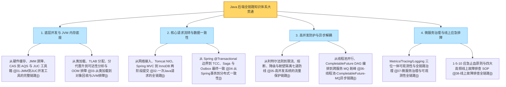

# 知识串联与专题：Java 后端全链路体系大贯通与复习指南

> **前置知识**：[[01-JMM到JUC并发工具的完整链路]] 至 [[08-线上故障排查全链路]] 全量篇目

---

## 1. 八大纵深专题全景贯通图谱

本章通过八条核心技术链路，将 Java 后端从底层硬件与虚拟机、单机并发与异步编排、Web 请求与分布式事务，一直串联到微服务治理与线上故障应急，形成完整的工程知识闭环：

---

## 2. Java 后端架构设计十条核心准则

1. **并发可见性与原子性边界**：`volatile` 依靠内存屏障解决可见性与禁止指令重排，但复合操作（如 `count++`）必须配合 CAS 原子类或锁；高并发统计优先使用分段累加的 `LongAdder` 替代 `AtomicLong`。
2. **对象分配与内存回收规律**：绝大部分小对象在 TLAB 内通过指针碰撞无锁分配，未逃逸对象可通过标量替换消除堆分配；排查内存泄漏重点看 MAT 支配树中的 **Retained Heap（深堆）** 与强引用链。
3. **利特尔法则与容量保护（$L = \lambda \times W$）**：当下游接口响应耗时 $W$ 恶化百倍时，系统内部在途并发请求数 $L$ 也会激增百倍，几秒内即可耗尽线程池引发级联雪崩；必须为所有远程调用设置合理的超时、隔离与熔断降级。
4. **数据库短事务铁律**：Spring `@Transactional` 在进入方法时即从 HikariCP 借出物理连接并持有至方法结束；严禁在事务方法内嵌套远程 RPC / HTTP 调用，防止慢网络调用拖垮数据库连接池。
5. **分布式超时与幂等准则**：跨网络调用发生 `Timeout` 只代表“结果未知”，绝不等于“执行失败”；所有写操作重试必须携带全局唯一的业务幂等键（Idempotency Key）。
6. **跨服务最终一致性优先**：高并发核心链路慎用全局持锁的刚性 2PC / Seata AT；优先采用 **Transactional Outbox（本地事务发件箱）** 或 **RocketMQ 半事务消息**，将分布式事务转化为“本地原子提交 + 异步可靠投递 + 下游幂等消费”。
7. **异步线程池隔离与上下文透传**：`CompletableFuture` 执行阻塞 I/O 时必须传入自定义有界线程池，切忌共用 `ForkJoinPool.commonPool()`；跨线程任务必须通过 `TaskDecorator` 或 TTL 传递并在 `finally` 中清理 MDC `TraceId`。
8. **全链路超时预算与尾部采样**：微服务调用链应传递剩余超时预算（Deadline），避免在网关已断开的请求上继续消耗下游算力；链路追踪采用尾部采样实现 100% 留存报错/慢请求的同时降低存储成本。
9. **监控指标高基数防御**：严禁将 `TraceId`、`userId`、`orderNo` 等高基数字段作为 Prometheus 的普通 `Label`（会撑爆 TSDB 内存索引），统一通过 `Exemplar` 挂载慢请求样本实现指标到链路的跳转。
10. **线上排障止血优先**：面对生产 P0/P1 故障，第一优先级是通过**回滚、摘流隔离或限流降级**在 10 分钟内恢复业务；对大堆执行阻塞式 `jmap` 堆转储前，必须先将节点从负载均衡摘除流量。

---

## 3. 跨模块综合面试 10 连问深度解析

> [!question]- Q1：为什么在主线程里设置了 `MDC.put("traceId", "xxx")`，一进 `CompletableFuture.supplyAsync()` 子线程打出的日志里 `TraceId` 就变成 `null` 了？为什么连 `@Transactional` 事务也一起失效了？
> 1. **底层共性原因**：Logback 的 MDC 和 Spring 的事务管理器（`TransactionSynchronizationManager`）在底层都是基于 **`ThreadLocal`** 存储上下文的。当任务提交给线程池中的工作线程异步执行时，子线程拥有自己独立的 `ThreadLocalMap`，无法自动共享父线程的 `ThreadLocal` 数据。
> 2. **两者的处理方式截然不同**：
>    - **对于日志 `TraceId`（只读上下文）**：应该通过为线程池配置 `TaskDecorator` 或使用阿里的 `TransmittableThreadLocal`（TTL），在提交任务时复制父线程的 MDC 快照并在子线程执行完毕后 `clear()`，实现链路不断裂。
>    - **对于 Spring 数据库事务 `Connection`（有状态非线程安全资源）**：**绝对不能**用 TTL 把父线程的 JDBC `Connection` 复制给多个子线程共用！因为同一个 `Connection` 不支持多线程并发执行 SQL，且父子线程完成时间不同会导致事务提交/回滚彻底错乱。跨线程操作必须使用各自独立的事务，并通过业务状态或消息协调一致性。

> [!question]- Q2：同样是数据库报错，为什么原生 JDBC 抛出的 `SQLException` 默认不会触发 Spring `@Transactional` 回滚，而 MyBatis / JdbcTemplate 报错却能正常回滚？
> 1. **Spring 默认回滚规则**：`@Transactional` 默认只对**未受检异常（`RuntimeException` 及其子类）和 `Error`** 执行回滚，而对受检异常（Checked Exception）默认认为属于业务可预期分支，不自动回滚。
> 2. **异常转换机制**：`java.sql.SQLException` 直接继承自 `Exception`，属于受检异常；如果代码直接抛出 `SQLException` 且未配置 `rollbackFor = Exception.class`，事务就不会回滚。而 Spring 的 `JdbcTemplate` 和 `MyBatis-Spring` 内置了 `SQLExceptionTranslator`（异常转换器），会自动拦截底层的 `SQLException` 并将其包装转换为继承自 `RuntimeException` 的 **`DataAccessException`**（如 `DuplicateKeyException`、`DeadlockLoserDataAccessException`），因此能够顺利触发 Spring 默认的事务回滚。在实际工程中，最佳实践是始终显式写上 `@Transactional(rollbackFor = Exception.class)`。

> [!question]- Q3：MySQL 既有 InnoDB 层的 Redo Log，又有 Server 层的 Binlog，为什么说只有 Redo Log 具有崩溃恢复（Crash-Safe）能力，且必须通过“两阶段提交”协同？
> 1. **物理日志 vs 逻辑日志的本质差异**：
>    - **Binlog（归档日志）**是 MySQL Server 层记录的逻辑日志（记录“给 ID=1 的行字段加 1”或行变更结果），它是追加写的，**没有记录数据页（Page）的物理刷新状态（LSN 序列号）**。如果数据库掉电重启，仅凭 Binlog 根本无法判断哪些内存脏页已经刷进了磁盘表空间、哪些还没刷进去，因而无法单独完成引擎崩溃恢复。
>    - **Redo Log（重做日志）**是 InnoDB 引擎层的物理日志（记录“对第 X 号表空间第 Y 号数据页偏移量 Z 处做了什么修改”），是循环写的，每个数据页头都记录了对应的 `FIL_PAGE_LSN`。重启时 InnoDB 只需对比数据页 LSN 与 Redo Log LSN，就能精准重做未落盘的修改。
> 2. **为什么要两阶段提交（Prepare -> 写 Binlog -> Commit）**：
>    如果先写完 Redo Log 再写 Binlog，假设中间掉电，重启后主库靠 Redo Log 恢复了这笔数据，但 Binlog 没记下这一笔，就会导致从库同步少一条数据（主从不一致）；反之如果先写 Binlog 再写 Redo Log，中间掉电会导致主库没恢复而从库多出一条数据。通过两阶段提交，崩溃恢复时若发现 Redo Log 处于 `Prepare` 状态，就去核对 Binlog 是否完整存在——存在则自动提交，不存在则自动回滚，从而保证主从数据严丝合缝。

> [!question]- Q4：在微服务调用链 `Gateway -> A -> B -> C` 中，如果网关配了 3s 超时，A、B、C 也全配了 3s 超时并开启了 2 次超时重试，大促时会引发什么后果？
> 这会引发灾难性的**“超时无效做功与重试风暴（Retry Storm）”**：
> 1. **重试放大效应**：如果最底层的 C 服务因为数据库负载高出现了响应超时，B 会自动对 C 重试 2 次（共请求 3 次）；同时 A 等待 B 超时后，A 也会对 B 重试 3 次，而每次 B 又会对 C 发起 3 次请求——请求量呈指数级放大（$3 \times 3 = 9$ 倍），瞬间将本已濒临崩溃的 C 服务彻底打死。
> 2. **超时预算倒挂**：网关早在第 3 秒就已经断开连接给用户报错了，但内部的 B 和 C 还在执行第 4 秒到第 9 秒的重试调用，白白消耗数据库连接与线程。
> 3. **治理规范**：① 全链路超时时间应呈**漏斗递减**或启用 **Deadline 剩余超时预算传播**；② **仅在紧贴最底层依赖的那一跳（或幂等只读接口）允许最多 1 次重试**，严禁在调用链的多个层级叠加配置自动重试；③ 当重试请求占比超过 10% 时，熔断器应停止重试直接走降级。

> [!question]- Q5：为什么做 JVM 调优时，不能为了“减少 Young GC 次数”而把年轻代（Eden 区）调得过大（比如占整个堆的 80%）？
> 盲目调大年轻代会带来两个严重的副作用：
> 1. **打破老年代空间余量，诱发频繁 Full GC**：堆总大小（`-Xmx`）固定时，年轻代占了 80%，老年代就只剩 20%。一旦遇到大批量数据加载或促销流量高峰，存活对象晋升到老年代时很容易迅速填满这仅有的 20% 空间，触发代价高昂的 Full GC。
> 2. **拉长单次 Young GC 的 STW 停顿时间**：Young GC 采用标记-复制算法，其停顿耗时主要取决于**存活对象的复制成本**与根扫描范围。如果 Eden 区过大，不仅单次回收攒下的存活对象变多导致复制变慢，而且在 G1 收集器中，手动死板固定过大的年轻代（如强设 `-Xmn`）会破坏 G1 根据 `-XX:MaxGCPauseMillis`（默认 200ms）动态调整年轻代 Region 数量的自适应机制，导致 GC 停顿时间严重超标。

> [!question]- Q6：线上应用抛出了 `java.lang.OutOfMemoryError: unable to create new native thread`，调大 `-Xmx` 堆内存能解决吗？甚至为什么调小堆内存反而可能缓解？
> 1. **调大 `-Xmx` 不仅不能解决，反而会让问题更严重！**
>    因为 Java 的平台线程（Platform Thread）是 1:1 映射到操作系统内核线程（pthread）上的，而每个线程的调用栈内存（`-Xss`，64 位 Linux 下默认 1MB）是在 **JVM 堆外（操作系统本地内存）** 分配的。如果容器总内存限制为 8GB，你把 `-Xmx` 堆内存调大到了 7.5GB，留给操作系统的剩余内存就只剩 500MB，反而能创建的线程数更少了。
> 2. **真正诱因与排查**：
>    绝大多数情况并不是物理内存不够，而是代码里存在 Bug（例如在业务方法内部每次请求都 `new ThreadPoolExecutor()` 且用完不调 `shutdown()`，或者无限制创建线程），导致进程内的总线程数突破了 Linux 系统的用户进程数限制（`ulimit -u` / `/etc/security/limits.conf` 中的 `nproc`）或 Docker/K8s 容器的 `pids.max` 上限。排查时通过 `jstack <PID> | grep "java.lang.Thread.State" | wc -l` 查看总线程数，并按线程名聚类找出是谁在源源不断创建新线程。

> [!question]- Q7：为什么在 Spring Cloud Gateway（WebFlux 响应式架构）中，不能直接用传统的 `ServletRequestAttributes` 或普通 `ThreadLocal` 存取用户信息？
> 1. **线程模型本质不同**：传统 Spring MVC 基于 Servlet 阻塞模型，基本遵循“一个请求从头到尾由同一个 Worker 线程执行（Thread-per-Request）”，因此把用户信息放进 `ThreadLocal` 随时都能取出来。
> 2. **响应式异步非阻塞切换**：Spring Cloud Gateway 基于 Project Reactor 和 Netty。一个请求在网关内部流转时，前半段可能在 `reactor-http-nio-1` 线程执行，经过一次异步 Redis 校验或 WebClient 调用回来后，后半段可能被切换到 `reactor-http-nio-3` 线程继续执行；同时，同一个 Netty EventLoop 线程在同一毫秒内会交替处理成百上千个不同用户的事件。如果使用普通 `ThreadLocal`，不仅跨线程后会读到 `null`，还会发生严重的跨用户数据串号！
> 3. **正确做法**：在 WebFlux 响应式链路中，应将请求级属性存储在 `ServerWebExchange.getAttributes()` 中，或写入随订阅流绑定的 **`Reactor Context`（`contextWrite` / `deferContextual`）** 中。

> [!question]- Q8：如果订单提交接口需要同步调用商品、库存、优惠券，还需要调营销服务发短信、调风控服务记日志，如何设计架构才能保证非核心服务挂掉时完全不影响下单？
> 采用**“动静/主次剥离 + 异步事件驱动 + 舱壁降级”**组合设计：
> 1. **彻底剥离后置非核心写操作（异步化）**：像“发通知短信”、“记录风控审计日志”、“增加会员成长值”这类不需要决定订单能否创建成功的后置动作，全部从下单同步链路中移除，改为监听订单创建成功的 MQ 消息异步执行。即使短信服务彻底宕机一天，也只会导致 MQ 队列积压，对下单接口的耗时与成功率影响为 0。
> 2. **弱依赖同步查询加舱壁与降级**：对于下单前确实需要查询但允许有损兜底的服务（例如可选的积分抵扣或非强制风控评分），使用独立的小容量线程池或信号量隔离，并配置严格的短超时（如 150ms）与 Sentinel 熔断器——一旦超时或报错，立即在 `Fallback` 中按默认放行策略处理，绝不阻塞主交易流程。

> [!question]- Q9：在微服务治理中，“客户端负载均衡重试”和“熔断器（Circuit Breaker）”是如何配合工作的？
> 两者分别应对**偶发单点抖动**与**持续性故障**：
> 1. **负载均衡重试应对偶发单点毛刺**：当下游集群有 10 台机器，其中 1 台因为正好发生 GC 停顿或网络丢包导致单次调用超时，客户端负载均衡器（Spring Cloud LoadBalancer + Retry）捕获异常后，立即换集群里的**另一台健康实例**重试一次，用户完全无感知。
> 2. **熔断器应对持续性故障并制止盲目重试**：如果下游是因为数据库挂了导致所有实例都在报错，此时的重试不仅毫无意义，还会加剧雪崩。因此熔断器位于重试机制的外层或协同统计——一旦窗口内的慢调用比例或异常率超过阈值（如 50%），熔断器立刻跳闸（`OPEN`），直接切断远程调用与重试，走本地降级返回，直到冷却期后再通过 `HALF_OPEN` 放行单次探测请求自动恢复。

> [!question]- Q10：为什么线上生产环境的 Redis 严禁执行 `KEYS *`、`FLUSHALL` 命令？如果要统计或清理某类前缀的 Key 应该怎么做？
> 1. **单线程阻塞风险**：Redis 的核心命令处理是**单线程事件循环模型**。如果生产实例中存有 2000 万个 Key，此时执行一次时间复杂度为 $O(N)$ 的 `KEYS *` 全量遍历，会导致 Redis 主线程卡死数百毫秒甚至数秒。在此期间，线上所有其他微服务的缓存读写、分布式锁续期、网关限流脚本全部排队超时，甚至可能触发主从哨兵误判主节点宕机而发起故障转移（Failover）。
> 2. **生产安全规范**：
>    - 在 `redis.conf` 中通过 `rename-command KEYS ""` 和 `rename-command FLUSHALL ""` 直接在服务端禁用高危命令；
>    - 需要遍历查找特定前缀的 Key 时，一律使用渐进式游标遍历命令 **`SCAN cursor MATCH prefix:* COUNT 500`**（分批次每次只扫描几百个槽位，不阻塞穿插的正常业务请求）；
>    - 删除包含几十万元素的超大 Hash/Set/List BigKey 时，使用异步非阻塞删除命令 **`UNLINK key`** 替代同步的 `DEL key`，交由 Redis 后台 `bio_lazy_free` 线程异步释放内存。

---

## 4. 全章核心复盘速查表

| 串联维度 | 核心机制关键词 | 生产落地黄金法则 |
| :--- | :--- | :--- |
| **并发与内存** | JMM、`volatile`、CAS、AQS、TLAB、G1、MAT | 复合操作加锁或 CAS；对象优先 TLAB 分配；MAT 查深堆与强引用链 |
| **请求与事务** | Tomcat NIO、Spring MVC、AOP、HikariCP、Redo/Binlog | 缩小 `@Transactional` 范围，严禁事务内嵌远程 RPC；TCC 防空回滚与悬挂；优先 Outbox 最终一致 |
| **流量与异步** | 利特尔法则、令牌桶、Sentinel 熔断、`CompletableFuture`、MQ | 入口令牌桶限流，出口慢调用熔断；`CompletableFuture` 必传自定义有界池并配 `TaskDecorator` 透传 `TraceId` |
| **治理与排障** | W3C `traceparent`、Deadline、尾部采样、1-5-10 止血 | 严禁高基数字段作指标 Label；线上故障先回滚/摘流/降级恢复业务，隔离后再采集堆快照离线复盘 |
