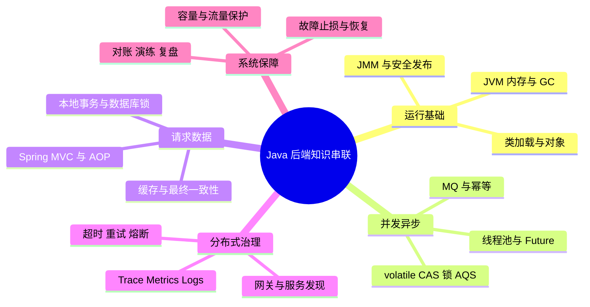

# 10 · 知识串联与专题 · 本章总结与复习

> [!abstract] 一句话总结
> Java 后端的整体能力，是把语言与 JVM 的运行规则、并发边界、Spring 执行链、数据一致性、流量治理和故障证据连接成可解释、可保护、可恢复的系统。

## 思维导图

## 八条主线速记

| 专题 | 一句话结论 |
| --- | --- |
| [[01-JMM到JUC并发工具的完整链路]] | JMM 给出正确性规则，JUC 工具提供不同强度的同步与协调封装。 |
| [[02-一次Java请求的全链路]] | 请求吞吐受线程、连接、下游和超时预算中最小容量约束。 |
| [[03-从类加载到对象回收与JVM排障]] | JVM 排障要从生命周期和证据出发，不能把所有问题都归因于堆大小。 |
| [[04-从Spring事务到分布式一致性]] | 本地事务之外必须显式设计可靠事件、幂等、补偿和对账。 |
| [[05-高并发系统的流量保护链路]] | 每层都要有容量边界，超载前完成限流、隔离、降级和削峰。 |
| [[06-线程池-CompletableFuture-MQ异步链路]] | 线程池、Future 和 MQ 分别解决并行度、结果编排和持久异步。 |
| [[07-微服务治理与可观测性全链路]] | 治理控制故障传播，可观测性证明策略是否工作并定位异常节点。 |
| [[08-线上故障排查全链路]] | 先缩小故障域并保留现场，再用跨层证据验证根因和恢复结果。 |

## 三个统一模型

### 容量模型

系统容量取决于最先饱和的线程池、连接池、数据库、缓存、队列或下游额度。单点扩容若没有同步调整上下游，只会移动排队位置。

### 一致性模型

先定义事实源和本地原子边界，再设计跨边界的事件、幂等、补偿、状态机和对账。缓存、MQ 和重试都不能替代业务一致性定义。

### 故障模型

任何远程调用都可能成功、失败、超时或结果未知；任何异步任务都可能重复、乱序、积压或丢失上下文。设计必须覆盖这些状态，而不是只画成功路径。

## 自测问题

1. JMM、volatile、CAS、AQS 和线程池之间分别是什么关系？
2. 为什么 Web 线程池调大后，接口吞吐可能不升反降？
3. `@Transactional` 为什么不能保证数据库、Redis 和 MQ 同时一致？
4. CompletableFuture 与 MQ 的可靠性和生命周期边界有何不同？
5. 一次接口变慢时，如何用指标、Trace、线程 Dump 和数据库证据逐层缩小范围？
6. 如何为一个高并发接口设计限流、缓存、数据库、异步和降级链路？

## 下一步实践

从 [[20-Java后端/09-项目实战/01-项目-高并发秒杀系统|高并发秒杀系统]] 或 [[20-Java后端/09-项目实战/03-项目-订单履约系统|订单履约系统]] 任选一个，画出请求链、数据链、异步链、容量边界和故障恢复链，再用本章八篇专题逐项审查。

## 相关入口

- [[_index|知识串联与专题索引]]
- [[20-Java后端/00-总览/学习仪表盘|Java 学习仪表盘]]

