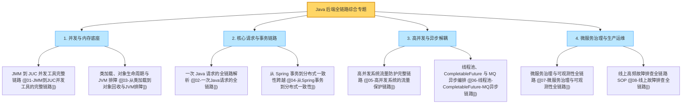

# 知识串联与专题：Java 后端全链路体系大贯通与终极通关宝典

> **前置知识**：[[01-JMM到JUC并发工具的完整链路]] 至 [[08-线上故障排查全链路]] 全量篇目

---

## 1. 八大纵深专题全景贯通图谱（一张图融会贯通）

真正的后端技术高手，绝不孤立地背诵某一个注解或类库，而是**将底层硬件、JVM、框架、分布式中间件与生产运维在脑海中融合成一条奔腾不息的全链路河流**：



---

## 2. 高级架构师“任督二脉”贯通十大核心心法

1. **从硬件理解并发**：`volatile` 不是魔法，它只是在汇编里加了一条 `lock` 前缀，强制刷新 CPU 写缓冲并让其他核心的缓存行失效。
2. **从时间理解容量**：利特尔法则（$L = \lambda W$）是并发的数学真理。下游慢 10 倍，在途堆积 10 倍，连接池打满只需几秒钟。
3. **从网络理解分布式**：跨越网络必有三种结果（成功、失败、未知）。超时绝不等于失败，没有幂等键的重试就是资损的开端。
4. **从生命周期理解对象**：`new` 出来的对象不一定进堆（逃逸分析栈上分配），Survivor 区的对象不一定等到 15 岁才晋升（动态年龄判断）。
5. **从事务边界理解性能**：`@Transactional` 绝不能包远程 RPC！数据库连接在 `doBegin` 瞬间借出，慢外部调用会瞬间挤爆 HikariCP。
6. **从持久性理解异步**：单机内存队列是易失的，掉电即丢失；跨系统核心异步必须靠 WAL 顺序刷盘的消息队列（RocketMQ/Kafka）。
7. **从灰度理解稳定性**：任何新功能上线都不能全量裸奔，基于流量染色的泳道隔离（Traffic Lane）是消灭全局事故的唯一手段。
8. **从因果时序理解观测**：指标用于宏观报警，链路用于定位慢调用 Span，日志用于还原现场堆栈，TraceId 是唯一的灵魂串联纽带。
9. **从商业价值理解排障**：线上报警第一准则是“止血保业务”，不是在原地看代码。有发布立即回滚，坏节点立即摘流。
10. **化繁为简，第一性原理**：技术选型不盲从大厂八股，根据数据规模、吞吐要求和维护成本做最经济的 Trade-off。

---

## 3. 大厂终面 30 秒高频绝杀 10 连问

### Q1：为什么执行了 `CompletableFuture.supplyAsync()` 之后，子线程打出的日志里找不到父线程的 TraceId？
> **答题标杆**：TraceId 通常存储在 Logback/SLF4J 的 MDC（底层是 `ThreadLocal`）中。`ThreadLocal` 是线程私有的，子线程不会继承父线程的局部变量。在线程池或异步执行时，必须使用阿里的 `TransmittableThreadLocal`（TTL）对线程池进行包装，在任务提交时抓取父线程 MDC 快照，在子线程执行前自动回填恢复。

### Q2：Spring 事务方法内如果抛出了 `SQLException`，为什么默认会触发回滚，而抛出自定义的受检异常（Checked Exception）却不会回滚？
> **答题标杆**：根据 Spring 官方规范设计，Spring 声明式事务默认**仅捕获未受检异常（`RuntimeException` 及其子类）和系统错误（`Error`）才会触发自动回滚**！而对于所有从 `Exception` 直接派生的受检查异常（Checked Exception），Spring 认为这是业务受控预期范围内的异常，默认执行 `commit` 提交。若要对所有异常回滚，必须显式指定 `@Transactional(rollbackFor = Exception.class)`。

### Q3：为什么说 MySQL 的 Redo Log 保证持久性（Crash-Safe），而 Binlog 做不到？
> **答题标杆**：Redo Log 是 InnoDB 存储引擎内核专属的物理重做日志（记录的是“对某个数据页做了什么物理位修改”），并且具有固定大小、循环覆盖写入（Circular Write）的特性，通过 Checkpoint 机制，MySQL 重启崩溃恢复时能够严格按照物理变更还原未刷盘的脏页；而 Binlog 是 Server 层的逻辑归档日志（记录的是 SQL 语句或行镜像），且是无上限追加写，没有 Checkpoint 崩溃恢复检查点机制，无法独立完成 Crash-Safe 崩溃恢复。

### Q4：在微服务全链路中，如果入口网关配置了 3 秒超时，订单服务配置了 2 秒超时，库存配置了 2 秒超时，有什么潜在重大隐患？
> **答题标杆**：存在**超时倒挂与无用功浪费**。如果请求在网关排队等待了 2.8 秒才被转发到订单服务，此时留给订单服务的总剩余时间只有 0.2 秒；但订单服务根本不知道这件事，依然按照自己的 2 秒超时傻傻去调用库存。当库存处理完返回时，用户在前端早就超时离开了！大厂最佳实践是引入**链路级超时预算传播（Deadline Propagation）**，沿途动态扣减剩余时间，剩余不足立即短路丢弃。

### Q5：为什么线上 JVM 调优时，不能盲目把年轻代 Eden 区调得无限大？
> **答题标杆**：虽然 Eden 区越大，Minor GC 的发生频次越低，但是：
> 1. 单次 Minor GC 的暂停停顿时间（STW）与堆中**存活对象的数量**成正比，过大的 Eden 区可能导致单次回收扫描和引用的开销增加；
> 2. 堆总大小一定时，Eden 过大会严重压缩老年代空间，导致老年代容灾缓冲不足，极易在突发流量时因空间担保失败（Promotion Failure）直接退化为破坏性的 Full GC。

### Q6：线上突发 `java.lang.OutOfMemoryError: unable to create new native thread`，可能是什么原因？怎么排查？
> **答题标杆**：
> 1. **核心原因**：Java 每创建一个 `new Thread()`，都需要在操作系统内核中分配一个轻量级进程（LWP），并分配独立的线程栈（默认 `-Xss1m`）。该报错代表操作系统拒绝分配新线程。
> 2. **两大元凶**：
>    - **达到 Linux 系统限制**：达到了操作系统的最大用户进程数上限（查看 `ulimit -u` 或 `/etc/security/limits.d/`）；
>    - **操作系统物理内存耗尽**：JVM 堆（`-Xmx`）配得过大，导致留给操作系统的直接内存不足以分配每个线程 1MB 的栈内存。
> 3. **排查**：使用 `ps -eLf | grep java | wc -l` 查看当前系统真实线程数，检查是否有无界线程池（如 `Executors.newCachedThreadPool()`）无节制创建线程。

### Q7：Spring Cloud Gateway 是基于 WebFlux 响应式的，为什么在代码里使用 `ThreadLocal` 会完全失效？
> **答题标杆**：传统 Spring MVC 采用“一个请求一个线程（Thread-per-Request）”模型，整个生命周期绑定在同一个线程上。而 Spring Cloud Gateway 底层基于 Reactor Netty 事件循环，一个 HTTP 请求的各个处理阶段可能在多个不同的 EventLoop 线程之间来回穿梭切换。因此传统的 `ThreadLocal` 必定发生数据丢失或串号；在响应式编程中，必须全面使用 Reactor 提供的**不可变上下文 `Mono.contextWrite()` / `Subscriber Context`** 进行上下文传递。

### Q8：如果一个服务依赖了 10 个下游接口，其中一个非核心下游（如发送推广短信）挂了，如何彻底防止它拖垮整个系统？
> **答题标杆**：四重隔离防护：
> 1. **异步化削峰解耦**：将发短信动作异步化，主流程仅投递 MQ 消息或写入本地事件表后立即返回，主线程根本不阻塞等待短信结果；
> 2. **舱壁隔离（Bulkhead）**：即便必须同步调用，也给短信客户端分配独立的专用线程池或信号量限制（如最多 5 个并发），绝不占用核心下单线程；
> 3. **极短超时控制**：设置连接超时 200ms，读超时 500ms；
> 4. **Sentinel 熔断降级**：配置熔断器，当短信接口失败率超过 50% 时，秒级开启熔断并短路走 Fallback 兜底逻辑。

### Q9：在分布式架构中，如何区分一次调用是“网络抖动暂时失败”还是“下游服务彻底崩溃”？
> **答题标杆**：
> 1. **依靠滑动窗口统计分析**：单次请求报错只能证明网络瞬时抖动；必须依赖熔断器（如 Sentinel / Resilience4j）的**滑动时间窗口（Sliding Window）**进行概率统计。
> 2. **指标判定**：在最近 10 秒（或最近 100 次请求）的统计窗口中，如果失败率持续超过阈值（如 50%），或者慢调用占比超过 50%，方可判定下游服务彻底过载或崩溃，并主动拉起熔断防护，防止盲目持续重试引发重试风暴。

### Q10：为什么线上排障时，我们绝不能使用 Redis 的 `KEYS *` 命令？替代方案是什么？
> **答题标杆**：
> 1. **致命危害：单线程主循环全线卡死**！Redis 是单线程执行网络命令的，`KEYS *` 命令的时间复杂度是 $O(N)$，它会一次性全量扫描整个数据库的所有 Key。在线上千万级 Key 的 Redis 实例上，执行一条 `KEYS *` 会导致 Redis 主线程陷入数秒甚至十几秒的阻塞卡顿，期间所有业务请求全部超时，直接引发全站雪崩！
> 2. **生产级替代方案**：使用 **`SCAN cursor [MATCH pattern] [COUNT count]`** 命令。`SCAN` 是基于游标的渐进式迭代器，每次只返回少量数据并返回新的游标，分批次轻量扫描，耗时在微秒级，完全不会阻塞 Redis 主线程。

---

## 4. 知识串联终极复盘记忆卡

```text
======================= 知识串联终极复盘口诀 =======================
八大专题一线穿，任督二脉天地宽。
硬件屏障锁缓存，JMM契约立威严；
TLAB无锁新生代，动态年龄进老单；
请求长征走网关，WAL两阶段二保全；
单机ACID发件箱，最终一致BASE添；
七道防线令牌桶，慢调用起熔断牵；
异步编排DAG展，削峰填谷MQ囤；
三位一体可观测，泳道染色灰度健；
1-5-10止血第一步，离线复盘见真诠！
======================================================================
```
