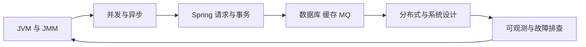

# 10 · 知识串联与专题

> [!info] 本区定位
> `01-09` 负责学清单个知识点，本区负责回答“这些知识在一条真实链路里如何共同工作”。建议完成相关基础章节后再读，并结合项目和故障案例复盘。

## 建议学习顺序

1. [[01-JMM到JUC并发工具的完整链路]]：先把并发章节的底层逻辑串成一条线。
2. [[02-一次Java请求的全链路]]：建立从 HTTP 入口到数据与可观测性的全局视角。
3. [[03-从类加载到对象回收与JVM排障]]：连接类加载、对象、内存、GC 和故障工具。
4. [[04-从Spring事务到分布式一致性]]：理解本地事务、数据库锁、消息与跨服务一致性。
5. [[05-高并发系统的流量保护链路]]：连接限流、线程池、缓存、数据库与降级。
6. [[06-线程池-CompletableFuture-MQ异步链路]]：区分进程内异步和跨服务异步。
7. [[07-微服务治理与可观测性全链路]]：连接注册发现、网关、韧性和链路追踪。
8. [[08-线上故障排查全链路]]：按现象、指标、证据和根因完成综合排障。

## 阅读方法

| 阅读层次 | 要回答的问题 | 产出 |
| --- | --- | --- |
| 单点回忆 | 每个组件解决什么问题 | 能说出边界和核心机制 |
| 链路连接 | 上游状态如何传到下游 | 能画执行时序和数据流 |
| 约束分析 | 容量、一致性和超时如何相互影响 | 能解释关键参数为什么这样配 |
| 故障推演 | 任一节点变慢或失败会发生什么 | 能给出监控、降级、补偿和恢复方案 |

## 专题关系图

## 本章复习

- [[99-本章总结与复习]]

## 相关入口

- [[20-Java后端/00-总览/学习仪表盘|Java 学习仪表盘]]
- [[20-Java后端/09-项目实战/_index|项目实战]]
- [[40-求职准备/17-面试-项目类问题|项目类面试]]

