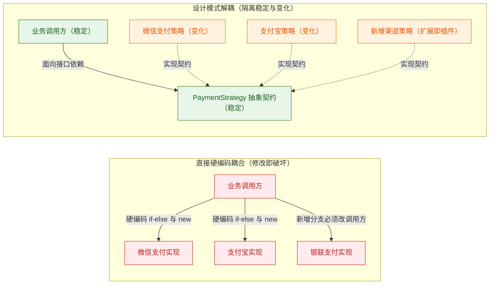
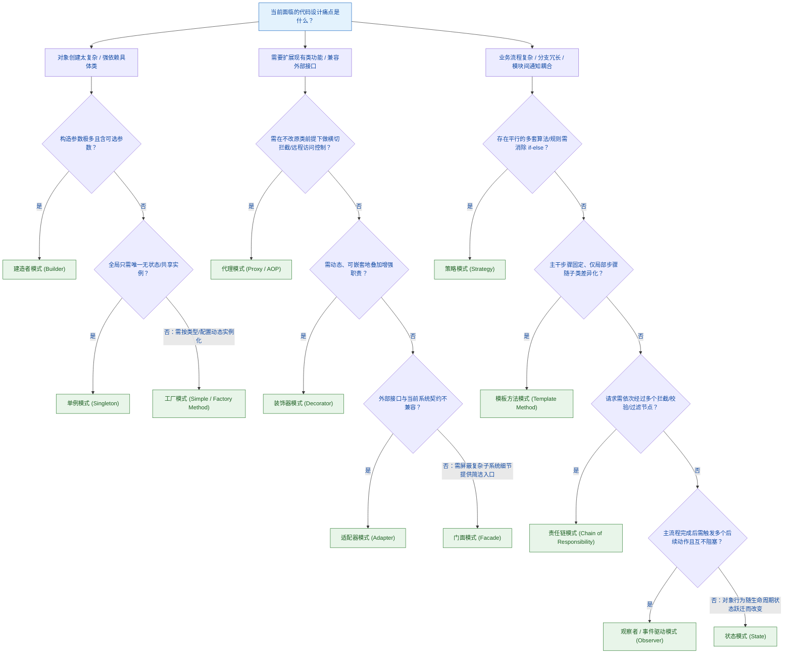

# 00 · 设计模式全景与心智模型

> **核心结论**：设计模式并非语法技巧或强制教条，而是针对面向对象软件设计中**反复出现的耦合与扩展问题**总结出的可复用解耦方案。其第一性原理只有一句话：**识别系统中频繁变化的维度，将其与稳定不变的骨架分离（封装变化点），面向抽象编程而非面向具体实现编程**。

---

## 一、 为什么需要设计模式？从第一性原理看代码腐化

在业务系统演进初期，直接编写面向过程的顺序逻辑与 `if-else` 分支往往开发速度最快。但随着业务迭代，缺乏设计的系统通常会经历以下三个阶段的腐化：

1. **霰弹式修改（Shotgun Surgery）**：每当新增一种支付渠道、营销规则或消息通知方式，必须在十几个类的 `if-else` 或 `switch` 分支中同步修改代码，极易遗漏并引发线上回归缺陷。
2. **类职责膨胀（God Class）**：一个核心业务 Service 类同时承担参数校验、风控拦截、幂等加锁、核心领域计算、第三方 HTTP 调用、数据库持久化及异步通知，代码动辄数千行，单元测试无法独立编写，多人协作频繁发生 Git 冲突。
3. **高层模块强耦合底层细节**：业务核心流程直接 `new` 具体的第三方 SDK 客户端或硬编码底层存储细节，一旦替换供应商或升级底层组件，上层业务代码必须随之大面积重写。

设计模式的本质作用，就是在**不改动或极少改动既有稳定代码（符合开闭原则 OCP）**的前提下，通过接口抽象、对象组合与职责委派，让系统具备局部替换与横向扩展的能力。

---

## 二、 GoF 23 种设计模式的三大分类与学习优先级

GoF（Gang of Four）提出的 23 种经典设计模式按其解决问题的维度分为**创建型（Creational）**、**结构型（Structural）**与**行为型（Behavioral）**三大类。

本章以常见 Java 后端开发任务安排学习优先级：先理解主要流程中的模式，再结合具体领域阅读扩展专题。**优先级是学习建议，不是普遍的使用频率排名**；例如组合常用于树形模型，访问者常用于稳定语法树上的多种分析。

### 1. 三大分类的核心职责

| 分类 | 数量 | 核心职责（解决什么阶段的问题） | 解耦手段 |
| :--- | :--- | :--- | :--- |
| **创建型模式（Creational）** | 5 种 | **解耦对象的创建与使用**：隐藏复杂对象的实例化细节、构造参数校验与生命周期管理，消除业务代码中的硬编码 `new`。 | 工厂封装、构造器链式分步构建、全局唯一实例控制、原型克隆 |
| **结构型模式（Structural）** | 7 种 | **优化类与对象的组合结构**：在不破坏现有类继承体系的前提下，通过对象包装、接口转换或子系统收敛来扩展功能。 | 动态代理拦截、装饰器层层叠加、适配器接口转换、门面统一入口 |
| **行为型模式（Behavioral）** | 11 种 | **规范对象间的职责分配与通信协作**：管理算法动态切换、主干流程复用、请求链式传递、事件发布订阅与状态流转。 | 策略多态委派、父类模板方法固化骨架、责任链管道、观察者事件解耦 |

### 2. 23 种设计模式学习优先级全景表

| 分类 | 🔥 P0 建议先读（建立主线） | ⚡ P1 随后掌握（结合任务） | 📌 P2 专题延伸（结合领域） |
| :--- | :--- | :--- | :--- |
| **创建型（5）** | • **单例模式（Singleton）** • **工厂方法 / 简单工厂（Factory）** • **建造者模式（Builder）** | • **抽象工厂模式（Abstract Factory）** • **原型模式（Prototype）** | （无，创建型全部需掌握） |
| **结构型（7）** | • **代理模式（Proxy）** • **装饰器模式（Decorator）** • **适配器模式（Adapter）** • **门面/外观模式（Facade）** | • **享元模式（Flyweight）** • **组合模式（Composite）** | • **桥接模式（Bridge）**（通知类型与发送方式独立变化） |
| **行为型（11）** | • **策略模式（Strategy）** • **模板方法模式（Template Method）** • **责任链模式（Chain of Responsibility）** • **观察者模式（Observer / Pub-Sub）** | • **状态模式（State）** • **迭代器模式（Iterator）** • **命令模式（Command）** | • **访问者模式（Visitor）**（ASM 字节码 / SQL AST 语法树遍历） • **中介者模式（Mediator）** • **备忘录模式（Memento）** • **解释器模式（Interpreter）**（SpEL / 正则解析） |

> **扩展阅读入口**：[[07-结构型扩展-桥接与组合]] 完整讲解桥接、组合；[[08-行为型扩展-中介者-备忘录-解释器-访问者]] 完整讲解中介者、备忘录、解释器、访问者。六种都属于 GoF；此处的学习分组不替代适用场景判断。简单工厂是额外讲解，不额外计入创建型 5 种。

---

## 三、 工程选型决策树：面对具体痛点如何选模式？

在日常编码与系统重构中，不应“手里拿着锤子找钉子”，而应从**当前面临的具体工程痛点**出发推导对应的模式：

---

## 四、 核心准则：KISS 原则与警惕“模式过度工程化”

学习设计模式最重要的一课，是知道**什么时候不该用设计模式**：

1. **设计模式是有认知与维护成本的**：引入工厂、策略、模板与抽象层会增加类文件数量与调用栈深度，降低代码直观可读性。
2. **遵循 YAGNI（You Aren't Gonna Need It）与三次法则（Rule of Three）**：
   - 如果一段 `if-else` 只有 2~3 个固定分支、每个分支仅几行代码，且未来一年内几乎不可能新增分支，直接写清晰的卫语句或 `switch` 表达式就是最优解；
   - 当同一个变化维度已经出现第 3 个分支，或单个分支内部逻辑超过 30 行并开始耦合外部依赖时，再引入**策略 + 工厂 + 模板方法**进行重构。
3. **组合优于继承，多种模式协同作战**：在真实工业级系统中，设计模式极少孤立出现，最经典的生产范式是**“策略模式（定义可变契约） + 模板方法（复用公共骨架） + 工厂模式（Spring Map 自动注册路由）”**三者组合使用。这是多模式搭配；GoF 的 **Composite 组合模式**专指用统一组件接口表达部分—整体树，详见 [[07-结构型扩展-桥接与组合]]。

---

## 五、 高频面试自测

> [!question]- Q1：请用一句话概括创建型、结构型、行为型设计模式分别解决什么层面的解耦？
> 1. **创建型模式**解决**“对象怎么来”**的耦合：将对象的实例化过程与使用方解耦，避免业务代码强依赖具体实现类的构造细节（代表：单例、工厂、建造者）。
> 2. **结构型模式**解决**“类与对象怎么组合扩展”**的耦合：在不修改原有类代码或避免继承体系爆炸的前提下，通过包装、代理或转换来增强功能与统一接口（代表：代理、装饰器、适配器、门面）。
> 3. **行为型模式**解决**“算法怎么换、流程怎么复用、对象间怎么通信”**的耦合：规范运行时职责委派、请求传递与事件通知（代表：策略、模板方法、责任链、观察者、状态）。

> [!question]- Q2：既然设计模式能提升扩展性，为什么在实际项目中不建议一开始就把所有地方都套上设计模式？
> 1. **复杂度守恒与调用链加深**：设计模式通过引入额外的抽象接口、代理层或委派类来换取扩展性，这会直接增加类的数量和阅读代码时的跳转成本。
> 2. **过早抽象容易预判错变化方向**：在业务早期需求尚未稳定时，强行预设扩展点往往会抽错维度，后续真实需求演进时不仅用不上原有的抽象层，反而要先拆掉冗余的接口体系。
> 3. **工程落地原则**：应当遵循 KISS 原则，对核心明确存在多渠道/多规则扩展诉求的模块（如支付网关、营销算价、风控规则引擎、多模型路由）一开始就采用模式化设计；对普通 CRUD 与简单确定性分支保持直接清晰的实现，待出现重复坏味道时再通过小步重构演进到设计模式。

---

## 🔗 下一篇导航
- 理解了设计模式的全局心智模型与选型脉络后，下一篇我们将深入所有设计模式底层的理论基石：[[01-七大面向对象设计原则]]。
