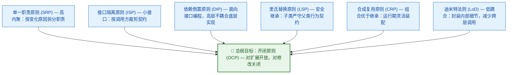
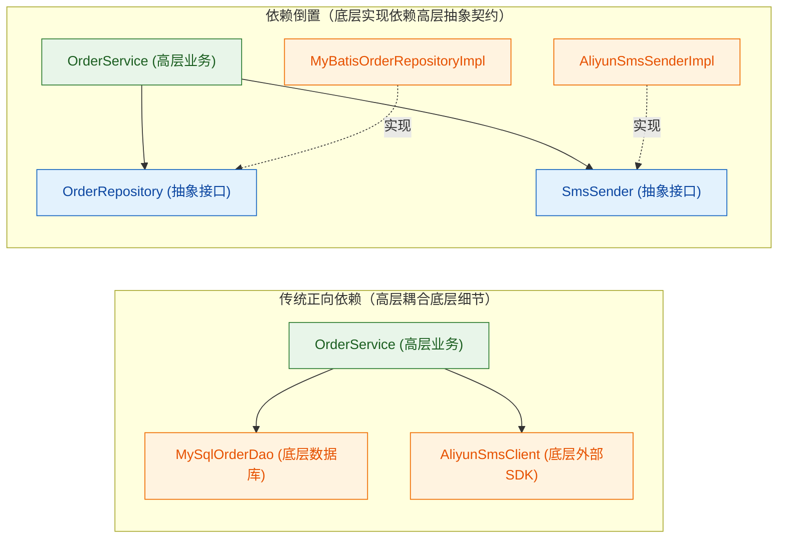

# 01 · 七大面向对象设计原则：SOLID、迪米特法则与合成复用

> **核心结论**：23 种设计模式都是为了在特定场景下践行**七大面向对象设计原则**而衍生出的具体实现手段。其中 **开闭原则（OCP）是总目标**，**单一职责（SRP）与接口隔离（ISP）是拆分边界的标尺**，**里氏替换（LSP）与合成复用（CRP）是继承与组合的准则**，**依赖倒置（DIP）与迪米特法则（LoD）是解耦组件依赖的核心途径**。

---

## 一、 七大设计原则全景速查表

| 缩写 | 原则名称 | 核心定义（一句话本质） | 违反该原则的典型代码坏味道 | 代表性落地设计模式 |
| :--- | :--- | :--- | :--- | :--- |
| **SRP** | **单一职责原则**<br>(Single Responsibility) | 一个类或模块只应该有一个引起它变化的原因（只对一类业务角色/职责负责）。 | 几千行的万能 `GodService`，既算价格又发短信还写审计表，改短信模板导致算价单测报错。 | 代理模式、装饰器模式、门面模式、责任链模式 |
| **OCP** | **开闭原则**<br>(Open-Closed) | 软件实体应当**对扩展开放，对修改关闭**（新增业务需求时通过新增类实现，而非修改原有稳定代码）。 | 每次新增渠道/类型都要去核心方法里加 `else if (type == xxx)`，并重新回归测试整个主流程。 | 策略模式、模板方法模式、工厂方法模式、观察者模式 |
| **LSP** | **里氏替换原则**<br>(Liskov Substitution) | 所有引用基类（父类）的地方必须能透明地使用其子类的对象，且不改变原有程序的正确性契约。 | 子类重写父类方法时抛出 `UnsupportedOperationException`，或篡改了父类方法约定的返回值/前置后置条件。 | 策略模式、模板方法模式、组合模式 |
| **ISP** | **接口隔离原则**<br>(Interface Segregation) | 客户端不应被迫依赖它不使用的方法；应将肥胖的庞大接口拆分为多个高内聚的特定角色小接口。 | 定义一个包含 15 个方法的 `UserService` 大接口，导致只读查询实现类被迫空实现一堆管理端删除方法。 | 适配器模式、门面模式、Spring 各类细粒度 `Aware` 接口 |
| **DIP** | **依赖倒置原则**<br>(Dependency Inversion) | 高层业务模块不应依赖低层实现模块，二者都应依赖抽象；抽象不应依赖细节，细节应依赖抽象。 | 订单领域服务直接依赖 `AliyunSmsClient` 具体类，切换腾讯云短信时必须修改订单服务源码。 | 工厂模式、Spring IoC 依赖注入、策略模式 |
| **LoD** | **迪米特法则**<br>(Law of Demeter / 最少知识) | 一个对象应当对其他对象保持最少的了解，只与直接的朋友（成员变量、方法参数、返回值）通信，不与陌生人说话。 | 链式跨越多个层级掏内部对象：`order.getMerchant().getAccount().getBankCard().deduct(amount)`。 | 门面模式（Facade）、中介者模式（Mediator） |
| **CRP** | **合成复用原则**<br>(Composite Reuse) | 优先使用**对象组合/聚合（Has-A）**，而不是**类继承（Is-A）**来达到代码复用的目的。 | 为了复用几个工具方法强行让业务类继承某个基类，导致多维度扩展时子类数量呈笛卡尔积爆炸。 | 装饰器模式、策略模式、代理模式、桥接模式 |



---

## 二、 逐条深入剖析与代码正反例对比

### 1. 单一职责原则（SRP, Single Responsibility Principle）

- **核心判据**：判断一个类是否符合单一职责，不是看它有几个方法，而是看**“有几个不同的业务变化维度会要求修改这个类”**。
- **工程粒度把握**：在编码初期，相关联的内聚操作（如订单 CRUD）放在同一个 `OrderService` 中是合理的；但当“订单履约状态流转”、“订单复杂满减算价”、“订单风控反欺诈校验”、“订单报表导出”各自演化出庞大的独立规则时，就必须按职责拆分为独立的领域组件。

```java
// ❌ 反例：一个类承担了订单落库、优惠金额计算、风控校验与第三方通知四种不同维度的变化
public class OrderGodService {
    public void createOrder(OrderDTO dto) {
        // 1. 风控黑名单与频次校验（风控规则变更会修改此处）
        // 2. 满减与优惠券叠加分摊计算（营销规则变更会修改此处）
        // 3. 订单主表与明细表落库（交易核心流程变更会修改此处）
        // 4. 拼接邮件与企微报文并发送 HTTP 请求（通知渠道变更会修改此处）
    }
}

// ✅ 正例：按职责边界拆分独立组件，由应用服务协调编排
@Service
@RequiredArgsConstructor
public class OrderApplicationService {
    private final RiskCheckService riskCheckService;       // 专职风控校验
    private final PriceCalculateService priceService;      // 专职营销算价
    private final OrderRepository orderRepository;         // 专职订单持久化
    private final ApplicationEventPublisher eventPublisher;// 异步事件解耦通知

    @Transactional(rollbackFor = Exception.class)
    public Long createOrder(OrderCreateCommand cmd) {
        riskCheckService.verify(cmd);
        PriceResult price = priceService.calculate(cmd);
        Order order = Order.create(cmd, price);
        orderRepository.save(order);
        eventPublisher.publishEvent(new OrderCreatedEvent(order.getId()));
        return order.getId();
    }
}
```

---

### 2. 开闭原则（OCP, Open-Closed Principle）

- **核心机制**：通过**抽象构建稳定框架，通过实现扩展细节**。当业务需要增加新规则时，主干调度代码一行不改，仅需新增一个实现类并注册到容器中。

```java
// ❌ 反例：每次新增会员等级或折扣类型，都必须修改核心算价方法
public class DiscountCalculator {
    public BigDecimal calculate(String userLevel, BigDecimal amount) {
        if ("SILVER".equals(userLevel)) {
            return amount.multiply(new BigDecimal("0.95"));
        } else if ("GOLD".equals(userLevel)) {
            return amount.multiply(new BigDecimal("0.85"));
        } else if ("BLACK_CARD".equals(userLevel)) {
            // 新增黑卡逻辑直接侵入原有方法
            return amount.multiply(new BigDecimal("0.75")).subtract(new BigDecimal("20"));
        }
        return amount;
    }
}

// ✅ 正例：定义稳定抽象契约，新增等级只需新增实现类（对扩展开放，对修改关闭）
public interface DiscountPolicy {
    String supportLevel();
    BigDecimal apply(BigDecimal amount);
}

@Component
public class GoldDiscountPolicy implements DiscountPolicy {
    @Override
    public String supportLevel() { return "GOLD"; }

    @Override
    public BigDecimal apply(BigDecimal amount) {
        return amount.multiply(new BigDecimal("0.85"));
    }
}
```

---

### 3. 里氏替换原则（LSP, Liskov Substitution Principle）

- **核心约束**：子类可以扩展父类的功能，但**绝不能改变父类原有的行为契约**。具体体现为以下四点工程规约：
  1. **子类必须完全实现父类的抽象方法**，不得在重写方法中直接抛出 `UnsupportedOperationException` 拒绝提供服务；
  2. **子类尽量不要重写（Override）父类已经实现的非抽象核心方法**（若需留出扩展点，父类应定义为抽象钩子方法，即模板方法模式）；
  3. **子类重载或重写方法时，前置条件（入参约束）不能比父类更严格，后置条件（返回值保证）不能比父类更宽松**；
  4. **如果两个类在现实概念中存在包含关系，但在代码行为契约上不一致（经典案例：正方形继承长方形，修改宽度时联动修改高度，破坏了长方形“宽高独立变化”的契约），则绝不应建立继承关系**，而应抽取公共只读接口（如 `Shape#area()`）。

---

### 4. 接口隔离原则（ISP, Interface Segregation Principle）

- **核心约束**：接口的设计粒度应当遵循**“按调用方所需最小契约定义”**，避免把不同业务场景的方法塞进同一个臃肿接口。
- **框架源码印证**：Spring 框架没有设计一个包罗万象的 `SpringContextAware` 巨型接口，而是拆分为 `BeanNameAware`、`BeanFactoryAware`、`ApplicationContextAware`、`EnvironmentAware` 等十几个细粒度接口，Bean 需要感知什么组件就只实现对应的接口。

```java
// ❌ 反例：臃肿接口强迫只读缓存组件实现分布式锁方法
public interface CacheOperations {
    String get(String key);
    void put(String key, String val);
    boolean tryLock(String lockKey, long timeoutMs);
    void unlock(String lockKey);
}

// ✅ 正例：按职责隔离为细粒度接口，实现类按需实现
public interface KeyValueCache {
    String get(String key);
    void put(String key, String val);
}

public interface DistributedLock {
    boolean tryLock(String lockKey, long timeoutMs);
    void unlock(String lockKey);
}
```

---

### 5. 依赖倒置原则（DIP, Dependency Inversion Principle）

- **为什么叫“倒置”？**
  - **传统面向过程自顶向下设计**：高层订单模块直接调用低层 MySQL 存储模块与阿里云短信 SDK，高层模块编译期直接依赖低层具体实现（高层 $\to$ 低层）。
  - **依赖倒置后的面向对象/DDD 设计**：由高层业务领域定义它所需要的抽象接口（如 `OrderRepository`、`MessageNotifier`），低层基础设施模块去实现这些接口（高层 $\to$ 抽象接口 $\leftarrow$ 低层实现）。底层依赖的方向发生了反转，从而实现了领域逻辑与基础设施的解耦。



---

### 6. 迪米特法则（LoD, Law of Demeter）与合成复用原则（CRP）

#### （1）迪米特法则（最少知识原则）
- **核心要求**：调用方只向直接关联的对象发出指令，由被调用对象内部自行完成数据的组装与流转，禁止调用方采用“火车残骸式（Train Wreck）”的连续 `getter` 穿透对象内部结构。

```java
// ❌ 反例：违反迪米特法则，调用方深入了解了 Wallet 与 Account 的内部层级结构
BigDecimal balance = user.getWallet().getPrimaryAccount().getAvailableBalance();
if (balance.compareTo(payAmount) >= 0) {
    user.getWallet().getPrimaryAccount().setAvailableBalance(balance.subtract(payAmount));
}

// ✅ 正例：遵循迪米特法则，高内聚封装行为，调用方只与直接朋友 user 交互
user.deductBalance(payAmount);
```

#### （2）合成复用原则（组合优于继承）
- **为什么继承容易导致设计僵化？**
  1. **白盒复用破坏封装**：父类的内部实现细节对子类暴露，父类一旦修改内部字段或方法签名，所有子类被迫连锁修改；
  2. **编译期静态绑定**：继承关系在编译期写死，无法在运行期动态切换行为；
  3. **单继承限制与类爆炸**：Java 不支持多继承，若一个类有“消息格式（JSON/XML）”与“发送渠道（HTTP/MQ/RPC）”两个变化维度，使用继承会产生 $2 \times 3 = 6$ 个子类；而使用对象组合（将 `MessageFormatter` 注入 `MessageSender`），只需 $2 + 3 = 5$ 个类，且可任意动态组合。

---

## 三、 高频面试自测

> [!question]- Q1：依赖倒置原则（DIP）、控制反转（IoC）和依赖注入（DI）三者之间是什么关系？
> 1. **依赖倒置原则（DIP）**是面向对象设计的**架构指导原则**，核心要求是“高层模块和低层模块都应依赖抽象接口，而非具体实现类”。
> 2. **控制反转（IoC）**是践行依赖倒置原则的一种**设计思想/机制**：将依赖对象的创建权与生命周期管理权从业务代码内部反转（交出）给外部容器（如 Spring IoC 容器）。
> 3. **依赖注入（DI）**是实现控制反转的**具体编码技术手段**：容器在运行期通过构造器注入、Setter 注入或字段反射注入，将符合抽象接口的具体实现 Bean 装配到高层组件中。

> [!question]- Q2：为什么说“组合优于继承（合成复用原则）”？什么情况下才应该真正使用继承？
> 1. **组合的优势**：
>    - **黑盒复用与低耦合**：外部对象仅通过被组合对象的公开接口交互，不感知其内部实现变更；
>    - **运行期动态灵活替换**：可在运行时通过注入不同的策略或装饰器实例动态改变对象行为；
>    - **避免多维度组合时的子类笛卡尔积膨胀**。
> 2. **何时应该使用继承**：
>    - 两个类之间存在严格且稳定的 **`Is-A` 关系**，并完全满足**里氏替换原则（LSP）**；
>    - 需要使用**模板方法模式**，即多个子类拥有完全一致的算法主干骨架，仅需重写少数受保护的抽象钩子方法（如 `AbstractQueuedSynchronizer`、`AbstractApplicationContext`）。

---

## 🔗 上下篇导航
- **上一篇**：[[00-设计模式全景与心智模型]]
- **下一篇**：掌握了七大设计原则后，我们将进入第一类高频模式实战：[[02-创建型模式-单例-工厂-建造者-原型]]。
