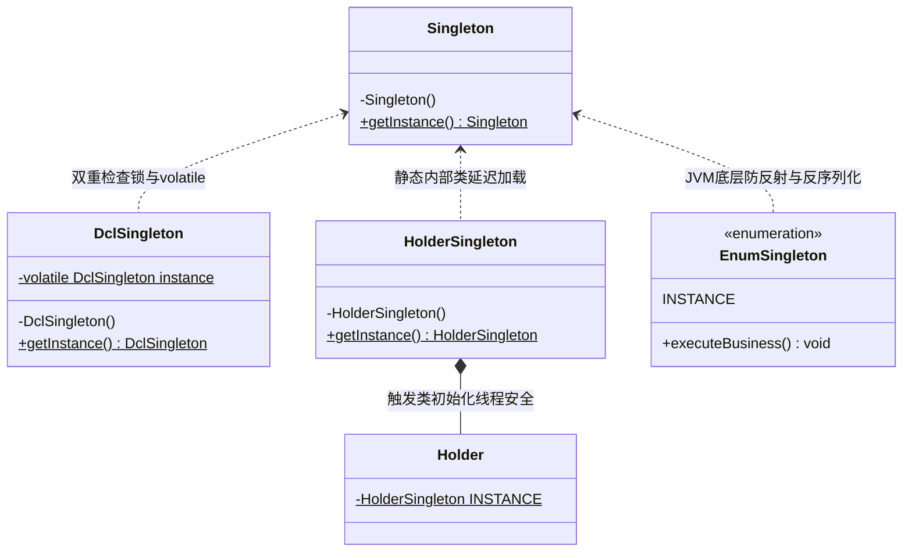
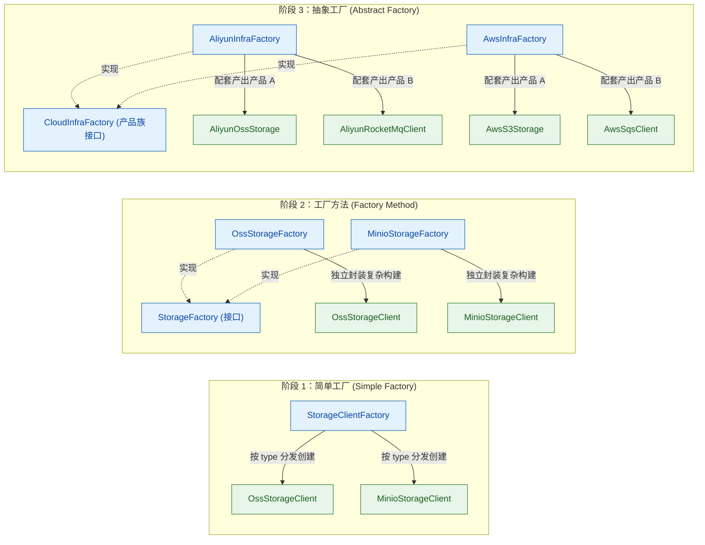
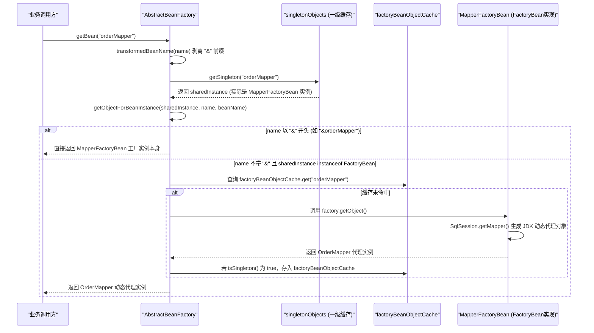
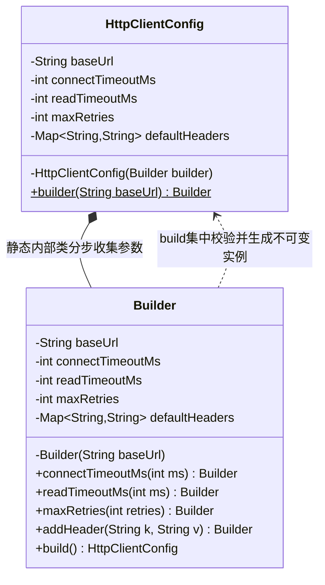
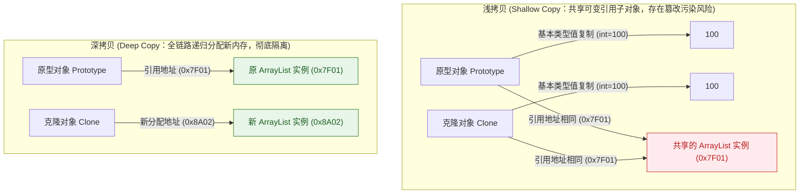

# 02 · 创建型模式：单例、工厂、建造者与原型

> **核心结论**：创建型模式（Creational Patterns）的第一性原理是**将对象的实例化过程（Instantiation）与业务使用过程（Usage）解耦**。通过封装全局唯一性控制、多实现类动态路由、多参数分步组装及内存复制逻辑，消除业务代码对具体类构造细节的硬编码依赖，使系统在对象创建维度满足开闭原则（OCP）与依赖倒置原则（DIP）。

---

## 一、 单例模式（Singleton Pattern）

### 1. 解决的核心耦合与工程痛点

在企业级后端系统中，诸如配置中心客户端、本地缓存容器、线程池管理器、雪花算法（Snowflake）ID 生成器以及无状态工具组件，在同一个运行环境中只需要维护一份实例。若任由调用方在业务代码中随处调用 `new` 实例化：
1. **资源耗尽与高频 GC**：每次创建连接池或线程池都会申请底层操作系统套接字与内核线程资源，重复实例化会迅速引发内存溢出（OOM）或文件描述符耗尽。
2. **状态视图分裂**：全局配置或发号器一旦存在多个实例，各实例内部的序列号游标或内存状态相互独立，直接破坏全局唯一性或数据一致性契约。

单例模式通过私有化构造器并由类自身管控唯一实例的创建与访问入口，从机制上收敛实例数量。

### 2. 核心结构与五种实现演进剖析



#### （1）饿汉式（Eager Initialization）

在类加载的初始化阶段（执行类构造器 `<clinit>()` 方法时）直接完成静态实例创建。JVM 保证 `<clinit>()` 在多线程环境下的同步互斥执行，天然具备线程安全性，且获取实例时无任何锁开销；缺点是不支持延迟加载（Lazy Loading），若实例初始化耗时长且启动后长期未被调用，会增加启动耗时与内存占用。

```java
public final class EagerSingleton {
    // 类初始化阶段即完成实例化，由 JVM <clinit> 保证线程安全
    private static final EagerSingleton INSTANCE = new EagerSingleton();

    private EagerSingleton() {
        // 防御常规反射调用（仅对已初始化后的反射有效）
        if (INSTANCE != null) {
            throw new IllegalStateException("Singleton instance already created.");
        }
    }

    public static EagerSingleton getInstance() {
        return INSTANCE;
    }
}
```

#### （2）双重检查锁（Double-Checked Locking, DCL）

当单例对象的创建依赖外部运行时参数，或者初始化成本较高必须按需延迟加载时，双重检查锁（DCL）是兼顾延迟加载与高并发性能的标准方案。

```java
public final class DclSingleton {
    // 必须使用 volatile 修饰，禁止指令重排序并保证跨线程可见性
    private static volatile DclSingleton instance;

    private final String endpoint;

    private DclSingleton() {
        this.endpoint = "https://config.internal.corp:8443";
    }

    public static DclSingleton getInstance() {
        // 第一次检查：实例已创建后直接返回，避免每次调用都进入 synchronized 锁竞争
        if (instance == null) {
            synchronized (DclSingleton.class) {
                // 第二次检查：防止多个线程同时通过第一次检查后，在排队获取锁后重复创建实例
                if (instance == null) {
                    instance = new DclSingleton();
                }
            }
        }
        return instance;
    }

    public String getEndpoint() {
        return endpoint;
    }
}
```

> [!IMPORTANT] 深度剖析：为什么 DCL 中的 `instance` 必须加 `volatile`？
> `instance = new DclSingleton()` 在 Java 源码中只有一行，但在字节码与 JVM 执行层面分为三个独立步骤：
> 1. **`new`（分配内存）**：在堆内存中为 `DclSingleton` 对象分配一块内存空间，此时成员变量 `endpoint` 处于零值状态（`null`）。
> 2. **`invokespecial <init>`（初始化对象）**：调用构造器方法，初始化成员变量（将 `endpoint` 赋值为有效字符串）。
> 3. **`putstatic`（引用赋值）**：将堆内存地址赋值给静态变量 `instance`（此时 `instance != null`）。
>
> 在没有 `volatile` 修饰时，JIT 编译器和 CPU 在遵循单线程语义不变（As-If-Serial）的前提下，允许对步骤 **2** 和步骤 **3** 进行**指令重排序**，实际执行顺序可能变为 **`1 -> 3 -> 2`**：
> - **时刻 T1**：线程 A 进入同步块，执行了步骤 1（分配内存）和步骤 3（将内存地址赋给 `instance`），但**尚未执行步骤 2（构造器初始化）**。
> - **时刻 T2**：线程 B 调用 `getInstance()`，执行外层第一次检查 `if (instance == null)`，发现 `instance` 已经指向非空内存地址，于是无需等待锁，直接将该引用返回给业务调用方。
> - **时刻 T3**：线程 B 调用 `singleton.getEndpoint()`，由于线程 A 的构造器尚未执行完毕，线程 B 读取到未初始化完成的**半初始化对象（Partially Initialized Object）**，触发空指针异常（NPE）或脏数据错误。
>
> 为 `instance` 加上 `volatile` 后，JVM 会在写操作前后插入内存屏障（`StoreStore` 屏障与 `StoreLoad` 屏障），严格保证**步骤 2（构造器初始化）必须在步骤 3（引用发布）之前完成**（Happens-Before 关系），从而彻底杜绝半初始化对象逃逸。

#### （3）静态内部类（Initialization-on-Demand Holder）

利用 JVM 类加载机制实现无锁延迟加载：外部类 `HolderSingleton` 被加载时，静态内部类 `Holder` 不会被立即加载；只有当首次调用 `getInstance()` 访问 `Holder.INSTANCE` 时，才会触发 `Holder` 类的加载与 `<clinit>()` 初始化，由 JVM 底层类加载锁保证线程安全。

```java
public final class HolderSingleton {
    private HolderSingleton() {}

    private static class Holder {
        private static final HolderSingleton INSTANCE = new HolderSingleton();
    }

    public static HolderSingleton getInstance() {
        return Holder.INSTANCE;
    }
}
```

#### （4）枚举单例（Enum Singleton）——《Effective Java》推荐方案

很多初学者看到枚举单例的第一反应通常是：*“枚举平时都是用来写状态码常量的，怎么能当单例用？这看着一点也不像单例啊。”*

之所以觉得它“不像单例”，是因为我们习惯了单例类必须包含 `private 构造器` 和 `getInstance()` 方法。要理解枚举为什么是单例，必须从 **JVM 底层编译机制** 来看。

##### ① 第一性原理：枚举在底层到底被编译成了什么？
如果我们编写一个最简单的枚举单例：
```java
public enum AppConfigManager {
    INSTANCE;
    // 业务方法与字段...
}
```
通过 `javap -p AppConfigManager.class` 反编译其底层字节码，会发现编译器实际生成的结构等价于：
```java
// 编译器自动将其声明为 final 类，并继承自 java.lang.Enum
public final class AppConfigManager extends Enum<AppConfigManager> {
    // 所谓的枚举项 INSTANCE，本质上就是一个 public static final 的常量对象！
    public static final AppConfigManager INSTANCE;

    // 静态代码块在类加载的 <clinit> 阶段由 JVM 保证线程安全地完成实例化
    static {
        INSTANCE = new AppConfigManager("INSTANCE", 0);
    }

    private AppConfigManager(String name, int ordinal) {
        super(name, ordinal);
    }
}
```
从反编译代码可以清晰看出：**枚举项 `INSTANCE` 本质就是一个静态常量对象！它在底层依然是基于 JVM 类加载机制的饿汉式单例，天然具备全局唯一性与线程安全性。**

---

##### ② 生产典型写法一：直接作为全局管理器使用（以应用配置管理器为例）
```java
/**
 * 全局应用配置管理器单例
 */
public enum AppConfigManager {
    INSTANCE;

    // 单例持有的业务状态与资源
    private final Map<String, String> configMap = new ConcurrentHashMap<>();

    // 枚举构造器：JVM 保证全局仅在类加载时调用一次
    AppConfigManager() {
        loadConfigurations();
    }

    private void loadConfigurations() {
        // 模拟从配置中心或本地配置文件加载核心配置
        configMap.put("app.name", "order-center");
        configMap.put("app.env", "production");
        configMap.put("network.timeout.ms", "3000");
    }

    public String getProperty(String key) {
        return configMap.get(key);
    }

    public void updateProperty(String key, String value) {
        configMap.put(key, value);
    }
}
```
**调用方式**：
```java
// 语法极其直观洁净，通过枚举项直接调用业务方法
String appName = AppConfigManager.INSTANCE.getProperty("app.name");
```

---

##### ③ 生产典型写法二：内部枚举 Holder 包装普通业务类（兼顾防破坏与传统调用习惯）
如果已有普通的复杂业务类（如 `ConnectionPoolManager`），不希望直接将它定义为 `enum`，或者希望保持传统的 `getInstance()` 语法，可以使用**内部枚举作为持有者（Holder）**：

```java
public class ConnectionPoolManager {
    // 私有化构造器，执行耗时的数据源连接初始化
    private ConnectionPoolManager() {
        // 初始化物理连接池...
    }

    // 对外提供标准静态工厂方法
    public static ConnectionPoolManager getInstance() {
        return SingletonHolder.HOLDER.getInstance();
    }

    // 借助内部枚举在 JVM 层面的绝对安全性，充当单例容器
    private enum SingletonHolder {
        HOLDER;

        private final ConnectionPoolManager instance;

        SingletonHolder() {
            this.instance = new ConnectionPoolManager();
        }

        public ConnectionPoolManager getInstance() {
            return instance;
        }
    }

    // 业务方法
    public void executeQuery(String sql) {
        // ...
    }
}
```
**调用方式**：
```java
// 外部调用依然是大家熟悉的传统风格，底层却享有枚举的坚固安全性
ConnectionPoolManager.getInstance().executeQuery("SELECT 1");
```

---

##### ④ 为什么《Effective Java》称枚举为“实现单例的最佳方法”？
前文介绍的“饿汉式”、“双重检查锁（DCL）”和“静态内部类”虽然在正常并发下没有问题，但在极端场景下存在两个机制性漏洞：
1. **JVM 规范硬编码防御反射攻击**：
   普通私有构造器可以通过 `constructor.setAccessible(true)` 强行破除权限并实例化新对象。
   而查看 JDK 源码 `java.lang.reflect.Constructor#newInstanceWithCaller`：
   ```java
   if ((clazz.getModifiers() & Modifier.ENUM) != 0)
       throw new IllegalArgumentException("Cannot reflectively create enum objects");
   ```
   JVM 在反射入口处做了硬编码限制，只要是枚举类型，调用反射 `newInstance()` 会直接抛出 `IllegalArgumentException`，彻底杜绝反射破坏。
2. **原生防御反序列化生成多个实例**：
   普通单例类如果实现了 `Serializable` 接口，在反序列化（`ObjectInputStream#readObject()`）时默认会通过反射绕过构造器在堆中创建全新的对象，必须额外手写 `private Object readResolve()` 才能替换返回引用。
   而根据 Java 序列化规范，枚举在序列化时**只将枚举常量名称（如 `"INSTANCE"`）写入字节流**；反序列化时，底层直接调用 `Enum.valueOf(Class, String)` 从内存中查找已有常量，绝不会在堆中新建任何实例。

#### （5）各单例实现方案对比矩阵

| 实现方式 | 延迟加载 | 线程安全保障机制 | 防反射攻击 | 防反序列化破坏 | 工程推荐度与适用场景 |
| :--- | :---: | :--- | :---: | :---: | :--- |
| **饿汉式** | ❌ | JVM 类加载 `<clinit>` | ❌ | ❌（需写 `readResolve`） | ⭐⭐⭐⭐（实例轻量、启动必用场景首选） |
| **双重检查锁（DCL）** | ✅ | `synchronized` + `volatile` 内存屏障 | ❌ | ❌（需写 `readResolve`） | ⭐⭐⭐⭐（需懒加载且初始化依赖运行时参数） |
| **静态内部类** | ✅ | JVM 内部类按需加载 `<clinit>` | ❌ | ❌（需写 `readResolve`） | ⭐⭐⭐⭐⭐（无参懒加载单例的最佳简洁写法） |
| **枚举单例** | ❌ | JVM 枚举类加载 `<clinit>` | ✅（JDK 硬编码拦截） | ✅（按常量名查找） | ⭐⭐⭐⭐⭐（需严格防止反射/序列化破坏的工具类） |

### 3. 源码印证：JVM 进程级单例 vs Spring IoC 容器级单例

在面试与架构设计中，必须严格区分 **GoF 单例模式** 与 **Spring 单例 Bean（`@Scope("singleton")`）** 的作用域边界：

1. **作用域边界不同**：
   - **GoF 单例**是 **ClassLoader 级别（通常等价于 JVM 进程级）**：在同一个类加载器命名空间下，整个 JVM 进程有且仅有一个该类的实例。
   - **Spring 单例 Bean** 是 **`ApplicationContext`（`BeanFactory`）容器级别**：同一个类在**同一个 Spring IoC 容器内**按 `beanName` 保持唯一；但如果同一个 JVM 进程内启动了多个 `ApplicationContext` 实例（例如历史遗留 Web 项目中同时存在 Spring Root 容器与 Spring MVC 子容器且重复扫描了同一个包），或者在同一个容器中针对同一个类注册了两个不同的 `beanName`，内存中就会存在多个该类的实例。
2. **底层实现机制不同（`DefaultSingletonBeanRegistry` 源码剖析）**：
   Spring 并未使用私有构造器或静态变量，而是采用**单例注册表（Singleton Registry）**模式。在 `org.springframework.beans.factory.support.DefaultSingletonBeanRegistry` 中：
   ```java
   // 一级缓存：存放完全初始化好的容器级单例 Bean，Key 为 beanName
   private final Map<String, Object> singletonObjects = new ConcurrentHashMap<>(256);

   public Object getSingleton(String beanName, ObjectFactory<?> singletonFactory) {
       // 1. 先尝试从 ConcurrentHashMap 无锁快速读取
       Object singletonObject = this.singletonObjects.get(beanName);
       if (singletonObject == null) {
           // 2. 缓存未命中时，对 singletonObjects 加互斥锁（类似 DCL 内层锁）
           synchronized (this.singletonObjects) {
               singletonObject = this.singletonObjects.get(beanName);
               if (singletonObject == null) {
                   // 3. 回调 createBean() 完成实例化、属性填充与初始化后放入一级缓存
                   singletonObject = singletonFactory.getObject();
                   addSingleton(beanName, singletonObject);
               }
           }
       }
       return singletonObject;
   }
   ```

### 4. 适用边界与反过度设计建议

- **严禁在单例中保存可变请求上下文状态**：单例对象被所有业务线程共享，一旦将用户 ID、当前事务连接或业务临时计算结果保存在普通成员变量中，并发读写会立即引发数据串号事故（若需绑定线程上下文，应使用 `ThreadLocal`）。
- **Spring 工程中避免手写单例样板代码**：在 Spring Boot 应用中，无状态 Service、Component、Repository 直接交由 IoC 容器管理生命周期即可，无需在业务类上叠写 DCL 或静态内部类。

---

## 二、 工厂模式（Factory Pattern：简单工厂、工厂方法、抽象工厂）

### 1. 解决的核心耦合与工程痛点

当系统中某个抽象接口存在多种具体实现（如多种文件存储引擎、多渠道消息推送、多数据库方言）时，如果业务调用方直接根据参数编写 `if ("OSS".equals(type)) { client = new AliyunOssClient(...); }`：
1. **调用方与全量实现类强耦合**：业务层被迫导入所有底层具体实现类及其配置依赖，违反依赖倒置原则（DIP）。
2. **复杂初始化逻辑散落各处**：如果实例化某个客户端需要读取证书、配置连接池并设置重试策略，所有调用点都必须重复编写这套构建代码，一旦初始化流程变更将引发霰弹式修改。

工厂模式的核心思想是将**“根据条件选择具体类型并完成组装”**的职责从业务调用方剥离，收敛到专门的工厂组件中。

### 2. 三种工厂形态的演进逻辑与代码实现

简单工厂、工厂方法与抽象工厂并非彼此割裂的概念，而是随着**产品初始化复杂度**与**产品维度数量**的增长自然演进的三个阶段：



#### （1）简单工厂（Simple Factory / 静态工厂方法）

当具体产品的创建过程相对简单，仅需根据类型标识（枚举或配置项）返回对应的实现实例时，使用一个工厂类集中管理映射关系。在现代 Java 中，通常结合 `Map<Enum, Supplier<T>>` 或 Spring 容器注入消除 `switch-case` 分支：

```java
public enum StorageType {
    ALIYUN_OSS, MINIO, LOCAL_DISK
}

public interface FileStorageClient {
    String upload(String bucket, String objectKey, byte[] content);
}

public final class FileStorageSimpleFactory {
    private static final Map<StorageType, Supplier<FileStorageClient>> REGISTRY = Map.of(
        StorageType.ALIYUN_OSS, AliyunOssStorageClient::new,
        StorageType.MINIO, MinioStorageClient::new,
        StorageType.LOCAL_DISK, LocalDiskStorageClient::new
    );

    private FileStorageSimpleFactory() {}

    public static FileStorageClient createClient(StorageType type) {
        Supplier<FileStorageClient> supplier = REGISTRY.get(type);
        if (supplier == null) {
            throw new IllegalArgumentException("Unsupported storage type: " + type);
        }
        return supplier.get();
    }
}
```

#### （2）工厂方法模式（Factory Method Pattern）

当每一种具体产品的实例化过程都包含**独立且复杂的初始化流程**（例如：阿里云 OSS 客户端需要向 KMS 拉取 STS 临时凭证并初始化 HTTPS 双向认证连接池；MinIO 客户端需要配置自签名证书信任链与分片阈值；本地磁盘客户端需要检查挂载目录权限并启动定时清理线程）时，如果继续塞在同一个简单工厂中，该工厂类就会膨胀为耦合所有第三方 SDK 细节的“上帝类”。

此时将工厂抽象为接口 `FileStorageFactory`，为每种产品配备专属子工厂，使单个产品的复杂构建逻辑完全内聚在各自子工厂中：

```java
// 抽象工厂契约
public interface FileStorageFactory {
    StorageType supportedType();
    FileStorageClient createStorageClient(StorageProperties properties);
}

// 阿里云 OSS 专属工厂：内聚 STS 鉴权与连接池组装细节
@Component
public class AliyunOssStorageFactory implements FileStorageFactory {
    @Override
    public StorageType supportedType() {
        return StorageType.ALIYUN_OSS;
    }

    @Override
    public FileStorageClient createStorageClient(StorageProperties props) {
        // 1. 构建连接池配置与超时参数
        // 2. 初始化 STS 凭证刷新器
        // 3. 返回完整组装好的 AliyunOssStorageClient
        return new AliyunOssStorageClient(props.getEndpoint(), props.getAccessKey(), props.getConnectTimeoutMs());
    }
}

// MinIO 专属工厂：内聚自签名证书与分片配置细节
@Component
public class MinioStorageFactory implements FileStorageFactory {
    @Override
    public StorageType supportedType() {
        return StorageType.MINIO;
    }

    @Override
    public FileStorageClient createStorageClient(StorageProperties props) {
        return new MinioStorageClient(props.getEndpoint(), props.getBucket(), props.getPartSizeMb());
    }
}
```

#### （3）抽象工厂模式（Abstract Factory Pattern）

- **工厂方法**针对的是**单一产品等级结构**（例如只生产 `FileStorageClient` 这一类组件）。
- **抽象工厂**针对的是**具有配套约束的多个产品等级结构（产品族，Product Family）**。例如企业多云底座需要同时使用云厂商的“对象存储（`ObjectStorage`）”、“消息队列（`MessageQueue`）”与“密钥管理（`KmsService`）”，且同一环境下的这三个组件必须属于同一云厂商生态（不能将阿里云的 KMS 密钥格式直接传给 AWS S3 客户端）。

```java
// 抽象工厂：定义一整套云原生基础设施“产品族”的创建契约
public interface CloudInfraAbstractFactory {
    FileStorageClient createStorageClient();
    MessageQueueClient createMqClient();
    KmsCryptoClient createKmsClient();
}

// 具体工厂 1：阿里云产品族（保证三个组件协议与鉴权体系完全配套）
public class AliyunCloudInfraFactory implements CloudInfraAbstractFactory {
    @Override
    public FileStorageClient createStorageClient() { return new AliyunOssStorageClient(); }
    @Override
    public MessageQueueClient createMqClient() { return new AliyunRocketMqClient(); }
    @Override
    public KmsCryptoClient createKmsClient() { return new AliyunKmsCryptoClient(); }
}

// 具体工厂 2：AWS 产品族
public class AwsCloudInfraFactory implements CloudInfraAbstractFactory {
    @Override
    public FileStorageClient createStorageClient() { return new AwsS3StorageClient(); }
    @Override
    public MessageQueueClient createMqClient() { return new AwsSqsClient(); }
    @Override
    public KmsCryptoClient createKmsClient() { return new AwsKmsCryptoClient(); }
}
```

### 3. 源码印证：Spring `BeanFactory` vs `FactoryBean` 深度解析

Spring 框架将工厂模式运用到了极致，其中最核心也最高频考察的源码机制是 **`BeanFactory`** 与 **`FactoryBean`** 的职责划分与协作流程：

| 对比维度 | `BeanFactory`（以 `DefaultListableBeanFactory` 为代表） | `FactoryBean<T>`（如 `SqlSessionFactoryBean`、`MapperFactoryBean`） |
| :--- | :--- | :--- |
| **角色定位** | **IoC 容器根接口（大工厂本身）**：负责管理成百上千个 Bean 的定义加载、依赖注入与生命周期。 | **容器内的定制化小工厂 Bean**：自身是一个注册在 Spring 容器中的 Bean，专门用于封装某个复杂目标对象 `T` 的实例化逻辑。 |
| **对应设计模式** | 简单工厂 + 抽象工厂 + 模板方法 | **工厂方法模式（Factory Method）**的标准落地 |
| **核心方法** | `getBean(String name)`、`getBean(Class<T> requiredType)` | `T getObject()`、`Class<?> getObjectType()`、`boolean isSingleton()` |
| **获取方式区分** | `context.getBean("myBean")` 返回目标产品对象 | `context.getBean("myBean")` 返回 `FactoryBean#getObject()` 产出的对象；<br>`context.getBean("&myBean")`（加 `&` 前缀）返回 `FactoryBean` 实例本身。 |

#### 源码级工作流程剖析（`AbstractBeanFactory#doGetBean`）

为什么第三方框架（如 MyBatis、Dubbo、Feign）接入 Spring 时都高度依赖 `FactoryBean`？因为 MyBatis 的 Mapper 接口和 Feign 的客户端接口**只有接口定义而没有实现类**，无法通过常规反射调用构造器实例化，必须在运行时通过 JDK 动态代理生成实例。`FactoryBean` 为这类非标对象的创建提供了标准扩展口：



### 4. 适用边界与反过度设计建议

1. **优先使用简单工厂（结合 Spring 依赖注入）**：在 85% 以上的日常业务开发中，不同实现类的创建已经由 Spring `@Component` 完成，只需定义一个简单工厂（通过构造器注入 `List<Strategy>` 转为 `Map<Type, Strategy>`）即可完美实现动态路由，无需额外编写 `XxxFactory` 接口和一堆子工厂类。
2. **克制使用抽象工厂**：抽象工厂在新增“产品族”（如新增华为云套件）时非常符合开闭原则，但在**产品族内部新增一种产品类型**（如在 `CloudInfraAbstractFactory` 接口中新增 `createCdnClient()` 方法）时，所有现有具体工厂实现类都必须被迫同步修改。若产品组合不固定，切勿强套抽象工厂。

---

## 三、 建造者模式（Builder Pattern）

### 1. 解决的核心耦合与工程痛点

当我们需要构建一个包含多个必填参数、多个可选参数，且参数之间存在交叉合法性校验约束的复杂配置对象或领域请求对象（如 `HttpClientConfig`、`RpcRequest`、`SearchQuery`）时，传统写法面临两大典型反模式：

1. **重叠构造器反模式（Telescoping Constructor Anti-Pattern）**：
   编写 5~6 个参数数量递增的重载构造器。调用方被迫写下 `new HttpRequestConfig("https://api.corp", "POST", 3000, 5000, 3, true, false, null)`。一长串同类型的 `int` 和 `boolean` 参数极易在传参时写反顺序（例如把 `connectTimeout` 与 `readTimeout` 颠倒），编译器无法报错，直到线上故障才暴露。
2. **JavaBean Setter 反模式（Inconsistent State & Mutability）**：
   先调用无参构造器 `new HttpRequestConfig()`，再分十几次调用 `setXxx()`。这带来两个严重隐患：
   - **对象状态撕裂**：在所有 `setXxx()` 调用完毕之前，对象处于半成品的不一致状态，也没有统一入口去执行跨字段校验（如校验“开启重试时最大重试次数必须大于 0，且总超时时间必须大于单次读取超时时间”）。
   - **丧失不可变性（Immutability）**：由于对外暴露了公开的 `setXxx()` 方法，对象在发布到多线程环境后随时可能被下游代码意外篡改，破坏线程安全性。

**建造者模式（Builder Pattern）**通过引入可变的内部 `Builder` 收集分步配置参数，在最终调用 `.build()` 的瞬间集中完成**跨字段不变式（Invariant）校验**，并一次性构造出所有字段均为 `final` 的**不可变目标对象（Immutable Object）**。

### 2. 核心结构图



### 3. 生产级 Java 代码实现与 Lombok 避坑指南

#### （1）手写高可靠不可变 Builder（生产标准范式）

```java
import java.util.Collections;
import java.util.LinkedHashMap;
import java.util.Map;
import java.util.Objects;

public final class HttpClientConfig {
    // 所有属性均为 private final，彻底保证对象创建后的不可变性（线程安全）
    private final String baseUrl;
    private final int connectTimeoutMs;
    private final int readTimeoutMs;
    private final int maxRetries;
    private final boolean retryOnTimeout;
    private final Map<String, String> defaultHeaders;

    // 私有构造器：仅允许通过 Builder.build() 实例化
    private HttpClientConfig(Builder builder) {
        this.baseUrl = builder.baseUrl;
        this.connectTimeoutMs = builder.connectTimeoutMs;
        this.readTimeoutMs = builder.readTimeoutMs;
        this.maxRetries = builder.maxRetries;
        this.retryOnTimeout = builder.retryOnTimeout;
        // 防御性不可变拷贝，防止外部修改 Map 引用破坏不可变性
        this.defaultHeaders = Collections.unmodifiableMap(new LinkedHashMap<>(builder.defaultHeaders));
    }

    // 必填参数直接放在 builder() 静态工厂入口，利用编译期检查防止漏传
    public static Builder builder(String baseUrl) {
        return new Builder(baseUrl);
    }

    // 仅提供 Getter，不提供任何 Setter
    public String getBaseUrl() { return baseUrl; }
    public int getConnectTimeoutMs() { return connectTimeoutMs; }
    public int getReadTimeoutMs() { return readTimeoutMs; }
    public int getMaxRetries() { return maxRetries; }
    public boolean isRetryOnTimeout() { return retryOnTimeout; }
    public Map<String, String> getDefaultHeaders() { return defaultHeaders; }

    public static final class Builder {
        // 必填项
        private final String baseUrl;
        // 可选项：设置合理的生产默认值
        private int connectTimeoutMs = 2000;
        private int readTimeoutMs = 5000;
        private int maxRetries = 0;
        private boolean retryOnTimeout = false;
        private final Map<String, String> defaultHeaders = new LinkedHashMap<>();

        private Builder(String baseUrl) {
            if (baseUrl == null || baseUrl.isBlank()) {
                throw new IllegalArgumentException("baseUrl must not be blank");
            }
            this.baseUrl = baseUrl;
        }

        public Builder connectTimeoutMs(int connectTimeoutMs) {
            this.connectTimeoutMs = connectTimeoutMs;
            return this;
        }

        public Builder readTimeoutMs(int readTimeoutMs) {
            this.readTimeoutMs = readTimeoutMs;
            return this;
        }

        public Builder maxRetries(int maxRetries) {
            this.maxRetries = maxRetries;
            return this;
        }

        public Builder retryOnTimeout(boolean retryOnTimeout) {
            this.retryOnTimeout = retryOnTimeout;
            return this;
        }

        public Builder addHeader(String key, String value) {
            this.defaultHeaders.put(Objects.requireNonNull(key), Objects.requireNonNull(value));
            return this;
        }

        public HttpClientConfig build() {
            // 集中执行单字段与跨字段不变式（Invariant）校验
            if (connectTimeoutMs <= 0 || readTimeoutMs <= 0) {
                throw new IllegalArgumentException("Timeouts must be positive");
            }
            if (readTimeoutMs < connectTimeoutMs) {
                throw new IllegalArgumentException("readTimeoutMs (" + readTimeoutMs
                        + ") must be >= connectTimeoutMs (" + connectTimeoutMs + ")");
            }
            if (retryOnTimeout && maxRetries <= 0) {
                throw new IllegalArgumentException("maxRetries must be > 0 when retryOnTimeout is enabled");
            }
            return new HttpClientConfig(this);
        }
    }
}
```

#### （2）Lombok `@Builder` 在生产环境中的三大坑点与规避

日常开发中常使用 Lombok 的 `@Builder` 简化样板代码，但直接裸用 `@Builder` 极易触发以下三个线上故障：

1. **字段默认值失效陷阱**：
   在类中直接声明 `private int status = 1;`，加上 `@Builder` 后，如果通过 `builder().build()` 创建对象而未显式调用 `.status(...)`，构建出的对象中 `status` 会变成 `0`（或引用类型变为 `null`）！因为 Lombok 生成的 `Builder` 内部字段默认不复制原类的初始化表达式。**修复方式**：必须在带有默认值的字段上显式标注 `@Builder.Default`。
2. **Jackson / Fastjson 反序列化报错**：
   单独使用 `@Builder` 时，Lombok 只会生成一个包级私有的全参构造器，而**不再生成无参构造器**，导致 Jackson 反序列化 JSON 时抛出 `MismatchedInputException: Cannot construct instance`。**修复方式**：配合 Jackson 使用时，标注 `@Jacksonized` + `@Builder`，或者显式组合 `@Builder` + `@NoArgsConstructor` + `@AllArgsConstructor`。
3. **无法自动 enforcing 必填参数与跨字段校验**：
   Lombok 生成的 `builder()` 是无参的，若需强制校验跨字段规则，可在类中手写静态内部类 `public static class XxxBuilder` 并重写 `build()` 方法，Lombok 会自动将未手写的字段方法补齐合并到该内部类中。

### 4. 源码印证：JDK 与 MyBatis 中的建造者模式

1. **JDK 标准库**：
   - `java.net.http.HttpRequest.newBuilder()` 与 `HttpClient.newBuilder()`：完全遵循上述不可变配置对象的构建范式。
   - `java.util.stream.Stream.Builder<T>`：通过 `add(T)` 分步向缓冲区追加元素，调用 `build()` 后将状态切换为只读并转化为不可再次修改的 `Stream` 管道。
   - `StringBuilder` / `StringBuffer`：通过 `append()` 链式组装字符数组，最终通过 `toString()` 构造不可变的 `String` 对象。
2. **MyBatis 核心初始化架构（`SqlSessionFactoryBuilder`）**：
   MyBatis 的 `Configuration` 全局配置对象包含极其庞大的属性体系（数据源、事务工厂、类型别名注册表、TypeHandler、插件拦截器链、MappedStatement SQL 映射集合）。MyBatis 设计了一套分层建造者体系：
   - `XMLConfigBuilder`：负责解析 `mybatis-config.xml` 全局配置；
   - `XMLMapperBuilder`：负责解析各个 `*Mapper.xml` 映射文件及 `<resultMap>`、`<sql>` 片段；
   - `XMLStatementBuilder`：负责解析具体的 `<select>` / `<insert>` 等 SQL 节点；
   - `SqlSessionFactoryBuilder`：作为最外层入口，驱动上述 Builder 完成复杂的解析与交叉引用绑定，组装出完整的 `Configuration` 实例并创建 `DefaultSqlSessionFactory`。创建完成后，所有解析期 `Builder` 对象立即在方法栈结束后被 GC 回收，不占用运行期内存。

### 5. 适用边界与反过度设计建议

- 当类属性少于 4 个、全部为必填项且类型区分明显时，直接使用**全参构造器**、Java 16+ **`record`（记录类）** 或语义化静态工厂方法（如 `OrderId.of(long id)`）更为紧凑直观，无需编写冗余的 Builder。

---

## 四、 原型模式（Prototype Pattern）

### 1. 解决的核心耦合与工程痛点

在以下两类工程场景中，直接通过 `new` 从头构造对象会带来性能损耗或状态污染：
1. **高成本对象创建**：某个复杂基准对象（如风控规则树 AST、经过多次 DB 查询与权限合并计算出的租户默认配置模板）初始化开销极大。当需要为每个请求基于该基准模板生成一份可独立微调的实例时，直接基于内存中的已有实例进行**复制（Clone）**远快于重新查询计算。
2. **保护性拷贝（Defensive Copy）防止状态污染**：在多线程流水线或本地缓存读取场景中，如果将缓存中的原始对象引用直接返回给调用方，调用方在业务代码中执行 `list.add()` 或 `dto.setPrice()` 会直接篡改本地缓存中的源数据，引发严重的跨请求脏数据污染。

原型模式通过让原型实例自身提供克隆接口，基于内存拷贝快速派生出状态相同的独立副本。

### 2. 核心结构与浅拷贝 vs 深拷贝底层剖析

理解原型模式的核心在于厘清 **浅拷贝（Shallow Copy）** 与 **深拷贝（Deep Copy）** 在堆内存中的引用关系差异：



1. **浅拷贝（Shallow Copy）**：
   调用 `Object#clone()` 的默认行为是按位内存复制（Bitwise Copy）。对于基本数据类型（`int`、`long`、`boolean` 等）以及不可变引用类型（如 `String`、`LocalDateTime`），浅拷贝是安全的；但对于**可变引用类型字段**（如 `List`、`Map`、`Date`、自定义嵌套实体类），浅拷贝**只复制了引用地址（指针）**，导致原对象与克隆对象内部的字段指向堆内存中同一个子对象实例。一方修改子对象内部数据，另一方同步受影响。
2. **深拷贝（Deep Copy）**：
   在拷贝顶层对象的同时，对其内部持有的所有可变引用类型字段递归创建新实例并复制内容，确保原型与副本在内存图上完全独立。

### 3. 生产级深拷贝实现方案与代码实战

在现代 Java 工程实践中，《Effective Java》（第 13 条：谨慎地重写 `clone`）明确指出：JDK 历史遗留的 `Cloneable` 接口设计存在缺陷（它没有定义任何方法，却改变了受保护方法 `Object#clone` 的行为，且无法与引用类型的 `final` 字段良好兼容）。**生产环境最推荐采用“拷贝构造器（Copy Constructor）”或“静态拷贝工厂方法（Copy Factory）”来实现深拷贝**。

```java
import java.math.BigDecimal;
import java.util.ArrayList;
import java.util.List;
import java.util.stream.Collectors;

public class PromotionRuleTemplate {
    private String templateId;
    private BigDecimal thresholdAmount;
    // 可变引用集合：浅拷贝重灾区
    private List<CouponItem> couponItems;

    public PromotionRuleTemplate(String templateId, BigDecimal thresholdAmount, List<CouponItem> couponItems) {
        this.templateId = templateId;
        this.thresholdAmount = thresholdAmount;
        this.couponItems = couponItems;
    }

    /**
     * 方案一（推荐）：显式拷贝构造器 + 静态拷贝工厂方法实现深拷贝
     * 优势：不依赖脆弱的 Cloneable 接口，支持 final 字段，类型安全无需强转，深拷贝层级清晰可见
     */
    public PromotionRuleTemplate(PromotionRuleTemplate source) {
        this.templateId = source.templateId;
        // BigDecimal 与 String 本身是不可变对象（Immutable），直接复制引用即完全安全
        this.thresholdAmount = source.thresholdAmount;
        // 对可变集合及集合内部的可变元素执行逐层深拷贝
        if (source.couponItems != null) {
            this.couponItems = source.couponItems.stream()
                    .map(CouponItem::deepCopy)
                    .collect(Collectors.toCollection(ArrayList::new));
        }
    }

    public static PromotionRuleTemplate copyOf(PromotionRuleTemplate source) {
        return new PromotionRuleTemplate(source);
    }

    public static class CouponItem {
        private String couponCode;
        private BigDecimal discountValue;

        public CouponItem(String couponCode, BigDecimal discountValue) {
            this.couponCode = couponCode;
            this.discountValue = discountValue;
        }

        public CouponItem deepCopy() {
            return new CouponItem(this.couponCode, this.discountValue);
        }
    }
}
```

#### 三种深拷贝技术方案选型对比

| 深拷贝方案 | 实现原理 | 性能表现 | 适用场景 |
| :--- | :--- | :---: | :--- |
| **拷贝构造器 / 拷贝工厂方法**（`copyOf`） | 显式调用构造器并逐层复制可变集合与嵌套子对象 | ⭐⭐⭐⭐⭐（极快，纯内存对象分配） | **生产首选**：核心领域模型、本地缓存防御性拷贝、高频调用链路 |
| **重写 `Object#clone()`** | 实现 `Cloneable`，调用 `super.clone()` 后手动 `clone` 内部可变字段 | ⭐⭐⭐⭐⭐（JVM Native 内存块复制） | JDK 底层数组/集合类（如 `ArrayList#clone` 配合元素深拷贝） |
| **序列化反序列化**（Kryo / Jackson） | 将对象图序列化为字节流或 Token 流后再反序列化为新对象 | ⭐⭐（存在反射/字节编解码开销） | 嵌套层级极深（5 层以上）、结构频繁变动且处于非高频路径的复杂 DTO 图 |

### 4. 源码印证：JDK `ArrayList#clone` 与 Spring `@Scope("prototype")`

1. **JDK `ArrayList#clone()` 源码剖析（典型浅拷贝）**：
   ```java
   public Object clone() {
       try {
           ArrayList<?> v = (ArrayList<?>) super.clone();
           // 仅将底层 Object[] 数组扩容复制了一份新数组容器，数组槽位中存放的元素引用地址并未改变！
           v.elementData = Arrays.copyOf(elementData, size);
           v.modCount = 0;
           return v;
       } catch (CloneNotSupportedException e) {
           throw new InternalError(e);
       }
   }
   ```
   因此，对 `ArrayList` 调用 `.clone()` 或 `new ArrayList<>(oldList)` 后，增删新列表的元素不会影响原列表，但**直接修改列表内某个元素的成员属性（如 `newList.get(0).setName("foo")`）仍然会污染原列表**。
2. **Spring `@Scope("prototype")`**：
   在 `AbstractBeanFactory#doGetBean` 中，当判断 `mbd.isPrototype()` 为 `true` 时，Spring 不会走 `singletonObjects` 缓存，而是每次调用都触发 `createPrototypeInstance(beanName, mbd, args)` 创建全新的 Bean 实例。注意：Spring 容器在创建并初始化完 `prototype` 作用域的 Bean 后，即将其交由调用方管理，容器不再持有其引用，也不会在容器关闭时调用其 `@PreDestroy` 销毁回调。

### 5. 适用边界与反过度设计建议

- **用不可变性消解深拷贝需求**：如果对象及内部嵌套组件从设计之初就采用**不可变对象（Immutable Object，如 Java `record`、Builder 构造出的只读对象）**，那么多线程和本地缓存直接共享同一个引用是 100% 安全的，根本不需要任何深拷贝开销。
- **警惕 `BeanUtils.copyProperties` 的浅拷贝陷阱**：Spring 的 `BeanUtils.copyProperties(source, target)` 与 MapStruct 默认的同名集合映射均为**浅拷贝**。当源对象与目标对象包含同名同类型的 `List<SubItem>` 时，直接拷贝会导致两个对象共享同一个 `List` 引用。

---

## 五、 高频面试自测

> [!question]- Q1：DCL 双重检查锁单例中，两次 `if (instance == null)` 分别起什么作用？如果去掉 `volatile` 关键字，在并发环境下会发生什么具体问题？
> 1. **两次判空的作用**：
>    - **外层第一次判空**：为了**性能**。当单例实例已经创建完成后，后续所有并发线程调用 `getInstance()` 时通过外层判空直接返回实例引用，避免每次调用都执行 `synchronized` 加锁与解锁操作。
>    - **内层第二次判空**：为了**线程安全性（唯一性）**。在实例尚未创建时，可能有线程 A 和线程 B 同时通过了外层第一次判空并在锁外排队；线程 A 率先获取锁并创建完实例释放锁后，线程 B 获得锁进入同步块，若没有内层第二次判空，线程 B 会再次执行 `new` 覆盖原有实例，破坏单例契约。
> 2. **去掉 `volatile` 的并发隐患**：
>    `instance = new Singleton()` 在字节码层面分为三步：① `new` 分配内存空间；② `invokespecial` 调用构造器初始化成员变量；③ `putstatic` 将内存地址赋值给 `instance`。在缺乏 `volatile` 时，JIT 编译器和 CPU 可能将步骤 ② 和 ③ 重排序为 `① -> ③ -> ②`。当线程 A 执行完 ③（此时 `instance != null`）但尚未执行 ② 时，线程 B 在外层第一次检查发现 `instance != null` 直接返回该引用并使用，就会读取到成员变量尚未完成初始化的**半初始化对象（Partially Initialized Object）**，导致空指针或脏数据异常。`volatile` 通过插入内存屏障禁止该重排序。

> [!question]- Q2：为什么说枚举单例是实现 JVM 级单例的最佳实践？它是如何从底层防御反射攻击和反序列化破坏的？
> 1. **天然线程安全与代码极简**：枚举实例在枚举类加载的 `<clinit>()` 阶段初始化，由 JVM 类加载机制保证线程安全。
> 2. **底层防御反射攻击**：普通私有构造器可被 `Constructor#setAccessible(true)` 强行调用 `newInstance()` 创建第二个实例；而在 `Constructor#newInstanceWithCaller` 源码中，JDK 硬编码了判断 `if ((clazz.getModifiers() & Modifier.ENUM) != 0) throw new IllegalArgumentException("Cannot reflectively create enum objects");`，从 JVM 反射机制层面彻底禁止反射实例化枚举。
> 3. **底层防御反序列化破坏**：普通实现了 `Serializable` 的单例在反序列化时，`ObjectInputStream` 会通过反射实例化新对象（除非手写 `readResolve()` 方法替换）；而枚举在序列化时仅将枚举常量名称（`name`）写入流，反序列化时 `ObjectInputStream#readEnum` 直接调用 `Enum.valueOf(Class, String)` 查找内存中已有的唯一枚举常量，不产生任何新对象分配。

> [!question]- Q3：Spring 中的 `BeanFactory` 和 `FactoryBean` 有什么本质区别？它们在源码中是如何协同工作的？
> 1. **角色定位区别**：
>    - **`BeanFactory`** 是 Spring IoC 容器的顶层根接口（即容器本身，如 `DefaultListableBeanFactory`），负责管理所有 Bean 的注册、依赖注入与生命周期。
>    - **`FactoryBean<T>`** 是注册在容器中的一个特殊工厂 Bean，遵循**工厂方法模式**，专门用于封装复杂对象（如动态代理接口、复杂第三方客户端）的实例化过程。
> 2. **源码协同机制**：
>    当调用 `applicationContext.getBean("orderMapper")` 时，`AbstractBeanFactory#doGetBean` 先从 `singletonObjects` 一级缓存中取出名为 `"orderMapper"` 的 Bean 实例（实际上是 `MapperFactoryBean`），随后调用 `getObjectForBeanInstance()`：
>    - 若传入的 `name` **不带 `&` 前缀**，且检测到该 Bean 实现了 `FactoryBean` 接口，Spring 会调用 `FactoryBean#getObject()` 方法（内部通过 JDK 动态代理生成 `OrderMapper` 代理实例），并将产出结果缓存在 `factoryBeanObjectCache` 中返回给调用方；
>    - 若传入的 `name` **带有 `&` 前缀**（即 `getBean("&orderMapper")`），则直接返回 `MapperFactoryBean` 工厂实例本身。

> [!question]- Q4：建造者模式（Builder）相比“无参构造 + Setter”有什么核心优势？`BeanUtils.copyProperties` 为什么会导致缓存污染事故？
> 1. **Builder 相比 Setter 的三大核心优势**：
>    - **消除中间不一致状态**：Setter 方式下对象从 `new` 出来到所有 `set` 调用完毕之间处于半成品状态；Builder 将分步收集过程隔离在构建器内部，仅在调用 `.build()` 后才对外发布完整对象。
>    - **集中式跨字段不变式校验**：可以在 `.build()` 方法中统一校验多个参数之间的逻辑约束（如 `readTimeout >= connectTimeout`），而分散的 Setter 无法感知其他字段是否已设置完毕。
>    - **保障对象不可变性（Immutability）**：使用 Builder 构建的目标对象可以将所有字段声明为 `private final` 且不暴露任何 Setter，在多线程并发读取时天然线程安全。
> 2. **`BeanUtils.copyProperties` 的浅拷贝隐患**：
>    `BeanUtils.copyProperties` 在复制属性时执行的是**浅拷贝**。当原对象（如本地 Caffeine 缓存中的配置对象）包含 `List`、`Map` 或自定义可变子对象字段时，`copyProperties` 仅将集合或子对象的内存引用地址复制给新对象。业务代码后续对新对象内部集合执行 `add/remove` 或修改子对象属性时，会直接篡改本地缓存中的源数据，造成跨请求的全局脏数据污染。

---

## 🔗 章节导航
- **上一篇**：[[01-七大面向对象设计原则]]
- **下一篇**：[[03-结构型模式-代理-装饰器-适配器-门面-享元]]
