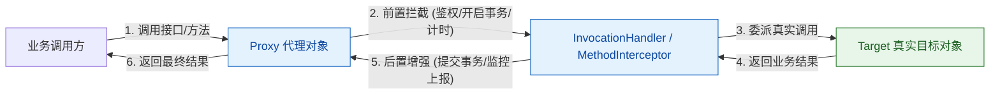
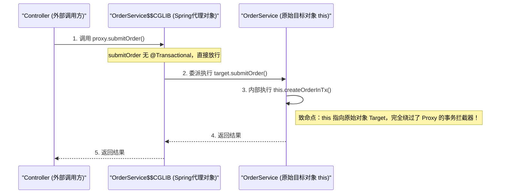
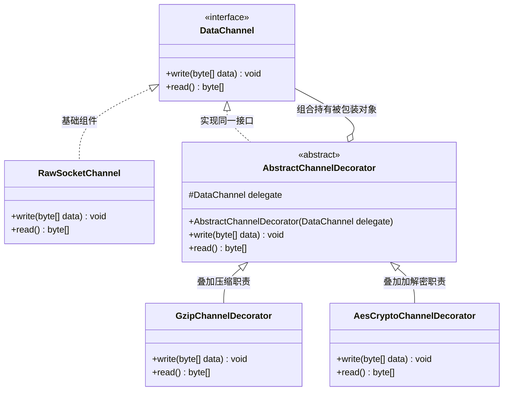
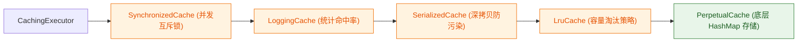
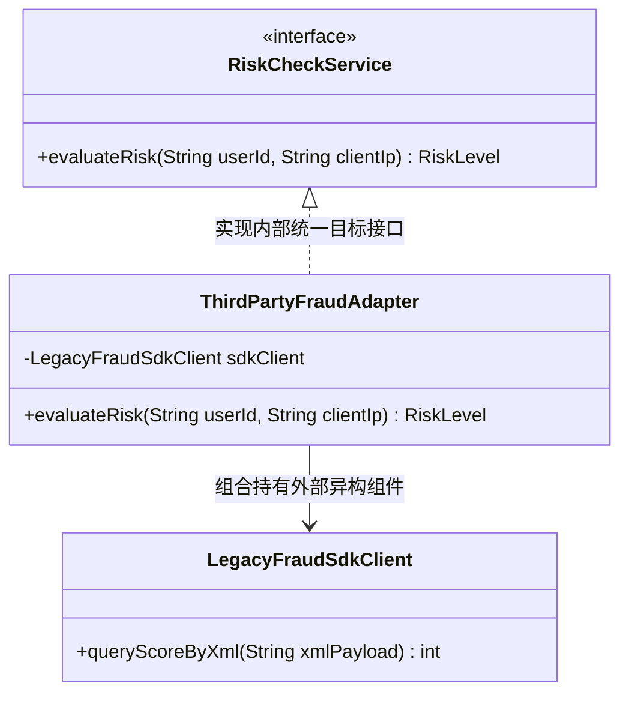
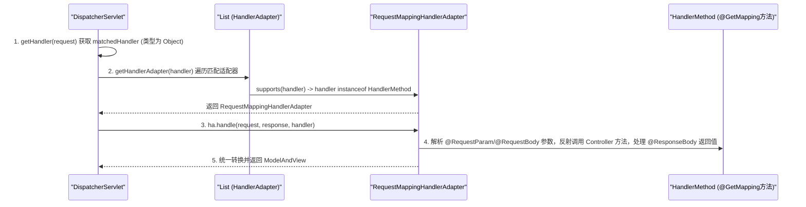
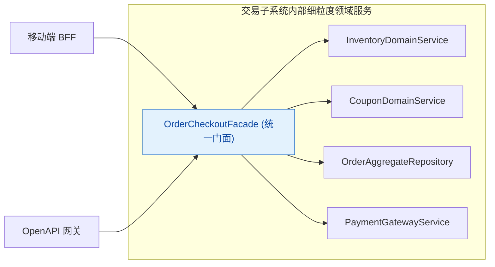
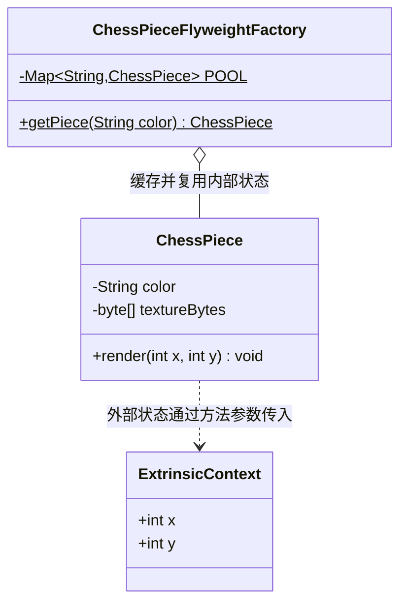

# 03 · 结构型模式：代理、装饰器、适配器、门面与享元

> **核心结论**：结构型模式（Structural Patterns）的第一性原理是**以对象组合（Composition）与职责委派（Delegation）替代僵化的类继承体系**。在不侵入原有类核心业务代码的前提下，通过代理拦截、层层装饰、契约适配、入口收敛与状态共享，实现非功能性横切关注点解耦、功能动态叠加以及异构组件无缝集成，是合成复用原则（CRP）与开闭原则（OCP）在架构设计中的核心落地。

---

> **扩展阅读**：本篇讲解结构型中的 5 种。桥接（独立维度）与组合（部分—整体树）在 [[07-结构型扩展-桥接与组合]] 中补全，含完整 Java 示例、角色、优缺点和面试辨析。

## 一、 代理模式（Proxy Pattern）

### 1. 解决的核心耦合与工程痛点

在企业级后端开发中，核心业务方法（如创建订单、资金划拨）除了领域计算外，往往需要配套执行**事务开启与回滚、分布式锁加解锁、接口权限鉴权、慢调用监控埋点、远程 RPC 序列化通信**等非功能性逻辑（即横切关注点，Cross-Cutting Concerns）。

如果将这些横切代码直接硬编码在每个业务 Service 方法内部：
1. **职责严重混杂**：核心业务逻辑被淹没在大量的 `try-catch-finally`、日志打印与事务模板代码中，违反单一职责原则（SRP）。
2. **代码高度重复且难以维护**：一旦监控上报格式或权限校验规则发生调整，被迫修改成百上千个业务方法。

代理模式通过提供一个与目标对象（Target）具有相同契约的**代理对象（Proxy）**，由代理对象接管客户端请求，在委派调用真实目标方法的前后统一织入横切控制逻辑。

### 2. 核心结构与三种代理形态对比



#### （1）静态代理（Static Proxy）
代理类与目标类实现同一个业务接口，由开发者显式编写代理类源码并在编译期生成 `.class` 文件。其局限性在于：每当业务接口新增一个方法，或者有几十个不同的 Service 接口需要相同的监控逻辑时，都必须手动编写大量重复的代理类代码，仅适用于被代理接口极少且固定的场景。

#### （2）JDK 动态代理（JDK Dynamic Proxy）
利用反射机制在运行时动态在内存中生成代理类的字节码（类名为 `$Proxy0`、`$Proxy1` 等）。
- **核心机制**：生成的 `$Proxy0` 类默认继承了 `java.lang.reflect.Proxy` 类并实现了目标接口列表。由于 Java 是单继承语言，**JDK 动态代理要求目标类必须至少实现一个接口**。
- **调用转发**：代理类中所有接口方法的实现均被重写为调用 `super.h.invoke(this, m3, new Object[]{...})`，即将请求统一收口到自定义的 `InvocationHandler#invoke` 方法中处理。

```java
import java.lang.reflect.InvocationHandler;
import java.lang.reflect.InvocationTargetException;
import java.lang.reflect.Method;
import java.lang.reflect.Proxy;

public class MetricsJdkProxyFactory {

    @SuppressWarnings("unchecked")
    public static <T> T createProxy(T target, Class<T> interfaceType) {
        return (T) Proxy.newProxyInstance(
                interfaceType.getClassLoader(),
                new Class<?>[]{interfaceType},
                new MetricsInvocationHandler(target)
        );
    }

    private static class MetricsInvocationHandler implements InvocationHandler {
        private final Object target;

        private MetricsInvocationHandler(Object target) {
            this.target = target;
        }

        @Override
        public Object invoke(Object proxy, Method method, Object[] args) throws Throwable {
            // Object 基类方法（equals / hashCode / toString）直接放行，不执行切面逻辑
            if (method.getDeclaringClass() == Object.class) {
                return method.invoke(target, args);
            }
            long startNanos = System.nanoTime();
            try {
                // 委派执行真实目标对象方法
                return method.invoke(target, args);
            } catch (InvocationTargetException ex) {
                // 必须拆包抛出真实业务异常，避免被 UndeclaredThrowableException 包装掩盖
                throw ex.getTargetException();
            } finally {
                long costMs = (System.nanoTime() - startNanos) / 1_000_000;
                System.out.printf("[Metrics] Method %s.%s executed in %d ms%n",
                        target.getClass().getSimpleName(), method.getName(), costMs);
            }
        }
    }
}
```

#### （3）CGLIB 动态代理（Code Generation Library）
当目标类没有实现任何接口时，使用基于 ASM 字节码操作框架的 CGLIB（Spring Core 已内置打包为 `org.springframework.cglib`）。
- **核心机制**：在运行时动态生成**目标类的子类**（如 `OrderService$$EnhancerBySpringCGLIB$$a1b2c3`），重写父类中所有非 `final`、非 `private`、非 `static` 的方法，并在重写方法中织入 `MethodInterceptor#intercept` 拦截调用。
- **`FastClass` 机制**：早期反射调用存在一定开销，CGLIB 引入了 `FastClass` 机制——为代理类和目标类分别额外生成一个索引类，将类的所有方法按签名建立 `int index` 映射表。当调用 `methodProxy.invokeSuper(obj, args)` 时，直接通过 `switch(index)` 定位并调用目标类的对应方法，完全避开了传统 `Method#invoke` 的反射检查开销。
- **使用限制**：由于底层依赖子类继承与方法重写，**CGLIB 无法代理被 `final` 修饰的类，也无法拦截 `final`、`private` 或 `static` 方法**。

#### （4）三种代理技术全方位对比表

| 对比维度 | 静态代理 | JDK 动态代理 | CGLIB 动态代理 |
| :--- | :--- | :--- | :--- |
| **字节码生成时机** | 编译期（手写源码或 APT 生成） | 运行时动态生成（`ProxyGenerator`） | 运行时动态生成（基于 ASM 框架） |
| **实现原理与限制** | 实现相同接口 | 继承 `Proxy` 并实现业务接口；**目标类必须有接口** | 继承目标类生成子类；**目标类及方法不能是 `final`** |
| **核心拦截接口** | 无（硬编码调用） | `java.lang.reflect.InvocationHandler` | `org.springframework.cglib.proxy.MethodInterceptor` |
| **目标方法调用方式** | 直接调用 `target.method()` | 反射调用 `method.invoke(target, args)` | `FastClass` 索引直接调用 `methodProxy.invokeSuper` |
| **典型源码应用** | 早期 Wrapper 封装 | MyBatis Mapper 代理、OpenFeign 客户端、Spring AOP（有接口） | Spring AOP（无接口或默认配置）、`@Configuration` 配置类增强 |

### 3. 源码印证：Spring AOP 选型机制与同类自调用失效深度剖析

#### （1）Spring AOP 代理工厂选型逻辑（`DefaultAopProxyFactory`）
在 Spring 源码 `DefaultAopProxyFactory#createAopProxy` 中：
1. 如果目标类实现了业务接口，且未开启 `proxyTargetClass = true`，则创建 `JdkDynamicAopProxy`；
2. 如果目标类没有实现任何接口，或者配置了 `proxyTargetClass = true`，则创建 `ObjenesisCglibAopProxy`（借助 `Objenesis` 绕过构造器直接实例化 CGLIB 代理对象，避免构造器被重复执行两次）。
3. **版本演进注意**：从 **Spring Boot 2.0** 开始，自动配置属性 `spring.aop.proxy-target-class` 的默认值已从 `false` 改为 **`true`**，即默认统一采用 CGLIB 动态代理，以防止开发者将 Bean 注入为具体类类型（而非接口类型）时发生 `ClassCastException`。

#### （2）为什么同类内部方法自调用会导致 `@Transactional` / `@Async` 失效？

在生产排查中，最常见的代理失效事故是：在同一个 `OrderService` 类中，一个无事务的入口方法 `submitOrder()` 直接调用了本类中标注了 `@Transactional` 的 `createOrderInTx()` 方法，发生异常时数据库事务完全没有回滚。



**根本原因**：Spring 的 `@Transactional`、`@Async`、`@Cacheable` 均基于动态代理实现。只有当调用请求**穿过代理对象 `Proxy` 的入口**时，才会触发 `TransactionInterceptor` 开启事务。而在进入 `target.submitOrder()` 方法内部后，Java 隐式传递的 `this` 引用指向的是**未经过增强的原始目标对象 `Target`**，直接调用 `this.createOrderInTx()` 属于普通对象内部方法调用，根本不会经过 `Proxy`。

**三种工程级修复方案（按推荐优先级排序）**：
1. **方案一（架构首选，遵循 SRP）**：将需要独立事务或异步执行的方法抽离到另一个独立的 Bean（如 `OrderTxManager` 或 `OrderCoreService`）中，通过构造器注入调用。
2. **方案二（自注入代理引用）**：在当前类中通过 `@Autowired @Lazy private OrderService selfProxy;` 注入自身的代理对象，使用 `selfProxy.createOrderInTx()` 替代 `this` 调用。
3. **方案三（暴露线程上下文代理）**：在启动类标注 `@EnableAspectJAutoProxy(exposeProxy = true)`，在方法内通过 `((OrderService) AopContext.currentProxy()).createOrderInTx()` 获取当前代理对象。

---

## 二、 装饰器模式（Decorator Pattern）

### 1. 解决的核心耦合与工程痛点

假设系统中有一个基础的数据导出流或缓存组件 `DataRepository`，业务上需要支持以下几种可选增强能力的任意组合：**① GZIP 数据压缩**、**② AES 敏感字段加密**、**③ 本地热点缓存**、**④ 读写耗时监控**。

如果采用**类继承（Inheritance）**来扩展：
- 我们需要编写 `GzipDataRepository`、`AesDataRepository`、`GzipAndAesDataRepository`、`CachedGzipAndAesDataRepository`……
- 4 种可选能力的排列组合会产生 $2^4 = 16$ 个子类！一旦新增第 5 种能力（如幂等校验），子类数量直接翻倍（**子类爆炸，Class Explosion**），且组合顺序在编译期被死死焊死，无法在运行时按配置动态增删某层功能。

**装饰器模式（Decorator Pattern）**通过让装饰器类与被装饰类实现**同一个抽象接口（Component）**，并在装饰器内部**持有同一个接口类型的引用**，从而支持像套娃一样在运行时将任意多个功能装饰器动态嵌套组合。

### 2. 核心结构与“代理模式 vs 装饰器模式”本质辨析




#### （3）用一段代码看懂“包装”

下面的 `GzipDecorator` 和 `AuditDecorator` 都实现 `DataChannel`，同时各自持有一个 `DataChannel`。因此，内部对象既可以是原始组件，也可以是另一个装饰器：

```java
interface DataChannel {
    void write(byte[] data);
}

final class RawChannel implements DataChannel {
    @Override
    public void write(byte[] data) {
        System.out.println("写入底层存储");
    }
}

final class GzipDecorator implements DataChannel {
    private final DataChannel delegate;

    GzipDecorator(DataChannel delegate) {
        this.delegate = delegate;
    }

    @Override
    public void write(byte[] data) {
        byte[] compressed = compress(data);
        delegate.write(compressed);
    }

    private byte[] compress(byte[] data) {
        return data; // 示例省略压缩实现
    }
}

final class AuditDecorator implements DataChannel {
    private final DataChannel delegate;

    AuditDecorator(DataChannel delegate) {
        this.delegate = delegate;
    }

    @Override
    public void write(byte[] data) {
        System.out.println("记录写入审计");
        delegate.write(data);
    }
}

DataChannel channel = new AuditDecorator(
        new GzipDecorator(
                new RawChannel()
        )
);
channel.write("hello".getBytes());
```

预期输出：

```text
记录写入审计
写入底层存储
```

调用顺序是：`AuditDecorator` → `GzipDecorator` → `RawChannel`。这就是“包装”：外层对象实现同一个接口，并持有内层对象，先增加自己的处理，再把调用委派给内层。
> [!IMPORTANT] 高频核心辨析：代理模式（Proxy）与装饰器模式（Decorator）在结构上都持有目标接口引用，它们的本质区别是什么？
>
> | 辨析维度 | 代理模式（Proxy Pattern） | 装饰器模式（Decorator Pattern） |
> | :--- | :--- | :--- |
> | **核心设计意图** | **控制访问与横切隔离**：管控对目标对象的访问权限、隐藏远程网络通信细节（RPC）、延迟初始化或附加事务控制，**不改变或增强业务核心功能本身**。 | **动态递归叠加功能职责**：在不采用继承的前提下，为对象动态添加可自由排列组合的业务增强能力（如压缩 + 加密 + 缓冲）。 |
> | **目标对象的透明度与创建权** | **对调用方隐藏**：调用方通常不知道也不关心目标对象是如何创建的（往往由代理内部创建或由 IoC 容器自动织入），调用方以为自己在直接调目标对象。 | **对调用方完全透明可控**：通常由调用方在外部**显式创建基础对象并层层传入装饰器构造器**进行组装（如 `new AesDecorator(new GzipDecorator(raw))`）。 |
> | **叠加层级特征** | 通常只有**单层代理**（或多切面合并成的单个代理实例）。 | 天然设计为**多层链式嵌套（Pipeline 式包裹）**，且调整包裹顺序会产生不同的组合效果（如“先压缩后加密”与“先加密后压缩”）。 |

### 3. 生产级 Java 代码实现（可插拔数据处理通道）

```java
import java.nio.charset.StandardCharsets;
import java.util.Base64;

// 1. 抽象组件接口
public interface DataStorage {
    void save(String key, byte[] payload);
    byte[] load(String key);
}

// 2. 具体基础组件（ConcreteComponent）：仅负责最纯粹的底层存储
public class MemoryDataStorage implements DataStorage {
    private final java.util.Map<String, byte[]> store = new java.util.concurrent.ConcurrentHashMap<>();

    @Override
    public void save(String key, byte[] payload) {
        store.put(key, payload);
    }

    @Override
    public byte[] load(String key) {
        return store.get(key);
    }
}

// 3. 抽象装饰器基类（Decorator）
public abstract class DataStorageDecorator implements DataStorage {
    protected final DataStorage delegate;

    protected DataStorageDecorator(DataStorage delegate) {
        this.delegate = java.util.Objects.requireNonNull(delegate);
    }

    @Override
    public void save(String key, byte[] payload) {
        delegate.save(key, payload);
    }

    @Override
    public byte[] load(String key) {
        return delegate.load(key);
    }
}

// 4. 具体装饰器 A：透明叠加编码/加密能力
public class Base64EncodingDecorator extends DataStorageDecorator {
    public Base64EncodingDecorator(DataStorage delegate) {
        super(delegate);
    }

    @Override
    public void save(String key, byte[] payload) {
        byte[] encoded = Base64.getEncoder().encode(payload);
        super.save(key, encoded);
    }

    @Override
    public byte[] load(String key) {
        byte[] encoded = super.load(key);
        return encoded != null ? Base64.getDecoder().decode(encoded) : null;
    }
}

// 5. 具体装饰器 B：透明叠加读写审计与非空校验能力
public class AuditLoggingDecorator extends DataStorageDecorator {
    public AuditLoggingDecorator(DataStorage delegate) {
        super(delegate);
    }

    @Override
    public void save(String key, byte[] payload) {
        System.out.printf("[Audit] Saving key=%s, bytes=%d%n", key, payload.length);
        super.save(key, payload);
    }

    @Override
    public byte[] load(String key) {
        byte[] data = super.load(key);
        System.out.printf("[Audit] Loaded key=%s, hit=%b%n", key, data != null);
        return data;
    }
}
```

调用方可以像搭积木一样按需组合：
```java
// 组合方式：先审计日志 -> 再 Base64 编码 -> 最终落入底层存储
DataStorage storage = new AuditLoggingDecorator(
        new Base64EncodingDecorator(
                new MemoryDataStorage()
        )
);
storage.save("user:1001", "sensitive_token".getBytes(StandardCharsets.UTF_8));
```

### 4. 源码印证：Java I/O 流体系与 MyBatis 二级缓存装饰器链

#### （1）JDK `java.io.InputStream` 装饰器体系
在 Java 标准 I/O 库中，`InputStream` 是顶层抽象组件：
- **基础数据源组件（ConcreteComponent）**：`FileInputStream`、`ByteArrayInputStream`、`SocketInputStream`，负责从物理文件、内存字节数组或网络套接字读取原始字节。
- **抽象装饰器基类**：`FilterInputStream` 继承自 `InputStream`，并且内部持有了 `protected volatile InputStream in` 字段。
- **具体功能装饰器**：
  - `BufferedInputStream`：内部维护 `byte[] buf` 缓冲区，为底层流叠加预读缓冲能力，减少系统调用次数；
  - `DataInputStream`：叠加按基本数据类型（`readInt()`、`readLong()`、`readUTF()`）解析字节的能力；
  - `GZIPInputStream`：叠加流式解压能力。
  调用时通过 `new DataInputStream(new BufferedInputStream(new FileInputStream("data.bin")))` 完成多层功能组装。

#### （2）MyBatis `org.apache.ibatis.cache.Cache` 装饰器链（工业级典范）
MyBatis 的缓存模块没有使用任何类继承，而是纯粹通过实现 `Cache` 接口构建了一套高度解耦的装饰器体系：



查看 `org.apache.ibatis.mapping.CacheBuilder#build` 源码：
- 唯一的基础存储实现类是 **`PerpetualCache`**，其内部仅仅封装了一个普通的 `private Map<Object, Object> cache = new HashMap<>()`，不包含任何淘汰、同步、统计或序列化代码。
- `CacheBuilder#setStandardDecorators` 根据配置项，依次将 `PerpetualCache` 用 `LruCache`（淘汰策略） -> `ScheduledCache`（定时清理） -> `SerializedCache`（序列化深拷贝） -> `LoggingCache`（日志与命中率统计） -> `SynchronizedCache`（线程安全同步）层层包裹。每个装饰器类代码量均不超过 100 行，单一职责极其纯粹。

### 5. 适用边界与反过度设计建议

- 当组件的附加功能只有固定的 1~2 种且无需动态组合时，直接通过配置开关或简单组合即可，无需强行抽象出装饰器基类体系。
- 注意**装饰器包裹顺序的敏感性**：例如在流处理中，“先压缩再加密”与“先加密再压缩”的结果完全不同（加密后的高熵密文几乎无法被压缩），在工程组装时建议通过 Builder 或工厂方法固化标准装饰顺序，避免业务方组装顺序错误。

---

## 三、 适配器模式（Adapter Pattern）

### 1. 解决的核心耦合与工程痛点

在系统演进与外部集成过程中，经常遇到**接口契约不兼容**的场景：
1. **接入多厂商异构第三方 SDK**：系统内部定义了统一的短信发送或风控核验接口，但供应商 A 的 SDK 方法名为 `sendSms(String phone, String jsonTemplate)`，供应商 B 的 SDK 方法名为 `submitMessage(SmsReqPack pack)`，且我们无法修改第三方 Jar 包源码。
2. **老系统接口平滑重构升级**：新版本架构定义了全新的领域服务接口，但仍需兼容历史遗留模块的旧版处理器类。

如果为了兼容外部 SDK 而直接修改本系统的核心业务代码，会导致外部供应商的畸形命名与专有数据结构侵入核心领域层（违反依赖倒置原则与防腐层设计准则）。**适配器模式（Adapter Pattern）**充当中间转换层（即 DDD 中的防腐层 ACL），将不兼容的外部接口（Adaptee）封装转换为本系统期望的目标接口（Target）。

### 2. 核心结构：对象适配器 vs 类适配器

适配器分为**类适配器（基于继承）**与**对象适配器（基于组合委派）**。由于 Java 不支持多继承且继承会将 `Adaptee` 的所有内部方法暴露给子类，**生产环境中一律采用对象适配器**。



### 3. 生产级 Java 代码实现（外部异构 SDK 防腐层适配）

```java
// 1. 本系统核心领域层定义的标准目标接口（Target）
public interface RiskControlClient {
    boolean isHighRiskUser(Long userId, String loginIp);
}

// 2. 第三方厂商提供的异构 SDK 类（Adaptee，来自外部 Jar 包，不可修改源码）
public class ExternalShieldSdk {
    // 参数格式与返回值语义均与本系统不兼容（返回 0~1000 的整形风险分）
    public int checkUserSecurityScore(String uidStr, String ipv4, int sceneCode) {
        // 模拟第三方 SDK 内部通信
        return ipv4.startsWith("10.") ? 100 : 850;
    }
}

// 3. 对象适配器（Adapter）：隔离外部协议转换细节，保护核心领域纯洁性
public class ExternalShieldRiskAdapter implements RiskControlClient {
    private static final int LOGIN_SCENE_CODE = 101;
    private static final int HIGH_RISK_SCORE_THRESHOLD = 800;

    private final ExternalShieldSdk externalSdk;

    public ExternalShieldRiskAdapter(ExternalShieldSdk externalSdk) {
        this.externalSdk = externalSdk;
    }

    @Override
    public boolean isHighRiskUser(Long userId, String loginIp) {
        // 1. 入参协议转换：Long -> String，补充第三方特有的 sceneCode
        String uidStr = String.valueOf(userId);
        // 2. 委派调用 Adaptee
        int score = externalSdk.checkUserSecurityScore(uidStr, loginIp, LOGIN_SCENE_CODE);
        // 3. 出参语义转换：将第三方风险分转换为本系统标准的布尔判定
        return score >= HIGH_RISK_SCORE_THRESHOLD;
    }
}
```

### 4. 源码印证：Spring MVC `HandlerAdapter` 与 JDK I/O 适配

#### （1）Spring MVC `HandlerAdapter`（适配器模式最经典的框架级应用）
在 Spring MVC 中，`DispatcherServlet#doDispatch` 是所有 HTTP 请求的核心分发器。但是，Spring MVC 历史上支持多种完全不同形态的处理器（Handler）：
1. 现代最常用的 **`@RequestMapping` 注解方法**：映射解析后对应的 Handler 对象类型是 `HandlerMethod`；
2. 实现 **`org.springframework.web.servlet.mvc.Controller`** 接口的类（方法签名为 `ModelAndView handleRequest(req, resp)`）；
3. 实现 **`HttpRequestHandler`** 接口的类（方法签名为 `void handleRequest(req, resp)`，无返回值）；
4. 标准的 **`jakarta.servlet.Servlet`** 实例或 WebFlux 函数式路由端点 `RouterFunction`。

由于这些 Handler 彼此之间**没有任何共同的业务接口，方法签名也完全不同**，如果 `DispatcherServlet` 直接去调用它们，就必须在 `doDispatch` 主流程里写满 `if (handler instanceof HandlerMethod) ... else if (handler instanceof Controller) ...`，每新增一种处理器写法就要修改 `DispatcherServlet` 核心源码！

为此，Spring MVC 引入了 **`HandlerAdapter`** 统一目标接口：



查看 `DispatcherServlet` 与 `HandlerAdapter` 核心源码契约：
```java
public interface HandlerAdapter {
    // 判断当前适配器是否支持该类型的 Handler
    boolean supports(Object handler);

    // 统一执行契约：屏蔽不同 Handler 的调用差异，统一返回 ModelAndView
    @Nullable
    ModelAndView handle(HttpServletRequest request, HttpServletResponse response, Object handler) throws Exception;
}
```
通过这一层适配，`DispatcherServlet#doDispatch` 始终只需要面向 `HandlerAdapter#handle` 这一行稳定代码编程，完美践行了**开闭原则（OCP）**。

#### （2）JDK 中的经典适配器
- **`java.io.InputStreamReader` 与 `OutputStreamWriter`**：`InputStreamReader` 继承自字符流抽象类 `Reader`（Target），内部组合持有了字节流 `InputStream`（Adaptee，通过 `StreamDecoder` 封装），将底层的字节读取接口适配转换为按字符编码读取的 `Reader` 接口。
- **`java.util.concurrent.Executors#callable(Runnable task, T result)`**：内部通过 `RunnableAdapter<T>` 实现 `Callable<T>` 接口并组合持有 `Runnable` 实例，将无返回值的 `Runnable` 适配为带返回值的 `Callable`。

### 5. 适用边界与反过度设计建议

- **新系统内部模块设计严禁使用适配器**：适配器模式本质上是**应对既有不兼容接口的补救或防腐隔离手段**。如果两个模块都在当前团队的控制范围内且处于新开发阶段，应当直接统一双方的接口契约，而不是设计两个不兼容的接口再写一个 Adapter 去转换。

---

## 四、 门面模式（Facade Pattern）与享元模式（Flyweight Pattern）

### 1. 门面模式（Facade Pattern）：收敛复杂子系统边界

#### （1）解决的核心痛点与结构
当一个底层子系统包含十几个细粒度组件（例如电商下单涉及库存预扣、优惠券核销、风控校验、订单主表落库、支付单生成、领域事件发布），或者底层存在多个历史模块时，若让上层 Controller 或外部微服务直接按顺序调用这十几个细粒度接口，会导致调用方与子系统内部实现细节强耦合，严重违反**迪米特法则（最少知识原则，LoD）**。

**门面模式**通过在子系统外部提供一层高内聚、粗粒度的统一入口（Facade），将子系统内部的组件协同编排隐藏在门面背后。



#### （2）源码与架构印证
1. **SLF4J（Simple Logging Facade for Java）日志门面**：
   Java 生态中存在 Logback、Log4j2、`java.util.logging` 等多种日志实现框架，且不同第三方依赖包可能各自使用了不同的日志 API。SLF4J 提供了统一的门面接口 `org.slf4j.Logger` 与 `LoggerFactory`。业务代码全部面向 SLF4J 门面接口打印日志，部署时只需更换底层桥接与绑定依赖即可无缝切换日志引擎，业务代码零改动。
2. **Tomcat `RequestFacade` 与 `ResponseFacade`**：
   Tomcat 内部的 `org.apache.catalina.connector.Request` 类包含了大量容器内部管理方法（如 `getConnector()`、`setContext()`）。如果直接将该对象转型并传给业务 Servlet 的 `doGet(HttpServletRequest req)`，业务开发者就能通过强转调用容器内部方法破坏安全性。因此 Tomcat 使用 `RequestFacade` 包装内部 `Request`，仅对外暴露标准的 `HttpServletRequest` 接口方法。

---

### 2. 享元模式（Flyweight Pattern）：分离内外部状态实现细粒度复用

#### （1）解决的核心痛点与内外部状态拆解
当系统中需要高频创建大量细粒度对象，且这些对象中很大一部分字段值是完全重复的（例如：在线文档编辑器中的百万个字符渲染节点、棋盘游戏中的海量棋子对象、高频交易中的基础货币元数据）时，若每个实例都完整保存所有字段，会迅速撑爆堆内存。

享元模式的核心原理是将对象的属性拆分为两类：
1. **内部状态（Intrinsic State）**：不随外部环境或上下文改变、可被多个场景安全共享的**不可变属性**（如棋子的颜色与形状纹理、字符的字体字号元数据）。存储在享元对象内部，全局只保留一份。
2. **外部状态（Extrinsic State）**：随每次调用上下文动态变化、不可共享的属性（如棋子在棋盘上的实时坐标 `(x, y)`、字符在文档中的行列位置）。**从享元对象中剥离，由调用方在调用方法时通过参数传入**。



#### （2）生产级代码示例

```java
import java.util.Map;
import java.util.concurrent.ConcurrentHashMap;

// 享元类：仅保存不可变的内部状态（Intrinsic State）
public final class ChessPiece {
    private final String color;       // 内部状态：黑子 / 白子
    private final String shapeModel;  // 内部状态：渲染模型标识

    public ChessPiece(String color, String shapeModel) {
        this.color = color;
        this.shapeModel = shapeModel;
    }

    // 外部状态（Extrinsic State：坐标 x, y）通过方法参数传入，不在享元内部保存
    public void renderOnBoard(int x, int y) {
        System.out.printf("Render [%s - %s] at coordinate (%d, %d)%n", color, shapeModel, x, y);
    }
}

// 享元工厂：利用 ConcurrentHashMap 管理享元池
public final class ChessPieceFactory {
    private static final Map<String, ChessPiece> FLYWEIGHT_POOL = new ConcurrentHashMap<>(4);

    private ChessPieceFactory() {}

    public static ChessPiece getChessPiece(String color) {
        return FLYWEIGHT_POOL.computeIfAbsent(color, c -> new ChessPiece(c, "Standard3DMesh_v1"));
    }
}
```

#### （3）源码印证：JDK 包装类缓存池与“享元 vs 连接池”本质对比

1. **JDK `Integer.valueOf(int i)` 与 `IntegerCache` 源码剖析**：
   ```java
   @IntrinsicCandidate
   public static Integer valueOf(int i) {
       // 默认 low = -128, high = 127（可通过 JVM 参数 -XX:AutoBoxCacheMax=<size> 调整上限）
       if (i >= IntegerCache.low && i <= IntegerCache.high)
           return IntegerCache.cache[i + (-IntegerCache.low)];
       return new Integer(i);
   }
   ```
   当使用自动装箱 `Integer a = 127; Integer b = 127;` 时，编译后会转换为调用 `Integer.valueOf(127)`，直接从 `IntegerCache.cache` 静态数组中返回预先创建好的同一个享元实例，因此 `a == b` 为 `true`；而当值为 `128`（默认配置下超出缓存范围）时，每次都会 `new Integer(128)`，故 `a == b` 为 `false`（**工程铁律：包装类型比较数值相等必须使用 `Objects.equals` 或 `.intValue()`，严禁使用 `==`**）。同理，`LongCache`、`ShortCache`、`ByteCache`、`CharacterCache`（`0 ~ 127`）以及 JVM 字符串常量池（String Table）均采用了享元模式。

2. **深度辨析：标准享元模式（Flyweight） vs 资源池化技术（Connection Pool / Thread Pool）**：

| 对比维度 | 标准享元模式（如 `IntegerCache`、`String` 常量池） | 资源池化技术（如 HikariCP 连接池、线程池） |
| :--- | :--- | :--- |
| **共享方式** | **空间并发共享（Concurrent Sharing）**：同一个享元实例在同一时刻被成百上千个线程**同时持有并读取**。 | **时间分片独占复用（Temporal Pooling）**：池中实例在某一时刻被某个线程借出（Borrow）后处于**独占状态**，使用完毕归还（Return）后才能被下一线程借用。 |
| **对象可变性** | 内部状态**绝对不可变（Immutable）**，无状态污染风险。 | 对象自身带有可变会话/运行状态（如事务自动提交标志、Socket 缓冲区），归还池时需重置状态。 |
| **解决的核心问题** | 降低海量细粒度相似对象的**堆内存占用**。 | 规避重量级昂贵资源（TCP 三次握手、数据库连接认证、内核线程创建）的**初始化耗时**。 |

---

## 五、 高频面试自测

> [!question]- Q1：JDK 动态代理和 CGLIB 动态代理在底层实现、使用限制和性能上有什么区别？Spring Boot 是如何选择的？
> 1. **底层原理与限制**：
>    - **JDK 动态代理**：通过 `Proxy.newProxyInstance` 在运行时动态生成继承自 `java.lang.reflect.Proxy` 并实现了业务接口的 `$Proxy0` 类，通过 `InvocationHandler#invoke` 反射调用目标方法。因 Java 单继承限制，**要求目标类必须实现接口**。
>    - **CGLIB 动态代理**：基于 ASM 字节码框架在运行时动态生成**目标类的子类**，重写父类方法并织入 `MethodInterceptor#intercept`，结合 `FastClass` 索引机制直接调用目标方法。因依赖继承重写，**无法代理 `final` 类以及 `final`、`private`、`static` 方法**。
> 2. **性能演进**：在早期 JDK 版本中，CGLIB 凭借 `FastClass` 机制调用性能高于 JDK 反射；但从 JDK 8 以后，JDK 反射内部引入了字节码动态生成优化（当调用次数超过阈值 `sun.reflect.inflationThreshold=15` 时动态生成 `GeneratedMethodAccessor` 字节码直接调用），两者在运行期调用性能上已处于同一量级。
> 3. **Spring Boot 选型**：自 Spring Boot 2.0 起，`spring.aop.proxy-target-class` 默认设为 `true`，即无论目标类是否实现接口，**默认统一采用 CGLIB 动态代理**，从而允许开发者直接按具体实现类类型注入 Bean。

> [!question]- Q2：代理模式（Proxy）和装饰器模式（Decorator）在类图结构上几乎一样，它们的核心区别是什么？请结合 JDK 或框架源码举例说明。
> 1. **设计意图不同**：
>    - **代理模式**的核心是**访问控制与横切关注点隔离**（如权限拦截、事务开启回滚、远程 RPC 通信屏蔽、延迟加载），重点在于控制对目标对象的访问，而不改变原接口的业务功能。例如 Spring AOP 的 `TransactionInterceptor`、MyBatis 的 `MapperProxy`。
>    - **装饰器模式**的核心是**动态、可嵌套地叠加扩展对象功能**，以组合替代继承避免子类爆炸。例如 Java I/O 的 `new BufferedInputStream(new FileInputStream(file))` 以及 MyBatis 二级缓存的 `SynchronizedCache -> LoggingCache -> SerializedCache -> LruCache -> PerpetualCache` 装饰链。
> 2. **对象关系确定方式不同**：
>    - **代理模式**中，调用方通常不感知真实目标对象的创建过程（由代理或容器在内部管控关联），且一般只有单层代理；
>    - **装饰器模式**中，通常由调用方（或专门的 Builder）显式创建基础组件实例，并将其作为构造参数层层传入多个装饰器中进行链式包装。

> [!question]- Q3：Spring MVC 的 `DispatcherServlet` 是如何运用适配器模式（`HandlerAdapter`）的？为什么不直接调用 Controller？
> 1. **背景痛点**：Spring MVC 支持多种完全异构的处理器（Handler）编写方式，包括基于 `@RequestMapping` 注解的方法（`HandlerMethod`）、实现 `Controller` 接口的类、实现 `HttpRequestHandler` 接口的类以及标准 `Servlet`。这些处理器之间没有任何共同的父接口，方法入参和返回值签名也截然不同。
> 2. **解耦机制**：如果 `DispatcherServlet#doDispatch` 直接调用 Handler，就必须编写大量 `instanceof` 分支判断，每次新增一种处理器类型都要修改 `DispatcherServlet` 核心代码。通过引入 `HandlerAdapter` 目标接口（定义 `boolean supports(Object handler)` 和 `ModelAndView handle(req, resp, handler)`），每种处理器类型配备专属的适配器（如 `RequestMappingHandlerAdapter` 负责解析注解参数并反射调用方法）。`DispatcherServlet` 只需遍历匹配 `supports(handler)` 为 `true` 的适配器并调用其 `handle()` 方法，从而使核心分发流程对处理器类型的扩展完全满足**开闭原则（OCP）**。

> [!question]- Q4：为什么 `Integer a = 100; Integer b = 100; a == b` 为 `true`，而 `Integer c = 200; Integer d = 200; c == d` 为 `false`？这体现了什么设计模式？
> 1. **体现的设计模式**：体现了**享元模式（Flyweight Pattern）**。
> 2. **源码原因**：Java 自动装箱在字节码层面会编译为调用 `Integer.valueOf(int i)`。在 `Integer.valueOf` 源码中，JDK 内部维护了一个静态内部类 `IntegerCache`，在类加载时预先实例化并缓存了 **`-128` 到 `127`**（上限可通过 `-XX:AutoBoxCacheMax` 调整）之间的所有 `Integer` 不可变享元对象。
>    - 当赋值为 `100` 时，命中 `IntegerCache` 缓存区间，直接返回缓存数组中同一个 `Integer` 对象引用，因此引用地址比较 `a == b` 为 `true`；
>    - 当赋值为 `200` 时，超出默认缓存区间，`valueOf` 会每次执行 `new Integer(200)` 在堆上分配新对象，两个变量引用地址不同，因此 `c == d` 为 `false`。在业务代码中比较包装类数值必须使用 `Objects.equals(c, d)`。

---

## 🔗 章节导航
- **上一篇**：[[02-创建型模式-单例-工厂-建造者-原型]]
- **扩展阅读**：[[07-结构型扩展-桥接与组合]]
- **下一篇**：[[04-行为型模式上-策略-模板方法-责任链]]
