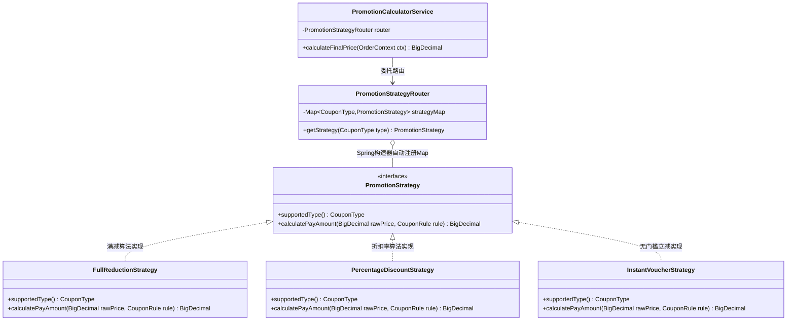
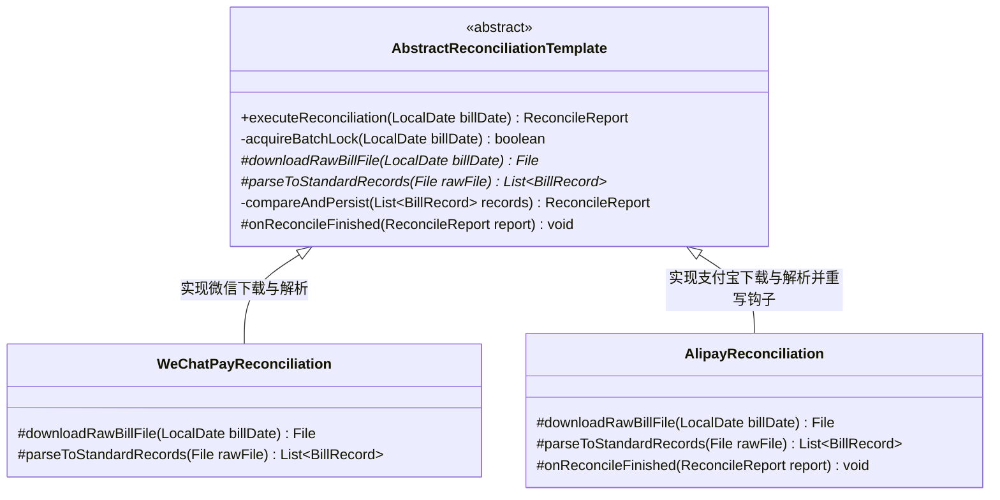

# 04 · 行为型模式（上）：策略、模板方法与责任链

> **核心结论**：行为型模式（Behavioral Patterns）的第一性原理是**将运行时算法的选择、主干流程的编排以及请求的处理链路从单一庞大的过程式方法中解耦出来**。在企业级 Java 后端研发中，**策略模式（横向隔离平行算法）**、**模板方法模式（纵向固化主干骨架）**与**责任链模式（串联可插拔处理节点）**是使用频次最高、重构复杂业务逻辑最核心的三大模式。

---

## 一、 策略模式（Strategy Pattern）

### 1. 解决的核心耦合与工程痛点

在电商促销算价、多渠道支付路由、多格式文件解析、阶梯税率计算等场景中，同一个业务动作往往存在多种平行的计算规则或渠道实现。如果将所有规则直接写在一个长方法的 `if-else` 或 `switch-case` 分支中：

1. **违反开闭原则（OCP）与单一职责原则（SRP）**：核心算价类会迅速膨胀至数千行，每新增一种优惠券类型或调整某一个渠道的参数逻辑，都必须直接修改核心类的源码，极易破坏已稳定运行的其他分支。
2. **多人协作冲突与单测困难**：多个开发人员同时修改同一个大分支方法会导致频繁的 Git 合并冲突；且由于所有分支依赖耦合在同一个类中，无法针对单一算法进行轻量级隔离单元测试。

**策略模式（Strategy Pattern）**通过定义统一的算法族抽象契约（`Strategy`），将每个分支算法独立封装为互不干扰的具体策略类（`ConcreteStrategy`），使算法的变化独立于使用算法的业务客户端。

### 2. 核心结构图



### 3. 生产级 Spring 自动注册与无分支路由完整实现

在现代 Spring Boot 工程中，使用策略模式**切忌在调用处写 `switch` 去获取策略对象**，而应当结合 Spring 的集合依赖注入机制，实现策略类的**自动发现、防重校验与 $O(1)$ 查表路由**：

```java
import org.springframework.stereotype.Component;
import java.math.BigDecimal;
import java.math.RoundingMode;
import java.util.EnumMap;
import java.util.List;
import java.util.Map;

// 1. 策略标识枚举
public enum CouponType {
    FULL_REDUCTION,      // 满减券
    PERCENTAGE_DISCOUNT, // 折扣券
    INSTANT_VOUCHER      // 立减代金券
}

// 2. 策略抽象契约接口
public interface PromotionStrategy {
    /**
     * 声明当前策略支持的类型标识（用于自动注册到路由表）
     */
    CouponType supportedType();

    /**
     * 执行核心优惠算价算法
     */
    BigDecimal calculatePayAmount(BigDecimal originalAmount, BigDecimal threshold, BigDecimal discountValue);
}

// 3. 具体策略实现 A：满减策略（满 threshold 减 discountValue）
@Component
public class FullReductionStrategy implements PromotionStrategy {
    @Override
    public CouponType supportedType() {
        return CouponType.FULL_REDUCTION;
    }

    @Override
    public BigDecimal calculatePayAmount(BigDecimal originalAmount, BigDecimal threshold, BigDecimal discountValue) {
        if (originalAmount.compareTo(threshold) >= 0) {
            return originalAmount.subtract(discountValue).max(BigDecimal.ZERO);
        }
        return originalAmount;
    }
}

// 4. 具体策略实现 B：折扣率策略（如 0.85 表示 85 折）
@Component
public class PercentageDiscountStrategy implements PromotionStrategy {
    @Override
    public CouponType supportedType() {
        return CouponType.PERCENTAGE_DISCOUNT;
    }

    @Override
    public BigDecimal calculatePayAmount(BigDecimal originalAmount, BigDecimal threshold, BigDecimal discountValue) {
        return originalAmount.multiply(discountValue).setScale(2, RoundingMode.HALF_UP);
    }
}

// 5. 策略路由器（结合简单工厂与 Spring 依赖注入，彻底消除 if-else）
@Component
public class PromotionStrategyRouter {
    // 使用 EnumMap 获得媲美数组的极高查询性能与最低内存开销
    private final Map<CouponType, PromotionStrategy> strategyRegistry = new EnumMap<>(CouponType.class);

    // Spring 启动时会自动将容器中所有 PromotionStrategy 实现类注入到 strategies 列表中
    public PromotionStrategyRouter(List<PromotionStrategy> strategies) {
        for (PromotionStrategy strategy : strategies) {
            CouponType type = strategy.supportedType();
            // 启动期防重校验：若两个策略类误配了相同的 CouponType，启动时立即快速失败（Fail-Fast）
            PromotionStrategy existing = strategyRegistry.put(type, strategy);
            if (existing != null) {
                throw new IllegalStateException("Duplicate PromotionStrategy registered for type: " + type);
            }
        }
    }

    public PromotionStrategy route(CouponType type) {
        PromotionStrategy strategy = strategyRegistry.get(type);
        if (strategy == null) {
            throw new IllegalArgumentException("No PromotionStrategy found for type: " + type);
        }
        return strategy;
    }
}
```

> [!TIP] 轻量级演进：何时使用函数式策略（Functional Strategy）？
> 如果每种策略仅仅是几行纯内存数学计算（不依赖数据库 Mapper 或外部 RPC 客户端），专门拆分出十几个 `.java` 文件反而会造成类文件碎片化。此时可直接将策略方法内聚在枚举中，或使用 `Map<CouponType, BiFunction<BigDecimal, CouponRule, BigDecimal>>` 配合 Lambda 表达式实现高内聚的函数式策略。

### 4. 源码印证：JDK 与 Spring 中的策略模式

1. **JDK `java.util.Comparator<T>`**：
   `Arrays.sort(T[] a, Comparator<? super T> c)` 中，归并排序（TimSort）的数组分治与合并主干流程完全固定，但“如何判定两个元素的大小关系”通过策略接口 `Comparator#compare(o1, o2)` 交由调用方动态传入，从而使同一套排序引擎可对任意对象按任意维度排序。
2. **JUC `ThreadPoolExecutor` 的拒绝策略（`RejectedExecutionHandler`）**：
   当线程池的核心线程、工作队列与最大线程全部饱和时，如何处置新提交的任务？`ThreadPoolExecutor` 定义了 `RejectedExecutionHandler` 策略接口（仅含一个方法 `rejectedExecution(Runnable r, ThreadPoolExecutor executor)`），并内置了四种标准策略实现：
   - `AbortPolicy`（默认策略）：直接抛出 `RejectedExecutionException`；
   - `CallerRunsPolicy`：由提交任务的调用者线程同步执行该任务，起到天然的背压限流作用；
   - `DiscardPolicy`：静默丢弃当前任务；
   - `DiscardOldestPolicy`：丢弃阻塞队列头部的最老任务，然后重试提交当前任务。
3. **Spring `InstantiationStrategy`（Bean 实例化策略）**：
   Spring IoC 在创建 Bean 实例时定义了 `InstantiationStrategy` 接口，提供 `SimpleInstantiationStrategy`（常规反射构造器实例化）与子类 `CglibSubclassingInstantiationStrategy`（当配置了 `lookup-method` / `replaced-method` 动态方法注入时使用 CGLIB 生成子类实例化）两种策略。

### 5. 适用边界与反过度设计建议

- **遵循“三次法则（Rule of Three）”**：当代码中仅存在 2~3 个稳定的简单分支（例如根据布尔标志或双状态枚举做简单字段赋值），直接编写清晰的卫语句或 Java 17+ `switch` 表达式即可，切勿为了消除所有 `if` 而强行拆出策略接口体系。

---

## 二、 模板方法模式（Template Method Pattern）

### 1. 解决的核心耦合与工程痛点

在单纯引入策略模式后，我们很快会遇到第二个典型工程痛点：**不同策略实现类之间存在大量重复的主干流程代码**。

例如在多渠道第三方支付回调或商户日终对账场景中，无论是微信支付、支付宝还是银联，其顶层处理步骤顺序完全一致：
1. **步骤 1（通用）**：验签防重与对账批次锁获取；
2. **步骤 2（差异化）**：调用对应渠道接口下载原始对账单文件；
3. **步骤 3（差异化）**：解析渠道专属文件格式（CSV / XML / 固定列宽文本），转换为统一的内部标准账单明细 `List<BillRecord>`；
4. **步骤 4（通用）**：与本地数据库交易流水进行逐笔勾兑比对，识别长款/短款差错并持久化归档；
5. **步骤 5（可选扩展）**：若存在差错账单，触发告警通知。

如果让每个渠道策略各自从头到尾实现这 5 个步骤，步骤 1、4、5 的通用代码会在所有子类中重复粘贴。**模板方法模式（Template Method Pattern）**在抽象父类中将顶层算法的**执行骨架固化（声明为 `final`）**，将公共步骤在父类中统一实现，仅将随渠道变化的步骤声明为 `protected abstract` 抽象方法或 `protected` 钩子方法（Hook Method）交由子类实现。

### 2. 核心结构与四类方法职责划分



在标准模板方法模式中，抽象父类内部的方法严格划分为四类：

| 方法类别 | 修饰符规范 | 核心职责与设计意图 |
| :--- | :--- | :--- |
| **1. 模板方法（Template Method）** | `public final` | 固化算法步骤的编排顺序与异常兜底，加上 `final` 严防子类重写篡改主流程骨架。 |
| **2. 具体基本方法（Concrete Method）** | `private` / `protected final` | 封装所有子类完全共用的公共逻辑（如加锁、通用入库、公共审计），消灭重复代码。 |
| **3. 抽象基本方法（Abstract Method）** | `protected abstract` | 声明必须由子类差异化实现的特定业务步骤（封装变化点）。 |
| **4. 钩子方法（Hook Method）** | `protected`（带默认实现） | 提供默认空实现（如 `afterComplete()`）或返回默认布尔值（如 `needNotify()`），允许子类**按需选择性挂载扩展逻辑或控制主流程分支**，避免强迫所有子类实现不需要的方法。 |

### 3. 生产级 Java 代码实现（继承式模板 + 函数式回调模板）

#### （1）经典继承式模板方法（对账主干流程编排）

```java
import java.io.File;
import java.time.LocalDate;
import java.util.List;

public abstract class AbstractReconciliationTemplate {

    /**
     * 模板方法：使用 final 锁定标准 5 步对账骨架，子类不可重写
     */
    public final void reconcile(LocalDate billDate) {
        // 步骤 1：通用前置幂等锁校验（具体基本方法）
        if (!acquireDistributedLock(billDate)) {
            return;
        }
        try {
            // 步骤 2：渠道差异化下载（抽象方法，延迟到子类）
            File rawFile = downloadRawBillFile(billDate);

            // 步骤 3：渠道差异化解析（抽象方法，延迟到子类）
            List<String> standardRecords = parseToStandardRecords(rawFile);

            // 步骤 4：通用核心流水勾兑与差错落库（具体基本方法）
            int diffCount = compareAndSaveDiscrepancies(billDate, standardRecords);

            // 步骤 5：钩子方法（Hook Method），子类可按需重写定制后续动作
            if (shouldTriggerAlert(diffCount)) {
                onDiscrepancyDetected(billDate, diffCount);
            }
        } finally {
            releaseDistributedLock(billDate);
        }
    }

    private boolean acquireDistributedLock(LocalDate billDate) {
        System.out.println("[Template] Acquired lock for date: " + billDate);
        return true;
    }

    private void releaseDistributedLock(LocalDate billDate) {
        System.out.println("[Template] Released lock for date: " + billDate);
    }

    private int compareAndSaveDiscrepancies(LocalDate billDate, List<String> records) {
        System.out.println("[Template] Comparing " + records.size() + " records with local DB...");
        return 0;
    }

    // 抽象方法：强制子类实现
    protected abstract File downloadRawBillFile(LocalDate billDate);
    protected abstract List<String> parseToStandardRecords(File rawFile);

    // 钩子方法 1：条件控制型钩子（默认存在差错即告警，子类可重写改变阈值）
    protected boolean shouldTriggerAlert(int diffCount) {
        return diffCount > 0;
    }

    // 钩子方法 2：生命周期扩展型钩子（默认空实现，子类可按需重写挂载通知逻辑）
    protected void onDiscrepancyDetected(LocalDate billDate, int diffCount) {
        // Default no-op
    }
}
```

#### （2）现代演进：基于 Lambda / Callback 的函数式模板（规避单继承限制）

由于 Java 是单继承语言，继承抽象模板类会占用子类的唯一继承位。当可变步骤只有 1~2 处时，工业界更倾向于采用**“模板类 + 函数式接口（`Supplier` / `Function`）”**的组合形态（这也正是 Spring `JdbcTemplate`、`TransactionTemplate` 的设计方式）：

```java
import java.util.function.Supplier;

@Component
public class DistributedLockTemplate {

    /**
     * 函数式模板方法：固化“加锁 -> 业务执行 -> 异常日志 -> finally 释放锁”骨架
     * 业务调用方无需继承任何父类，直接传入 Lambda 表达式即可复用主干流程
     */
    public <T> T executeWithLock(String lockKey, long timeoutMs, Supplier<T> businessAction) {
        boolean locked = tryLock(lockKey, timeoutMs);
        if (!locked) {
            throw new IllegalStateException("Failed to acquire lock: " + lockKey);
        }
        try {
            // 回调执行可变业务逻辑
            return businessAction.get();
        } finally {
            unlock(lockKey);
        }
    }

    private boolean tryLock(String key, long timeoutMs) { return true; }
    private void unlock(String key) {}
}
```

### 4. 源码印证：JUC `AQS`、Spring `refresh()` 与 `JdbcTemplate`

#### （1）JUC `AbstractQueuedSynchronizer`（AQS）——模板方法与钩子设计的教科书
在 `java.util.concurrent.locks.AbstractQueuedSynchronizer` 中，CLH 变体双向等待队列的入队竞争、线程阻塞挂起（`LockSupport.park`）、中断恢复以及出队唤醒等极其复杂的并发主干逻辑，全部被固化在 **`public final void acquire(int arg)`**、**`release(int arg)`**、**`acquireShared(int arg)`** 等 `final` 模板方法中：

```java
// AQS 核心独占获取锁模板方法（final 禁止子类重写）
public final void acquire(int arg) {
    // 1. 先回调子类重写的钩子方法 tryAcquire(arg)
    // 2. 若获取失败，则执行 AQS 父类固化的入队排队与线程阻塞主干流程
    if (!tryAcquire(arg) &&
        acquireQueued(addWaiter(Node.EXCLUSIVE), arg))
        selfInterrupt();
}

// 留给子类（ReentrantLock / Semaphore / CountDownLatch）重写的钩子方法
protected boolean tryAcquire(int arg) {
    throw new UnsupportedOperationException();
}
```

> [!NOTE] 源码思考：为什么 AQS 中的 `tryAcquire`、`tryRelease`、`tryAcquireShared`、`tryReleaseShared` 没有声明为 `abstract`，而是提供了默认抛出 `UnsupportedOperationException` 的钩子实现？
> 因为同步器分为**独占模式**（如 `ReentrantLock`，只需实现 `tryAcquire` 和 `tryRelease`）和**共享模式**（如 `CountDownLatch`、`Semaphore`，只需实现 `tryAcquireShared` 和 `tryReleaseShared`）。如果 AQS 将这四个方法全部声明为 `abstract`，那么编写独占锁时就被迫还要去空实现共享锁的两个抽象方法，违反了**接口隔离原则（ISP）**。采用默认抛异常的钩子方法，让子类只重写自己所属模式的方法，设计极为精炼。

#### （2）Spring IoC 容器启动核心方法 `AbstractApplicationContext#refresh()`
`refresh()` 方法是 Spring 容器加载的顶层模板方法，严格按顺序编排了 12 个标准生命周期步骤（`prepareRefresh` -> `obtainFreshBeanFactory` -> `prepareBeanFactory` -> `postProcessBeanFactory` -> `invokeBeanFactoryPostProcessors` -> `registerBeanPostProcessors` -> `initMessageSource` -> `initApplicationEventMulticaster` -> `onRefresh` -> `registerListeners` -> `finishBeanFactoryInitialization` -> `finishRefresh`）。其中：
- `refreshBeanFactory()` 与 `getBeanFactory()` 是**抽象方法**，交由 `GenericApplicationContext` 或 `AbstractRefreshableApplicationContext` 实现；
- `postProcessBeanFactory(beanFactory)` 和 `onRefresh()` 是经典的**钩子方法（默认空实现）**。例如在 Spring Boot Web 环境中，子类 `ServletWebServerApplicationContext` 正是通过重写 `onRefresh()` 钩子，在容器刷新的第 9 步精准挂载了内置 Tomcat Web 服务器的创建与启动。

---

## 三、 责任链模式（Chain of Responsibility Pattern）

### 1. 解决的核心耦合与工程痛点

在网关鉴权、风控审核、订单创建前置校验、数据清洗流水线等场景中，一个请求往往需要依次经过多个规则节点的检验或加工。例如电商下单前置校验包含：
1. 基础参数完整性校验（商品列表、收货地址非空）；
2. 账号黑名单与灰产刷单风控校验；
3. 商品上下架状态与限购数量校验；
4. 促销优惠券可用性与余额核验。

如果将这些校验逻辑全部塞进一个 `validateOrder()` 方法中，不仅方法体冗长臃肿，而且当不同业务线（如虚拟商品订单无需校验收货地址、秒杀订单需额外前置图形验证码校验）需要**动态调整校验节点顺序或增删节点**时，硬编码的顺序代码根本无法复用。

**责任链模式**将每个独立的处理或校验规则封装为统一接口的节点（`Handler` / `Filter`），并将这些节点串联成一条处理链，请求沿链条依次传递。

### 2. 核心结构与两种工程变体深度剖析

在工业级开发与框架源码中，责任链模式演化出两种截然不同的工作形态，必须明确区分：

```mermaid
flowchart TD
    subgraph Variant1["变体一：单向短路责任链 (Short-Circuit Validation Chain)"]
        Req1["下单请求"] --> H1["1. 参数校验节点"]
        H1 -->|"通过"| H2["2. 风控黑名单节点"]
        H1 -.->|"校验失败：立即短路返回"| Fail["返回错误响应"]
        H2 -->|"通过"| H3["3. 库存与限购节点"]
        H2 -.->|"命中黑名单：立即短路返回"| Fail
        H3 -->|"全部通过"| Pass["进入核心下单主流程"]
    end

    subgraph Variant2["变体二：双向拦截管道链 (Filter Pipeline / 洋葱模型)"]
        Req2["HTTP 请求"] --> F1["Filter 1 前置逻辑"]
        F1 -->|"chain.doFilter()"| F2["Filter 2 前置逻辑"]
        F2 -->|"chain.doFilter()"| Target["目标 Servlet / Controller"]
        Target --> F2_Post["Filter 2 后置逻辑"]
        F2_Post --> F1_Post["Filter 1 后置逻辑"]
        F1_Post --> Resp2["返回 HTTP 响应"]
    end

    classDef fail fill:#ffebee,stroke:#c62828,color:#b71c1c
    classDef pass fill:#e8f5e9,stroke:#2e7d32,color:#1b5e20
    classDef node fill:#e3f2fd,stroke:#1565c0,color:#0d47a1
    class Fail fail
    class Pass,Target pass
    class H1,H2,H3,F1,F2,F1_Post,F2_Post node
```



1. **变体一：单向短路校验链 / 路由匹配链**：
   由外部管理器统一遍历节点列表（或通过 `next` 指针传递）。在业务校验场景中，一旦某个节点返回失败结果，立即**短路中止（Short-Circuit）**后续高成本节点（如远程 RPC 风控调用）的执行；在任务认领场景中，一旦某个节点匹配并消费了该请求，同样立即终止传递。
2. **变体二：双向过滤器管道链（Filter Pipeline / 洋葱模型）**：
   每个节点的方法签名为 `void doFilter(Context ctx, FilterChain chain)`。节点通过决定是否调用 `chain.doFilter(ctx)` 来控制放行或熔断，并且可以在 `chain.doFilter(ctx)` 调用**之前**编写前置处理（如解析请求头、开启计时），在调用**之后**编写后置处理（如计算总耗时、清理 `ThreadLocal`、统一包装响应体）。

### 3. 生产级代码实现：结合 Spring `@Order` 自动编排的校验责任链

在传统教材中，责任链往往通过手工调用 `handlerA.setNext(handlerB)` 来组装链表，这种写法在工程中维护成本较高。在 Spring Boot 生产实践中，推荐利用 **`@Order` 注解 + `List<Handler>` 构造器自动排序注入**，实现零配置的声明式责任链：

```java
import org.springframework.core.annotation.Order;
import org.springframework.stereotype.Component;
import java.util.List;

// 1. 责任链上下文与结果定义
public record OrderCreateCommand(Long userId, Long skuId, int quantity, String clientIp) {}

public record ValidationResult(boolean passed, String errorCode, String errorMsg) {
    public static ValidationResult ok() {
        return new ValidationResult(true, null, null);
    }
    public static ValidationResult fail(String code, String msg) {
        return new ValidationResult(false, code, msg);
    }
}

// 2. 责任链节点统一契约接口
public interface OrderValidationHandler {
    ValidationResult validate(OrderCreateCommand command);
}

// 3. 节点 1（优先级最高 @Order(10)，纯内存极速校验）：基础参数合法性校验
@Component
@Order(10)
public class ParamValidationHandler implements OrderValidationHandler {
    @Override
    public ValidationResult validate(OrderCreateCommand cmd) {
        if (cmd.userId() == null || cmd.skuId() == null || cmd.quantity() <= 0) {
            return ValidationResult.fail("INVALID_PARAM", "订单参数不合法");
        }
        return ValidationResult.ok();
    }
}

// 4. 节点 2（优先级次之 @Order(20)，本地缓存/Redis 校验）：灰产黑名单风控拦截
@Component
@Order(20)
public class RiskBlacklistValidationHandler implements OrderValidationHandler {
    @Override
    public ValidationResult validate(OrderCreateCommand cmd) {
        if ("127.0.0.99".equals(cmd.clientIp())) {
            return ValidationResult.fail("RISK_REJECTED", "当前 IP 存在安全风险，禁止下单");
        }
        return ValidationResult.ok();
    }
}

// 5. 节点 3（优先级靠后 @Order(30)，涉及 DB/RPC 远程调用）：商品限购与库存预检
@Component
@Order(30)
public class QuotaAndStockValidationHandler implements OrderValidationHandler {
    @Override
    public ValidationResult validate(OrderCreateCommand cmd) {
        if (cmd.quantity() > 10) {
            return ValidationResult.fail("EXCEED_QUOTA", "超出单笔订单最大购买数量限制(10件)");
        }
        return ValidationResult.ok();
    }
}

// 6. 责任链执行引擎（Pipeline Executor）
@Component
public class OrderValidationChainEngine {
    // Spring 注入 List 时，会自动按照各组件上的 @Order 数值从小到大排序！
    private final List<OrderValidationHandler> handlerChain;

    public OrderValidationChainEngine(List<OrderValidationHandler> handlerChain) {
        this.handlerChain = handlerChain;
    }

    public ValidationResult executeChain(OrderCreateCommand command) {
        for (OrderValidationHandler handler : handlerChain) {
            ValidationResult result = handler.validate(command);
            // 一旦任一节点校验未通过，立即短路返回，避免执行后续高开销远程校验
            if (!result.passed()) {
                return result;
            }
        }
        return ValidationResult.ok();
    }
}
```

> [!TIP] 责任链节点排序的性能优化准则
> 在编排校验责任链的 `@Order` 顺序时，务必遵循**“开销由轻到重、拦截率由高到低”**的原则：
> 1. **第一梯队（`@Order(1~10)`）**：纯内存 CPU 校验（参数非空、格式正则、签名校验），耗时微秒级；
> 2. **第二梯队（`@Order(11~50)`）**：本地缓存或 Redis 校验（频率限制、黑名单、幂等 Token），耗时亚毫秒级；
> 3. **第三梯队（`@Order(51~100)`）**：数据库查询或外部微服务 RPC 校验（库存、账户余额、实名认证），耗时毫秒至数十毫秒级。
> 这样能用最低的成本在链条前段挡住绝大部分非法流量，保护后端数据库与下游服务。

### 4. 源码印证：Servlet `FilterChain`、Spring MVC `HandlerInterceptor` 与 Netty `ChannelPipeline`

#### （1）Servlet `FilterChain`（Tomcat `ApplicationFilterChain` 源码剖析）
在 Tomcat 的 `org.apache.catalina.core.ApplicationFilterChain` 中，没有使用链表指针，而是使用**数组 + 游标索引 `pos`** 实现双向递归调用栈：
```java
private ApplicationFilterConfig[] filters = new ApplicationFilterConfig[0];
private int pos = 0; // 当前执行到的 Filter 索引游标
private int n = 0;   // 已注册的 Filter 总数
private Servlet servlet = null;

private void internalDoFilter(ServletRequest request, ServletResponse response)
        throws IOException, ServletException {
    // 1. 若游标 pos 小于总数 n，取出下一个 Filter 并递增 pos
    if (pos < n) {
        ApplicationFilterConfig filterConfig = filters[pos++];
        Filter filter = filterConfig.getFilter();
        // 关键：将当前链对象 this 作为第三个参数传入 filter.doFilter！
        filter.doFilter(request, response, this);
        return;
    }
    // 2. 当所有 Filter 都调用了 chain.doFilter 放行后（pos == n），最终触发目标 Servlet
    servlet.service(request, response);
}
```

#### （2）Spring MVC `HandlerExecutionChain`（正向拦截与逆向清理）
在 `DispatcherServlet#doDispatch` 中，`HandlerExecutionChain` 维护了 `HandlerInterceptor[] interceptors` 数组及当前成功执行的索引 `interceptorIndex`：
1. **`applyPreHandle`（正序遍历 `0 -> n-1`）**：依次调用每个拦截器的 `preHandle()`。如果第 `k` 个拦截器返回 `false`（拦截中断），Spring MVC 会立即调用 `triggerAfterCompletion()`，**从第 `k-1` 个拦截器开始倒序回调 `afterCompletion()`**，确保前面已经成功执行的拦截器（例如开启了数据库连接或绑定了 `ThreadLocal` 的第 `0 ~ k-1` 号拦截器）能够安全释放资源，不会发生内存泄漏！
2. **`applyPostHandle`（倒序遍历 `n-1 -> 0`）**：Controller 方法正常返回后，倒序执行所有拦截器的 `postHandle()`。
3. **`triggerAfterCompletion`（倒序遍历 `interceptorIndex -> 0`）**：在 `finally` 块中倒序执行清理。

#### （3）Netty `ChannelPipeline` 与 `ChannelHandlerContext`（双向链表责任链）
Netty 的每个 `Channel` 在创建时都会分配一条 `DefaultChannelPipeline`，内部采用**双向链表**结构，头尾固定为哨兵节点 `HeadContext` 与 `TailContext`：
- **入站事件（Inbound，如 `channelRead` 收到网络字节流）**：从 `HeadContext` 开始，沿着 `ctx.fireChannelRead(msg)` 向后（`next` 方向）依次经过解码器（`ByteToMessageDecoder`）、业务处理器，直至 `TailContext` 兜底检查未释放的 `ByteBuf`。
- **出站事件（Outbound，如 `writeAndFlush` 发送响应）**：从 `TailContext`（或当前 `ctx`）开始，沿着 `prev` 方向逆向经过编码器（`MessageToByteEncoder`），最终到达 `HeadContext` 调用底层 `Unsafe.write` 写入 Socket 缓冲区。

---

## 四、 三大行为型模式横向对比与协同关系

在实际复杂业务架构中，策略、模板方法与责任链并非互斥选项，而是分别解决不同维度的解耦：

| 模式名称 | 解决的变化维度 | 结构特征 | 在复合架构中的定位 |
| :--- | :--- | :--- | :--- |
| **策略模式（Strategy）** | **横向算法替换**：同一业务接口下有多种平行的渠道或规则实现。 | 接口 + 多个平行实现类 + 路由 Map | 作为顶层契约，对外屏蔽渠道差异。 |
| **模板方法（Template Method）** | **纵向骨架复用**：不同策略实现类内部有 70% 的主干步骤相同、30% 的局部步骤不同。 | 抽象父类（`final` 模板方法） + 子类重写抽象/钩子方法 | 作为策略接口与具体策略类之间的**中间抽象层**，消除各策略类内部的重复代码。 |
| **责任链模式（Chain of Responsibility）** | **顺序流水线编排**：进入核心算法前后的多级过滤、校验与加工。 | 节点接口 + 排序列表/链表 + 上下文对象 | 作为主干流程中的**前置校验步骤**或独立过滤管道。 |

---

## 五、 高频面试自测

> [!question]- Q1：在 Spring 项目中，如何使用策略模式彻底消除复杂的 `if-else` 分支？如果连工厂类里的 `switch` 分支也不想写，该如何设计？
> 1. **定义统一契约与自报家门方法**：在策略接口（如 `PaymentStrategy`）中除了定义业务执行方法外，额外定义一个返回枚举标识的方法 `ChannelType supportedType()`。
> 2. **利用 Spring 集合注入自动构建注册表**：在策略路由工厂类中，通过构造器注入 `List<PaymentStrategy>`（Spring 会自动扫描并收集容器中所有实现了该接口的 Bean），在构造器内部遍历该列表，将其转换为 `EnumMap<ChannelType, PaymentStrategy>`（同时校验是否存在重复注册的枚举 Key）。
> 3. **运行时无分支路由**：业务调用方只需调用 `router.route(channelType).pay(request)`，通过 Map 查表直接定位具体策略，全链路没有任何一行 `if-else` 或 `switch-case`；后续新增渠道时只需新建一个 `@Component` 策略实现类，原有路由器和业务方代码零改动，完全满足开闭原则（OCP）。

> [!question]- Q2：模板方法模式中的“抽象方法”和“钩子方法（Hook Method）”有什么区别？请结合 JUC `AQS` 或 Spring 源码说明钩子方法的设计价值。
> 1. **核心区别**：
>    - **抽象方法（`protected abstract`）**：父类仅声明方法签名，**强制所有子类必须提供实现**，用于封装算法骨架中不可或缺的核心差异化步骤。
>    - **钩子方法（`protected` 非抽象方法）**：父类提供了**默认空实现**（或默认返回固定布尔值/默认抛出 `UnsupportedOperationException`），子类可以**按需选择性重写（Override）**，用于在模板流程的关键节点挂载可选扩展逻辑或控制分支走向。
> 2. **源码设计价值**：
>    - **JUC `AQS`**：AQS 提供了独占锁（`tryAcquire`/`tryRelease`）和共享锁（`tryAcquireShared`/`tryReleaseShared`）两组钩子方法，均采用默认抛出 `UnsupportedOperationException` 的非抽象实现。这样 `ReentrantLock`（独占锁）只需重写前两个方法，而无需被迫空实现共享锁的方法，既复用了 AQS 的队列主干模板，又遵守了接口隔离原则。
>    - **Spring `AbstractApplicationContext#refresh()`**：提供了 `onRefresh()` 空实现钩子，普通非 Web 容器无需关心该步骤，而 Spring Boot 的 `ServletWebServerApplicationContext` 则通过重写 `onRefresh()` 钩子，在不改动 `refresh()` 12 步标准模板的前提下，嵌入了内置 Tomcat 的启动逻辑。

> [!question]- Q3：Spring MVC 的 `HandlerInterceptor` 拦截器链与 Servlet 的 `Filter` 过滤器链在责任链实现机制上有什么异同？如果第 2 个 Interceptor 的 `preHandle` 返回了 `false`，后面的回调会怎么执行？
> 1. **实现机制对比**：
>    - **Servlet `FilterChain`**：基于函数回调栈（`ApplicationFilterChain#internalDoFilter`），每个 `Filter` 必须显式调用 `chain.doFilter(req, resp)` 才能推进到下一个节点，天然构成栈式包围结构。
>    - **Spring MVC `HandlerExecutionChain`**：由 `DispatcherServlet` 通过 `for` 循环集中调度，将执行过程拆分为 `preHandle`（前置）、`postHandle`（Controller 正常执行后）与 `afterCompletion`（`finally` 最终清理）三个独立阶段。
> 2. **中途短路时的资源清理机制（源码重点）**：
>    假设共有 3 个拦截器（索引 `0, 1, 2`），当索引 `0` 和 `1` 的 `preHandle` 返回 `true`（此时 `interceptorIndex` 记录为 `1`），而索引 `2`（第 3 个拦截器）的 `preHandle` 返回 `false` 时：
>    - 请求立即短路中止，**不会调用目标 Controller，也不会调用任何拦截器的 `postHandle` 方法**；
>    - 但 `HandlerExecutionChain` 会立即触发 `triggerAfterCompletion` 方法，按照从 `interceptorIndex`（即索引 `1`）到 `0` 的**倒序**，依次执行第 2 个和第 1 个拦截器的 `afterCompletion()` 方法，从而保证前面已经执行成功的拦截器所开启的资源（如计时器、`ThreadLocal` 上下文、数据库连接）得以安全释放。

> [!question]- Q4：在设计多级风控/参数校验责任链时，如何安排各个校验节点的执行顺序以保障系统高并发性能？
> 应当严格遵循**“执行开销由轻到重、拦截命中率由高到低”**的短路编排原则：
> 1. **前置层（纳秒/微秒级，纯 CPU 内存计算）**：将空值检查、字段长度/正则格式校验、时间戳过期检查、本地签名验签放在链条最前端，以近乎零成本挡住畸形请求与重放攻击。
> 2. **中间层（亚毫秒/毫秒级，本地缓存与 Redis 查询）**：将滑动窗口限流、IP/UID 黑名单校验、防重幂等 Token 校验放在中间段。
> 3. **后置层（数毫秒至数十毫秒级，DB 查询与外部 RPC 调用）**：将商品库存预检、账户额度核验、第三方实名/反欺诈接口调用放在链条最末端。只有通过了前面所有轻量级校验的合法流量，才会触发昂贵的磁盘 I/O 与网络 I/O 操作。

---

## 🔗 章节导航
- **上一篇**：[[03-结构型模式-代理-装饰器-适配器-门面-享元]]
- **下一篇**：[[05-行为型模式下-观察者-状态-命令-迭代器]]
