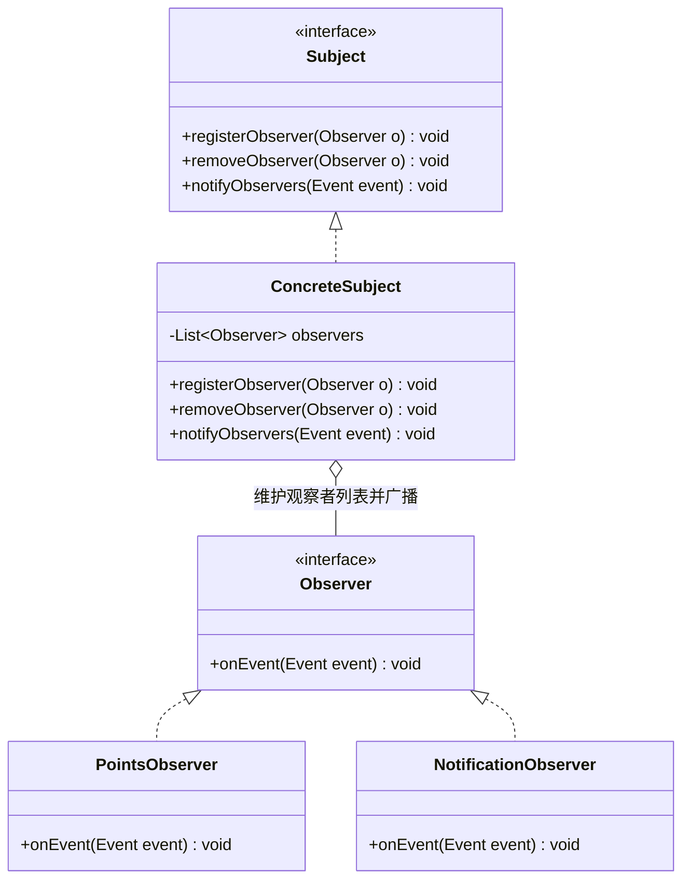
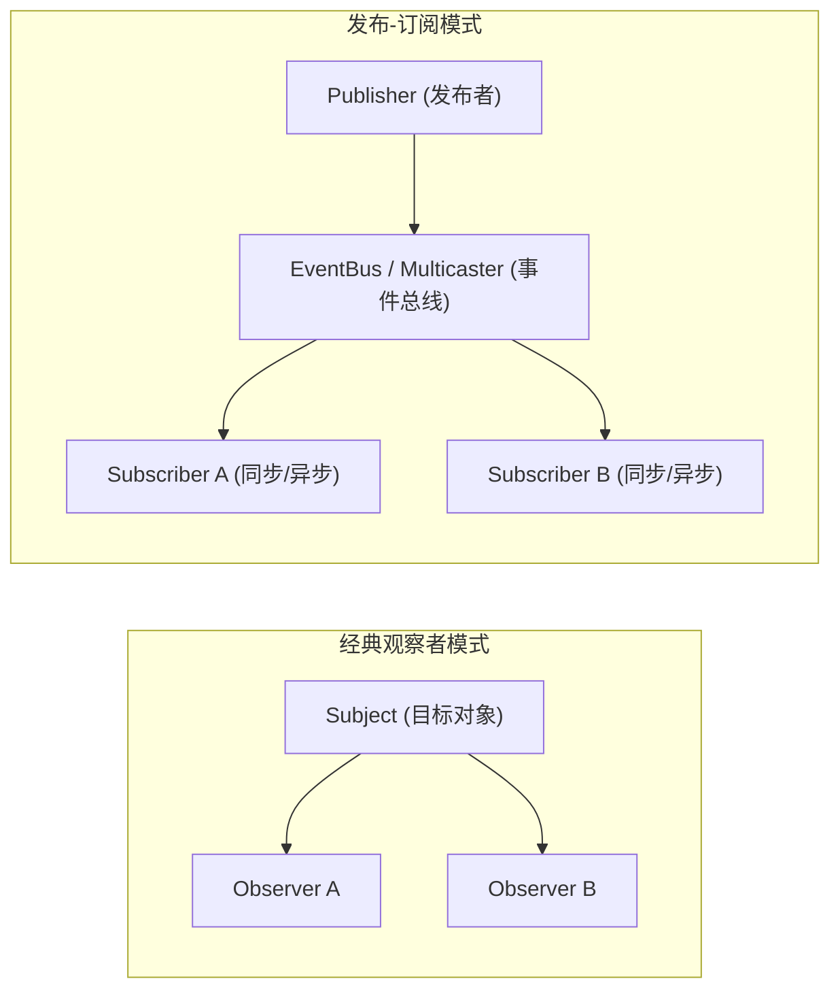
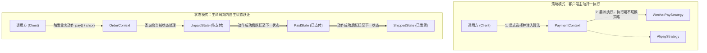
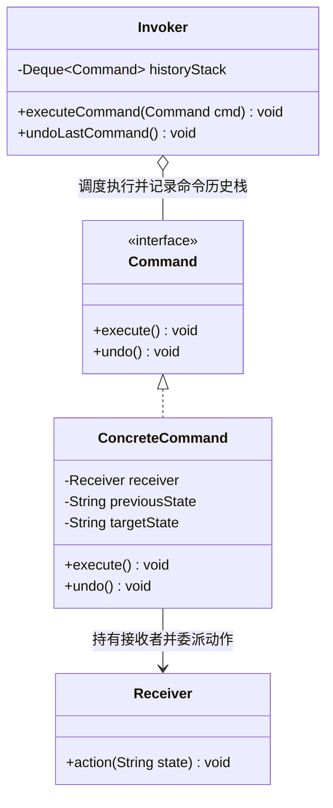

# 05 · 行为型模式（下）：观察者、状态、命令与迭代器

> 上一篇：[[04-行为型模式上-策略-模板方法-责任链]] | 下一篇：[[06-生产实战-策略+工厂+模板方法组合重构]]

---

## 一、核心认知：从流程解耦到状态与请求的封装

在 [[04-行为型模式上-策略-模板方法-责任链]] 中，策略模式、模板方法模式与责任链模式解决了“算法替换、骨架复用、流水线串联”三类核心流程问题。本篇聚焦行为型模式的另外四个工程支柱：**观察者模式（Observer）**、**状态模式（State）**、**迭代器模式（Iterator）**与**命令模式（Command）**。

从软件工程第一性原理审视，这四种模式分别解决以下领域的耦合痛点：

| 设计模式 | 核心工程问题 | 解耦维度 | JDK / 框架核心代表 |
| :--- | :--- | :--- | :--- |
| **观察者模式 (Observer)** | 核心状态变更后需要触发多个无直接关联的下游动作，硬编码调用导致主流程膨胀且违反开闭原则 | 解耦**事件源（Subject）**与**多个响应方（Observer）**的一对多通知依赖 | `java.util.EventListener`、Spring `ApplicationEvent` / `@EventListener` |
| **状态模式 (State)** | 对象在生命周期内存在多个离散状态，不同状态下的合法操作与流转规则交织成巨型 `if-else` 分支 | 将与**特定状态绑定的行为与流转约束**局部化到独立的状态类中 | 电商订单状态机、TCP 连接状态流转、Spring StateMachine |
| **迭代器模式 (Iterator)** | 数组、链表、红黑树、哈希表等容器内部结构迥异，调用方若直接依赖底层存储结构进行遍历将产生强耦合 | 将**游标遍历逻辑**从**容器存储结构**中剥离，提供统一的顺序访问契约 | `java.util.Iterator`、`java.lang.Iterable`、MyBatis `Cursor` |
| **命令模式 (Command)** | 直接的方法调用无法被放入队列缓存、无法延迟调度、无法记录审计流水或执行逆向撤销（Undo） | 将**请求本身（接收者 + 动作 + 参数）**封装为独立对象，解耦调用方与执行方 | `java.lang.Runnable`、`Callable`、`ThreadPoolExecutor` 任务提交 |

---

## 二、观察者模式（Observer）与发布-订阅（Pub/Sub）

### 2.1 第一性原理：消除一对多通知的正向硬编码依赖

在复杂业务系统中，一个核心领域事件的发生往往伴随着多个衍生动作。例如“用户订单支付成功”后，系统需要依次执行：更新订单主状态、扣减真实库存、发放会员积分、推送短信与 App 通知、上报风控大盘数据。

若采用面向过程的直接调用，核心支付服务 `PaymentService` 必须显式注入 `StockService`、`PointsService`、`NotificationService`、`RiskReportService` 等所有下游组件：

```java
// 反例：事件源与所有下游响应方强耦合，违背单一职责原则与开闭原则
public void onPaySuccess(Order order) {
    orderRepository.updateStatus(order.getId(), OrderStatus.PAID);
    stockService.deductRealStock(order);          // 核心强依赖
    pointsService.grantPoints(order);             // 非核心衍生动作
    notificationService.sendSms(order);           // 非核心衍生动作
    riskReportService.reportPayment(order);       // 每次新增下游都必须修改此方法
}
```

这种写法存在三个严重工程缺陷：
1. **违反开闭原则（OCP）**：每当运营新增“支付成功赠送优惠券”或“触发分销返佣”需求时，都必须修改核心 `PaymentService` 的代码。
2. **故障域耦合**：非核心的短信发送或积分发放接口出现网络超时，会直接拖垮核心支付回调主线程，甚至导致核心事务回滚。
3. **职责边界模糊**：支付领域服务被迫感知积分、短信、报表等外部领域的接口细节。

**观察者模式（Observer Pattern）**通过定义对象间的一种**一对多依赖关系**，使得当被观察的目标对象（Subject）状态发生改变时，所有预先注册的观察者对象（Observer）都会自动收到通知并执行各自的响应逻辑。



### 2.2 观察者模式 vs 发布-订阅模式（Pub/Sub）

在架构设计中，经典 GoF 观察者模式与发布-订阅模式（Publish-Subscribe）共享相同的解耦思想，但在拓扑结构上存在明确的演进关系：

1. **经典观察者模式**：目标对象（Subject）直接维护观察者（Observer）引用集合，并在状态变更时直接遍历集合调用 `observer.onEvent()`。Subject 与 Observer 虽然面向抽象接口编程，但二者仍在同一个进程上下文中直接交互。
2. **发布-订阅模式（Pub/Sub）**：在发布者（Publisher）与订阅者（Subscriber）之间引入了独立的**事件通道或调度中心（Event Bus / Event Multicaster / Message Broker）**。发布者只需将事件对象投递给事件中心，完全不感知订阅者的存在；事件中心负责事件路由、过滤、同步/异步线程派发以及异常隔离。
   - **进程内发布-订阅**：Spring `ApplicationEventPublisher` + `ApplicationEventMulticaster`、Google Guava `EventBus`。
   - **跨进程分布式发布-订阅**：Apache Kafka、RocketMQ、RabbitMQ。



### 2.3 Spring 事件机制深度剖析与源码印证

Spring Framework 内置了一套完整的进程内事件发布-订阅体系，是企业级开发中落地观察者模式的标准方式。其核心由四大角色构成：

1. **事件载体（`ApplicationEvent` 或任意 POJO）**：从 Spring 4.2 开始，事件对象无需强制继承 `ApplicationEvent`，任何普通 Java 对象（Payload）均可直接作为事件发布，Spring 底层会自动将其包装为 `PayloadApplicationEvent<T>`。
2. **事件发布器（`ApplicationEventPublisher`）**：`ApplicationContext` 继承了该接口，业务组件通过注入 `ApplicationEventPublisher` 调用 `publishEvent(Object event)` 发布事件。
3. **事件广播器（`ApplicationEventMulticaster`）**：默认实现为 `SimpleApplicationEventMulticaster`，负责管理所有注册的监听器，并根据事件类型匹配对应的监听器执行通知。
4. **事件监听器（`ApplicationListener<E>` 或 `@EventListener`）**：后置处理器 `EventListenerMethodProcessor` 在容器启动阶段扫描所有标注了 `@EventListener` 的方法，将其动态解析并适配为 `ApplicationListenerMethodAdapter` 注册到广播器中。

#### 源码印证：`SimpleApplicationEventMulticaster` 的同步与异步派发

查看 `org.springframework.context.event.SimpleApplicationEventMulticaster#multicastEvent` 核心源码：

```java
@Override
public void multicastEvent(final ApplicationEvent event, @Nullable ResolvableType eventType) {
    ResolvableType type = (eventType != null ? eventType : resolveDefaultEventType(event));
    Executor executor = getTaskExecutor();
    // 匹配所有订阅了该事件类型的 ApplicationListener
    for (ApplicationListener<?> listener : getApplicationListeners(event, type)) {
        if (executor != null) {
            // 若配置了全局 TaskExecutor，则提交到线程池异步执行
            executor.execute(() -> invokeListener(listener, event));
        }
        else {
            // 默认 executor 为 null，直接在发布者当前线程中同步调用！
            invokeListener(listener, event);
        }
    }
}
```

> [!WARNING] Spring 事件默认是同步阻塞且共享事务上下文的
> 在默认配置下，`SimpleApplicationEventMulticaster` 的 `taskExecutor` 为 `null`。这意味着：
> 1. `publishEvent()` 是**完全同步阻塞**的，所有监听器在发布者的同一个线程中串行执行。
> 2. 如果任意一个监听器抛出未捕获的 `RuntimeException`，异常会直接向上冒泡打断主流程，甚至导致主业务的 `@Transactional` 本地事务整体回滚。
> 3. 工程实践中，通常不在全局 `ApplicationEventMulticaster` 上一刀切配置线程池，而是保持全局默认同步，在需要异步执行的监听器方法上按需叠加 `@Async("customEventExecutor")` 注解，从而精细控制哪些监听器需要同步强一致、哪些需要异步解耦。

### 2.4 生产核心痛点：事务提交后通知与 `@TransactionalEventListener`

#### 问题现场：事务未提交即触发异步通知引发的数据不一致

考虑以下常见的订单支付代码：

```java
@Service
@RequiredArgsConstructor
public class OrderPaymentService {
    private final OrderMapper orderMapper;
    private final ApplicationEventPublisher eventPublisher;

    @Transactional(rollbackFor = Exception.class)
    public void completePayment(Long orderId, String tradeNo) {
        // 1. 更新数据库订单状态为 PAID（此时事务尚未提交！）
        orderMapper.updateOrderStatus(orderId, "PAID", tradeNo);
        
        // 2. 发布订单已支付事件
        eventPublisher.publishEvent(new OrderPaidEvent(orderId, tradeNo));
        
        // 3. 后续可能还有其他数据库操作，甚至可能因异常触发整个事务回滚
        orderMapper.insertPaymentLog(orderId, tradeNo);
    }
}
```

如果下游监听器标注了 `@Async` 异步处理该事件，就会出现两个致命的并发与一致性缺陷：
1. **幻读/脏读未提交数据**：异步线程立即被唤醒去数据库查询订单详情，而此时主线程的本地事务尚未完成 `COMMIT`，在 `READ COMMITTED` 或 `REPEATABLE READ` 隔离级别下，异步线程查到的订单状态仍然是 `UNPAID`。
2. **幽灵通知（主事务回滚但外部通知已发出）**：如果在 `publishEvent` 之后的第 3 步抛出异常，主事务发生回滚，订单实际上并未支付成功，但异步监听器已经把“支付成功”的短信或积分发放给了用户。

#### 终极解决方案：`@TransactionalEventListener`

为了解决事务生命周期与事件触发时机的对齐问题，Spring 4.2 引入了 `@TransactionalEventListener` 注解。其底层通过 `TransactionSynchronizationManager.registerSynchronization(...)` 将监听器挂载到当前线程的事务同步回调钩子上，支持四个精确的触发阶段（`TransactionPhase`）：

- `TransactionPhase.AFTER_COMMIT`（**默认值，最常用**）：仅在当前事务**成功提交（Commit）之后**才触发监听器。若事务回滚，事件将被静默丢弃。
- `TransactionPhase.AFTER_ROLLBACK`：仅在当前事务回滚后触发（常用于失败告警或补偿清理）。
- `TransactionPhase.AFTER_COMPLETION`：无论事务提交还是回滚，完成后均触发。
- `TransactionPhase.BEFORE_COMMIT`：在事务提交前触发（仍处于同一事务内）。

#### 生产级标准代码实现

```java
package com.example.designpattern.observer;

import lombok.extern.slf4j.Slf4j;
import org.springframework.context.ApplicationEventPublisher;
import org.springframework.scheduling.annotation.Async;
import org.springframework.stereotype.Component;
import org.springframework.stereotype.Service;
import org.springframework.transaction.annotation.Propagation;
import org.springframework.transaction.annotation.Transactional;
import org.springframework.transaction.event.TransactionPhase;
import org.springframework.transaction.event.TransactionalEventListener;

import java.math.BigDecimal;
import java.time.LocalDateTime;

/**
 * 1. 定义领域事件载体（使用不可变 Record 表达已发生的事实）
 */
public record OrderPaidEvent(
        Long orderId,
        Long userId,
        BigDecimal paidAmount,
        LocalDateTime paidTime
) {}

/**
 * 2. 事件发布方：核心订单支付服务
 */
@Slf4j
@Service
public class OrderDomainService {

    private final ApplicationEventPublisher eventPublisher;

    public OrderDomainService(ApplicationEventPublisher eventPublisher) {
        this.eventPublisher = eventPublisher;
    }

    @Transactional(rollbackFor = Exception.class)
    public void payOrder(Long orderId, Long userId, BigDecimal amount) {
        log.info("[主事务] 更新订单状态为已支付, orderId={}", orderId);
        // 执行数据库更新: UPDATE t_order SET status = 'PAID' WHERE id = ?
        
        // 发布领域事件（此时仅注册事务同步钩子，尚未真正触发 AFTER_COMMIT 监听器）
        eventPublisher.publishEvent(new OrderPaidEvent(orderId, userId, amount, LocalDateTime.now()));
        
        log.info("[主事务] 准备提交数据库事务, orderId={}", orderId);
    }
}

/**
 * 3. 事件订阅方：积分与消息通知监听器
 */
@Slf4j
@Component
public class OrderPaidEventListeners {

    /**
     * 场景 A：事务提交后 + 异步线程池执行（推荐用于短信推送、非核心远程调用）
     * 主事务成功提交后，交由专用线程池执行，彻底隔离耗时与异常
     */
    @Async("domainEventExecutor")
    @TransactionalEventListener(phase = TransactionPhase.AFTER_COMMIT)
    public void handleSmsNotification(OrderPaidEvent event) {
        log.info("[异步通知] 订单事务已提交，发送支付成功通知, orderId={}", event.orderId());
    }

    /**
     * 场景 B：事务提交后 + 监听器内部需要执行新的数据库写操作
     * 注意：进入 AFTER_COMMIT 时，外层主事务已经完成提交但数据库连接资源可能尚未清理完毕。
     * 若监听器在同一线程内执行写库操作，必须显式声明 Propagation.REQUIRES_NEW 开启独立新事务，
     * 否则默认的 REQUIRED 传播行为会复用已提交的旧事务上下文，导致修改无法提交到数据库！
     */
    @Transactional(propagation = Propagation.REQUIRES_NEW, rollbackFor = Exception.class)
    @TransactionalEventListener(phase = TransactionPhase.AFTER_COMMIT)
    public void handlePointsGrant(OrderPaidEvent event) {
        log.info("[独立新事务] 发放订单积分, userId={}, amount={}", event.userId(), event.paidAmount());
        // INSERT INTO t_points_record ...
    }
}
```

> [!IMPORTANT] 进程内事件 vs 消息中间件（MQ）的边界权衡
> Spring `@TransactionalEventListener` + `@Async` 本质上属于**进程内存级事件分发**。如果在主事务提交后的瞬间 JVM 进程发生 OOM 崩溃或断电重启，内存中的异步任务将会丢失。
> - **适用 Spring 事件的场景**：同进程内模块解耦、本地缓存刷新、操作审计日志记录、允许极低概率丢失或有定时任务兜底的通知推送。
> - **必须使用分布式消息队列（本地消息表 / RocketMQ 事务消息）的场景**：跨微服务边界通知、资金结算、核心库存扣减等要求**至少一次投递（At-Least-Once）与最终一致性保障**的核心链路。

---

## 三、状态模式（State Pattern）

### 3.1 第一性原理：用多态状态对象替代二维分支矩阵

在具有明确生命周期的领域模型中（如电商订单、审批工单、信贷申请单、支付流水），一个核心实体往往包含多个**状态（State）**以及多种可触发的**动作/事件（Action/Event）**。

假设订单包含 5 种状态（`UNPAID` 待支付、`PAID` 已支付、`SHIPPED` 已发货、`COMPLETED` 已完成、`CANCELLED` 已取消）和 4 种操作（`pay` 支付、`ship` 发货、`confirmReceipt` 确认收货、`cancel` 取消）。如果采用面向过程的写法，每个操作方法内部都必须编写一套针对当前状态的 `if-else` 或 `switch` 判断：

```java
// 反例：每个动作方法都充斥着对所有状态的防御判断，状态流转规则散落在各个方法中
public class OrderService {
    public void cancel(Order order) {
        if (order.getStatus() == OrderStatus.UNPAID) {
            order.setStatus(OrderStatus.CANCELLED);
            releaseLockedStock(order);
        } else if (order.getStatus() == OrderStatus.PAID) {
            order.setStatus(OrderStatus.CANCELLED);
            triggerRefund(order);
            releaseLockedStock(order);
        } else if (order.getStatus() == OrderStatus.SHIPPED) {
            throw new IllegalStateException("订单已发货，不可直接取消，请发起售后退货流程");
        } else {
            throw new IllegalStateException("当前状态不支持取消操作: " + order.getStatus());
        }
    }
    // pay()、ship()、confirmReceipt() 内部同样重复着类似的 switch/if-else...
}
```

当状态数量扩展到 10 个、动作扩展到 8 个时，代码将演变为 $10 \times 8$ 的二维分支矩阵，引发以下严重维护问题：
1. **状态流转规则碎片化**：想要搞清楚“已支付状态（`PAID`）究竟允许做哪些操作、会流转到哪些下游状态”，必须翻遍整个 `OrderService` 的所有方法。
2. **新增状态改动面失控**：一旦业务新增一个“拼团中（`GROUPING`）”状态，必须修改 `pay`、`ship`、`cancel` 等每一个动作方法的 `if-else` 分支，极易遗漏边界条件导致状态机被非法击穿。

**状态模式（State Pattern）**的核心思想是：**将与特定状态相关的所有行为抽取并局部化到独立的状态实现类中，使得对象在内部状态发生改变时，其行为也随之改变。**

### 3.2 深度辨析：状态模式 vs 策略模式

从 UML 类图结构上看，状态模式与策略模式几乎完全一致：它们都包含一个上下文类（Context），并通过组合方式持有一个抽象接口（`State` 或 `Strategy`）的多态实现。然而，二者的**设计意图、运行期动态特性以及职责边界**有着本质区别：



| 对比维度 | 策略模式 (Strategy Pattern) | 状态模式 (State Pattern) |
| :--- | :--- | :--- |
| **核心解决痛点** | **同一目标的不同算法替换**（解决“怎么做”的多样性，如不同支付渠道、不同折扣算法） | **对象生命周期内不同状态下的行为约束与合法流转**（解决“在什么状态下允许做什么，做完变成什么状态”） |
| **实现的耦合关系** | 各个具体策略类之间**完全独立、互不感知**（微信支付策略绝不需要知道支付宝策略的存在） | 各个具体状态类之间存在明确的**有限状态机（FSM）拓扑流转关系**（`UnpaidState` 明确知道支付成功后下一个状态是 `PaidState`） |
| **切换的主导权** | 通常由**外部调用方（或结合工厂模式根据入参）**在调用前一次性选定，单次请求执行期间策略保持不变 | 由**状态机内部规则（Context 或具体 State 类）**在业务动作执行过程中自动驱动状态跃迁 |
| **平行可替换性** | 策略之间是**平行可互换**的等价方案 | 状态之间具有严格的**时序先后与不可逆约束**，绝不可随意互换 |

### 3.3 生产级实战：电商订单状态模式实现（Spring 无状态 Bean 方案）

在 GoF 经典教材中，每次状态流转都会 `new` 一个新的状态对象赋值给 `OrderContext`。但在高并发 Java 后端应用中，由于状态类本身只封装行为规则而不保存单个订单的私有数据（订单数据保存在数据库与 `Order` 实体中），**最佳实践是将所有具体状态类声明为无状态的 Spring 单例 Bean，将订单实体作为上下文参数传入**，既消除了高频对象创建开销，又能够直接在状态类中注入 Mapper 或其他领域服务。

```java
package com.example.designpattern.state;

import lombok.Data;
import lombok.Getter;
import lombok.RequiredArgsConstructor;
import lombok.extern.slf4j.Slf4j;
import org.springframework.stereotype.Component;
import org.springframework.stereotype.Service;

import java.util.EnumMap;
import java.util.List;
import java.util.Map;

/**
 * 1. 订单状态枚举
 */
@Getter
@RequiredArgsConstructor
public enum OrderStatusEnum {
    UNPAID("UNPAID", "待支付"),
    PAID("PAID", "已支付待发货"),
    SHIPPED("SHIPPED", "已发货待收货"),
    COMPLETED("COMPLETED", "已完成"),
    CANCELLED("CANCELLED", "已取消");

    private final String code;
    private final String desc;
}

/**
 * 2. 订单领域实体（维护当前状态数据）
 */
@Data
public class Order {
    private Long orderId;
    private OrderStatusEnum status;

    public Order(Long orderId, OrderStatusEnum status) {
        this.orderId = orderId;
        this.status = status;
    }

    public void transitTo(OrderStatusEnum nextStatus) {
        this.status = nextStatus;
    }
}

/**
 * 3. 抽象状态接口：定义订单全生命周期支持的所有动作契约
 * 利用接口默认方法统一拦截非法状态下的操作，具体状态类只需重写当前状态下合法的动作！
 */
public interface OrderState {

    /**
     * 返回当前状态实现对应的枚举标识
     */
    OrderStatusEnum getSupportedStatus();

    default void pay(Order order) {
        throw new IllegalStateException(
                String.format("订单[%d]当前处于[%s]状态，禁止执行[支付]操作", order.getOrderId(), order.getStatus().getDesc()));
    }

    default void ship(Order order, String trackingNo) {
        throw new IllegalStateException(
                String.format("订单[%d]当前处于[%s]状态，禁止执行[发货]操作", order.getOrderId(), order.getStatus().getDesc()));
    }

    default void confirmReceipt(Order order) {
        throw new IllegalStateException(
                String.format("订单[%d]当前处于[%s]状态，禁止执行[确认收货]操作", order.getOrderId(), order.getStatus().getDesc()));
    }

    default void cancel(Order order, String reason) {
        throw new IllegalStateException(
                String.format("订单[%d]当前处于[%s]状态，禁止执行[取消订单]操作", order.getOrderId(), order.getStatus().getDesc()));
    }
}

/**
 * 4. 具体状态实现 A：待支付状态（仅允许“支付”与“取消”）
 */
@Slf4j
@Component
public class UnpaidOrderState implements OrderState {

    @Override
    public OrderStatusEnum getSupportedStatus() {
        return OrderStatusEnum.UNPAID;
    }

    @Override
    public void pay(Order order) {
        log.info("订单[{}]核验支付凭证通过，执行状态跃迁: UNPAID -> PAID", order.getOrderId());
        order.transitTo(OrderStatusEnum.PAID);
    }

    @Override
    public void cancel(Order order, String reason) {
        log.info("订单[{}]在待支付状态下取消，释放预占库存，原因: {}，状态跃迁: UNPAID -> CANCELLED", order.getOrderId(), reason);
        order.transitTo(OrderStatusEnum.CANCELLED);
    }
}

/**
 * 5. 具体状态实现 B：已支付待发货状态（仅允许“发货”与“带退款取消”）
 */
@Slf4j
@Component
public class PaidOrderState implements OrderState {

    @Override
    public OrderStatusEnum getSupportedStatus() {
        return OrderStatusEnum.PAID;
    }

    @Override
    public void ship(Order order, String trackingNo) {
        log.info("订单[{}]已录入物流单号[{}]，执行状态跃迁: PAID -> SHIPPED", order.getOrderId(), trackingNo);
        order.transitTo(OrderStatusEnum.SHIPPED);
    }

    @Override
    public void cancel(Order order, String reason) {
        log.info("订单[{}]在已支付状态下取消，触发原路退款并回滚库存，原因: {}，状态跃迁: PAID -> CANCELLED", order.getOrderId(), reason);
        order.transitTo(OrderStatusEnum.CANCELLED);
    }
}

/**
 * 6. 具体状态实现 C：已发货状态（仅允许“确认收货”，直接取消将被默认方法拦截）
 */
@Slf4j
@Component
public class ShippedOrderState implements OrderState {

    @Override
    public OrderStatusEnum getSupportedStatus() {
        return OrderStatusEnum.SHIPPED;
    }

    @Override
    public void confirmReceipt(Order order) {
        log.info("订单[{}]买家已确认收货，触发商家结算，状态跃迁: SHIPPED -> COMPLETED", order.getOrderId());
        order.transitTo(OrderStatusEnum.COMPLETED);
    }
}

/**
 * 7. 状态机上下文调度器（OrderStateMachineEngine）
 */
@Service
public class OrderStateMachineEngine {

    private final Map<OrderStatusEnum, OrderState> stateRegistry = new EnumMap<>(OrderStatusEnum.class);

    public OrderStateMachineEngine(List<OrderState> orderStates) {
        for (OrderState state : orderStates) {
            stateRegistry.put(state.getSupportedStatus(), state);
        }
    }

    private OrderState resolveState(Order order) {
        OrderState state = stateRegistry.get(order.getStatus());
        if (state == null) {
            throw new IllegalStateException("未注册或处于终态的订单状态处理器: " + order.getStatus());
        }
        return state;
    }

    public void pay(Order order) {
        resolveState(order).pay(order);
    }

    public void ship(Order order, String trackingNo) {
        resolveState(order).ship(order, trackingNo);
    }

    public void confirmReceipt(Order order) {
        resolveState(order).confirmReceipt(order);
    }

    public void cancel(Order order, String reason) {
        resolveState(order).cancel(order, reason);
    }
}
```

#### 工程亮点总结
1. **接口默认方法防御非法流转**：`OrderState` 接口对所有方法提供了默认实现（直接抛出包含当前状态上下文的 `IllegalStateException`）。具体状态类（如 `ShippedOrderState`）只需重写 `confirmReceipt` 一个方法，任何在已发货状态下企图调用 `pay()` 或 `cancel()` 的请求都会被自动拦截。
2. **数据库并发安全防线**：在生产环境中，内存态的 `order.transitTo(nextStatus)` 最终落地到数据库时，**必须配合带前置状态条件（CAS）的乐观锁 SQL 更新**：
   ```sql
   UPDATE t_order 
   SET status = 'PAID', version = version + 1, update_time = NOW() 
   WHERE order_id = #{orderId} AND status = 'UNPAID';
   ```
   校验受影响行数 `affectedRows == 1`，防止并发重复回调穿透内存状态校验。

---

## 四、迭代器模式（Iterator Pattern）

### 4.1 第一性原理：分离“容器存储结构”与“游标遍历状态”

集合容器（Collection）的核心职责是高效地存储与组织数据，其底层数据结构可能是连续内存数组（`ArrayList`）、双向链表（`LinkedList`）、哈希桶加红黑树（`HashMap`）或跳表（`ConcurrentSkipListMap`）。

如果将遍历游标（当前遍历到了哪个位置）直接保存在集合类自身字段中，会导致两个严重问题：
1. **集合职责膨胀**：容器既要负责增删改查数据，又要维护遍历游标状态。
2. **无法支持同一集合的多处并发/嵌套遍历**：如果两个循环同时遍历同一个 `List` 实例，共享在容器内部的单个游标字段就会互相覆盖，导致遍历错乱。

**迭代器模式（Iterator Pattern）**通过将“遍历游标状态与推进算法”抽取为独立的 `Iterator` 对象，每次调用 `collection.iterator()` 时都创建一个全新的轻量级游标实例，从而在屏蔽底层数据结构差异的同时，支持对同一容器实例开启多个互不干扰的遍历过程。

### 4.2 JDK `Iterable` 与 `Iterator` 源码深度剖析

在 Java 集合框架中，所有集合顶层都实现了 `java.lang.Iterable<T>` 接口（这也是 Java `for (T item : collection)` 增强 for 循环语法糖的编译期契约，编译器会自动将其解糖为 `Iterator.hasNext()` 与 `Iterator.next()` 调用）。

以 `java.util.ArrayList` 的内部类 `Itr` 源码为例，剖析迭代器游标状态机与 **`fail-fast`（快速失败）并发修改检测机制**：

```java
// java.util.ArrayList 内部迭代器核心源码节选
private class Itr implements Iterator<E> {
    int cursor;       // 下一个即将返回的元素的索引位置
    int lastRet = -1; // 上一次返回的元素的索引位置；若尚未调用 next() 或刚调用过 remove()，则为 -1
    
    // 核心防线：创建迭代器时，记录外部 ArrayList 当前的结构修改次数快照
    int expectedModCount = modCount;

    public boolean hasNext() {
        return cursor != size;
    }

    @SuppressWarnings("unchecked")
    public E next() {
        // 每次推进游标前，首先校验外部集合结构是否被绕过迭代器直接修改！
        checkForComodification();
        int i = cursor;
        if (i >= size)
            throw new NoSuchElementException();
        Object[] elementData = ArrayList.this.elementData;
        if (i >= elementData.length)
            throw new ConcurrentModificationException();
        cursor = i + 1;
        return (E) elementData[lastRet = i];
    }

    public void remove() {
        if (lastRet < 0)
            throw new IllegalStateException();
        checkForComodification();

        try {
            // 调用外部 ArrayList.remove(lastRet)，该方法会使 modCount++，并将后续元素前移一位
            ArrayList.this.remove(lastRet);
            // 关键1：由于被删元素后面的所有元素向左移动了一位，游标 cursor 必须回退到刚被删除的位置 lastRet！
            cursor = lastRet;
            // 关键2：重置 lastRet 为 -1，防止在未调用下一次 next() 前连续调用两次 remove()
            lastRet = -1;
            // 关键3：将 expectedModCount 同步更新为最新的 modCount，从而允许后续迭代继续合法进行！
            expectedModCount = modCount;
        } catch (IndexOutOfBoundsException ex) {
            throw new ConcurrentModificationException();
        }
    }

    final void checkForComodification() {
        if (modCount != expectedModCount)
            throw new ConcurrentModificationException();
    }
}
```

#### 核心机制解析：为什么 `for-each` 中直接调用 `list.remove(item)` 会抛异常？

1. `ArrayList` 维护了一个成员变量 `transient int modCount = 0`，每当调用 `list.add()`、`list.remove()`、`list.clear()` 等改变集合容量结构的方法时，`modCount` 都会自增 1。
2. 当开启 `for-each` 循环时，底层新建了 `Itr` 对象，并将当前的 `modCount` 赋值给迭代器私有的 `expectedModCount`。
3. 如果在循环体内绕过迭代器、直接调用容器自身的 `list.remove(item)`，会导致容器的 `modCount++`，但迭代器的 `expectedModCount` 保持原值不变，且游标 `cursor` 没有随数组元素前移而回退。
4. 在进入下一轮循环调用 `iterator.next()` 时，`checkForComodification()` 发现 `modCount != expectedModCount`，立即抛出 `ConcurrentModificationException`，防止因数组下标错位产生漏读或越界访问。

#### 遍历期安全删除元素的三种标准工程写法

```java
// 方式 1（推荐，JDK 8+ 最简洁高效）：使用 Collection.removeIf(Predicate)
userList.removeIf(user -> user.isExpired());

// 方式 2：显式使用 Iterator.remove()（内部自动同步 expectedModCount = modCount 并修正 cursor）
Iterator<User> iterator = userList.iterator();
while (iterator.hasNext()) {
    if (iterator.next().isExpired()) {
        iterator.remove();
    }
}

// 方式 3（多线程并发读写场景）：使用 CopyOnWriteArrayList（Fail-Safe 快照机制）
// CopyOnWriteArrayList 的 COWIterator 直接持有创建迭代器瞬间的底层数组引用快照，
// 遍历期间不检查 modCount，写操作在复制出的新数组上进行，彻底避免 ConcurrentModificationException。
```

---

## 五、命令模式（Command Pattern）

### 5.1 第一性原理：将“方法调用”升维为“一等公民对象”

在面向对象语言中，常规的方法调用（如 `light.turnOn()`）是一个瞬时完成的栈帧压入与弹出动作。一旦采用直接方法调用，调用方（Invoker）就与接收方（Receiver）的接口签名强绑定，且这个“调用请求”本身无法被赋值给变量、无法存入集合队列、无法序列化落盘、也无法记录它改了什么以便事后回滚。

**命令模式（Command Pattern）**的核心洞见在于：**将“请求本身”（包含目标执行对象 Receiver、执行动作以及所需参数）封装为一个独立的对象（Command）**。一旦动作被对象化，系统就立刻获得了以下四大工程能力：

1. **调用方与执行方彻底解耦**：调用者（Invoker，如遥控器按钮、线程池、定时调度器）只需要依赖统一的 `Command.execute()` 接口，完全不需要知道底层究竟是在发邮件、扣减库存还是执行 SQL。
2. **请求排队、延迟调度与异步化**：命令对象可以被放入阻塞队列（`BlockingQueue<Command>`），由后台工作线程按速率消费削峰，或由定时任务在指定时间点触发。
3. **可逆操作（Undo / Redo）与事务补偿**：通过在 `Command` 接口中增加 `undo()` 方法，并在命令对象内部保存执行前的快照状态，用一个栈（`Deque<Command>`）记录已执行的命令历史，即可实现多级撤销与重做（广泛应用于文本编辑器、图形设计软件及 Saga 分布式事务补偿链路）。
4. **统一植入横切管控（日志审计、超时熔断、舱壁隔离）**：在 `Invoker` 执行 `command.execute()` 前后，可以统一记录命令参数日志（崩溃重启后重放日志即可恢复状态），或为不同命令分配独立的线程池实现舱壁隔离。



### 5.2 JDK 与主流框架中的命令模式印证

#### 1. `java.lang.Runnable` / `Callable` 与 `ThreadPoolExecutor`
这是 Java 标准库中最经典的命令模式实现：
- **抽象命令（Command）**：`Runnable`（无返回值命令）与 `Callable<V>`（带返回值命令）。
- **具体命令（ConcreteCommand）**：业务代码编写的任务实现类或 Lambda 表达式，内部封装了业务 Service（Receiver）与调用参数。
- **调用者（Invoker）**：`ThreadPoolExecutor`。线程池内部维护了 `BlockingQueue<Runnable> workQueue` 和工作线程集合 `HashSet<Worker>`。线程池完全不关心任务内部的具体业务逻辑，只负责任务排队、线程复用、拒绝策略执行以及统一调用 `command.run()`。

#### 2. 容错隔离框架中的 Command 模型（Hystrix / Resilience4j）
在微服务网关与远程调用容错设计中，`HystrixCommand` 将每一次远程 RPC 调用封装为一个独立的命令对象。调用方通过命令模式将请求交给容错引擎调度，引擎在 `execute()` 周围统一包裹了**线程池/信号量舱壁隔离、滑动窗口断路器统计、超时中断控制以及 `getFallback()` 降级回退**。

### 5.3 实战代码示例：支持历史轨迹与多级撤销（Undo）的工单配置变更命令

```java
package com.example.designpattern.command;

import lombok.Getter;
import lombok.extern.slf4j.Slf4j;

import java.util.ArrayDeque;
import java.util.Deque;

/**
 * 1. 接收者（Receiver）：真正持有业务状态并执行底层操作的领域对象
 */
@Slf4j
@Getter
public class TicketDocument {
    private final Long ticketId;
    private String priority;
    private String assignee;

    public TicketDocument(Long ticketId, String priority, String assignee) {
        this.ticketId = ticketId;
        this.priority = priority;
        this.assignee = assignee;
    }

    public void updatePriority(String newPriority) {
        log.info("[工单 {}] 优先级变更: {} -> {}", ticketId, this.priority, newPriority);
        this.priority = newPriority;
    }

    public void updateAssignee(String newAssignee) {
        log.info("[工单 {}] 处理人变更: {} -> {}", ticketId, this.assignee, newAssignee);
        this.assignee = newAssignee;
    }
}

/**
 * 2. 抽象命令接口（Command）：声明执行与逆向撤销契约
 */
public interface TicketCommand {
    void execute();
    void undo();
}

/**
 * 3. 具体命令 A：修改工单优先级命令（内部保存变更前快照以支持精确 Undo）
 */
public class ChangePriorityCommand implements TicketCommand {
    private final TicketDocument ticket;
    private final String targetPriority;
    private String previousPriority;

    public ChangePriorityCommand(TicketDocument ticket, String targetPriority) {
        this.ticket = ticket;
        this.targetPriority = targetPriority;
    }

    @Override
    public void execute() {
        // 执行前保存状态快照
        this.previousPriority = ticket.getPriority();
        ticket.updatePriority(targetPriority);
    }

    @Override
    public void undo() {
        if (this.previousPriority != null) {
            ticket.updatePriority(this.previousPriority);
        }
    }
}

/**
 * 4. 具体命令 B：转派工单处理人命令
 */
public class ReassignTicketCommand implements TicketCommand {
    private final TicketDocument ticket;
    private final String targetAssignee;
    private String previousAssignee;

    public ReassignTicketCommand(TicketDocument ticket, String targetAssignee) {
        this.ticket = ticket;
        this.targetAssignee = targetAssignee;
    }

    @Override
    public void execute() {
        this.previousAssignee = ticket.getAssignee();
        ticket.updateAssignee(targetAssignee);
    }

    @Override
    public void undo() {
        if (this.previousAssignee != null) {
            ticket.updateAssignee(this.previousAssignee);
        }
    }
}

/**
 * 5. 调用者（Invoker）：命令调度与历史栈管理器
 */
@Slf4j
public class TicketCommandInvoker {
    private final Deque<TicketCommand> undoStack = new ArrayDeque<>();
 
    public void invoke(TicketCommand command) {
        command.execute();
        undoStack.push(command);
    }

    public void undoLast() {
        if (undoStack.isEmpty()) {
            log.warn("历史命令栈为空，无操作可撤销");
            return;
        }
        TicketCommand lastCommand = undoStack.pop();
        log.info("触发撤销操作: {}", lastCommand.getClass().getSimpleName());
        lastCommand.undo();
    }
}
```

---

## 六、本篇小结

1. **观察者模式与发布-订阅**：核心价值在于打破一对多通知的正向强依赖。在 Spring 生产环境中，务必警惕默认 `publishEvent()` 的同步阻塞特性，针对跨事务边界的异步通知，标准解法是 `@TransactionalEventListener(phase = TransactionPhase.AFTER_COMMIT)` 配合自定义线程池 `@Async` 或 `Propagation.REQUIRES_NEW`。
2. **状态模式**：核心价值在于消除围绕实体生命周期状态的巨型 `if-else` 矩阵，将“某状态下允许执行什么动作、动作完成后跃迁到什么状态”内聚到独立的状态 Bean 中，并通过接口 `default` 方法统一收口非法状态拦截。
3. **迭代器模式**：核心价值在于将游标遍历状态从容器底层存储结构中剥离。理解 `ArrayList.Itr` 中 `modCount != expectedModCount` 的 `fail-fast` 检测原理，严禁在增强 `for` 循环中直接调用集合自身的 `remove()` 方法。
4. **命令模式**：核心价值在于将方法调用请求对象化，赋予调用动作排队缓冲、异步调度、操作审计以及 `undo()` 逆向回滚的能力。

至此，我们已经完整掌握了创建型、结构型与行为型中的核心高频模式。在下一篇 [[06-生产实战-策略+工厂+模板方法组合重构]] 中，我们将进入企业级工程实战，剖析如何将多种设计模式有机组合，彻底重构真实生产环境中的复杂腐化代码，并明确防止过度设计的工程边界。

---

> 上一篇：[[04-行为型模式上-策略-模板方法-责任链]] | 下一篇：[[06-生产实战-策略+工厂+模板方法组合重构]]
