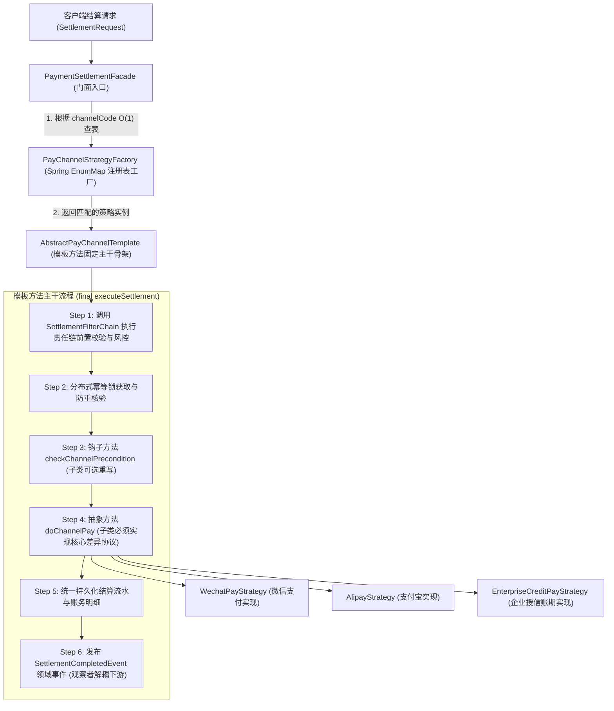
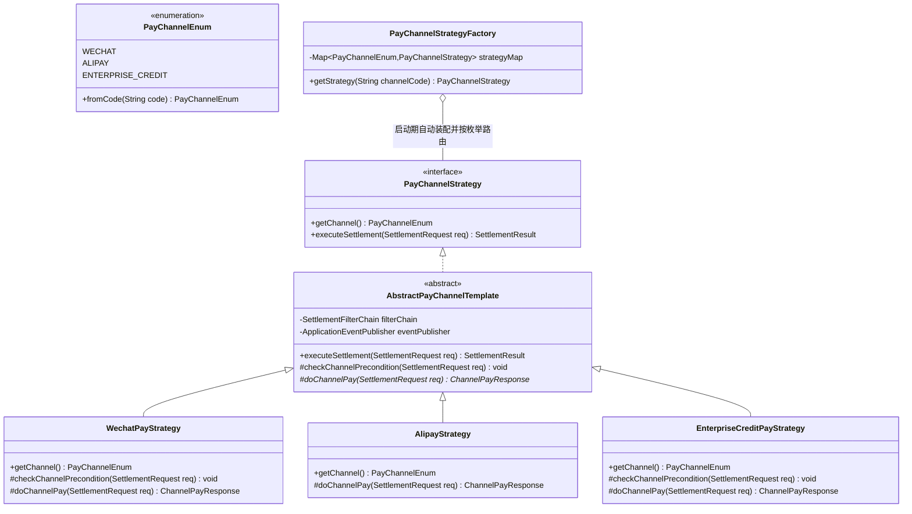
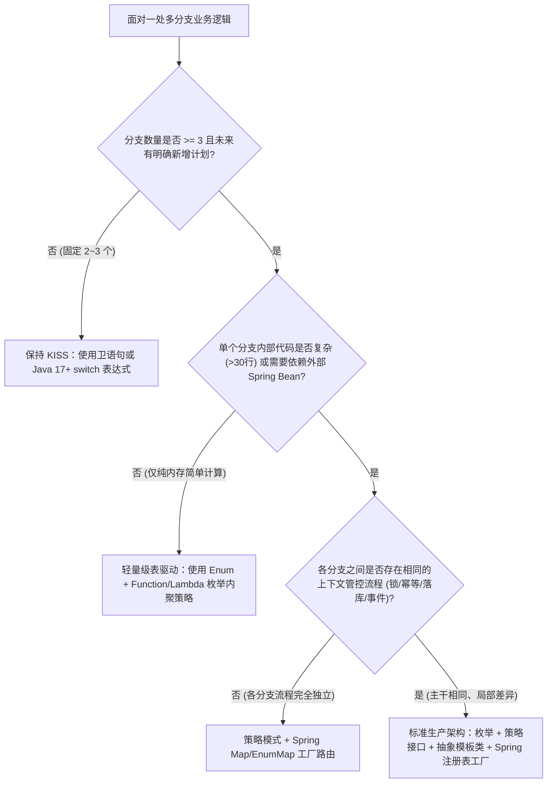

# 06 · 生产实战：策略 + 工厂 + 模板方法组合重构

> 上一篇：[[05-行为型模式下-观察者-状态-命令-迭代器]] | 下一篇：[[07-结构型扩展-桥接与组合]]

---

## 一、核心认知：为什么生产级架构需要组合使用设计模式？

在孤立学习单个设计模式时，代码结构往往非常清晰；但当面对真实的企业级核心系统（如支付收银台、多渠道营销发券、多平台跨境物流履约、多数据源报表引擎）时，**单独使用某一种设计模式往往左支右绌**：

1. **仅使用策略模式（Strategy）的局限**：虽然将不同渠道的算法拆分到了独立的策略类中，但客户端在决定实例化哪一个策略时，依然需要在调用处编写一长串 `if-else` 或 `switch`；更严重的是，每个渠道策略在执行前后都包含大量相同的样板流程（如参数校验、分布式防重锁、幂等表核验、交易流水落库、监控指标上报），如果每个策略类都各自实现一遍，会导致严重的**代码重复（违反 DRY 原则）**。
2. **仅使用模板方法模式（Template Method）的局限**：虽然通过抽象父类复用了公共骨架，但缺乏统一的路由与生命周期管理机制，调用方依然不知如何根据动态入参无分支地定位到目标子类。
3. **仅使用简单工厂模式（Simple Factory）的局限**：解决了对象的创建与路由，但工厂选出的各个具体处理器之间缺乏流程规范约束，公共前置风控与后置通知依然散落在各处。

因此，在 Java + Spring Boot 企业级工程实践中，最经典、复刻率最高的重构范式是**“枚举契约 + 责任链（前置过滤） + 策略模式（行为多态） + 模板方法模式（主干复用） + Spring 依赖注入工厂（O(1) 路由） + 观察者模式（后置解耦）”**的组合架构。



---

## 二、反例诊断：一段典型的腐化生产代码

假设我们正在维护一个企业级商城的**多渠道支付结算服务（`LegacySettlementService`）**。随着业务迭代，系统先后接入了微信支付（`WECHAT`）、支付宝（`ALIPAY`）和企业大客户授信账期支付（`CREDIT`），代码逐渐演变成如下形态：

```java
package com.example.designpattern.combat.legacy;

import lombok.extern.slf4j.Slf4j;
import org.springframework.stereotype.Service;

import java.math.BigDecimal;

/**
 * 反例：充斥着多重分支、重复样板代码与强耦合调用的腐化服务类
 */
@Slf4j
@Service
public class LegacySettlementService {

    public String settleOrder(String orderNo, Long userId, BigDecimal amount, String channelCode, String extJson) {
        // 痛点1：前置参数校验与风控逻辑直接硬编码在主方法开头，越来越臃肿
        if (orderNo == null || amount == null || amount.compareTo(BigDecimal.ZERO) <= 0) {
            throw new IllegalArgumentException("订单号或金额非法");
        }
        if (amount.compareTo(new BigDecimal("500000")) > 0) {
            throw new IllegalStateException("单笔交易超出反洗钱风控限额");
        }

        // 痛点2：围绕魔法字符串的巨型 if-else 分支，且每个分支内部重复编写锁、幂等、落库与通知逻辑
        if ("WECHAT".equals(channelCode)) {
            // 重复样板 A：加幂等锁与防重检查
            log.info("获取分布式锁: lock:settle:{}", orderNo);
            try {
                // 渠道特有逻辑：组装微信 JSAPI 报文、证书签名、调用微信统一下单接口
                if (extJson == null || !extJson.contains("openId")) {
                    throw new IllegalArgumentException("微信支付必须传入 openId");
                }
                log.info("调用微信支付 V3 接口扣款, orderNo={}, amount={}", orderNo, amount);
                String thirdPartyTradeNo = "WX_" + System.currentTimeMillis();

                // 重复样板 B：保存交易流水、发积分、发短信
                log.info("持久化支付流水: orderNo={}, tradeNo={}", orderNo, thirdPartyTradeNo);
                log.info("同步调用积分服务发放积分, orderNo={}", orderNo);
                log.info("同步调用短信服务发送通知, orderNo={}", orderNo);
                return thirdPartyTradeNo;
            } finally {
                log.info("释放分布式锁: lock:settle:{}", orderNo);
            }

        } else if ("ALIPAY".equals(channelCode)) {
            // 重复样板 A：加幂等锁与防重检查（复制粘贴）
            log.info("获取分布式锁: lock:settle:{}", orderNo);
            try {
                // 渠道特有逻辑：RSA2 签名、调用支付宝交易创建接口
                log.info("调用支付宝 OpenAPI 扣款, orderNo={}, amount={}", orderNo, amount);
                String thirdPartyTradeNo = "ALI_" + System.currentTimeMillis();

                // 重复样板 B：保存交易流水、发积分、发短信（复制粘贴）
                log.info("持久化支付流水: orderNo={}, tradeNo={}", orderNo, thirdPartyTradeNo);
                log.info("同步调用积分服务发放积分, orderNo={}", orderNo);
                log.info("同步调用短信服务发送通知, orderNo={}", orderNo);
                return thirdPartyTradeNo;
            } finally {
                log.info("释放分布式锁: lock:settle:{}", orderNo);
            }

        } else if ("CREDIT".equals(channelCode)) {
            // 重复样板 A：加幂等锁与防重检查（复制粘贴）
            log.info("获取分布式锁: lock:settle:{}", orderNo);
            try {
                // 渠道特有逻辑：校验企业授信剩余额度并执行账期扣减
                if (amount.compareTo(new BigDecimal("1000")) < 0) {
                    throw new IllegalArgumentException("企业账期支付起付金额不得低于 1000 元");
                }
                log.info("扣减企业授信额度成功, userId={}, amount={}", userId, amount);
                String thirdPartyTradeNo = "CRD_" + System.currentTimeMillis();

                // 重复样板 B：保存交易流水、发积分、发短信（复制粘贴）
                log.info("持久化支付流水: orderNo={}, tradeNo={}", orderNo, thirdPartyTradeNo);
                log.info("同步调用积分服务发放积分, orderNo={}", orderNo);
                log.info("同步调用短信服务发送通知, orderNo={}", orderNo);
                return thirdPartyTradeNo;
            } finally {
                log.info("释放分布式锁: lock:settle:{}", orderNo);
            }
        } else {
            throw new UnsupportedOperationException("不支持的支付渠道: " + channelCode);
        }
    }
}
```

### 架构坏味道（Bad Smells）深度剖析

| 编号 | 架构缺陷 | 违背的设计原则 | 引发的线上隐患 |
| :--- | :--- | :--- | :--- |
| **1** | **公共骨架复制粘贴**：分布式锁、幂等校验、流水落库在每个 `if-else` 分支中重复出现 | **DRY 原则 / 模板方法缺失** | 若需修改锁超时时间或流水表字段，必须同步修改所有分支，极易遗漏某个渠道引发线上资损或死锁 |
| **2** | **多渠道耦合于单一巨型方法**：所有支付渠道的协议细节全部堆砌在同一个类中 | **开闭原则 (OCP) & 单一职责 (SRP)** | 接入“银联云闪付”或修改“微信证书升级”时，都在修改同一个核心文件，多人协作高频产生 Git 冲突，且改动微信逻辑可能意外改坏支付宝分支 |
| **3** | **魔法值硬编码**：`"WECHAT"`、`"ALIPAY"` 字符串散落各处 | **类型安全契约缺失** | 拼写错误无法在编译期暴露，且外部传入非法渠道码时难以统一收敛 |
| **4** | **前置风控与核心结算耦合**：基础校验、反洗钱限额检查直接写在支付主逻辑前 | **单一职责 (SRP) / 责任链缺失** | 风控规则频繁调整（如新增黑名单拦截、设备指纹核验）会直接污染支付结算主流程 |

---

## 三、五步渐进式重构实战（Spring Boot 生产级落地）

下面我们按照**“厘清边界 → 提炼契约 → 收敛骨架 → 多态扩展 → 工厂路由”**的结构化步骤，对该模块进行彻底重构。



### Step 1：定义强类型渠道枚举与领域上下文模型

首先消灭魔法字符串，使用枚举统一管理所有合法的支付渠道，并封装高内聚的入参请求与返回结果对象。

```java
package com.example.designpattern.combat.model;

import lombok.Builder;
import lombok.Getter;
import lombok.RequiredArgsConstructor;

import java.math.BigDecimal;
import java.util.Arrays;
import java.util.Map;
import java.util.function.Function;
import java.util.stream.Collectors;

/**
 * 1. 支付渠道强类型枚举（消灭魔法值）
 */
@Getter
@RequiredArgsConstructor
public enum PayChannelEnum {

    WECHAT("WECHAT", "微信支付"),
    ALIPAY("ALIPAY", "支付宝"),
    ENTERPRISE_CREDIT("CREDIT", "企业授信账期支付");

    private final String code;
    private final String description;

    private static final Map<String, PayChannelEnum> CODE_LOOKUP = Arrays.stream(values())
            .collect(Collectors.toUnmodifiableMap(PayChannelEnum::getCode, Function.identity()));

    public static PayChannelEnum fromCode(String code) {
        PayChannelEnum channel = CODE_LOOKUP.get(code);
        if (channel == null) {
            throw new IllegalArgumentException("不支持或非法的支付渠道编码: " + code);
        }
        return channel;
    }
}
```

```java
package com.example.designpattern.combat.model;

import java.math.BigDecimal;
import java.util.Map;

/**
 * 2. 结算请求上下文、渠道底层响应与最终结算结果（使用 Java Record 保持不可变性）
 */
public record SettlementRequest(
        String orderNo,
        Long userId,
        BigDecimal amount,
        String channelCode,
        Map<String, String> extParams
) {
    public String getExtParam(String key) {
        return extParams == null ? null : extParams.get(key);
    }
}

public record ChannelPayResponse(
        boolean success,
        String thirdPartyTradeNo,
        String rawChannelResponse
) {}

public record SettlementResult(
        String orderNo,
        String channelCode,
        String thirdPartyTradeNo,
        BigDecimal settledAmount
) {}

public record SettlementCompletedEvent(
        String orderNo,
        Long userId,
        BigDecimal settledAmount,
        String thirdPartyTradeNo
) {}
```

### Step 2：引入责任链模式剥离前置参数校验与风控规则

利用 Spring 的 `@Order` 注解与 `List<SettlementFilter>` 自动排序注入机制，将前置参数校验与反洗钱风控限额检查拆分为独立、可插拔的过滤器节点。后续若新增“黑名单用户拦截”，只需新建一个实现类即可。

```java
package com.example.designpattern.combat.filter;

import com.example.designpattern.combat.model.SettlementRequest;
import lombok.RequiredArgsConstructor;
import lombok.extern.slf4j.Slf4j;
import org.springframework.core.annotation.Order;
import org.springframework.stereotype.Component;

import java.math.BigDecimal;
import java.util.List;

/**
 * 1. 前置校验责任链节点接口
 */
public interface SettlementFilter {
    void doFilter(SettlementRequest request);
}

/**
 * 2. 节点 A：基础参数合法性校验（优先级最高 @Order(10)）
 */
@Component
@Order(10)
public class BasicParamValidationFilter implements SettlementFilter {
    @Override
    public void doFilter(SettlementRequest request) {
        if (request.orderNo() == null || request.orderNo().isBlank()) {
            throw new IllegalArgumentException("结算订单号不能为空");
        }
        if (request.amount() == null || request.amount().compareTo(BigDecimal.ZERO) <= 0) {
            throw new IllegalArgumentException("结算金额必须大于 0");
        }
    }
}

/**
 * 3. 节点 B：反洗钱与大额交易风控拦截（优先级次之 @Order(20)）
 */
@Slf4j
@Component
@Order(20)
public class AntiMoneyLaunderingRiskFilter implements SettlementFilter {
    private static final BigDecimal MAX_SINGLE_AMOUNT = new BigDecimal("500000");

    @Override
    public void doFilter(SettlementRequest request) {
        if (request.amount().compareTo(MAX_SINGLE_AMOUNT) > 0) {
            log.warn("[风控拦截] 订单[{}]交易金额[{}]超出单笔反洗钱上限", request.orderNo(), request.amount());
            throw new IllegalStateException("单笔交易金额超出风控限额");
        }
    }
}

/**
 * 4. 责任链组装执行器（Spring 自动按 @Order 升序注入所有 SettlementFilter）
 */
@Component
@RequiredArgsConstructor
public class SettlementFilterChain {
    private final List<SettlementFilter> filters;

    public void execute(SettlementRequest request) {
        for (SettlementFilter filter : filters) {
            filter.doFilter(request);
        }
    }
}
```

### Step 3：定义策略顶层接口（面向抽象契约编程）

策略接口只暴露两个核心方法：声明自身支持的渠道枚举（供工厂注册使用），以及执行结算的标准入口。

```java
package com.example.designpattern.combat.strategy;

import com.example.designpattern.combat.model.PayChannelEnum;
import com.example.designpattern.combat.model.SettlementRequest;
import com.example.designpattern.combat.model.SettlementResult;

/**
 * 支付渠道策略顶层契约接口
 */
public interface PayChannelStrategy {

    /**
     * 返回当前策略所支持的支付渠道枚举（用于工厂自动注册）
     */
    PayChannelEnum getChannel();

    /**
     * 执行订单支付结算
     */
    SettlementResult executeSettlement(SettlementRequest request);
}
```

### Step 4：引入模板方法模式构建抽象骨架类（收敛公共流程）

创建抽象模板类 `AbstractPayChannelTemplate` 实现 `PayChannelStrategy` 接口，并使用 `final` 关键字修饰主干方法 `executeSettlement()`，防止子类篡改核心安全流程（前置责任链校验 → 分布式锁与幂等检查 → 渠道特异前置钩子 → **子类核心支付抽象方法** → 统一落库 → 发布领域事件 → 释放锁）。

```java
package com.example.designpattern.combat.strategy;

import com.example.designpattern.combat.filter.SettlementFilterChain;
import com.example.designpattern.combat.model.*;
import lombok.RequiredArgsConstructor;
import lombok.extern.slf4j.Slf4j;
import org.springframework.context.ApplicationEventPublisher;

/**
 * 支付渠道抽象模板类（Template Method Pattern）
 * 封装所有渠道通用的横切主干流程，仅将渠道差异化协议下沉至子类实现
 */
@Slf4j
@RequiredArgsConstructor
public abstract class AbstractPayChannelTemplate implements PayChannelStrategy {

    private final SettlementFilterChain filterChain;
    private final ApplicationEventPublisher eventPublisher;

    /**
     * 模板主干方法：使用 final 锁定标准执行步骤次序，严禁子类覆写篡改
     */
    @Override
    public final SettlementResult executeSettlement(SettlementRequest request) {
        // Step 1: 执行责任链通用前置校验与风控拦截
        filterChain.execute(request);

        // Step 2: 执行渠道特有的前置校验钩子（Hook Method）
        checkChannelPrecondition(request);

        // Step 3: 获取分布式锁与幂等性核验
        String lockKey = "lock:settlement:" + request.orderNo();
        acquireDistributedLock(lockKey);
        try {
            if (isOrderAlreadySettled(request.orderNo())) {
                throw new IllegalStateException("订单已完成结算，请勿重复提交: " + request.orderNo());
            }

            // Step 4: 【核心多态扩展点】委派给具体渠道子类执行底层支付协议
            ChannelPayResponse payResponse = doChannelPay(request);
            if (!payResponse.success()) {
                throw new IllegalStateException("渠道支付失败: " + payResponse.rawChannelResponse());
            }

            // Step 5: 统一持久化支付结算流水
            persistSettlementRecord(request, payResponse.thirdPartyTradeNo());

            // Step 6: 发布结算完成领域事件（由观察者异步处理积分发放与短信通知）
            eventPublisher.publishEvent(new SettlementCompletedEvent(
                    request.orderNo(),
                    request.userId(),
                    request.amount(),
                    payResponse.thirdPartyTradeNo()
            ));

            return new SettlementResult(
                    request.orderNo(),
                    getChannel().getCode(),
                    payResponse.thirdPartyTradeNo(),
                    request.amount()
            );
        } finally {
            releaseDistributedLock(lockKey);
        }
    }

    /**
     * 可选钩子方法（Hook Method）：默认空实现，有特殊前置校验诉求的渠道子类可按需重写
     */
    protected void checkChannelPrecondition(SettlementRequest request) {
        // 默认无额外校验
    }

    /**
     * 抽象原语方法（Primitive Operation）：强制具体渠道子类实现各自的支付交互协议
     */
    protected abstract ChannelPayResponse doChannelPay(SettlementRequest request);

    private void acquireDistributedLock(String lockKey) {
        log.info("[模板骨架] 成功获取分布式幂等锁: {}", lockKey);
    }

    private void releaseDistributedLock(String lockKey) {
        log.info("[模板骨架] 成功释放分布式幂等锁: {}", lockKey);
    }

    private boolean isOrderAlreadySettled(String orderNo) {
        // 查询幂等表或订单状态
        return false;
    }

    private void persistSettlementRecord(SettlementRequest request, String tradeNo) {
        log.info("[模板骨架] 统一落库支付结算流水: orderNo={}, channel={}, tradeNo={}, amount={}",
                request.orderNo(), getChannel().getCode(), tradeNo, request.amount());
    }
}
```

### Step 5：编写具体渠道策略子类与 Spring 自动注册工厂

现在，编写具体支付渠道策略类变得极其纯粹——每个类只需关心自身渠道特有的前置参数要求（重写 `checkChannelPrecondition`）和第三方接口调用（实现 `doChannelPay`），完全无需再写任何锁、落库或通知代码！

```java
package com.example.designpattern.combat.strategy.impl;

import com.example.designpattern.combat.filter.SettlementFilterChain;
import com.example.designpattern.combat.model.ChannelPayResponse;
import com.example.designpattern.combat.model.PayChannelEnum;
import com.example.designpattern.combat.model.SettlementRequest;
import com.example.designpattern.combat.strategy.AbstractPayChannelTemplate;
import lombok.extern.slf4j.Slf4j;
import org.springframework.context.ApplicationEventPublisher;
import org.springframework.stereotype.Component;

import java.math.BigDecimal;

/**
 * 具体策略 1：微信支付渠道实现
 */
@Slf4j
@Component
public class WechatPayStrategy extends AbstractPayChannelTemplate {

    public WechatPayStrategy(SettlementFilterChain filterChain, ApplicationEventPublisher eventPublisher) {
        super(filterChain, eventPublisher);
    }

    @Override
    public PayChannelEnum getChannel() {
        return PayChannelEnum.WECHAT;
    }

    @Override
    protected void checkChannelPrecondition(SettlementRequest request) {
        String openId = request.getExtParam("openId");
        if (openId == null || openId.isBlank()) {
            throw new IllegalArgumentException("微信支付渠道必须提供用户 openId 扩展参数");
        }
    }

    @Override
    protected ChannelPayResponse doChannelPay(SettlementRequest request) {
        log.info("[微信支付策略] 组装 WechatPay V3 报文并执行证书签名扣款, orderNo={}, openId={}",
                request.orderNo(), request.getExtParam("openId"));
        String tradeNo = "WX_" + System.currentTimeMillis();
        return new ChannelPayResponse(true, tradeNo, "SUCCESS");
    }
}

/**
 * 具体策略 2：支付宝渠道实现（无需额外前置钩子，直接实现核心扣款方法即可）
 */
@Slf4j
@Component
public class AlipayStrategy extends AbstractPayChannelTemplate {

    public AlipayStrategy(SettlementFilterChain filterChain, ApplicationEventPublisher eventPublisher) {
        super(filterChain, eventPublisher);
    }

    @Override
    public PayChannelEnum getChannel() {
        return PayChannelEnum.ALIPAY;
    }

    @Override
    protected ChannelPayResponse doChannelPay(SettlementRequest request) {
        log.info("[支付宝策略] 执行 RSA2 签名并调用 Alipay TradePay 接口, orderNo={}", request.orderNo());
        String tradeNo = "ALI_" + System.currentTimeMillis();
        return new ChannelPayResponse(true, tradeNo, "10000_SUCCESS");
    }
}

/**
 * 具体策略 3：企业授信账期支付渠道实现
 */
@Slf4j
@Component
public class EnterpriseCreditPayStrategy extends AbstractPayChannelTemplate {

    private static final BigDecimal MIN_CREDIT_PAY_AMOUNT = new BigDecimal("1000");

    public EnterpriseCreditPayStrategy(SettlementFilterChain filterChain, ApplicationEventPublisher eventPublisher) {
        super(filterChain, eventPublisher);
    }

    @Override
    public PayChannelEnum getChannel() {
        return PayChannelEnum.ENTERPRISE_CREDIT;
    }

    @Override
    protected void checkChannelPrecondition(SettlementRequest request) {
        if (request.amount().compareTo(MIN_CREDIT_PAY_AMOUNT) < 0) {
            throw new IllegalArgumentException("企业授信账期支付起付金额不得低于 1000 元");
        }
    }

    @Override
    protected ChannelPayResponse doChannelPay(SettlementRequest request) {
        log.info("[企业授信策略] 核验企业授信账户余额并执行账期额度扣减, userId={}, amount={}",
                request.userId(), request.amount());
        String tradeNo = "CRD_" + System.currentTimeMillis();
        return new ChannelPayResponse(true, tradeNo, "CREDIT_DEDUCTED");
    }
}
```

最后，构建 **Spring 依赖注入策略注册表工厂（`PayChannelStrategyFactory`）** 与对外门面服务（`PaymentSettlementFacade`）：

```java
package com.example.designpattern.combat.factory;

import com.example.designpattern.combat.model.PayChannelEnum;
import com.example.designpattern.combat.model.SettlementRequest;
import com.example.designpattern.combat.model.SettlementResult;
import com.example.designpattern.combat.strategy.PayChannelStrategy;
import lombok.RequiredArgsConstructor;
import org.springframework.stereotype.Component;
import org.springframework.stereotype.Service;

import java.util.EnumMap;
import java.util.List;
import java.util.Map;

/**
 * 支付渠道策略注册表工厂
 * 利用 Spring 构造器自动注入容器内所有 PayChannelStrategy 实现类，构建 EnumMap 实现 O(1) 路由
 */
@Component
public class PayChannelStrategyFactory {

    private final Map<PayChannelEnum, PayChannelStrategy> strategyRegistry = new EnumMap<>(PayChannelEnum.class);

    public PayChannelStrategyFactory(List<PayChannelStrategy> strategies) {
        for (PayChannelStrategy strategy : strategies) {
            PayChannelStrategy existing = strategyRegistry.put(strategy.getChannel(), strategy);
            if (existing != null) {
                throw new IllegalStateException("检测到重复注册的支付渠道策略: " + strategy.getChannel());
            }
        }
    }

    public PayChannelStrategy getStrategy(String channelCode) {
        PayChannelEnum channelEnum = PayChannelEnum.fromCode(channelCode);
        PayChannelStrategy strategy = strategyRegistry.get(channelEnum);
        if (strategy == null) {
            throw new UnsupportedOperationException("尚未配置对应的支付渠道策略实现: " + channelEnum);
        }
        return strategy;
    }
}

/**
 * 重构后的结算门面服务：彻底消灭 if-else，代码极度精简且完全符合开闭原则
 */
@Service
@RequiredArgsConstructor
public class PaymentSettlementFacade {

    private final PayChannelStrategyFactory strategyFactory;

    public SettlementResult settle(SettlementRequest request) {
        PayChannelStrategy strategy = strategyFactory.getStrategy(request.channelCode());
        return strategy.executeSettlement(request);
    }
}
```

---

## 四、重构前后工程质量对比验证

经过“枚举 + 责任链 + 策略 + 模板方法 + 工厂 + 观察者”六位一体的组合重构后，系统的可维护性与扩展性发生了质的飞跃：

| 评估维度 | 重构前（`LegacySettlementService`） | 重构后（组合设计模式架构） |
| :--- | :--- | :--- |
| **核心入口圈复杂度** | 随渠道与风控规则增加呈线性甚至指数级上升（> 25） | `PaymentSettlementFacade.settle()` 圈复杂度恒定为 **1** |
| **新增“银联云闪付”渠道改动范围** | 必须直接修改核心 `LegacySettlementService` 类，复制粘贴整套锁与落库代码 | 仅需枚举新增一项 + 新建 `UnionPayStrategy` 继承模板类，**既有核心代码零修改** |
| **公共流程一致性保障** | 靠程序员人工保证每个 `if-else` 分支里的锁与落库逻辑一致，极易漏改 | 由 `AbstractPayChannelTemplate#executeSettlement`（`final` 方法）在语言层面强制统一 |
| **单元测试粒度与成本** | 测试任意一个渠道都必须构造包含所有依赖的庞大上下文 | 可针对单个 `WechatPayStrategy` 或单个 `RiskFilter` 进行独立、极速的单元测试 |
| **故障隔离能力** | 任一渠道代码改坏或下游积分超时，全渠道结算不可用 | 各渠道代码物理隔离；积分与短信通过观察者事件异步解耦，绝不阻塞核心结算 |

---

## 五、KISS 原则与防过度设计边界：什么时候不该用设计模式？

掌握了设计模式的组合威力后，工程师最容易陷入的另一个极端误区是**“拿着锤子看什么都是钉子”的过度设计（Over-Engineering）**。

从软件工程第一性原理出发，**任何设计模式都不会凭空消灭复杂度，它只是通过引入额外的接口、抽象类和间接跳转层（Indirection），将“集中式的分支判断复杂度”转化为“分布式的类拓扑结构复杂度”**。这种置换只有在“变化频繁发生、分支逻辑足够厚重”时才具有正收益。

### 5.1 严禁滥用设计模式的四大场景

#### 1. 分支数量固定且业务语义长期不变（2~3 个固定枚举）
如果一个判断分支在可预见的业务生命周期内只有固定的 2~3 种情况（例如：根据订单配送方式是“自提”还是“快递”计算运费、根据交易方向是“收入”还是“支出”更新余额），直接编写清晰的**卫语句（Guard Clauses）**或使用 **Java 17+ 增强 `switch` 表达式**，代码可读性远高于拆分成 1 个接口、1 个工厂、1 个抽象模板和 2 个策略子类。

```java
// 推荐写法：对于固定且逻辑简单的分支，Java 17+ 穷尽式 switch 表达式清晰直观、一目了然
public BigDecimal calculateShippingFee(DeliveryType deliveryType, BigDecimal orderAmount) {
    return switch (deliveryType) {
        case SELF_PICKUP -> BigDecimal.ZERO;
        case STANDARD_EXPRESS -> orderAmount.compareTo(new BigDecimal("99")) >= 0 
                ? BigDecimal.ZERO 
                : new BigDecimal("8.00");
        case INSTANT_RIDER -> new BigDecimal("15.00");
    };
}
```

#### 2. 每个分支内部仅有三五行简单逻辑，无公共重型骨架
如果不同类型之间的差异仅仅是计算公式不同或调用同一个客户端的不同方法，强行创建十几个只有 5 行代码的 Strategy 实现类，会导致严重的**“类爆炸（Class Explosion）”**。此时，直接使用**枚举绑定函数式接口（Enum + Lambda 表驱动）**即可在单个文件内实现多态分发，兼顾“消灭 `if-else`”与“高内聚零膨胀”。

```java
package com.example.designpattern.combat.kiss;

import lombok.Getter;
import lombok.RequiredArgsConstructor;

import java.math.BigDecimal;
import java.math.RoundingMode;
import java.util.function.BiFunction;

/**
 * 轻量级替代方案：当各分支仅存在轻量计算差异时，直接在枚举内聚合 BiFunction 函数式策略
 * 无需创建额外的 Strategy 接口、Factory 类与多个实现类文件！
 */
@Getter
@RequiredArgsConstructor
public enum MemberDiscountPolicyEnum {

    REGULAR("普通会员：无折扣", (amount, points) -> amount),
    SILVER("白银会员：固定 95 折", (amount, points) -> amount.multiply(new BigDecimal("0.95")).setScale(2, RoundingMode.HALF_UP)),
    GOLD("黄金会员：9 折后再抵扣积分", (amount, points) -> {
        BigDecimal discounted = amount.multiply(new BigDecimal("0.90"));
        BigDecimal pointDeduction = BigDecimal.valueOf(points).multiply(new BigDecimal("0.01"));
        return discounted.subtract(pointDeduction).max(BigDecimal.ZERO).setScale(2, RoundingMode.HALF_UP);
    });

    private final String desc;
    private final BiFunction<BigDecimal, Integer, BigDecimal> calculator;

    public BigDecimal applyDiscount(BigDecimal originalAmount, int availablePoints) {
        return this.calculator.apply(originalAmount, availablePoints);
    }
}
```

#### 3. 需求处于早期探索阶段，扩展维度尚不明确
遵循 **YAGNI（You Aren't Gonna Need It）原则**与 Martin Fowler 提出的 **“三次法则（Rule of Three）”**：
- **第 1 次实现某功能**：直接用最直白、最简单的方式编写代码，不要为了“假想未来可能接入 10 个渠道”而提前搭建复杂的抽象框架。
- **第 2 次出现类似分支**：忍住立即抽离庞大继承体系的冲动，先通过提取私有方法保持代码整洁，观察两次需求之间的真正共性与差异边界。
- **第 3 次接入同类扩展**：此时公共骨架（哪些步骤是不变的模板）与多态扩展点（哪些步骤是渠道特有的策略）已经完全被事实印证，立即果断引入“策略 + 模板方法 + 工厂”进行重构。

#### 4. 过度叠加间接层导致的“调用链迷宫”
在阅读某些过度设计的项目源码时，排查一个简单的业务保存逻辑，往往需要经历 `Controller -> Facade -> CommandBus -> CommandHandler -> AbstractTemplate -> StrategyFactory -> ConcreteStrategy -> Adapter -> Proxy` 长达 9 层的接口跳转，而真正干活的业务代码只有最后 3 行。
**工程铁律**：每一层抽象都必须能够回答“它隔离了什么真实的业务变化，或者复用了什么实质性的公共逻辑”。如果某个接口永远只有一个实现类（`XxxService` 与 `XxxServiceImpl` 除外，但领域内部组件应避免无意义的单一实现接口），或者某个抽象类没有收敛任何公共代码，就应当坚决将其内联裁撤。

### 5.2 架构重构决策树（Checklist）

在决定是否引入本篇的“策略 + 工厂 + 模板方法”组合架构前，请对照以下决策矩阵进行评估：



---

## 六、本篇小结

1. **设计模式组合的工程本质**：
   - **责任链模式**负责“进门前的层层安检”（参数核验、风控拦截）；
   - **Spring 注册表工厂 + 枚举**负责“进门后的精准无分支导航”（O(1) 定位目标处理器）；
   - **模板方法模式**负责“立规矩与干脏活累活”（用 `final` 主干方法统一搞定加锁、幂等、落库与事件广播）；
   - **策略模式子类**只负责“填空题”（专注实现当前渠道独有的几十行第三方协议代码）；
   - **观察者模式**负责“完事后的善后广播”（异步解耦积分、短信与报表）。
2. **恪守 KISS 与演进式架构**：好架构是随业务演进重构出来的，而非脱离业务规模凭空预设出来的。在简单确定的场景坚持直白清晰的表达，在高频扩展的复杂领域果断运用模式组合收敛腐化，才是成熟软件工程师的权衡之道。

接下来可先读 [[07-结构型扩展-桥接与组合]] 与 [[08-行为型扩展-中介者-备忘录-解释器-访问者]]，结合实例补齐 GoF 23 种；再进入 [[99-本章总结与复习]]，对整个《11-设计模式与设计原则》章节进行全景式的体系归纳，提炼 JDK / Spring / MyBatis / Netty 源码中的模式落地点速查总表、高频易混模式深度辨析以及大厂面试高频 10 连问。

---

> 上一篇：[[05-行为型模式下-观察者-状态-命令-迭代器]] | 下一篇：[[07-结构型扩展-桥接与组合]]
