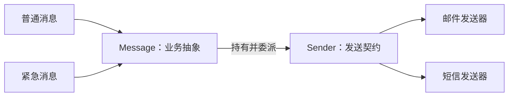

# 07 · 结构型扩展阅读：桥接与组合

> **阅读定位**：接续 [[03-结构型模式-代理-装饰器-适配器-门面-享元]]，补全结构型的另外两种 GoF 模式。“扩展阅读”表示建议先掌握前文，再结合业务练习；不表示这两种模式不重要或不常用。
>
> **一句话区分**：桥接解决“两套变化怎么独立扩展”；组合解决“一个对象和一组对象怎么统一处理”。所有示例均为教学用 Java 17+ 单文件程序，无第三方依赖；发送通知仅打印文本，不访问网络。

---

## 一、桥接模式（Bridge）：通知类型与发送方式分开变化

### 1. 直白定义与要解决的问题

**桥接就是把两个需要独立扩展的维度拆成两套类型，用对象持有和委派把它们接起来。** GoF 所说的“抽象与实现分离”，不是单纯写一个接口，而是业务抽象层次和实现层次能分别演进。

例如通知有“普通消息、紧急消息”，发送有“邮件、短信”。如果全部靠继承，会出现 `NormalEmailMessage`、`UrgentEmailMessage`、`NormalSmsMessage`、`UrgentSmsMessage`。新增一种通知类型，要为所有渠道再建一轮类。拆分后，两种消息类型各自负责内容规则，两种发送器各自负责发送方式，在运行时组合。

若两边分别有 m、n 个类型，继承组合可能需要 m×n 个类；桥接通常把两侧实现收敛到 m+n 的规模，外加稳定的抽象契约。实际发送次数和对象数并不会因此自动减少。

### 2. 关键角色与调用关系

| 角色 | 示例 | 职责 |
| :--- | :--- | :--- |
| 抽象 Abstraction | `Message` | 保存 `Sender`，组织通知的业务流程 |
| 扩展抽象 Refined Abstraction | `NormalMessage`、`UrgentMessage` | 定义不同消息类型的内容规则 |
| 实现接口 Implementor | `Sender` | 定义发送能力，不感知具体消息子类 |
| 具体实现 Concrete Implementor | `EmailSender`、`SmsSender` | 实现各自的发送方式 |
| 客户端 Client | `main` | 选择消息类型与发送器的组合 |



### 3. 完整 Java 示例：四种组合，不写四套消息子类

保存为 `BridgeDemo.java`，执行 `javac -encoding UTF-8 BridgeDemo.java`、`java BridgeDemo`。

```java
import java.util.Objects;

public class BridgeDemo {
    interface Sender {
        void send(String content);
    }

    static final class EmailSender implements Sender {
        public void send(String content) {
            System.out.println("EMAIL: " + content);
        }
    }

    static final class SmsSender implements Sender {
        public void send(String content) {
            System.out.println("SMS: " + content);
        }
    }

    abstract static class Message {
        private final Sender sender;

        Message(Sender sender) {
            this.sender = Objects.requireNonNull(sender);
        }

        public final void notify(String text) {
            sender.send(format(Objects.requireNonNull(text)));
        }

        protected abstract String format(String text);
    }

    static final class NormalMessage extends Message {
        NormalMessage(Sender sender) { super(sender); }

        protected String format(String text) {
            return "NORMAL " + text;
        }
    }

    static final class UrgentMessage extends Message {
        UrgentMessage(Sender sender) { super(sender); }

        protected String format(String text) {
            return "URGENT " + text;
        }
    }

    public static void main(String[] args) {
        Sender email = new EmailSender();
        Sender sms = new SmsSender();
        new NormalMessage(email).notify("order paid");
        new NormalMessage(sms).notify("order paid");
        new UrgentMessage(email).notify("disk almost full");
        new UrgentMessage(sms).notify("disk almost full");
    }
}
```

输出依次为 `EMAIL: NORMAL order paid`、`SMS: NORMAL order paid`、`EMAIL: URGENT disk almost full`、`SMS: URGENT disk almost full`。新增推送渠道，只需实现 `Sender`；新增摘要消息，只需扩展 `Message`。生产中还要为渠道能力、长度限制、失败重试和幂等定义清楚契约，并非所有组合都天然合法。

### 4. 适用边界、优缺点与易混区别

- **适用**：报表类型×导出介质、消息类型×发送渠道、设备类型×通信协议等，两边都有独立变化的需求。
- **不适用**：只有一个变化维度；发送方式长期固定；拆出的两边高度互相依赖，无法形成稳定能力契约。此时直接组合、策略或普通方法就可能足够。
- **优点**：避免按两个维度建立庞大继承矩阵；可分别测试两侧；实例可灵活装配。
- **缺点**：增加接口和委派层；契约设计困难；若渠道特性不断泄漏到消息层，仍会重新耦合。它也不负责自动选择渠道。

| 易混模式 | 与桥接的区别 |
| :--- | :--- |
| 策略 | 重点是替换一族算法；桥接重点是让业务抽象与实现两套层次独立演进。两者都可能使用接口组合，要看变化意图。 |
| 适配器 | 把现有的不兼容接口翻译成目标接口；桥接是在建模时拆分独立维度。某个 `Sender` 内部仍可再使用适配器。 |
| 装饰器 | 围绕同一接口一层层叠加职责；桥接连接的是不同职责的两侧，不要求它们实现同一接口。 |

> **面试总结**：桥接通过组合连接业务抽象层与实现层，使两侧分别扩展。例如普通/紧急消息和邮件/短信渠道独立建模，避免为每种交叉组合创建子类。只有一个算法变化点时，不必强行把策略升级为桥接。

---

## 二、组合模式（Composite）：文件与目录统一计算大小

### 1. 直白定义与要解决的问题

**组合把对象组织成“部分—整体”的树，让调用方用同一契约处理叶子对象和容器对象。** 对一个文件调用 `size()` 得到自身大小；对目录调用同一个 `size()`，由目录递归汇总孩子，无需调用方反复判断它是什么类型。

它适合目录、菜单、组织机构、设备分组等具有树形层次的数据。**Composite 组合模式不等于“策略 + 工厂 + 模板方法”搭配使用，也不等于所有 `has-a` 对象组合。** 本章 [[06-生产实战-策略+工厂+模板方法组合重构]] 讲的是多模式协同。

### 2. 关键角色与安全式接口

| 角色 | 示例 | 职责 |
| :--- | :--- | :--- |
| 公共组件 Component | `Node` | 定义叶子、容器都能支持的 `size()` 和 `print()` |
| 叶子 Leaf | `FileLeaf` | 保存文件大小，不管理孩子 |
| 组合节点 Composite | `Directory` | 管理孩子，递归执行统一操作 |
| 客户端 Client | `main` | 创建树，再通过 `Node` 使用它 |

本例把 `add()` 仅放在目录上，属于**安全式组合**：文件在编译期就没有“添加孩子”的操作。若把 `add/remove` 也放进公共接口，称为透明式设计；调用方更统一，但叶子只能拒绝这些不支持的操作，损失类型安全。

### 3. 完整 Java 示例：递归汇总与防止成环

保存为 `CompositeDemo.java`。这里的文件目录都是内存对象，不读写电脑文件。

```java
import java.util.ArrayList;
import java.util.List;
import java.util.Objects;

public class CompositeDemo {
    abstract static class Node {
        final String name;
        Directory parent;

        Node(String name) { this.name = Objects.requireNonNull(name); }
        abstract long size();
        abstract void print(String indent);
    }

    static final class FileLeaf extends Node {
        private final long bytes;

        FileLeaf(String name, long bytes) {
            super(name);
            if (bytes < 0) throw new IllegalArgumentException("negative size");
            this.bytes = bytes;
        }

        long size() { return bytes; }

        void print(String indent) {
            System.out.println(indent + name + " (" + size() + ")");
        }
    }

    static final class Directory extends Node {
        private final List<Node> children = new ArrayList<>();

        Directory(String name) { super(name); }

        void add(Node child) {
            Objects.requireNonNull(child);
            // 禁止把自己或祖先接成孩子，否则递归不会终止。
            for (Node cursor = this; cursor != null; cursor = cursor.parent) {
                if (cursor == child) {
                    throw new IllegalArgumentException("cycle");
                }
            }
            if (child.parent != null) {
                throw new IllegalArgumentException("already has a parent");
            }
            children.add(child);
            child.parent = this;
        }

        long size() {
            long total = 0;
            for (Node child : children) total = Math.addExact(total, child.size());
            return total;
        }

        void print(String indent) {
            System.out.println(indent + name + "/ (" + size() + ")");
            for (Node child : children) child.print(indent + "  ");
        }
    }

    public static void main(String[] args) {
        Directory root = new Directory("root");
        Directory notes = new Directory("notes");
        notes.add(new FileLeaf("patterns.md", 100));
        root.add(notes);
        root.add(new FileLeaf("readme.md", 80));
        Node node = root; // 使用方无需识别具体节点类型。
        node.print("");
        System.out.println("TOTAL=" + node.size()); // 180
    }
}
```

`Directory.size()` 委派给孩子，孩子可能继续是目录，也可能已经是文件。这里维护单父节点并拒绝成环，表示一棵树；若业务允许多父节点的有向图，需要重新定义去重和聚合语义。示例不支持并发修改；深树、反复汇总的性能、溢出与缓存失效也需要结合实际数据处理。

### 4. 适用边界、优缺点与易混区别

- **适用**：单个元素与元素组需要同样的操作，且对象天然具有树形“部分—整体”关系；例如目录求大小、设备组统计功耗、菜单树渲染。
- **不适用**：普通平铺集合已经够用；元素和容器没有共同的业务操作；对象关系本质是一般图却没有定义环与共享节点语义。
- **优点**：调用方统一使用组件接口；递归逻辑集中在容器；可增添叶子实现，而不修改客户端的类型判断。
- **缺点**：难以用单一契约表达所有层级约束；错误的树关系会导致重复计算或死递归；缓存聚合值时必须维护一致性。安全式与透明式接口需要取舍。

| 易混概念 | 与 Composite 的区别 |
| :--- | :--- |
| 对象组合、组合优于继承 | 泛指通过持有对象复用能力；Composite 进一步要求统一组件契约和递归的部分—整体结构。 |
| 多种模式组合使用 | 可以没有树与叶子/容器角色；仅把策略、工厂等放在一起，不会自动成为 Composite。 |
| 装饰器 | 通常包装一个同接口对象，主要为它增加职责；Composite 通常管理多个同接口孩子，主要表达树形整体。 |
| 迭代器 | 分离遍历方式；Composite 组织对象结构。树也可以提供独立迭代器，两者可以协作。 |

> **面试总结**：Composite 用统一组件接口表示叶子和容器，容器递归委派，从而统一处理树中的部分与整体。需要说明是否允许孩子操作、如何防环，以及它与普通对象组合、多模式搭配的区别。

---

## 三、扩展阅读自测

> [!question]- Q1：通知方式与消息类型各增加一种时，桥接需要新增哪些代码？
> 分别新增一个 `Sender` 实现和一个 `Message` 子类，再由装配代码选择组合。无需为所有交叉组合创建专用子类；但必须检查渠道是否支持新消息所需的能力。

> [!question]- Q2：为什么 `List<Node>` 本身不足以证明使用了组合模式？
> 普通集合只是存储关系；关键还要有叶子与容器共享的业务契约，以及容器对孩子递归委派的部分—整体语义。

> [!question]- Q3：两个模式能否一起使用？
> 可以。例如每个设备叶子通过桥接持有通信实现，设备组通过 Composite 递归管理设备。前者解决独立维度，后者解决层次结构，职责不同。

---

## 四、参考与章节导航

- 模式分类与意图：Gamma、Helm、Johnson、Vlissides，《Design Patterns: Elements of Reusable Object-Oriented Software》的 Bridge、Composite 章节。本文通知与目录代码为独立教学示例。
- 返回结构型正文：[[03-结构型模式-代理-装饰器-适配器-门面-享元]]
- 上一篇：[[06-生产实战-策略+工厂+模板方法组合重构]]
- 下一篇：[[08-行为型扩展-中介者-备忘录-解释器-访问者]]
- 复习定位：[[99-本章总结与复习]] | 本章目录：[[_index]]
