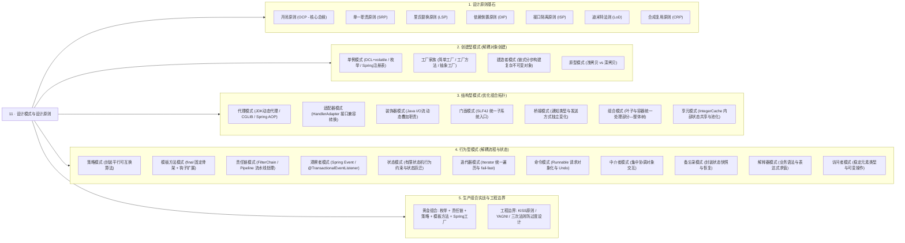

# 99 · 本章总结与复习：设计模式与设计原则

> 上一篇：[[08-行为型扩展-中介者-备忘录-解释器-访问者]] | 返回导读：[[00-设计模式全景与心智模型]]

---

## 一、全章知识架构全景图

设计模式与设计原则的核心目标并非追求复杂的类继承结构，而是**通过合理的职责划分与抽象间接层，隔离软件系统中高频变化的维度，降低模块间的耦合度，提升代码的可维护性与可扩展性**。



### 章节文档导航索引
0. [[00-设计模式全景与心智模型]]
1. [[01-七大面向对象设计原则]]
2. [[02-创建型模式-单例-工厂-建造者-原型]]
3. [[03-结构型模式-代理-装饰器-适配器-门面-享元]]
4. [[04-行为型模式上-策略-模板方法-责任链]]
5. [[05-行为型模式下-观察者-状态-命令-迭代器]]
6. [[06-生产实战-策略+工厂+模板方法组合重构]]
7. [[07-结构型扩展-桥接与组合]]（扩展阅读）
8. [[08-行为型扩展-中介者-备忘录-解释器-访问者]]（扩展阅读）

---

## 二、JDK / Spring / MyBatis / Netty 源码设计模式落地点速查总表

在高级 Java 工程师面试中，面试官极少让你背诵设计模式的教科书定义，而是要求你结合 **JDK、Spring、MyBatis、Netty** 等主流框架源码，剖析设计模式在工业级底层架构中的真实落地点。

| 设计模式 | 类型 | JDK 核心源码印证 | Spring 生态核心源码印证 | MyBatis / Netty 核心源码印证 | 源码设计的工程意图解析 |
| :--- | :--- | :--- | :--- | :--- | :--- |
| **单例模式 (Singleton)** | 创建型 | `java.lang.Runtime#getRuntime()`（饿汉式）、`Desktop` | `DefaultSingletonBeanRegistry`（三级缓存单例注册表） | MyBatis `ErrorContext`（基于 `ThreadLocal` 的线程级单例）、`LogFactory` | 避免重量级无状态基础设施组件重复创建，统一管控全局唯一状态或容器生命周期 |
| **简单工厂 / 静态工厂** | 创建型 | `Integer.valueOf()`、`Executors.newFixedThreadPool()`、`Collections.singletonList()` | `BeanFactory#getBean(String name)`（根据名称路由创建或获取 Bean） | MyBatis `SqlSessionFactoryBuilder` | 以语义化的静态方法或统一参数入口隐藏复杂的构造逻辑与实现类选择 |
| **工厂方法 (Factory Method)** | 创建型 | `Collection#iterator()`、`URLStreamHandlerFactory` | `FactoryBean<T>#getObject()`（将复杂第三方对象如 `SqlSessionFactory` 的构建逻辑封装在独立工厂类中） | MyBatis `SqlSessionFactory#openSession()`、Netty `ChannelFactory` | 将具体产品的实例化延迟到对应的工厂子类，新增产品时符合开闭原则 |
| **建造者模式 (Builder)** | 创建型 | `StringBuilder`、`Stream.Builder`、`HttpRequest.newBuilder()` | `BeanDefinitionBuilder`、`UriComponentsBuilder`、`MockMvcBuilders` | MyBatis `XMLConfigBuilder`、`MappedStatement.Builder`、Netty `ServerBootstrap` | 解决多可选参数构造器膨胀（重叠构造器反模式），分步骤组装复杂对象并在 `build()` 阶段集中校验不变式 |
| **原型模式 (Prototype)** | 创建型 | `Object#clone()`、`Cloneable`、`ArrayList#clone()` | `@Scope("prototype")` 原型作用域 Bean | MyBatis `CacheKey#clone()` | 当直接通过拷贝既有内存对象状态比重新执行复杂初始化流程成本更低，或需要隔离可变状态时使用 |
| **代理模式 (Proxy)** | 结构型 | `java.lang.reflect.Proxy`（JDK 动态代理）、RMI 远程桩对象 | `JdkDynamicAopProxy`、`CglibAopProxy`、`@Transactional` 事务拦截、`@Async` 异步代理 | MyBatis `MapperProxy`（将 Mapper 接口方法调用拦截并转化为 `SqlSession` SQL 执行） | 在不侵入目标对象源码的前提下，通过代理对象拦截方法调用，统一植入事务、日志、权限或远程 RPC 通信 |
| **适配器模式 (Adapter)** | 结构型 | `InputStreamReader`（字节流适配为字符流）、`Arrays.asList()`、`Executors.callable(Runnable)` | Spring MVC `HandlerAdapter`（适配多种形式的 Controller）、Spring AOP `MethodBeforeAdviceAdapter` | MyBatis `Log` 日志接口（适配 SLF4J、Log4j2、JUL 等不同日志实现） | 抹平既有遗留接口或第三方多样化组件与当前系统标准契约之间的不兼容，使调用方无需编写类型判断分支 |
| **装饰器模式 (Decorator)** | 结构型 | `java.io.BufferedInputStream`、`DataInputStream`、`Collections.synchronizedList()` | `BeanWrapper`、`HttpHeadResponseDecorator`、`TransactionAwareCacheDecorator` | MyBatis 二级缓存体系：`Cache` 接口下的 `LruCache`、`LoggingCache`、`SynchronizedCache` 层层装饰 | 以组合替代继承，在不改变原有接口契约的前提下，支持运行期像搭积木一样动态、按需叠加多层增强职责 |
| **外观/门面模式 (Facade)** | 结构型 | `java.lang.Class`（封装底层反射元数据子系统） | `JdbcTemplate`（封装 JDBC 连接获取、Statement 执行与资源释放）、`RequestContextHolder` | SLF4J `LoggerFactory`、MyBatis `SqlSession`（对外隐藏 `Executor`、`StatementHandler` 等复杂协作）、Tomcat `RequestFacade` | 为复杂的底层子系统提供极简、高内聚的高层统一入口，遵循迪米特法则降低客户端与内部组件的耦合 |
| **桥接模式 (Bridge)** | 结构型 | —（本次不据类名认定源码归属） | — | — | 将独立变化的业务抽象与实现拆开；完整教学示例“消息类型×发送方式”见 [[07-结构型扩展-桥接与组合]] |
| **享元模式 (Flyweight)** | 结构型 | `Integer.valueOf()`（`-128 ~ 127` `IntegerCache`）、`String` 字符串常量池 | Spring 内部大量缓存的 `ResolvableType`、`AnnotationUtils` 元数据缓存 | Netty `Recycler` 轻量级对象池、ByteBuf 内存池化 (`PooledByteBufAllocator`) | 分离不可变的内部状态（Intrinsic State，可共享）与可变的外部状态，通过缓存复用细粒度对象大幅降低 GC 压力 |
| **策略模式 (Strategy)** | 行为型 | `Comparator<T>`（注入 `Collections.sort()` 或 `TreeMap`）、`ThreadPoolExecutor` 的四种 `RejectedExecutionHandler` | `InstantiationStrategy`（Bean 实例化策略）、`Resource` 资源访问策略（`ClassPathResource` / `UrlResource`） | Netty `EventExecutorChooserFactory.EventExecutorChooser`（2 的幂次位运算选择策略 vs 普通取模策略） | 将一族平行可互换的算法独立封装，消除客户端围绕算法选择的硬编码分支，支持运行期动态替换 |
| **模板方法 (Template Method)** | 行为型 | `AbstractList`、`InputStream#read(byte[], int, int)`、`AbstractQueuedSynchronizer (AQS)`（`acquire` 固定骨架，`tryAcquire` 留给子类实现） | `AbstractApplicationContext#refresh()`（IOC 容器启动 12 步标准主干）、`JdbcTemplate`、`TransactionTemplate` | MyBatis `BaseExecutor`（固定一级缓存查询与事务管理骨架，将 `doUpdate`、`doQuery` 留给 `SimpleExecutor` / `BatchExecutor` 实现） | 在抽象父类中用 `final` 锁定不可变的算法主干步骤，将可变细节声明为 `abstract` 方法或可选 `protected` 钩子交由子类填空 |
| **责任链模式 (Chain of Responsibility)** | 行为型 | Servlet `Filter` 与 `FilterChain#doFilter`、`java.util.logging.Logger` | Spring MVC `HandlerExecutionChain`（`HandlerInterceptor` 拦截器链）、Spring Security `SecurityFilterChain`、Spring AOP `ReflectiveMethodInvocation` | Netty `ChannelPipeline` 与 `ChannelHandlerContext`（双向链表维护 Inbound / Outbound 事件处理链）、MyBatis `InterceptorChain` 插件链 | 将请求的发送者与多个处理节点解耦，每个节点专注单一横切职责，支持动态编排节点顺序与中途短路拦截 |
| **观察者模式 (Observer)** | 行为型 | `java.util.EventListener`、`CompletableFuture` 回调链 | `ApplicationEvent`、`ApplicationListener`、`@EventListener`、`@TransactionalEventListener` | Netty `ChannelFuture#addListener(GenericFutureListener)`（I/O 操作完成后的异步事件回调通知） | 建立事件源（Subject）与多个观察者（Observer）的一对多通知机制，消除主业务流程对下游衍生业务的硬编码正向依赖 |
| **状态模式 (State)** | 行为型 | `Thread.State` 线程状态机 | Spring StateMachine 状态机框架 | Netty `Channel` 生命周期状态流转（Unregistered -> Registered -> Active -> Inactive） | 将与特定状态绑定的合法操作与状态跃迁规则局部化到独立的状态类中，消除二维状态分支矩阵 |
| **迭代器模式 (Iterator)** | 行为型 | `java.util.Iterator`、`Iterable`、`ArrayList.Itr`（含 `modCount` 快速失败机制） | `CompositeIterator` | MyBatis `Cursor<T>` 流式查询游标迭代器 | 将游标遍历状态从容器底层数据结构中分离，对外提供统一的顺序访问契约并支持同一容器的多处并发遍历 |
| **命令模式 (Command)** | 行为型 | `java.lang.Runnable`、`Callable`（配合 `ThreadPoolExecutor` 调度） | Spring `JdbcTemplate` 中的 `StatementCallback` | Hystrix `HystrixCommand`（将远程请求封装为命令对象以支持排队、超时熔断与回退）、Netty `WriteTask` | 将方法调用请求封装为独立的一等公民对象，从而支持任务队列缓冲、异步线程调度、操作日志记录与逆向撤销（Undo） |

---

## 三、高频易混设计模式深度对比表

### 3.1 创建型辨析：简单工厂 vs 工厂方法 vs 抽象工厂

| 对比维度 | 简单工厂 (Simple Factory / 注册表工厂) | 工厂方法 (Factory Method) | 抽象工厂 (Abstract Factory) |
| :--- | :--- | :--- | :--- |
| **核心结构** | 一个具体工厂类（内部通过 `switch` 或 `EnumMap` 注册表），根据入参直接返回不同具体产品实例 | 定义抽象工厂接口 `createProduct()`，每个具体产品对应一个独立的具体工厂子类 | 定义创建**一族相关或相互依赖产品**的抽象工厂接口（含 `createButton()`、`createTextField()` 等多个方法） |
| **解决的核心问题** | 集中收口同一产品等级结构下不同实现的创建与路由逻辑 | 当某个产品的构建过程极其复杂（需读取特定配置、组装多层依赖），不适合塞进同一个简单工厂时，按产品拆分独立工厂 | 需要成套切换**“产品族（Product Family）”**（如跨操作系统的整套 UI 组件、跨云厂商的“对象存储 + 消息队列 + KMS”套件） |
| **对开闭原则的支持** | 传统 `if-else` 简单工厂新增产品需改工厂类；但结合 **Spring 依赖注入 + `Map` 自动注册**后，新增产品完全符合开闭原则 | 新增产品只需新建具体产品类与对应的具体工厂类，无需修改既有代码（符合 OCP） | **新增产品族**（如新增阿里云套件）符合 OCP；但**在产品族内新增一种产品类型**（如接口新增 `createCDN()`）需修改所有工厂实现类 |
| **Java 后端使用频率** | **极高**（Spring `Map` 注入策略工厂是日常业务开发首选） | **中高**（常见于框架扩展点，如 Spring `FactoryBean`） | **较低**（主要用于底层跨平台 SDK 或基础设施抽象层） |

### 3.2 结构型辨析：代理模式 vs 装饰器模式 vs 适配器模式

这三个模式在代码形态上都属于**“Wrapper（包装器）”**——内部持有一个目标对象的引用并对外暴露方法，但它们的设计初衷截然不同：

| 对比维度 | 代理模式 (Proxy) | 装饰器模式 (Decorator) | 适配器模式 (Adapter) |
| :--- | :--- | :--- | :--- |
| **核心设计意图** | **控制对目标对象的访问并植入横切管控**（权限拦截、事务开启提交、延迟加载、远程通信屏蔽） | **动态、可叠加地增强目标对象的功能职责**（如在基础字节流上叠加缓冲能力、压缩能力、加密能力） | **兼容转换不匹配的接口契约**，让原本因接口签名不兼容而无法协作的两个类能够一起工作 |
| **对外接口是否改变** | **严格保持不变**（代理类与目标类实现相同的接口或继承同一父类） | **严格保持不变**（装饰器与被装饰组件实现相同的顶层接口，因此支持无限层递归嵌套包装） | **发生改变**（将源接口 `Adaptee` 转换包装为客户端期望的目标接口 `Target`） |
| **与目标对象的绑定关系** | 关系在编译期或容器启动期固定，客户端通常**不感知甚至无法直接拿到**原始目标对象（由代理全权代表） | 关系在运行期由客户端**动态自由组装**（如 `new BufferedInputStream(new FileInputStream(file))`），客户端明确知道自己在层层叠加功能 | 仅起桥梁转接作用，不增强原有业务能力，只做参数格式转换与方法名映射 |
| **典型源码代表** | Spring AOP (`JdkDynamicAopProxy`)、MyBatis `MapperProxy` | `java.io.FilterInputStream` 体系、MyBatis `LruCache` / `LoggingCache` | `InputStreamReader`、Spring MVC `HandlerAdapter` |

### 3.3 行为型辨析（一）：策略模式 vs 状态模式 vs 模板方法模式

| 对比维度 | 策略模式 (Strategy) | 状态模式 (State) | 模板方法模式 (Template Method) |
| :--- | :--- | :--- | :--- |
| **核心设计意图** | 封装一族**平行、可互换的算法**，消除围绕“怎么做”的多分支判断 | 封装对象在**有限状态机生命周期内不同状态下的行为约束与状态跃迁规则** | 在抽象父类中**固化算法的骨架步骤次序**，将可变步骤延迟到子类实现，消除公共流程重复 |
| **核心实现机制** | **对象组合 + 多态接口**（遵循合成复用原则，灵活度高） | **对象组合 + 状态流转图**（状态实现类或引擎内部内聚状态变迁拓扑） | **类继承 + `final` 主干方法 + `abstract` / 钩子方法** |
| **实现类之间的耦合度** | 各具体策略类之间**完全解耦、互不感知** | 各具体状态类之间存在明确的**前置/后继状态流转依赖** | 子类强依赖父类的骨架执行顺序与上下文约定 |
| **生产组合关系** | 在企业级架构中，**策略模式与模板方法模式通常合并使用**：顶层定义 `Strategy` 接口供工厂路由，中间层编写 `AbstractTemplate` 实现该接口并固化公共锁与落库流程，底层具体 `Strategy` 继承模板类仅实现差异化步骤 | 独立用于订单、工单、支付单等具有严格状态流转约束的领域模型 | 常作为策略模式实现类的公共抽象基类，避免各策略内部重复编写样板代码 |

### 3.4 行为型辨析（二）：观察者模式 vs 责任链模式

| 对比维度 | 观察者模式 / 发布-订阅 (Observer / Pub-Sub) | 责任链模式 (Chain of Responsibility) |
| :--- | :--- | :--- |
| **拓扑结构与流向** | **一对多星型广播（Fan-out）**：事件源发布一次事件，所有匹配的监听器平级接收通知（可并行或异步执行） | **线性流水线传递（Pipeline）**：请求沿着预设顺序的节点链条依次向后传递（严格讲究先后次序） |
| **执行中断与返回值** | 监听器之间相互独立，某个监听器通常无权阻止其他监听器接收事件，且事件发布通常不依赖监听器的返回值 | 链条上的任意前置节点均可根据校验结果**随时短路中断（Short-Circuit）**后续节点的执行（如鉴权失败直接拦截返回） |
| **典型工程场景** | 订单支付成功后的积分发放、短信通知、审计上报等**后置衍生动作解耦** | 网关鉴权、参数校验、反洗钱风控过滤、HTTP 请求/响应拦截等**前置流水线管控** |

---

## 四、大厂面试高频 10 连问（深度解析版）

> [!question]- Q1：双重检查锁（DCL）单例模式中，为什么 `instance` 成员变量必须加上 `volatile` 关键字？如果不加会发生什么？如何防止反射和反序列化破坏单例？
> **1. 为什么必须加 `volatile`（禁止指令重排序）：**
> 在 Java 中，`instance = new Singleton()` 并非原子操作，它在字节码与 CPU 执行层面分为三步：
> - ① `memory = allocate()`：分配对象的堆内存空间；
> - ② `ctorInstance(memory)`：调用构造函数初始化对象成员变量；
> - ③ `instance = memory`：将 `instance` 引用指向刚分配的内存地址（执行完此步，`instance != null` 即成立）。
> 
> 若不加 `volatile`，JIT 编译器和处理器在遵守单线程 `as-if-serial` 语义的前提下，允许将步骤 ② 和步骤 ③ **重排序为 ① -> ③ -> ②**。
> 在高并发下，当线程 A 执行完 ① 和 ③（此时 `instance` 已非 `null`，但步骤 ② 构造函数尚未执行完毕，对象处于**半初始化状态**）时，线程 B 恰好进入外层第一重检查 `if (instance == null)`，发现 `instance != null` 便直接返回该引用并访问其内部字段，从而读到未初始化的零值甚至触发空指针异常（NPE）。
> 加上 `volatile` 后，JVM 会在写操作前后插入**内存屏障（StoreStore / StoreLoad Barrier）**，严格禁止步骤 ② 与步骤 ③ 重排序，确保任何线程看到 `instance != null` 时，对象的构造函数一定已经完整执行完毕。
> 
> **2. 如何防御反射与反序列化破坏单例：**
> - **防御反射攻击**：在私有构造器中增加状态检查或直接采用 **Java 枚举单例（`enum Singleton { INSTANCE; }`）**。JVM 在底层源码（`Constructor#newInstance`）中硬编码规定：若检测到类修饰符包含 `Modifier.ENUM`，直接抛出 `IllegalArgumentException("Cannot reflectively create enum objects")`。
> - **防御反序列化攻击**：普通单例类实现 `Serializable` 后，反序列化时 `ObjectInputStream` 会通过反射创建新实例，必须在类中显式定义 `private Object readResolve() { return instance; }` 钩子方法替换反序列化结果；而**枚举单例**在序列化时仅写入枚举常量名称，反序列化时通过 `Enum.valueOf()` 查找已有枚举对象，天然免疫反序列化破坏。

> [!question]- Q2：Spring 中的 Singleton Bean 和 GoF 单例模式有什么本质区别？Spring 是如何处理单例 Bean 的并发安全问题的？
> **1. 作用域边界的本质区别：**
> - **GoF 经典单例模式**：作用域是 **ClassLoader（类加载器）级别**。通过私有化构造器与静态方法控制，确保在同一个 JVM 进程的同一个 `ClassLoader` 下，该类有且仅有一个实例。
> - **Spring Singleton Bean**：作用域是 **IoC 容器（`ApplicationContext` / `BeanFactory`）级别**。Spring 并不限制类本身的构造器可见性（通常仍是 `public` 构造器），而是通过 `DefaultSingletonBeanRegistry` 内部的 `ConcurrentHashMap<String, Object> singletonObjects`（单例注册表），保证**每个 `beanName` 在同一个 Spring 容器实例中只创建并缓存一份实例**。如果同一个 JVM 中手动启动了两个独立的 `ApplicationContext`，或者在同一个容器中针对同一个类定义了两个不同 `id`/`name` 的 BeanDefinition，就会存在多个该类的实例。
> 
> **2. Spring 单例 Bean 的并发安全机制：**
> Spring 框架本身**仅保证单例 Bean 创建与获取过程（注册表管理）的线程安全**，而**不对单例 Bean 内部业务执行期间的线程安全做任何兜底保证**。在工程实践中遵循以下准则：
> - **无状态设计（Stateless，占 99% 场景）**：日常编写的 `Controller`、`Service`、`Mapper` 内部只持有其他无状态 Bean 的 `final` 引用，不定义保存请求上下文的可变成员变量，所有业务数据均通过方法参数与局部变量在线程私有的虚拟机栈帧中传递，因此天然是线程安全的。
> - **有状态隔离**：若确实需要在单例 Bean 中维护请求级可变状态（如当前登录用户信息、链路 TraceId、数据库 Connection），必须使用 **`ThreadLocal`** 进行线程封闭；若为跨线程共享计数器或缓存，则必须使用 `AtomicLong`、`ConcurrentHashMap` 等并发容器。

> [!question]- Q3：JDK 动态代理和 CGLIB 动态代理在底层实现、性能特征及使用限制上有哪些区别？Spring Boot 是如何选择代理方式的？
> **1. 核心差异对比：**
> - **实现原理**：
>   - **JDK 动态代理**：基于 Java 反射机制，利用 `java.lang.reflect.Proxy` 在运行期动态生成实现目标接口的代理类字节码（类名形如 `$Proxy0 extends Proxy implements TargetInterface`），并将所有方法调用统一转发给 `InvocationHandler#invoke`。
>   - **CGLIB 动态代理**：基于 ASM 字节码框架，在运行期动态生成**继承自目标类**的子类字节码（类名形如 `TargetClass$$EnhancerBySpringCGLIB$$...`），通过重写父类非 `final` 方法并织入 `MethodInterceptor#intercept` 实现拦截，且引入了 `FastClass` 索引机制避免反射调用开销。
> - **使用限制**：
>   - **JDK 动态代理**：由于 Java 单继承限制（生成的代理类已继承 `java.lang.reflect.Proxy`），**强制要求目标类必须至少实现一个业务接口**，且只能代理接口中声明的方法。
>   - **CGLIB 动态代理**：无需目标类实现接口，但由于基于继承重写机制，**无法代理被 `final` 修饰的类，也无法拦截被 `final`、`private` 或 `static` 修饰的方法**（调用这些方法会直接走原始方法，导致 `@Transactional` 等切面静默失效）。
> - **性能特征**：在 JDK 8 及现代 JVM 中，当反射调用次数超过阈值（默认 15 次，`sun.reflect.inflationThreshold`）触发字节码动态生成优化（Inflation 机制）及 JIT 内联后，JDK 动态代理与 CGLIB 的运行期调用性能已处于同一数量级，不再构成选型瓶颈。
> 
> **2. Spring Framework 与 Spring Boot 的默认代理选择策略：**
> - 在传统 **Spring Framework**（`DefaultAopProxyFactory`）中：默认 `proxyTargetClass = false`，即如果目标类实现了接口则优先使用 JDK 动态代理，若未实现任何接口则退化使用 CGLIB。
> - 在 **Spring Boot 2.x / 3.x** 中：为了避免开发者因直接注入具体类（`@Autowired private OrderServiceImpl orderService;`）而在 JDK 动态代理下触发 `BeanNotOfRequiredTypeException` 类型转换异常，Spring Boot 在自动配置中将 `spring.aop.proxy-target-class` 的默认值改为了 **`true`**，即**无论目标类是否实现接口，默认统一采用 CGLIB 动态代理**（除非目标类本身是接口，如 MyBatis Mapper 或 Spring Data Repository，才会走 JDK 动态代理）。

> [!question]- Q4：代理模式（Proxy）和装饰器模式（Decorator）在代码结构上极其相似，面试中如何从第一性原理精准阐述二者的本质区别？
> 虽然二者都实现了与目标对象相同的接口并持有目标对象的引用，但在架构设计中有三个根本分水岭：
> 1. **核心意图不同（控制访问 vs 增强职责）**：
>    - **代理模式**的核心在于**“访问控制与隔离”**。调用方原本就只想调用目标对象的核心方法，代理类的职责是替目标对象挡在前面，处理与具体业务算法无关的横切管控（如判断调用方是否有权限、开启/提交数据库事务、将本地调用序列化为网络 RPC 请求、或者延迟到真正使用时才初始化重量级对象）。
>    - **装饰器模式**的核心在于**“在原始核心能力之上动态叠加新职责”**。例如基础的 `FileInputStream` 只提供原始磁盘字节读取，`BufferedInputStream` 为其叠加了内存缓冲区预读能力，`GZIPInputStream` 又为其叠加了流式解压缩能力。每一层装饰器都在实实在在地扩展业务功能本身。
> 2. **目标对象的可见性与组装主导权不同**：
>    - 在**代理模式**中，目标对象通常对客户端是透明甚至隐藏的。客户端直接从容器或工厂获取到的就是代理对象，客户端既不关心也不知道代理背后的真实对象是如何创建的。
>    - 在**装饰器模式**中，原始组件由客户端自己显式创建，并由客户端根据当前场景需要，像搭积木一样显式地将原始对象一层层传给不同的装饰器构造器进行动态组装。
> 3. **递归嵌套特性不同**：装饰器模式天生为了支持**任意顺序、任意层数的递归嵌套组合**而设计；而代理模式通常只有一层（或由框架固定织入切面链），客户端不会手动去把一个代理对象再套进另一个同类型代理中。

> [!question]- Q5：Spring MVC 中的 `HandlerAdapter` 为什么需要使用适配器模式？如果不使用适配器模式，`DispatcherServlet` 会面临什么问题？
> **1. 背景痛点：**
> 在 Spring MVC 演进历程中，开发者定义请求处理器（Handler / Controller）的方式是高度多样且不断扩展的：
> - 现代最常用的基于 `@RequestMapping` 注解的方法级处理器（对应类型为 `HandlerMethod`）；
> - 实现传统 `org.springframework.web.servlet.mvc.Controller` 接口的类；
> - 实现 `HttpRequestHandler` 接口的资源处理器；
> - 响应式或函数式路由端点（`RouterFunction` / `HandlerFunction`）。
> 
> 由于这些不同类型的 Handler 根本没有共同的业务执行方法签名（有的叫 `handleRequest`，有的是任意自定义方法名加反射调用），因此 `HandlerMapping` 根据请求 URL 查找到返回的 Handler 只能声明为顶层 **`Object`** 类型。
> 
> **2. 如果不使用适配器模式的后果：**
> `DispatcherServlet#doDispatch` 核心分发方法内部就必须编写一长串针对 `Object mappedHandler` 的 `instanceof` 类型强转分支：
> ```java
> if (mappedHandler instanceof HandlerMethod) { ... }
> else if (mappedHandler instanceof Controller) { ... }
> else if (mappedHandler instanceof HttpRequestHandler) { ... }
> ```
> 一旦未来框架新增一种 Handler 编程模型，就必须直接修改核心引擎 `DispatcherServlet` 的源码，严重违背开闭原则（OCP）。
> 
> **3. `HandlerAdapter` 的破局之道：**
> Spring MVC 定义了统一的适配器契约接口 `HandlerAdapter`（包含 `boolean supports(Object handler)` 和 `ModelAndView handle(..., Object handler)`）。每种类型的 Handler 都配有一个专属的适配器实现类（如 `RequestMappingHandlerAdapter` 专门负责解析 `@RequestParam`/`@RequestBody` 并反射调用 `HandlerMethod`）。
> `DispatcherServlet` 只需遍历容器中的 `List<HandlerAdapter>`，通过 `adapter.supports(handler)` 找到匹配的适配器，然后统一调用 `adapter.handle(request, response, handler)`，从而使核心分发引擎与具体的 Controller 实现形式实现彻底解耦。

> [!question]- Q6：在生产项目中，你是如何消除复杂业务里的多重 `if-else` 的？请结合具体代码结构谈谈“策略 + 工厂 + 模板方法”是如何协同工作的？
> 在企业级复杂业务（如多渠道支付收银台、多类型优惠券核销、多平台外部订单同步）中，单纯使用某一个模式无法同时解决“路由选择”与“公共流程代码重复”两大问题。标准生产重构方案由四个核心层次协同工作：
> 1. **强类型枚举层（消除魔法值）**：定义业务类型枚举（如 `PayChannelEnum`），提供 `fromCode(String)` 静态查找表，将外部传入的字符串在入口处第一时间收敛为强类型枚举。
> 2. **顶层策略契约层（`Strategy` 接口）**：定义统一的业务处理接口，包含两个核心方法：`PayChannelEnum getChannel()`（自报家门，声明自身处理的枚举类型）与 `Result execute(Request)`（标准业务执行入口）。
> 3. **抽象模板骨架层（`AbstractTemplate` 抽象类实现 `Strategy` 接口）**：使用 **`final`** 修饰并实现 `execute(Request)` 方法，在其中将所有渠道通用的横切主干流程（前置责任链校验 -> 获取分布式幂等锁 -> 幂等状态核查 -> **调用 `protected abstract doChannelExecute()`** -> 统一落库交易流水 -> 发布完成领域事件 -> `finally` 释放锁）一次性写死。同时提供默认空实现的 `protected` 钩子方法供有特殊诉求的子类按需覆写。
> 4. **具体策略子类 + Spring 注册表工厂层**：
>    - 各个具体渠道类（如 `WechatPayStrategy`）继承抽象模板类，标注 `@Component`，只需编写几十行该渠道独有的第三方协议调用代码，完全无需关心锁与落库。
>    - 编写 `StrategyFactory` 组件，通过构造器注入 `List<PayChannelStrategy>`，在容器启动时遍历列表，以 `strategy.getChannel()` 为 Key 将所有策略装入 `EnumMap<PayChannelEnum, PayChannelStrategy>`。
>    - 门面服务调用 `factory.getStrategy(code).execute(req)`，以 $O(1)$ 时间复杂度完成无分支路由。未来新增渠道时，仅需枚举加一项并新建一个策略子类，既有核心代码实现真正的**零修改**。

> [!question]- Q7：状态模式（State）和策略模式（Strategy）的类图几乎一模一样，它们在实际业务建模时的核心区分标准是什么？
> 判断一个业务场景应当建模为策略模式还是状态模式，核心看以下三个本质标准：
> 1. **平行可互换性 vs 生命周期时序约束**：
>    - **策略模式**处理的是一组**平行的、可互相替代的等价方案**（如“用微信支付”还是“用支付宝支付”，“按满减算折扣”还是“按会员等级算折扣”）。客户端可以在调用前自由指定任意一种策略。
>    - **状态模式**处理的是领域实体在**有限状态机（FSM）生命周期内的严格时序阶段**（如订单从“待支付”到“已支付”再到“已发货”）。状态之间具有严格的先后流转方向与不可逆约束，调用方绝不可能跳过“待支付”直接把订单指定为“已完成”状态来执行。
> 2. **执行期间是否发生自主跃迁**：
>    - **策略模式**在单次请求选定策略后，整个执行期间策略对象保持不变，且各个策略类之间完全不知道彼此的存在。
>    - **状态模式**的核心职责恰恰在于**“动作触发后的状态跃迁”**——当在 `UnpaidOrderState` 上成功执行 `pay(order)` 动作后，状态机内部会自动将订单的当前状态推进变更为 `PAID`（即切换到 `PaidOrderState`）。
> 3. **拦截非法操作的职责**：状态模式天然承担着“在状态 X 下禁止执行动作 Y”的守卫职责（例如通过 `OrderState` 接口默认方法抛出 `IllegalStateException` 拦截“已发货状态下直接取消订单”），而策略模式不存在“某策略下禁止调用接口方法”的概念。

> [!question]- Q8：在使用 Spring 的 `@EventListener` 实现观察者模式时，如果主业务方法带有 `@Transactional` 事务，直接发布异步事件会引发什么线上事故？如何彻底解决？
> **1. 引发的两大线上生产事故：**
> 当主业务方法标注了 `@Transactional`，并在方法内部调用 `applicationEventPublisher.publishEvent(event)`，而下游监听器标注了 `@Async` 异步执行时：
> - **事故一（异步线程读不到未提交数据 / 查出旧状态）**：`publishEvent` 执行时，主线程的数据库事务尚未执行 `COMMIT`。异步线程池立即被唤醒去数据库查询刚刚插入或更新的订单记录，在 `READ COMMITTED` 或 `REPEATABLE READ` 隔离级别下，异步线程根本查不到未提交的新数据，导致下游业务报“订单不存在”或读到旧状态。
> - **事故二（主事务回滚导致幽灵外部通知）**：如果主线程在 `publishEvent` 之后的代码中抛出异常导致整个本地事务回滚，数据库里订单并未支付成功，但异步线程已经把“支付成功”的短信、优惠券或第三方发货指令发送出去了，造成严重的资损与客诉。
> 
> **2. 彻底解决方案：**
> - 将监听器的 `@EventListener` 替换为 **`@TransactionalEventListener(phase = TransactionPhase.AFTER_COMMIT)`**。Spring 底层会通过 `TransactionSynchronizationManager` 将监听器挂载到当前事务的同步回调钩子上，严格保证**只有当主事务真正成功 Commit 之后**，才触发该监听器；若主事务回滚，事件将自动被丢弃。
> - **关键避坑点**：当进入 `AFTER_COMMIT` 阶段时，原主事务已经提交完成。如果该监听器没有开启 `@Async` 而是在原线程同步执行，且监听器内部需要执行新的数据库 `INSERT/UPDATE` 操作，**必须在监听器上显式声明 `@Transactional(propagation = Propagation.REQUIRES_NEW)`**（或者配合 `@Async` 在新线程中开启标准 `@Transactional`），否则默认的 `REQUIRED` 传播行为会挂靠到已经提交完毕的旧事务资源上，导致新写入的数据无法提交落库！

> [!question]- Q9：Servlet 的 `FilterChain`、Spring MVC 的 `HandlerInterceptor` 以及 Netty 的 `ChannelPipeline` 都用到了责任链模式，它们在链条推进机制上有何差异？
> 这三者代表了责任链模式在工业界最经典的三种实现变体：
> 1. **Servlet `Filter` + `FilterChain`（函数调用栈递归推进型）**：
>    - 每个 `Filter#doFilter(req, resp, chain)` 方法都接收 `FilterChain` 对象作为参数。节点若决定放行，必须显式调用 `chain.doFilter(req, resp)`。
>    - 这种机制天然形成了**函数递归调用栈（洋葱模型）**：在 `chain.doFilter()` 之前编写的代码属于前置处理，在 `chain.doFilter()` 之后编写的代码会在下游所有节点及目标 Servlet 执行完毕后按**逆序（后进先出）**自动回溯执行，非常适合统一包裹耗时统计、编码转换或安全上下文清理。
> 2. **Spring MVC `HandlerInterceptor`（外部循环调度 + 三阶段拆分型）**：
>    - 拦截器本身不持有 `chain` 引用，而是由调度器 `HandlerExecutionChain` 维护拦截器数组下标 `interceptorIndex`。
>    - 它将前置、后置与最终清理明确拆分为三个独立方法：调度器先**正序循环**调用所有拦截器的 `preHandle()`（若某节点返回 `false`，立即中断并根据已记录的 `interceptorIndex` **逆序回溯**调用已放行节点的 `triggerAfterCompletion()`）；目标 Controller 执行成功后，再**逆序循环**调用所有拦截器的 `postHandle()`；最后在 `finally` 块中**逆序循环**调用 `afterCompletion()`。
> 3. **Netty `ChannelPipeline`（双向链表 + 上下文事件传播型）**：
>    - `ChannelPipeline` 内部维护了一个由 `AbstractChannelHandlerContext` 节点组成的**双向链表**（头部 `HeadContext`，尾部 `TailContext`）。
>    - 将处理器分为入站（`ChannelInboundHandler`，从 Head 向 Tail 正向传播）与出站（`ChannelOutboundHandler`，从 Tail 向 Head 逆向传播）。每个节点通过调用 `ctx.fireChannelRead(msg)` 或 `ctx.write(msg)` 自动在双向链表上寻找下一个匹配的节点推进事件，具有极高的吞吐灵活性与动态增删节点能力。

> [!question]- Q10：为什么在 `for-each` 循环中直接调用 `ArrayList.remove()` 会抛出 `ConcurrentModificationException`？迭代器模式是如何通过 `modCount` 实现 `fail-fast` 机制的？
> **1. 异常触发的底层链路：**
> - Java 的增强 `for-each` 循环（`for (T item : list)`）在编译期会被解糖为 `Iterator<T>` 的 `hasNext()` 与 `next()` 调用。
> - `ArrayList` 内部维护了一个记录集合结构变更次数的计数器 `modCount`（每次调用 `add`、`remove`、`clear` 等改变元素个数的方法时，`modCount++`）。
> - 当调用 `list.iterator()` 创建内部迭代器 `Itr` 时，迭代器会将容器当前的 `modCount` 快照保存到自身的成员变量 `expectedModCount = modCount` 中。
> - 如果在循环体内绕过迭代器，直接调用集合自身的 `list.remove(item)`，集合的 `modCount` 会加 1，但迭代器内部的 `expectedModCount` 保持不变，且迭代器的游标 `cursor` 不知道底层数组元素已经整体向左前移了一位。
> - 当进入下一轮循环调用 `iterator.next()` 时，第一行代码就会执行 `checkForComodification()`，发现 `modCount != expectedModCount`，立即抛出 `ConcurrentModificationException`（即 **Fail-Fast 快速失败机制**），防止因游标错位引发元素漏读或数组越界。
> 
> **2. 正确的遍历删除方式：**
> - **单线程遍历删除**：使用 JDK 8+ 的 `list.removeIf(item -> ...)`，或者显式使用 `Iterator` 并调用 **`iterator.remove()`**。因为 `Itr#remove()` 内部在调用外部集合删除元素后，会主动将游标回退（`cursor = lastRet`），并执行 **`expectedModCount = modCount`** 同步版本号，从而保证后续遍历安全进行。
> - **多线程并发遍历与修改**：使用 JUC 包下的 `CopyOnWriteArrayList`（采用 **Fail-Safe 写时复制快照机制**，迭代器直接持有创建瞬间的底层数组引用快照，写操作在拷贝的新数组上进行，读写完全分离，绝不会抛出 `ConcurrentModificationException`）。

---

## 五、面向对象与设计模式工程实践十项准则（Checklist）

在日常架构设计与代码评审（Code Review）中，请始终对照以下十项准则检验代码质量：

1. **以开闭原则（OCP）为终极标尺，但不做盲目的超前抽象**：只对系统中**已经发生过变化或明确即将扩展的维度**提炼接口与设计模式；对于固定不变的逻辑，保持最直接的线性表达。
2. **遵循三次法则（Rule of Three）演进重构**：第一次写功能追求简单直接（KISS）；第二次出现相似逻辑先提取公共私有方法观察边界；第三次接入同类扩展时，果断使用“策略 + 模板方法 + 工厂”彻底重构。
3. **优先使用对象组合而非类继承（CRP 合成复用原则）**：继承应仅用于存在明确 `is-a` 关系且需要复用模板方法主干骨架的场景（且继承层级严禁超过 3 层）；其余行为扩展一律优先采用接口组合与依赖注入。
4. **模板方法主干必须加 `final` 保护**：在编写 `AbstractTemplate` 抽象基类时，固化流程次序的模板方法必须用 `final` 修饰，严防子类重写主干方法绕过分布式锁、幂等校验或事务审计。
5. **消灭业务分支中的魔法字符串**：凡是用于策略路由或状态流转的标识码，一律收敛为强类型 `Enum`，并在工厂层使用 `EnumMap` 建立编译期与启动期双重校验的注册表。
6. **状态流转必须遵守“内存状态机拦截 + 数据库乐观锁兜底”**：使用状态模式通过接口 `default` 方法默认拦截一切非法状态动作；落库更新状态时，SQL 的 `WHERE` 条件必须带上前置状态（`WHERE id = ? AND status = 'UNPAID'`）。
7. **Spring 进程内事件必须对齐事务边界**：凡是在 `@Transactional` 方法内发布的领域事件，下游监听器若涉及外部通知或异步读取，一律使用 `@TransactionalEventListener(phase = TransactionPhase.AFTER_COMMIT)`，严防脏读与幽灵通知。
8. **警惕 CGLIB 代理的静默失效陷阱**：切勿在需要被 Spring AOP（如 `@Transactional`、`@Async`、`@Cacheable`）拦截的方法上使用 `final`、`private` 或 `static` 修饰符，且避免同类内部自调用（Self-Invocation）绕过代理对象。
9. **轻量级分支优先采用“枚举 + 函数式接口（Lambda）”**：当不同分支的差异仅在于几行纯内存计算公式时，直接将 `Function` / `BiFunction` 声明为枚举字段，无需拆出十几个只有几行代码的策略实现类。
10. **拒绝无意义的单一实现接口**：在领域内部组件设计中，如果某个类不存在多态替换诉求、也不需要对外暴露 RPC 契约，直接编写具体类即可，消除死板教条的 `IUserService` / `UserServiceImpl` 冗余间接层。

---

## 六、GoF 23 种完整覆盖与扩展阅读复习

以下按 GoF 口径计数；简单工厂、MVC、DI/IoC、DDD 和设计原则不另占名额。扩展阅读表示本章建议的学习顺序，不意味着对应模式在所有领域都低频。

| 分类 | 完整讲解位置 | 模式清单 |
| :--- | :--- | :--- |
| 创建型（5） | [[02-创建型模式-单例-工厂-建造者-原型]] | 单例、工厂方法、抽象工厂、建造者、原型 |
| 结构型（7） | [[03-结构型模式-代理-装饰器-适配器-门面-享元]] + [[07-结构型扩展-桥接与组合]] | 代理、装饰器、适配器、门面/外观、享元；扩展阅读：桥接、组合 |
| 行为型（11） | [[04-行为型模式上-策略-模板方法-责任链]] + [[05-行为型模式下-观察者-状态-命令-迭代器]] + [[08-行为型扩展-中介者-备忘录-解释器-访问者]] | 策略、模板方法、责任链、观察者、状态、迭代器、命令；扩展阅读：中介者、备忘录、解释器、访问者 |

### 6.1 六种扩展模式的一句话辨析

| 模式 | 解决的问题与示例 | 主要取舍 | 易混点 |
| :--- | :--- | :--- | :--- |
| 桥接 Bridge | 消息类型×发送方式独立扩展 | 多一层契约与委派，需保持两侧能力兼容 | 两套变化维度；策略重点是替换算法，适配器重点是兼容旧接口 |
| 组合 Composite | 文件与目录共享操作，目录递归汇总 | 树约束、防环、聚合缓存一致性 | 部分—整体树，不是“策略+工厂”等多模式搭配 |
| 中介者 Mediator | 聊天室集中处理成员间路由 | 防止协调者膨胀成上帝对象 | 协作规则不同于观察者的一对多通知 |
| 备忘录 Memento | 编辑器自行保存/恢复快照，历史栈不拆开看 | 拷贝与历史空间成本，可变引用要隔离 | 保存状态不同于命令保存动作；可组合实现撤销 |
| 解释器 Interpreter | 小语法的表达式树解释订单上下文 | 语法复杂度、解析与求值资源上限 | 业务 DSL 对象设计，不是 JVM 字节码解释器 |
| 访问者 Visitor | 文档/图片类型稳定，新增页数统计和审计操作 | 新操作容易，新增元素类型牵动访问者 | `accept/visit` 双分派，不是迭代器的遍历机制 |

### 6.2 扩展面试自测

> [!question]- Q11：组合模式与“组合优于继承”“多模式组合”有什么区别？
> 普通对象组合是持有和委派的复用手段，多模式组合是多种设计方式协作；Composite 还要求部分—整体的递归结构，以及叶子与容器共享的业务接口。可用目录 `size()` 举例。

> [!question]- Q12：为什么访问者适合类型稳定但操作常变的系统？
> 新操作通常新增访问者即可；新增元素类型则通常要扩展 Visitor 接口并调整各访问者。`accept/visit` 让元素类型与访问者实现共同决定处理逻辑，代价是两者耦合及潜在封装泄漏。

> [!question]- Q13：解释器与备忘录分别有哪些工程边界？
> 解释器适合小语法，必须考虑优先级、非法输入及表达式规模；不要把业务 DSL 混成 JVM 解释执行。备忘录需隔离可变引用、控制历史成本，不能把恢复内存状态当成回滚远程副作用。

---

> 上一篇：[[08-行为型扩展-中介者-备忘录-解释器-访问者]] | 返回导读：[[_index|本章导读]] | 全景回顾：[[00-设计模式全景与心智模型]]
