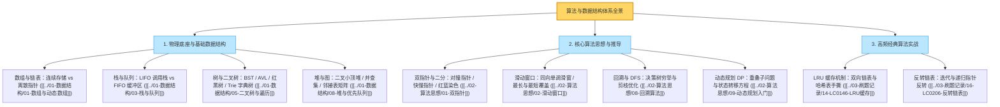
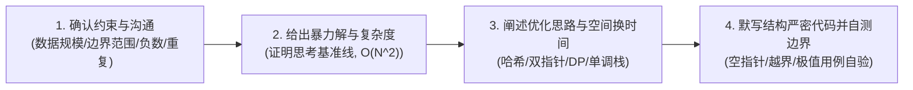

# 🧮 算法与数据结构 · 学习仪表盘与大厂手撕通关指南

> **第一性原理**：计算机算法的本质只有两件事——**【穷举】与【剪枝】**！
> 世界上所有的复杂数据结构，物理底层只有两种：**连续存储的【数组】**（寻址快、插入慢）与**离散指针的【链表】**（插入快、寻址慢）。树、图、堆、栈、队列、哈希表，皆是二者的逻辑组合封装！

---

## 1. 算法体系全景思维导图（一张图融会贯通）



---

## 2. 大厂面试手撕算法“四步白板通关 SOP”

在技术面试中，面试官扔出一道算法题，千万不要一言不发立刻敲代码！按照大厂标准 SOP 进行互动：



1. **Step 1：沟通约束条件（Clarification）**
   - 数组长度是多少？（$10^5$ 意味着必须在 $O(N)$ 或 $O(N \log N)$ 内搞定，暴力的 $O(N^2)$ 必定超时）；
   - 数据有负数吗？有重复元素吗？允许修改原数组吗？
2. **Step 2：给出保底思路（Baseline）**
   - 先用 30 秒向面试官阐明最直观的暴力枚举方案及其时间复杂度，让面试官知道你已经有了兜底解法。
3. **Step 3：推导最优解（Optimization）**
   - 阐述利用何种数据结构（如哈希表加速查找、双指针剪枝、前缀和消灭嵌套）将复杂度降低。
4. **Step 4：Bug-Free 编码与主动演练边界（Dry Run）**
   - 命名规范，书写清晰；写完后**主动用特异测试用例（如空数组、单元素、全部相同元素）进行人工白板单步推演**，给面试官留下极具工程严谨性的深刻印象！

---

## 3. 核心知识区导航（MOC）

- 🧱 **01 · 核心数据结构深入**：[[../01-数据结构/_index|数据结构专区]]（数组、链表、栈队列、哈希、二叉树、红黑树、堆、图、并查集、Trie）
- 💡 **02 · 核心算法思想**：[[../02-算法思想/_index|算法思想专区]]（双指针、滑动窗口、二分查找、排序、DFS/BFS、回溯、动态规划、背包全家桶）
- 📐 **04 · 工业级算法模板库**：[[../04-模板与技巧/_index|模板与解题套路]]（八大核心通用模板，支持白板无脑复用默写）
- 📝 **03 · 经典高频手撕题解**：[[../03-刷题记录/_index|LeetCode Top 100 实战]]（LRU、岛屿数量、最长递增子序列、反转链表等）

---

## 4. 必杀错题与重难点通关看板

- [x] **LRU 缓存机制（LC 146）**：[[../03-刷题记录/14-LC0146-LRU缓存]] —— 双向链表 + 哈希表，手撕 No.1！
- [x] **无重复字符的最长子串（LC 3）**：[[../04-模板与技巧/02-模板-滑动窗口]] —— 滑动窗口经典范式一！
- [x] **最小覆盖子串（LC 76 Hard）**：[[../04-模板与技巧/02-模板-滑动窗口]] —— 双指针滑动窗口终极模板！
- [x] **柱状图中最大的矩形（LC 84 Hard）**：[[../04-模板与技巧/06-模板-单调栈]] —— 单调递增栈 + 首尾哨兵技巧！
- [x] **和为 K 的子数组（LC 560）**：[[../04-模板与技巧/07-模板-前缀和与差分]] —— 前缀和 + 哈希表消灭负数难题！
- [x] **全排列与组合去重（LC 46/47/90）**：[[../04-模板与技巧/03-模板-回溯框架]] —— 排序 + 树层同层去重剪枝！
- [x] **零钱兑换与分割子集（LC 322/416）**：[[../02-算法思想/10-背包问题]] —— 0-1背包倒序 vs 完全背包正序！
- [x] **冗余连接无向图判环（LC 684）**：[[../04-模板与技巧/05-模板-并查集]] —— 路径压缩与按秩合并！

---

## 5. 一分钟复盘记忆卡

```text
======================= 算法通关核心口诀 =======================
穷举剪枝算核心，数组链表定乾坤。
双指针滑窗单调走，二分染色红蓝分；
回溯决策树中探，同层去重先排序；
动态规划查拓扑，01倒序完全正；
单调栈里视线阻，前缀和如积分深；
并查集认江湖老，路径压缩常数均；
手撕先理四步法，白板无畏大厂登！
======================================================================
```
