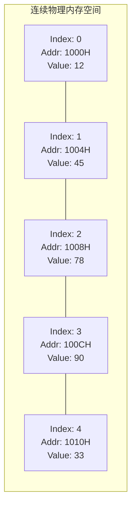
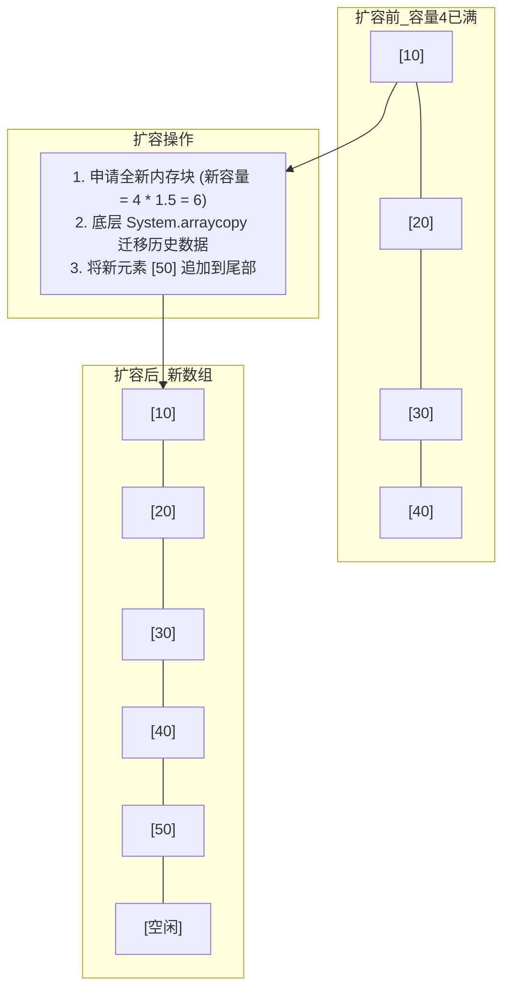

# 01 · 数组与动态数组底层物理模型与复杂度分析

> **导读**：数组（Array）是计算机科学中最基础、应用最广泛的线性数据结构。其基于连续物理内存空间的布局特性，赋予了它强大的 $O(1)$ 常数级随机访问能力与极致的 CPU 缓存局部性（Cache Locality）。但在插入、删除操作时，元素的物理平移也带来了 $O(n)$ 的线性开销。动态数组（如 Java 的 `ArrayList`）通过预分配与均摊扩容策略，在灵活性与高性能之间达成了平衡。本文从内存物理寻址、CPU 缓存行预取、动态扩容的均摊分析，到高频算法技巧进行全景剖析。

---

## 一、数组核心定义与物理内存模型

### 1. 技术定义
**数组（Array）**是由一组相同数据类型的元素构成的有限序列。在物理内存中，数组元素严格占用**一段连续的物理内存空间**。



### 2. 随机访问的第一性原理：内存寻址公式
为什么数组的按索引随机访问能够做到 $O(1)$ 时间复杂度？
- 假设数组在内存中的起始基地址为 $\text{BaseAddress}$；
- 每个元素占用的内存字节数为 $\text{element\_size}$（例如 32 位整型 `int` 占用 4 个字节）；
- 则访问下标为 $i$ 的元素时，CPU 的内存管理单元（MMU）直接通过一条简单的硬件算术逻辑指令计算出其物理内存绝对地址：

$$\text{Address}(i) = \text{BaseAddress} + i \times \text{element\_size}$$

> [!NOTE] 为什么大多数编程语言数组下标从 0 开始？
> 从寻址公式可以看出，下标 $i$ 在硬件物理本质上代表的是**相对于基地址的“偏移量（Offset）”**。若下标从 1 开始，每次寻址 CPU 都必须额外执行一次减法指令：`Address(i) = BaseAddress + (i - 1) * element_size`，在纳秒级高频计算中会造成不必要的指令时钟周期开销。

---

## 二、硬件级性能优势：CPU 缓存局部性（Cache Locality）

在现代计算机体系结构中，CPU 访问寄存器和 L1/L2 高速缓存的速度比直接访问主内存（DRAM）快 10 到 100 倍。

### 1. 空间局部性原理（Spatial Locality）
- **缓存行（Cache Line）机制**：CPU 从内存中读取数据时，并非单字节读取，而是以**缓存行（通常为 64 字节）**为单位将相邻数据整块预取到 L1/L2 缓存中。
- **数组的绝对优势**：由于数组元素在物理内存中严格相邻，当程序读取 `array[0]` 时，后续的 `array[1]` 到 `array[15]`（以 4 字节整数为例）已经被自动预加载进 CPU 缓存。后续连续访问几乎 100% 触发 **Cache Hit（缓存命中）**。
- **与链表对比**：链表节点的内存分布是离散分散的，顺序遍历链表会导致 CPU 频繁发生 **Cache Miss（缓存缺失）**，不得不反复向慢速主内存发起总线事务。因此在实际基准测试中，遍历大小相同的数组往往比遍历链表快一个数量级。

---

## 三、动态数组（Dynamic Array）底层扩容与均摊复杂度分析

传统静态数组在声明后长度固定，无法动态追加。Java 中的 `ArrayList` 和 C++ 中的 `std::vector` 通过封装动态数组解决了这一痛点。

### 1. 扩容机制底层原理（以 Java `ArrayList` 为例）
```java
// Java ArrayList 核心扩容机制
private void grow(int minCapacity) {
    int oldCapacity = elementData.length;
    // 新容量扩容为原容量的 1.5 倍 (向右位移 1 位相当于除以 2)
    int newCapacity = oldCapacity + (oldCapacity >> 1);
    
    if (newCapacity - minCapacity < 0)
        newCapacity = minCapacity;
        
    // 底层调用 native 的 System.arraycopy 执行整块内存数据复制
    elementData = Arrays.copyOf(elementData, newCapacity);
}
```



### 2. 均摊时间复杂度（Amortized Time Complexity）数学推导
虽然某一次扩容操作需要复制全部 $n$ 个历史元素，单次最坏耗时为 $O(n)$，但扩容并非每次都发生：
- 假设初始容量为 1，每次扩容为原来的 2 倍；
- 连续插入 $N$ 个元素，触发扩容的节点分别为：$1, 2, 4, 8, \dots, 2^k$；
- 复制元素产生的总额外搬家次数为：$1 + 2 + 4 + 8 + \dots + N/2 = N - 1$；
- 将这 $N - 1$ 次额外的搬迁成本均摊到全部 $N$ 次插入操作中：

$$\text{Amortized Cost} = \frac{N + (N - 1)}{N} \approx 2 = O(1)$$

> **结论**：动态数组在尾部追加元素的**均摊时间复杂度严格为 $O(1)$**。

---

## 四、数组核心操作复杂度与高频算法技巧

### 1. 操作时空复杂度矩阵

| 操作类型 | 时间复杂度 | 复杂度根因 | 优化与规避手段 |
| :--- | :---: | :--- | :--- |
| **按索引随机访问（Access）** | **$O(1)$** | 连续物理内存，利用寻址公式直接定位。 | 无需优化，极速操作。 |
| **尾部追加（Push Back）** | **$O(1)$ 均摊** | 未满时直接写入；满时触发均摊扩容。 | 在已知数据量规模时，初始化动态数组直接指定容量（如 `new ArrayList<>(10000)`），**彻底避免扩容复制**。 |
| **指定位置插入（Insert）** | **$O(n)$** | 插入点之后的所有元素必须物理向后平移 1 个单位。 | 若不要求保持顺序，可直接将末尾元素复制到被覆盖位置，实现 $O(1)$ 原地覆盖。 |
| **指定位置删除（Delete）** | **$O(n)$** | 删除点之后的所有元素必须物理向前平移 1 个单位补齐空位。 | 批量删除时改用快慢双指针原地覆盖。 |

### 2. 数组三大高频算法技巧

#### ① 快慢双指针：原地修改与覆盖（In-place Modification）
用于解决“原地去重”、“移动零”、“原地删除指定值”等空间复杂度要求 $O(1)$ 的问题：
```java
// 典型模板：原地移除值为 val 的元素
public int removeElement(int[] nums, int val) {
    int slow = 0; // slow 指针维护有效有效数据边界
    for (int fast = 0; fast < nums.length; fast++) {
        if (nums[fast] != val) {
            nums[slow] = nums[fast]; // 原地覆盖
            slow++;
        }
    }
    return slow; // 返回有效长度
}
```

#### ② 前缀和数组（Prefix Sum）：$O(1)$ 区间求和
```java
// 前缀和数组初始化 (推荐使用 length + 1 长度规避边界判断)
int[] prefix = new int[nums.length + 1];
for (int i = 0; i < nums.length; i++) {
    prefix[i + 1] = prefix[i] + nums[i];
}

// 快速查询闭区间 [left, right] 的和：耗时 O(1)
int rangeSum = prefix[right + 1] - prefix[left];
```

#### ③ 差分数组（Difference Array）：$O(1)$ 批量区间增减
用于在频繁对数组的某个区间 $[i, j]$ 内的所有元素同时加上一个增量 $k$ 的场景。区间增减操作只需修改两个端点：`diff[i] += k; diff[j + 1] -= k;`，最后对差分数组求前缀和即可还原最终数组。

---

## 五、场景演示：高铁连座与候车厅扩建

- **固定间距连座排号（物理连续内存空间）**：每排座位严格固定占地 1 米。乘务员手持 15 排车票（数组下标），无需从第 1 排逐一查验，直接按间距走出 $15 \times 1$ 米定位目标（`Base_Address + index * Element_Size`，随机访问耗时 $O(1)$）；巡检员看一眼即扫过整排旅客（CPU 缓存行空间局部性预取）。
- **加塞新座位（数组中间插入元素）**：若在第 5 排强行加座，必须腾出物理空位，第 5 排及之后的所有旅客必须全员起身后移一排（数据全量后移，时间复杂度 $O(n)$）。
- **隔壁划拨 1.5 倍场地并整体转移（动态数组扩容迁移）**：原候车大厅 100 张长椅坐满且后方无可用空地时，管理处在隔壁空地划拨能容纳 150 张长椅的新区（申请 1.5 倍大新连续内存），将旧大厅 100 名旅客全量搬迁过去（`System.arraycopy`），随后开放第 101 号及后续席位。

---

## 🧭 下一步

数组虽然拥有无与伦比的 $O(1)$ 随机读性能，但连续内存的要求也使其在“频繁任意位置插入与删除”场景下性能受到严重制约。
为了突破连续物理内存的束缚、实现真正的 $O(1)$ 局部插入与删除，我们需要引入**基于指针离散链接**的数据结构。
请进入下一篇核心专题：[[02-链表]]！
