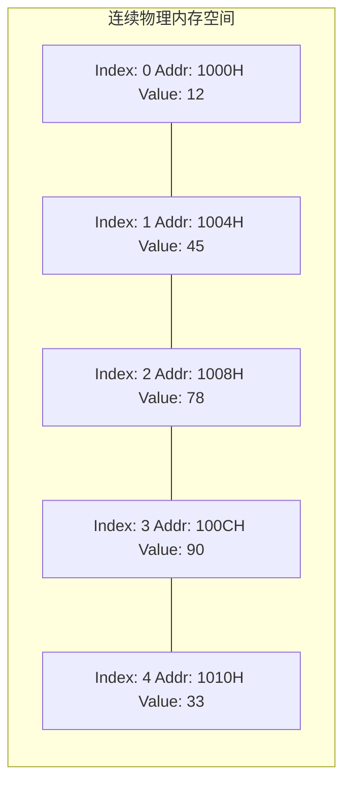
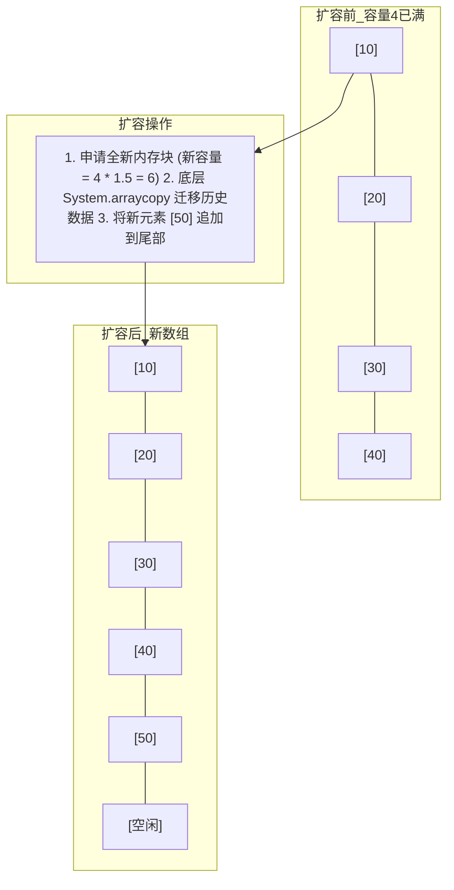

# 01 · 数组与动态数组底层物理模型与复杂度分析

> **导读**：数组（Array）是计算机科学中最基础、应用最广泛的线性数据结构。其基于连续物理内存空间的布局特性，赋予了它强大的 $O(1)$ 常数级随机访问能力与极致的 CPU 缓存局部性（Cache Locality）。但在插入、删除操作时，元素的物理平移也带来了 $O(n)$ 的线性开销。动态数组（如 Java 的 `ArrayList`）通过预分配与均摊扩容策略，在灵活性与高性能之间达成了平衡。本文从内存物理寻址、CPU 缓存行预取、动态扩容的均摊分析，到高频算法技巧进行全景剖析。

---

## 一、数组核心定义与物理内存模型

### 1. 技术定义
**数组（Array）**是由一组相同数据类型的元素构成的有限序列。在物理内存中，数组元素严格占用**一段连续的物理内存空间**。



### 2. 随机访问的第一性原理：内存寻址公式
为什么数组的按索引随机访问能够做到 $O(1)$ 时间复杂度？
- 假设数组在内存中的起始基地址为 $\text{BaseAddress}$；
- 每个元素占用的内存字节数为 $\text{element\_size}$（例如 32 位整型 `int` 占用 4 个字节）；
- 则访问下标为 $i$ 的元素时，CPU 的内存管理单元（MMU）直接通过一条简单的硬件算术逻辑指令计算出其物理内存绝对地址：

$$\text{Address}(i) = \text{BaseAddress} + i \times \text{element\_size}$$

> [!NOTE] 为什么大多数编程语言数组下标从 0 开始？
> 从寻址公式可以看出，下标 $i$ 在硬件物理本质上代表的是**相对于基地址的“偏移量（Offset）”**。若下标从 1 开始，每次寻址 CPU 都必须额外执行一次减法指令：`Address(i) = BaseAddress + (i - 1) * element_size`，在纳秒级高频计算中会造成不必要的指令时钟周期开销。

---

## 二、硬件级性能优势：CPU 缓存局部性（Cache Locality）

在现代计算机体系结构中，CPU 访问寄存器和 L1/L2 高速缓存的速度比直接访问主内存（DRAM）快 10 到 100 倍。

### 1. 空间局部性原理（Spatial Locality）
- **缓存行（Cache Line）机制**：CPU 从内存中读取数据时，并非单字节读取，而是以**缓存行（通常为 64 字节）**为单位将相邻数据整块预取到 L1/L2 缓存中。
- **数组的绝对优势**：由于数组元素在物理内存中严格相邻，当程序读取 `array[0]` 时，后续的 `array[1]` 到 `array[15]`（以 4 字节整数为例）已经被自动预加载进 CPU 缓存。后续连续访问几乎 100% 触发 **Cache Hit（缓存命中）**。
- **与链表对比**：链表节点的内存分布是离散分散的，顺序遍历链表会导致 CPU 频繁发生 **Cache Miss（缓存缺失）**，不得不反复向慢速主内存发起总线事务。因此在实际基准测试中，遍历大小相同的数组往往比遍历链表快一个数量级。

---

## 三、动态数组（Dynamic Array）底层扩容与均摊复杂度分析

传统静态数组在声明后长度固定，无法动态追加。Java 中的 `ArrayList` 和 C++ 中的 `std::vector` 通过封装动态数组解决了这一痛点。

### 1. 扩容机制底层原理（以 Java `ArrayList` 为例）
```java
// Java ArrayList 核心扩容机制
private void grow(int minCapacity) {
    int oldCapacity = elementData.length;
    // 新容量扩容为原容量的 1.5 倍 (向右位移 1 位相当于除以 2)
    int newCapacity = oldCapacity + (oldCapacity >> 1);
    
    if (newCapacity - minCapacity < 0)
        newCapacity = minCapacity;
        
    // 底层调用 native 的 System.arraycopy 执行整块内存数据复制
    elementData = Arrays.copyOf(elementData, newCapacity);
}
```



### 2. 均摊时间复杂度（Amortized Time Complexity）数学推导

虽然某一次扩容操作需要复制全部历史元素，单次最坏耗时为 $O(N)$，但扩容并非每次都发生。

为了直观理解，我们假设初始容量为 1，每次扩容为原来的 **2 倍**，连续插入 $N$ 个元素（假设 $N = 16 = 2^4$）：

| 插入事件 | 当前容量 | 发生的操作 | 本次额外搬家（复制）次数 |
| :--- | :---: | :--- | :---: |
| 插入第 1 个 | 1 | 放入即满 | 0 |
| 准备插第 2 个 | 1 $\to$ 2 | 容量满！扩容至 2，**搬运原有的 1 个元素**，放入第 2 个 | **1** |
| 准备插第 3 个 | 2 $\to$ 4 | 容量满！扩容至 4，**搬运原有的 2 个元素**，放入第 3 个 | **2** |
| 插入第 4 个 | 4 | 直接写入，刚好装满 | 0 |
| 准备插第 5 个 | 4 $\to$ 8 | 容量满！扩容至 8，**搬运原有的 4 个元素**，放入第 5 个 | **4** |
| 插入第 6~8 个 | 8 | 直接写入，插完第 8 个刚好装满 | 0 |
| 准备插第 9 个 | 8 $\to$ 16 | 容量满！扩容至 16，**搬运原有的 8 个元素**，放入第 9 个 | **8（即 $N/2$）** |
| 插入第 10~16 个| 16 | 容量已达到 16，**直接依次写入，期间不再触发任何扩容！** | 0 |

#### 为什么最后一项搬家次数是 $N/2$ 而不是 $N$？
- 因为当系统把容量扩充到 $N$ 的那一刻，旧数组里**总共只有 $N/2$ 个元素**，因此这次扩容只搬运了 $N/2$ 个旧元素；
- 扩容完成后，新数组容量已经为 $N$，接下来的元素（从 $N/2 + 1$ 到第 $N$ 个）直接存入空闲槽位即可，**根本不需要再次扩容**！

#### 均摊成本计算：
将历次扩容所复制的元素总次数累加（公比为 2 的等比数列求和）：
$$\text{总额外搬运次数} = 1 + 2 + 4 + 8 + \dots + \frac{N}{2} = 2^{\log_2 N} - 1 = N - 1$$

将这 $N - 1$ 次搬家成本分摊到全部 $N$ 次普通的插入操作上：
$$\text{均摊单次插入耗时} = \frac{N \text{ 次正常写入} + (N - 1) \text{ 次额外搬家}}{N} = \frac{2N - 1}{N} < 2 = O(1)$$

> **核心结论**：虽然极少数插入触发了 $O(N)$ 的搬家，但后续大量的 $O(1)$ 廉价插入均摊了成本，因此动态数组尾部追加元素的**均摊时间复杂度严格为 $O(1)$**。

---

## 四、数组核心操作复杂度与高频算法技巧

### 1. 操作时空复杂度矩阵

| 操作类型 | 时间复杂度 | 复杂度根因 | 优化与规避手段 |
| :--- | :---: | :--- | :--- |
| **按索引随机访问（Access）** | **$O(1)$** | 连续物理内存，利用寻址公式直接定位。 | 无需优化，极速操作。 |
| **尾部追加（Push Back）** | **$O(1)$ 均摊** | 未满时直接写入；满时触发均摊扩容。 | 在已知数据量规模时，初始化动态数组直接指定容量（如 `new ArrayList<>(10000)`），**彻底避免扩容复制**。 |
| **指定位置插入（Insert）** | **$O(n)$** | 插入点之后的所有元素必须物理向后平移 1 个单位。 | 若不要求保持顺序，可直接将末尾元素复制到被覆盖位置，实现 $O(1)$ 原地覆盖。 |
| **指定位置删除（Delete）** | **$O(n)$** | 删除点之后的所有元素必须物理向前平移 1 个单位补齐空位。 | 批量删除时改用快慢双指针原地覆盖。 |

### 2. 数组三大高频算法技巧

#### ① 快慢双指针：原地修改与覆盖（In-place Modification）
用于解决“原地去重”、“移动零”、“原地删除指定值”等空间复杂度要求 $O(1)$ 的问题：
```java
// 典型模板：原地移除值为 val 的元素
public int removeElement(int[] nums, int val) {
    int slow = 0; // slow 指针维护有效有效数据边界
    for (int fast = 0; fast < nums.length; fast++) {
        if (nums[fast] != val) {
            nums[slow] = nums[fast]; // 原地覆盖
            slow++;
        }
    }
    return slow; // 返回有效长度
}
```

#### ② 前缀和数组（Prefix Sum）：$O(1)$ 区间求和
```java
// 前缀和数组初始化 (推荐使用 length + 1 长度规避边界判断)
int[] prefix = new int[nums.length + 1];
for (int i = 0; i < nums.length; i++) {
    prefix[i + 1] = prefix[i] + nums[i];
}

// 快速查询闭区间 [left, right] 的和：耗时 O(1)
int rangeSum = prefix[right + 1] - prefix[left];
```

> [!tip] 深度剖析：为什么公式是 `prefix[right + 1] - prefix[left]`？
> 1. **核心定义（语义偏移）**：
>    我们将 `prefix` 数组的长度多开辟了 1 位（`nums.length + 1`），并规定 **`prefix[k]` 的语义为“`nums` 中前 `k` 个元素的累加和”**：
>    - `prefix[0] = 0`：表示前 0 个元素的和为 0；
>    - `prefix[1] = nums[0]`：表示前 1 个元素（索引 0）的和；
>    - `prefix[2] = nums[0] + nums[1]`：表示前 2 个元素（索引 0~1）的和；
> 2. **区间求和逻辑**：
>    我们要计算闭区间 `[left, right]` 的和（即 `nums[left] + ... + nums[right]`）：
>    - `nums[0...right]` 共有 **`right + 1`** 个元素，其总和等于 **`prefix[right + 1]`**；
>    - 多算的前半段 `nums[0...left - 1]` 共有 **`left`** 个元素，其总和等于 **`prefix[left]`**；
>    - 两者相减，刚好把前半段扣除，剩下的就是区间 `[left, right]` 的和：
>      $$\sum_{i=left}^{right} nums[i] = \text{prefix}[right + 1] - \text{prefix}[left]$$
> 3. **最大的工程好处（规避下标越界）**：
>    若不偏移 1 位，当 `left == 0` 时，求和公式必须写成 `prefix[right] - prefix[-1]`，会直接抛出数组越界异常，必须额外写 `if (left == 0)` 做防御；而偏移后，`left == 0` 时减去的是 `prefix[0]`（即 0），代码优雅且天然无分支判断。

$$\sum_{i=left}^{right} nums[i] = \text{prefix}[right + 1] - \text{prefix}[left]$$

---

#### ③ 差分数组（Difference Array）：$O(1)$ 批量区间增减

##### 1. 业务痛点：频繁区间修改的性能瓶颈
假设有一个长度为 $N$ 的数组，我们要频繁执行 10 万次区间更新指令（例如：“将索引 `[2, 5]` 之间的所有元素都加上 3”）。
- **暴力做法**：每次更新都用 `for` 循环遍历区间，单次耗时 $O(N)$，10 万次操作总耗时高达 $O(M \times N)$，直接超时（TLE）；
- **差分数组解法**：单次区间修改只需要**修改两个端点的值（$O(1)$ 极速完成）**，等全部更新指令执行完毕后，只需一次线性遍历即可统一还原出最终结果！

##### 2. 核心原理：差分是前缀和的“逆运算”
- **定义差分数组 `diff`**：
  `diff[0] = nums[0]`；对任意 $i > 0$，都有 **`diff[i] = nums[i] - nums[i - 1]`**（即每一项保存当前元素与前一个元素的差值）。
- **核心数学性质**：
  **对差分数组求前缀和，就能百分之百还原出原数组 `nums`！**
- **为什么区间 `[i, j]` 全部加上 `val` 只需要操作两个端点？**
  - 因为区间 `[i, j]` 内的所有相邻元素同时加上了 `val`，它们之间的**差值保持完全不变**；
  - 只有两处交界位置的差值改变了：
    1. `nums[i]` 变大了 `val`，而它前面的 `nums[i - 1]` 没变 $\implies$ **`diff[i] += val`**；
    2. `nums[j]` 变大了 `val`，而它后面的 `nums[j + 1]` 没变，导致差值 `nums[j + 1] - nums[j]` 相对减少了 `val` $\implies$ **`diff[j + 1] -= val`**。

##### 3. 完整 Java 代码实现与用法模板

```java
/**
 * 差分数组工具类：支持 O(1) 批量区间增减与 O(n) 最终还原
 */
public class Difference {
    // 差分数组
    private final int[] diff;

    public Difference(int[] nums) {
        if (nums == null || nums.length == 0) {
            throw new IllegalArgumentException("Array cannot be empty");
        }
        diff = new int[nums.length];
        // 1. 根据初始数组构造差分数组
        diff[0] = nums[0];
        for (int i = 1; i < nums.length; i++) {
            diff[i] = nums[i] - nums[i - 1];
        }
    }

    /**
     * 给闭区间 [i, j] 的每个元素都加上 val（耗时 O(1)）
     */
    public void increment(int i, int j, int val) {
        diff[i] += val;
        // 如果 j + 1 超出数组长度，说明修改影响一直延伸到了数组末尾，无需减去
        if (j + 1 < diff.length) {
            diff[j + 1] -= val;
        }
    }

    /**
     * 根据当前差分数组，还原并返回最终修改后的完整数组（耗时 O(n)）
     */
    public int[] result() {
        int[] res = new int[diff.length];
        // 对差分数组做前缀和累计，逐位还原原数组
        res[0] = diff[0];
        for (int i = 1; i < diff.length; i++) {
            res[i] = res[i - 1] + diff[i];
        }
        return res;
    }
}
```

##### 4. 运行实例走查（秒懂数据流转）

```java
public class DifferenceDemo {
    public static void main(String[] args) {
        // 初始数组：比如 5 个站点的公交车当前乘客数
        int[] nums = {1, 2, 3, 4, 5};
        Difference df = new Difference(nums);
        // 此时生成的初始 diff 数组为：[1, 1, 1, 1, 1]

        // 操作 1：区间 [1, 3] 全体加上 3（即站点 1 到 3 上车 3 人）
        df.increment(1, 3, 3);
        // 此时 diff 变动：diff[1] += 3 -> 4, diff[4] -= 3 -> -2

        // 操作 2：区间 [2, 4] 全体减去 2
        df.increment(2, 4, -2);

        // 最终一次性结算还原结果
        int[] finalArray = df.result();
        // 打印最终数组 -> [1, 5, 4, 5, 3]，各操作全部精确叠加！
        System.out.println(Arrays.toString(finalArray));
    }
}
```

---

## 五、场景演示：高铁连座与候车厅扩建

- **固定间距连座排号（物理连续内存空间）**：每排座位严格固定占地 1 米。乘务员手持 15 排车票（数组下标），无需从第 1 排逐一查验，直接按间距走出 $15 \times 1$ 米定位目标（`Base_Address + index * Element_Size`，随机访问耗时 $O(1)$）；巡检员看一眼即扫过整排旅客（CPU 缓存行空间局部性预取）。
- **加塞新座位（数组中间插入元素）**：若在第 5 排强行加座，必须腾出物理空位，第 5 排及之后的所有旅客必须全员起身后移一排（数据全量后移，时间复杂度 $O(n)$）。
- **隔壁划拨 1.5 倍场地并整体转移（动态数组扩容迁移）**：原候车大厅 100 张长椅坐满且后方无可用空地时，管理处在隔壁空地划拨能容纳 150 张长椅的新区（申请 1.5 倍大新连续内存），将旧大厅 100 名旅客全量搬迁过去（`System.arraycopy`），随后开放第 101 号及后续席位。

---

## 🧭 下一步

数组虽然拥有无与伦比的 $O(1)$ 随机读性能，但连续内存的要求也使其在“频繁任意位置插入与删除”场景下性能受到严重制约。
为了突破连续物理内存的束缚、实现真正的 $O(1)$ 局部插入与删除，我们需要引入**基于指针离散链接**的数据结构。
请进入下一篇核心专题：[[02-链表]]！
