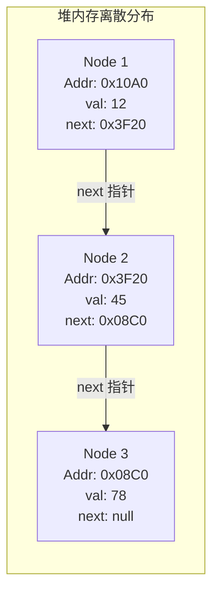
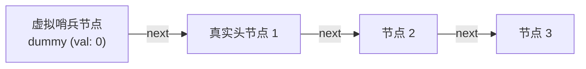

# 02 · 链表底层物理模型、指针技巧与复杂度分析

> **导读**：链表（Linked List）是一种通过指针将一组零散的物理内存节点连接在一起的线性数据结构。与数组强求连续物理空间不同，链表天然具备动态扩展能力，在已知目标位置时可实现 $O(1)$ 的常数级插入与删除。然而，离散的内存分布也导致其失去了随机访问能力（查询复杂度为 $O(n)$），并且无法享受 CPU 高速缓存局部性。掌握虚拟头节点（Dummy Head）、快慢双指针及原地指针反转技巧，是攻克链表类算法的核心抓手。

---

## 一、链表核心定义与物理离散存储模型

### 1. 技术定义与节点结构
在链表中，每个元素被称为一个**节点（Node）**。节点在堆内存中独立分配，物理地址不必连续。每个节点至少包含两个核心域：
- **数据域（Data Field / Value）**：存储业务有效数据；
- **指针域（Pointer / Reference Field）**：存储下一个（或前一个）节点的物理内存地址引用。



### 2. 常见链表形态分类

| 链表类型 | 节点指针域 | 结构特征 | 典型工业级应用 |
| :--- | :--- | :--- | :--- |
| **单向链表（Singly Linked List）** | 仅包含 `next` 指针 | 只能单向从头至尾遍历，内存开销最小。 | 简易单向流水线、哈希表拉链法（Java 7/8 HashMap 桶内链表）。 |
| **双向链表（Doubly Linked List）** | 包含 `prev` 与 `next` 指针 | 支持双向移动，可在 $O(1)$ 时间内删除给定节点（无需通过前驱遍历）。 | Java `LinkedList`、AQS 同步阻塞队列（CLH 变体）、LRU 淘汰缓存。 |
| **循环链表（Circular Linked List）** | 尾节点的 `next` 指向头节点 | 形成闭合环形结构，适合环状资源调度。 | 操作系统轮转调度（Round-Robin）、约瑟夫环问题。 |

---

## 二、数组 vs 链表底层的全方位对比

| 对比维度 | 数组（Array） | 链表（Linked List） | 架构选型建议 |
| :--- | :--- | :--- | :--- |
| **物理内存布局** | 严格占用一段**物理连续**的内存空间 | 内存节点**离散分布**，随用随申请（动态分配） | 内存碎片较多时链表更易申请成功 |
| **随机访问能力** | **$O(1)$**（内存基址公式直接物理寻址） | **$O(n)$**（必须从 head 开始顺着指针逐级步进） | 读多写少、频繁随机查询选数组 |
| **已知位置插入/删除** | **$O(n)$**（目标位置后续元素必须整体物理平移） | **$O(1)$**（仅需修改相邻节点的指针指向） | 写多读少、频繁在头尾或已知位置增删选链表 |
| **CPU 缓存命中率** | **极高**（空间局部性强，64 字节 Cache Line 自动预取） | **较低**（节点离散导致频繁触发 Cache Miss） | 追求极致遍历计算吞吐量选数组 |
| **额外内存开销** | 纯净无开销（仅存储业务数据本身） | 存在指针域元数据开销（64位JVM每个引用占 4~8 字节） | 存储极小对象时链表额外内存占比大 |

---

## 三、链表算法三大核心基石技巧

### 1. 技巧一：虚拟头节点（Dummy Head / Sentinel）
- **痛点**：在对链表执行删除或插入操作时，如果操作的目标恰好是**头节点（Head）**，由于头节点没有前驱节点，通常需要单独编写一套 `if (head == target)` 的特判代码，极易引发空指针异常。
- **解法**：在真实头节点之前人为引入一个虚拟哨兵节点：`ListNode dummy = new ListNode(0); dummy.next = head;`。将所有针对真实头节点的操作全部平滑降级为“中间节点的通用操作”，最终返回 `dummy.next` 即可。



### 2. 技巧二：快慢双指针（Two Pointers）
- **寻找链表中点**：`slow` 指针每次走 1 步，`fast` 指针每次走 2 步。当 `fast` 走到链表末尾时，`slow` 恰好停在链表中点（归并排序切分链表的核心基础）。
- **链表判环（Floyd 判圈算法）**：若链表中存在环，由于相对速度差为 1，`fast` 与 `slow` 必然在环内发生追及相遇。
- **寻找环入口的数学证明**：
  设链表起点到环入口距离为 $a$，环入口到相遇点距离为 $b$，相遇点继续走到环入口距离为 $c$。
  相遇时快指针走过的路程是慢指针的 2 倍：
  $2(a + b) = a + b + k(b + c)$（其中 $k$ 为快指针在环内绕过的圈数，且 $k \ge 1$）。
  化简得：$a = c + (k - 1)(b + c)$。
  **结论**：当快慢指针在环内相遇后，将一个指针重置回链表头部，两个指针同时以每次 1 步的速度前进，**两者再次相遇的物理位置必然是环的入口节点**！

### 3. 技巧三：多指针迭代反转（穿针引线防断链）
修改指针前，**必须先使用临时变量备份后继节点**，否则一旦执行 `cur.next = prev`，原有的后续节点引用将彻底丢失造成内存泄漏。

---

## 四、高频经典手撕算法模板

### 1. 经典三指针迭代反转链表（LeetCode 206）

```java
public ListNode reverseList(ListNode head) {
    ListNode prev = null;
    ListNode cur = head;

    while (cur != null) {
        ListNode next = cur.next; // 1. 必须先缓存下一个节点的地址
        cur.next = prev;          // 2. 将当前节点指针反向指向前驱
        prev = cur;               // 3. prev 指针前进一步
        cur = next;               // 4. cur 指针前进一步
    }
    return prev; // prev 成为新链表的头节点
}
```

### 2. 虚拟头节点删除链表元素（LeetCode 203）

```java
public ListNode removeElements(ListNode head, int val) {
    ListNode dummy = new ListNode(0);
    dummy.next = head;
    ListNode cur = dummy;

    // 统一处理所有节点，无需针对 head 做额外 if 特判
    while (cur.next != null) {
        if (cur.next.val == val) {
            cur.next = cur.next.next; // 跳过目标节点即完成物理删除
        } else {
            cur = cur.next;
        }
    }
    return dummy.next;
}
```

### 3. 合并两个升序有序链表（LeetCode 21）

```java
public ListNode mergeTwoLists(ListNode list1, ListNode list2) {
    ListNode dummy = new ListNode(0);
    ListNode tail = dummy;

    while (list1 != null && list2 != null) {
        if (list1.val <= list2.val) {
            tail.next = list1;
            list1 = list1.next;
        } else {
            tail.next = list2;
            list2 = list2.next;
        }
        tail = tail.next;
    }
    // 拼接剩余非空链表段
    tail.next = (list1 != null) ? list1 : list2;
    return dummy.next;
}
```

## 五、场景演示：密室寻宝与哨兵铁牌

- **散落全城的藏宝点（堆内存离散分布节点）**：节点物理地址彼此不连续，每个藏宝点只放本站线索（数据域 `val`）和下一站地址纸条（指针域 `next`）。
- **按纸条指示逐站寻访（顺序寻址 Sequential Access）**：探险者无法直接跳跃到第 4 站（无法 $O(1)$ 随机访问），必须从第 1 站按纸条指引骑车跑 $k-1$ 趟（遍历耗时 $O(n)$）；若撕毁中途纸条未留备份，后续整段路线彻底丢失（指针断链造成内存泄漏/无法访问）。
- **队伍入口固定铁牌（虚拟头节点 Dummy Head）**：检票口排队剔除无票者时，若首位常变会导致排头判断复杂。保安在最前固定立一个标志铁牌（哨兵节点 `dummy`），使真实首位游客始终成为“某节点的后继”，增删头节点逻辑统一化，无需任何边界特判。
- **两倍速侦探在环形跑道追逐（快慢指针判环 Floyd 算法）**：快侦探一次跨两步，慢侦探一次跨一步，进入环路后相对距离每步缩短 1，若存在环必在有限步内相遇，以此检测死循环。

---

## 🧭 下一步

在掌握了线性结构的数组与链表之后，我们将受限的插入与删除操作施加在链表或数组上，由此演化出了两种极其重要的抽象数据结构——**栈（Stack，后进先出 LIFO）**与**队列（Queue，先进先出 FIFO）**。
它们在括号匹配、单调栈计算以及高并发阻塞队列中扮演着怎样的核心角色？
请进入下一篇核心专题：[[03-栈与队列]]！
