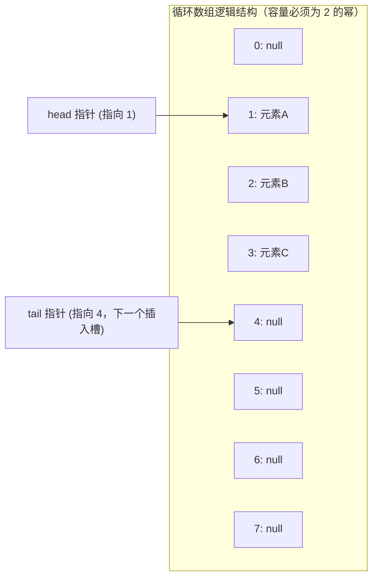
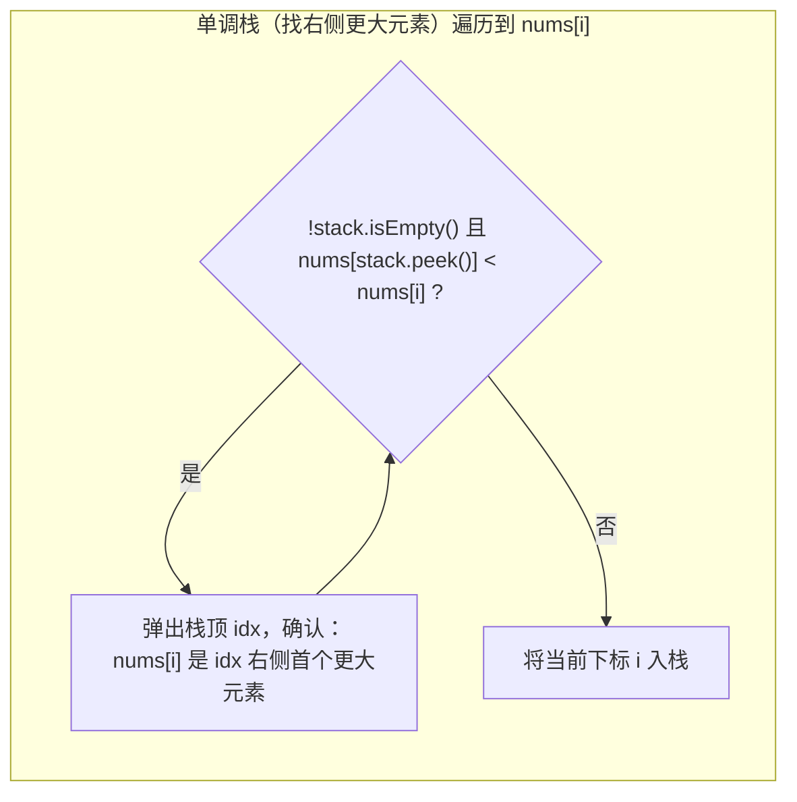
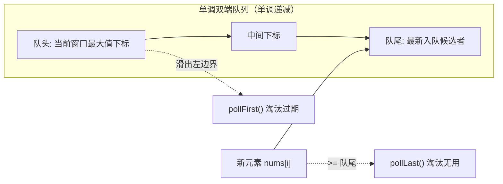

# 栈与队列

> [!abstract] 一句话总结
> 栈（LIFO）与队列（FIFO）是对线性表操作受限的抽象数据类型。栈的核心应用在于利用单调栈以 $O(N)$ 解决“下一个更大/更小元素”问题，队列的核心应用在于单调队列维护滑动窗口最值及 BFS 层序状态扩散。在 Java 工程实现中，必须使用 `ArrayDeque` 替代历史遗留的 `Stack`。

---

## 1. 结构本质与底层机制

### 1.1 为什么 Java 官方推荐 `Deque` 替代 `java.util.Stack`

`Stack` 仍保留在 Java 标准库中，并未标注为 deprecated；官方建议优先用 `Deque` 的栈接口。单线程算法通常选 `ArrayDeque`，理由如下：

1. **继承破坏封装性**：`Stack` 继承了 `Vector`。由于 `Vector` 暴露了基于索引的随机访问接口（如 `add(index, element)`、`remove(index)`、`get(index)`），导致用户可以绕过后进先出（LIFO）的语义在栈底或栈中插入删除元素，破坏了栈的不变量。
2. **严重的同步锁性能损耗**：`Vector` 的许多核心操作使用 `synchronized` 保护。在单线程算法场景下，无谓的监视器锁竞争与重入检查会产生巨大的性能开销。

> [!IMPORTANT] 选型规范
> - 栈接口实现：使用 `Deque<Integer> stack = new ArrayDeque<>();`，调用 `push()`、`pop()`、`peek()`。
> - 队列接口实现：使用 `Queue<Integer> queue = new ArrayDeque<>();`，调用 `offer()`、`poll()`、`peek()`。

---

### 1.2 `ArrayDeque` 循环双端数组实现机制

`ArrayDeque` 是基于动态循环数组实现的高性能双端队列，下面的掩码和 `doubleCapacity` 机制以 JDK 8 为例，属于实现细节，不能套用到所有 JDK 版本。JDK 21 使用边界判断回绕，容量也不保证为 2 的幂。



#### 指针移动与位运算取模
`ArrayDeque` 内部维护一个 `Object[] elements` 数组，以及两个游标 `head`（指向队头元素）和 `tail`（指向队尾待插入的空槽）。
JDK 8 这套实现的容量保证为 **2 的幂次方**（$2^k$）。当容量为 $2^k$ 且下标非负时，`index % capacity` 等价于 `index & (capacity - 1)`；负下标回绕对应 `Math.floorMod(index, capacity)`，不等于 Java 的负数 `%` 结果：

- **入队头 (`addFirst`)**：
  ```java
  head = (head - 1) & (elements.length - 1);
  elements[head] = e;
  ```
  若 `head == 0`，`head - 1` 为 `-1`（补码全 1），与掩码相与后直接跳到数组末尾下标 `elements.length - 1`，实现物理循环。
- **入队尾 (`addLast`)**：
  ```java
  elements[tail] = e;
  tail = (tail + 1) & (elements.length - 1);
  ```

#### 扩容机制（`doubleCapacity`）
由于 `tail` 指向下一个可用空位，当队列完全填满时，`head == tail` 成立。此时触发两倍扩容：
1. 分配容量为原大小 2 倍的新数组（`newCapacity = oldCapacity << 1`）。
2. 调用两次 `System.arraycopy` 将循环环形切片展开为线性序列：
   - 复制从 `head` 到原数组末尾的切片至新数组起始段；
   - 复制原数组从下标 `0` 到 `head` 的切片至新数组紧邻段；
3. 重置 `head = 0`，`tail = oldCapacity`。

> [!NOTE] 元素约束
> `ArrayDeque` 禁止存储 `null`。底层使用 `elements[head] == null` 作为队列为空的判断标记，插入 `null` 会直接抛出 `NullPointerException`。

---

## 2. 单调栈（Monotonic Stack）

### 2.1 核心原理与不变量维护

单调栈是指在整个操作过程中，栈内元素始终保持单调递增或单调递减的栈结构。
单调栈的核心用途是：在 **$O(N)$ 线性时间** 内找到每个元素左侧或右侧的**第一个更大或更小元素（Next/Previous Greater/Lesser Element）**。

#### 物理含义与出栈时机
以维护**栈底到栈顶单调递减**（寻找右侧第一个更大元素）为例：
- **进栈元素小于栈顶**：无法打破递减趋势，直接压栈。说明当前元素尚不能成为栈内元素的“更大者”。
- **进栈元素大于栈顶**：单调性被破坏！当前进栈元素正是导致栈顶元素被弹出的“直接原因”。**当前元素就是被弹出元素的右侧第一个更大元素**。
- 循环弹出所有小于当前元素的栈顶后，将当前元素入栈。
- 栈内通常存储**数组下标**，既可快速获取元素数值，又可直接计算元素间跨度距离。



---

### 2.2 代表母题与通用标准代码模板

#### 代表母题：下一个更大元素（Next Greater Element，LeetCode 496 / 739 原型）
> **题目描述**：
> 给定一个整数数组 `nums`，请你找到每个元素右边第一个比它大的元素。
> 返回一个数组 `result`，其中 `result[i]` 是 `nums[i]` 右侧第一个比它大的元素的下标；如果不存在，则填入 `-1`。
>
> **输入输出示例**：
> - 示例 1：
>   - 输入：`nums = [2, 1, 2, 4, 3]`
>   - 输出：`[3, 2, 3, -1, -1]`
>   - 解释：对于 `nums[0]=2`，右侧第一个比它大的是 `nums[3]=4`，下标为 3；对于 `nums[1]=1`，右侧第一个更大的是 `nums[2]=2`，下标为 2；对于 `nums[3]=4` 和 `nums[4]=3`，右边没有更大的，填 -1。

```java
import java.util.ArrayDeque;
import java.util.Arrays;
import java.util.Deque;

public class MonotonicStackTemplate {

    /**
     * 计算数组中每个元素右侧第一个更大元素的下标
     * 若右侧无更大元素，则结果为 -1
     * 时间复杂度: O(N)，每个元素最多入栈一次、出栈一次
     * 空间复杂度: O(N)，栈最大深度为 N
     */
    public static int[] nextGreaterElements(int[] nums) {
        int n = nums.length;
        int[] result = new int[n];
        Arrays.fill(result, -1);
        
        // 存储下标，栈内对应数值从栈底到栈顶严格单调递减
        Deque<Integer> stack = new ArrayDeque<>();

        for (int i = 0; i < n; i++) {
            // 当前元素大于栈顶对应元素，触发结算
            while (!stack.isEmpty() && nums[stack.peek()] < nums[i]) {
                int topIndex = stack.pop();
                result[topIndex] = i; // nums[i] 即为 nums[topIndex] 右侧首个更大元素
            }
            stack.push(i);
        }
        return result;
    }
}
```

---

## 3. 单调队列（Monotonic Queue）

### 3.1 核心原理与滑动窗口极值

普通队列先进先出，查询最值需 $O(K)$ 遍历。单调队列通过双端弹出策略，将滑动窗口极值查询均摊优化至 **$O(1)$**。

#### 双端维护与淘汰机制
维护一个从**队头到队尾数值单调递减**的双端队列（存下标）：
1. **队头过期淘汰**：若队头下标滑出当前窗口左边界（`deque.peekFirst() <= i - k`），从队头弹出。
2. **队尾劣汰淘汰**：新元素 `nums[i]` 入队前，若队尾对应元素小于等于 `nums[i]`，则队尾元素“既比新元素老，又比新元素小”，在后续任何包含 `nums[i]` 的窗口中都不可能成为最大值，从队尾彻底弹出。
3. **极值获取**：队头元素始终对应当前窗口的最大值。



---

### 3.2 代表母题与通用标准代码模板

#### 代表母题：LeetCode 239. 滑动窗口最大值
> **题目描述**：
> 给你一个整数数组 `nums`，有一个大小为 `k` 的滑动窗口从数组的最左侧移动到数组的最右侧。你只可以看到在滑动窗口内的 `k` 个数字。滑动窗口每次只向右移动一位。
> 返回滑动窗口中的最大值。
>
> **输入输出示例**：
> - 示例 1：
>   - 输入：`nums = [1,3,-1,-3,5,3,6,7], k = 3`
>   - 输出：`[3,3,5,5,6,7]`
>   - 解释：
>     - 窗口位置 `[1  3  -1]` 最大值为 3
>     - 窗口位置 `[3  -1  -3]` 最大值为 3
>     - 窗口位置 `[-1  -3  5]` 最大值为 5
>     - 窗口位置 `[-3  5  3]` 最大值为 5
>     - 窗口位置 `[5  3  6]` 最大值为 6
>     - 窗口位置 `[3  6  7]` 最大值为 7
> - 示例 2：
>   - 输入：`nums = [1], k = 1`
>   - 输出：`[1]`

```java
import java.util.ArrayDeque;
import java.util.Deque;

public class MonotonicQueueTemplate {

    /**
     * 滑动窗口最大值
     * 时间复杂度: O(N)，每个下标进出双端队列各至多一次
     * 空间复杂度: O(K)，队列存储窗口内的下标
     */
    public static int[] maxSlidingWindow(int[] nums, int k) {
        if (nums == null || nums.length == 0 || k <= 0) return new int[0];
        
        int n = nums.length;
        int[] result = new int[n - k + 1];
        int resIdx = 0;
        
        // 双端队列维护下标，对应数值从队头到队尾单调递减
        Deque<Integer> deque = new ArrayDeque<>();

        for (int i = 0; i < n; i++) {
            // 1. 队头淘汰：下标超出滑动窗口左边界 [i - k + 1, i]
            while (!deque.isEmpty() && deque.peekFirst() < i - k + 1) {
                deque.pollFirst();
            }

            // 2. 队尾淘汰：新元素更大，劣势旧元素永无翻身可能
            while (!deque.isEmpty() && nums[deque.peekLast()] <= nums[i]) {
                deque.pollLast();
            }

            // 3. 当前下标入队
            deque.offerLast(i);

            // 4. 窗口成型，记录极值
            if (i >= k - 1) {
                result[resIdx++] = nums[deque.peekFirst()];
            }
        }
        return result;
    }
}
```

---

## 4. 典型算法应用速览

| 方向 | 代表题号 | 一句话核心思路 |
| :--- | :--- | :--- |
| 单调栈（右侧更大） | LeetCode 739. 每日温度 | 维护单调递减栈，新元素高于栈顶时结算温差天数。 |
| 单调栈（循环数组） | LeetCode 503. 下一个更大元素 II | 将遍历范围扩展为 $2N$，下标取模 `i % n` 模拟循环数组扫描。 |
| 单调栈（柱状面积） | LeetCode 84. 柱状图中最大矩形 | 维护单调递增栈，元素出栈时左右边界即为该柱子向两端扩展的极限。 |
| 单调栈（双向约束） | LeetCode 42. 接雨水 | 栈底到栈顶递减，遇高柱出栈凹槽基准，以当前柱和新栈顶作左右壁算积水。 |
| 单调队列（窗口最值） | LeetCode 239. 滑动窗口最大值 | 递减双端队列，队头淘汰滑出边界者，队尾淘汰小于新入者，队头为窗口最值。 |
| 双栈模拟 | LeetCode 232. 用栈实现队列 | 入队压入 `inStack`，出队若 `outStack` 为空则将 `inStack` 元素倒序倒入。 |

---

### 代表性题目实现

> [!example]- 展开查看：LeetCode 739. 每日温度（单调栈）
> **题目描述**：给定一个整数数组 `temperatures` ，表示每天的温度，返回一个数组 `answer` ，其中 `answer[i]` 是指对于第 `i` 天，下一个更高温度出现在几天后。如果气温在这之后都不会升高，请在该位置用 `0` 来代替。
> **示例**：输入 `temperatures = [73,74,75,71,69,72,76,73]`，输出 `[1,1,4,2,1,1,0,0]`。
> **思路**：维护一个单调递减栈存储下标。遍历到当前天，若温度高于栈顶那天的温度，说明找到了栈顶那天的下一个更高温度，弹出栈顶并结算天数差 `i - prevIndex`。
> ```java
> class Solution {
>     public int[] dailyTemperatures(int[] temperatures) {
>         int n = temperatures.length;
>         int[] ans = new int[n];
>         Deque<Integer> stack = new ArrayDeque<>(); // 存储下标，温度严格递减
> 
>         for (int i = 0; i < n; i++) {
>             while (!stack.isEmpty() && temperatures[stack.peek()] < temperatures[i]) {
>                 int prevIndex = stack.pop();
>                 ans[prevIndex] = i - prevIndex;
>             }
>             stack.push(i);
>         }
>         return ans;
>     }
> }
> ```

> [!example]- 展开查看：LeetCode 84. 柱状图中最大的矩形（单调栈哨兵技巧）
> **题目描述**：给定 `n` 个非负整数，用来表示柱状图中各个柱子的高度。每个柱子彼此相邻，且宽度为 1。求在该柱状图中，能够勾勒出来的矩形的最大面积。
> **示例**：输入 `heights = [2,1,5,6,2,3]`，输出 `10`（高度为 5 和 6 的两根柱子构成面积为 $5 \times 2 = 10$ 的矩形）。
> **思路**：任一根柱子能向左右延伸的极限，取决于左右两侧第一个比它矮的柱子。维护单调递增栈，遇到更矮柱子时，当前栈顶出栈作为矩形高，新栈顶为左边界，当前遍历下标为右边界。首尾加入高度为 0 的哨兵可避免栈空和数组越界特判。
> ```java
> class Solution {
>     public int largestRectangleArea(int[] heights) {
>         int n = heights.length;
>         // 头部与尾部添加高度为 0 的哨兵，避免边界特判并强制清空栈
>         int[] newHeights = new int[n + 2];
>         System.arraycopy(heights, 0, newHeights, 1, n);
> 
>         Deque<Integer> stack = new ArrayDeque<>();
>         int maxArea = 0;
> 
>         for (int i = 0; i < newHeights.length; i++) {
>             while (!stack.isEmpty() && newHeights[stack.peek()] > newHeights[i]) {
>                 int curHeight = newHeights[stack.pop()];
>                 int left = stack.peek(); // 新栈顶为左侧第一个更低高度的下标
>                 int width = i - left - 1;
>                 maxArea = Math.max(maxArea, curHeight * width);
>             }
>             stack.push(i);
>         }
>         return maxArea;
>     }
> }
> ```

---

## 5. 工程实践与避坑指南

1. **避免 `NullPointerException`**：`ArrayDeque` 不允许存 `null`。若算法场景必须使用 `null` 标记（如层序遍历的分层哨兵），改用 `LinkedList` 或直接维护每层的 `size`。
2. **栈操作 API 混用风险**：`ArrayDeque` 同时实现了 `Queue` 和 `Deque`。
   - 作为栈时使用 `push()` / `pop()` / `peek()`（等价于 `addFirst` / `removeFirst` / `peekFirst`）。
   - 切忌在栈逻辑中调用 `add()` / `poll()`，否则会导致一头进一头出，隐蔽地退化为队列行为。
3. **单调栈单调性选型**：
   - 包含重复元素时，若要精确寻找严格大于，出栈条件为 `<` 还是 `<=` 取决于业务是否允许相等元素互相结算。从左到右为出栈元素结算“右侧第一个严格更大”时，条件应为 `nums[stack.peek()] < nums[i]`，相等不能结算。例如 `[2,2,3]` 两个 2 都应等到 3。反向扫描、为当前元素读取候选栈顶时则可用 `<=` 淘汰相等候选，两种写法的结算对象不同。

---

## 关联知识
- [[../02-算法思想/07-BFS广度优先]]
- [[../03-刷题记录/03-LC0020-有效的括号]]
- [[../03-刷题记录/11-LC0102-二叉树层序遍历]]

## 📚 参考资料
- 《算法导论》（Introduction to Algorithms）- 栈与队列基础
- [Java SE 21 Stack 文档](https://docs.oracle.com/en/java/javase/21/docs/api/java.base/java/util/Stack.html)
- [OpenJDK 21 ArrayDeque 源码](https://github.com/openjdk/jdk/blob/jdk-21-ga/src/java.base/share/classes/java/util/ArrayDeque.java)
- LeetCode 官方题库：单调栈与单调队列精选题单
