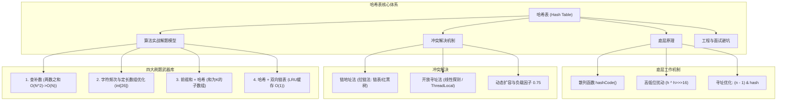
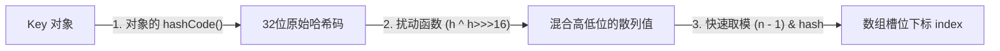
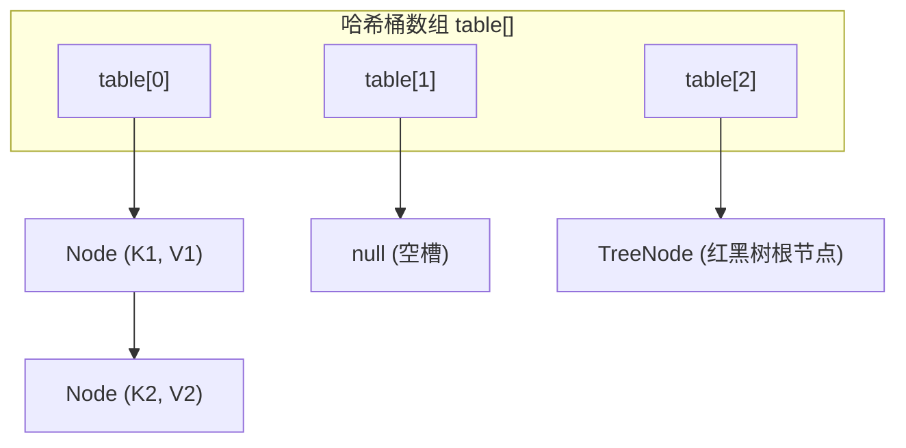
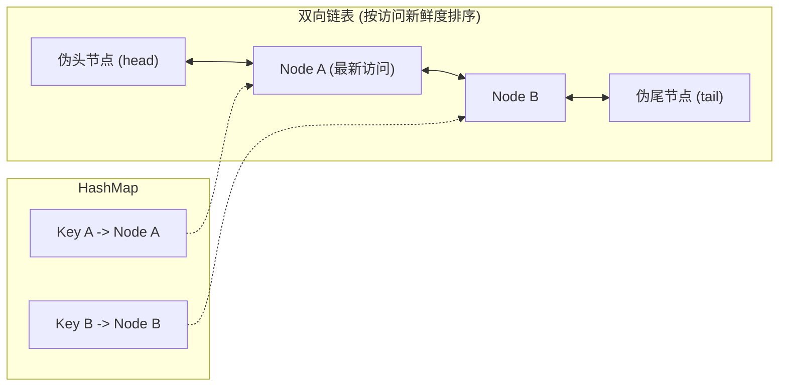

# 04 · 哈希表：散列原理、冲突解决与算法实战

> [!abstract] 一句话第一性原理
> **哈希表（Hash Table / 散列表）** 的本质是**通过散列函数将任意维度的键（Key）映射为定长数组的整数下标，用额外空间换取平均 $O(1)$ 的直接寻址能力**。

---

## 知识全景图



---

## 一、 为什么有了数组和链表，还需要哈希表？

数据结构演进的核心矛盾在于**查找效率与存储灵活性**的权衡：

| 数据结构 | 按下标/索引访问 | 按值（Key）查找 | 插入 / 删除 | 核心痛点 |
| :--- | :--- | :--- | :--- | :--- |
| **数组（Array）** | $O(1)$ 极快 | $O(N)$ 需线性扫描 | $O(N)$ 需搬移元素 | 无法使用非整型、稀疏或任意对象作为 Key 寻址 |
| **链表（LinkedList）** | $O(N)$ 逐个跳跃 | $O(N)$ 遍历全链 | $O(1)$（已知前驱节点） | 无法随机寻址，查找效率低下 |
| **平衡树（AVL / 红黑树）** | - | $O(\log N)$ 严格有序 | $O(\log N)$ 需旋转平衡 | 维持全局有序代价较高，达不到常数级 $O(1)$ |
| **哈希表（Hash Table）** | - | **平均 $O(1)$** | **平均 $O(1)$** | 无序存储、消耗额外空间、极端冲突时退化 |

哈希表通过**数组作为底层物理容器**，配合**哈希函数**将任意对象转为合法的数组下标，实现了在无序场景下的极致读写性能。

---

## 二、 底层工作机制与冲突解决（以 Java HashMap 为例）

### 1. 从对象到数组下标的三步映射

当调用 `map.put(key, value)` 时，底层并不是直接用对象内存地址去寻址，而是经过严密的三步计算：



#### ① 计算原始 HashCode
调用对象本身的 `key.hashCode()`，返回一个 32 位有符号整型（`int`）。

#### ② 高低位异或扰动（Spread Function）
```java
static final int hash(Object key) {
    int h;
    return (key == null) ? 0 : (h = key.hashCode()) ^ (h >>> 16);
}
```
- **为什么需要这一步？** 
  当数组长度较小（例如初始容量 $16$）时，二进制运算只会用到低 4 位。如果某些对象的哈希码仅高位不同、低位全相同，不经扰动就会发生严重的哈希碰撞。
- **作用**：将高 16 位与低 16 位进行异或混合，让高位的特征也参与到低位计算中，加大散列的随机性与均匀度。

#### ③ 寻址计算：位与运算替代取模
- 传统数组取模：`index = Math.floorMod(hash, table.length)`（CPU 除法指令非常昂贵）。
- 寻址：当数组容量 $n$ 恒为 $2$ 的幂次方时，数学上的非负模 $hash \pmod n$ 等价于 `(n - 1) & hash`；Java 的 `hash % n` 在 hash 为负时可能为负，不能直接混同。
  例如 $n = 16$，$n - 1 = 15$（二进制 `00001111`），任何数与 `00001111` 做位与，结果均落在 `0 ~ 15` 之间。
- **性能优势**：掩码避免除法形式的取模，也能保证下标非负；实际指令和耗时取决于编译器、JIT 与硬件，不能统一承诺周期或倍数。

---

### 2. 哈希冲突解决：链地址法 vs 开放寻址法

因为 32 位整数的总数有限（约 43 亿），而输入的对象键集合是无限的，根据**鸽巢原理**，哈希冲突（Hash Collision）在数学上必然存在。

#### 方案一：链地址法（拉链法，Java HashMap 采用）
所有散列到同一个槽位的元素，串联在一个链表中。
- **JDK 8 的红黑树优化**：JDK 8/21 的树化阈值为 `TREEIFY_THRESHOLD=8`，容量不足 `MIN_TREEIFY_CAPACITY=64` 时优先扩容。阈值触发还取决于插入路径，不能简化为“第 8 个节点一定树化”。`UNTREEIFY_THRESHOLD=6` 用于扩容拆分后的退化判断；普通删除还会按树形结构决定退化。
- **为什么阈值是 8 和 6？** 根据泊松分布概率论计算，在正常均匀散列下，单槽位链表长度达到 8 的概率不足千万分之一。阈值设为 8 是为了防范恶意攻击或极端偏斜；退化阈值设为 6（而不是 7）是为了留出缓冲空间，防止在 7 和 8 之间频繁震荡进行红黑树与链表的互相转换。



#### 方案二：开放寻址法（Open Addressing，ThreadLocalMap 采用）
不使用外部链表，所有元素全部紧凑存放在主数组中。当发生冲突时，按照某种探查规则寻找下一个空闲槽位（如线性探测：`index = (index + 1) % len`）。
- **优势**：没有链表指针开销，CPU 缓存行（Cache Line）局部性极好。
- **劣势**：删除节点不能直接设为 `null`（必须打删除标记/重哈希），随着装载率上升，容易发生群集（Clustering）现象，性能断崖式下跌。

---

### 3. 扩容（Rehash）与负载因子 0.75

- **负载因子（Load Factor）**：$\alpha = \frac{\text{元素总个数}}{\text{数组容量}}$。默认值为 `0.75`。
- **为什么是 0.75？** 空间与时间的帕累托折中：
  - 若设为 $1.0$：空间利用率高，但后半段哈希冲突急剧增多，查询链路变长，时间开销显著增大；
  - 若设为 $0.5$：冲突极少、查询极快，但数组有一半空间闲置，内存浪费严重。
- **JDK 8 翻倍扩容的位运算技巧**：
  由于容量每次扩为原来的 2 倍（$oldCap \to 2 \times oldCap$），元素的新位置只需看新增的一位高位二进制是 0 还是 1：
  - 如果 `(e.hash & oldCap) == 0`，元素留在原槽位 `index`；
  - 如果 `(e.hash & oldCap) != 0`，元素迁移到 `index + oldCap` 槽位。
  无需重新计算每个键的哈希值，大大提升了扩容吞吐量。

---

## 三、 算法实战解题四大武器库

在算法题中，遇到哈希表千万不要仅仅当成“存键值对的工具”，它在算法策略中承担着以下四种强大的解题模式：

### 武器 1：查补数（以两数之和为代表，用时间换空间）

- **本质模型**：在数组中寻找一对元素满足 $A + B = \text{Target}$。
- **原始思路**：双重循环枚举 $A$ 和 $B$，耗时 $O(N^2)$。
- **哈希破局**：遍历到当前元素 $x$ 时，我们要找的补数（Need）是固定的：$\text{need} = \text{Target} - x$。我们把已经遍历过的元素放入哈希表，每次只需要耗费 $O(1)$ 检查哈希表内是否存在 `need`。

```java
public int[] twoSum(int[] nums, int target) {
    // Key: 数值, Value: 对应下标
    Map<Integer, Integer> map = new HashMap<>();
    for (int i = 0; i < nums.length; i++) {
        int complement = target - nums[i];
        if (map.containsKey(complement)) {
            return new int[]{map.get(complement), i};
        }
        // 边查边放，保证不会与自己重复配对
        map.put(nums[i], i);
    }
    return new int[0];
}
```

---

### 武器 2：频次统计与定长数组优化

- **本质模型**：统计序列中各元素出现的频次，用于判断异位词、查找最高频元素、窗口去重等。
- **工程与算法性能陷阱**：在小字符集（如 26 个小写英文字母、ASCII 128 字符）场景下，**不要使用 `HashMap<Character, Integer>`**！
  - `HashMap` 涉及对象的自动装箱与拆箱（`char` $\leftrightarrow$ `Character`，`int` $\leftrightarrow$ `Integer`）；
  - 涉及桶数组计算、链表节点分配、内存开销巨大且常数级耗时高。
- **优化方案**：直接使用 `int[26]` 或 `int[128]` 数组，用偏移量作为索引，通常减少常数开销，具体提速需要基准测试：

```java
// 示例：判断 s 和 t 是否为有效的字母异位词 (LeetCode 242)
public boolean isAnagram(String s, String t) {
    if (s.length() != t.length()) return false;
    
    int[] count = new int[26];
    for (int i = 0; i < s.length(); i++) {
        count[s.charAt(i) - 'a']++;
        count[t.charAt(i) - 'a']--;
    }
    for (int c : count) {
        if (c != 0) return false;
    }
    return true;
}
```

---

### 武器 3：前缀和 + 哈希表（解决任意区间和问题）

- **核心场景**：求数组中有多少个连续子数组的和等于 $K$（如 LeetCode 560）。
- **数学推导**：
  连续子数组 $[i, j]$ 的元素之和为：
  $$\sum_{x=i}^{j} \text{nums}[x] = \text{prefix}[j] - \text{prefix}[i - 1]$$
  若要求区间和等于 $K$，即：
  $$\text{prefix}[j] - \text{prefix}[i - 1] = K \implies \text{prefix}[i - 1] = \text{prefix}[j] - K$$
- **解法**：我们从左到右维护当前前缀和 `currentSum`（即 $\text{prefix}[j]$）。每一步只要在哈希表中查询“历史上有多少个前缀和等于 `currentSum - K`”，并将结果累加进答案。
- **关键为什么：为什么必须提前 `map.put(0, 1)`？**
  > [!IMPORTANT] 为什么必须初始化 `map.put(0, 1)`？
  > 设想一种场景：数组下标 $0 \sim j$ 的所有元素之和恰好等于 $K$（即 `currentSum == K`）。
  > 此时需要寻找的补数是 `currentSum - K = 0`。
  > 此时的子数组是从下标 $0$ 开始截取的，对应的前缀状态是“一个数都不选时的前缀和为 $0$”。
  > 如果没有提前存入 `(0, 1)` 这条基线记录，所有从数组头部开始且自身累加和恰为 $K$ 的合法区间，都会被直接遗漏！

```java
public int subarraySum(int[] nums, int k) {
    int count = 0;
    int currentSum = 0;
    // Key: 前缀和数值, Value: 该前缀和出现的次数
    Map<Integer, Integer> prefixMap = new HashMap<>();
    
    // 关键基线：前缀和为 0 出现过 1 次（代表一个数都不选的前缀）
    prefixMap.put(0, 1);
    
    for (int x : nums) {
        currentSum += x;
        int targetPrefix = currentSum - k;
        if (prefixMap.containsKey(targetPrefix)) {
            count += prefixMap.get(targetPrefix);
        }
        // 记录当前前缀和出现频次
        prefixMap.put(currentSum, prefixMap.getOrDefault(currentSum, 0) + 1);
    }
    return count;
}
```

---

### 武器 4：哈希表 + 双向链表（LRU 缓存机制）

- **痛点**：
  - 纯哈希表：按 Key 查询是 $O(1)$，但没有顺序，无法感知数据被访问的时间先后；
  - 纯双向链表：可以按访问时间排序（最新访问放表头，淘汰表尾），但根据 Key 查节点需要 $O(N)$ 遍历。
- **组合破局**：
  - **哈希表**保存 `Key -> Node` 映射，提供 $O(1)$ 的定位能力；
  - **双向链表**串联所有节点，提供 $O(1)$ 的节点移动、插入与表尾删除能力。两者结合即构成了高频面试必考的 **LRU Cache（最近最少使用缓存）**。



Java 标准库直接提供了现成的实现：`LinkedHashMap`。只需重写 `removeEldestEntry` 即可秒变定长 LRU 缓存：

```java
class LRUCache<K, V> extends LinkedHashMap<K, V> {
    private final int capacity;

    public LRUCache(int capacity) {
        // accessOrder = true 表示按照访问顺序（get/put）排序，而非插入顺序
        super(capacity, 0.75f, true);
        this.capacity = capacity;
    }

    @Override
    protected boolean removeEldestEntry(Map.Entry<K, V> eldest) {
        // 当元素个数超过上限时，自动淘汰最久未访问的表头元素
        return size() > capacity;
    }
}
```

---

## 四、 工程避坑与大厂高频面试点

### 1. 为什么重写 `equals()` 必须同时重写 `hashCode()`？

这是 Java 面试中出现频率最高的基础题，但也是生产中引发严重线上事故的常客。

#### 核心契约约定
- 如果两个对象通过 `equals()` 比较为 `true`，那么它们的 `hashCode()` 返回值**必须相等**；
- 如果两个对象的 `hashCode()` 相等，它们通过 `equals()` 比较**不一定相等**（哈希冲突）。

#### 只重写 `equals` 漏写 `hashCode` 会引发什么灾难？
看以下生产隐患代码：

```java
public class User {
    private Long id;
    private String name;

    public User(Long id, String name) {
        this.id = id;
        this.name = name;
    }

    @Override
    public boolean equals(Object o) {
        if (this == o) return true;
        if (o == null || getClass() != o.getClass()) return false;
        User user = (User) o;
        return Objects.equals(id, user.id);
    }
    // 致命错误：遗漏了重写 hashCode()！
}
```

测试行为：
```java
Map<User, String> userMap = new HashMap<>();
User u1 = new User(1001L, "张三");
User u2 = new User(1001L, "张三");

userMap.put(u1, "VIP用户");

// 业务期望：u1 和 u2 的 id 相同，应该判定为同一个用户并取到 "VIP用户"
// 实际运行结果：userMap.get(u2) 返回 null！
System.out.println(userMap.get(u2)); // 输出: null
```

> [!CAUTION] 事故原因深度剖析
> 因为没有重写 `hashCode()`，`User` 继承 `Object.hashCode()` 的默认实现；Java 不保证其值等于对象地址。
> 两个按业务含义相等的实例仍可能得到不同哈希值。它们可能落入不同桶，也可能同桶但保存的哈希值不同；都可能使查询无法匹配到原记录。
> 当执行 `get(u2)` 时，HashMap 去查找 `u2` 的槽位，可能因桶或哈希值不匹配而不会调用到预期的 `equals` 比较，导致返回 `null`。即使某次碰巧查到，也不能依赖这种行为。

---

### 2. 为什么绝对不要使用可变对象（Mutable Object）作为 Map 的 Key？

```java
public class Point {
    public int x, y;
    public Point(int x, int y) { this.x = x; this.y = y; }
    
    @Override
    public int hashCode() { return Objects.hash(x, y); }
    @Override
    public boolean equals(Object o) {
        if (this == o) return true;
        Point p = (Point) o;
        return x == p.x && y == p.y;
    }
}
```

下述修改会破坏按原键内容定位条目的能力，Map 仍保留该条目，可能造成非预期内存保留：
```java
Map<Point, String> map = new HashMap<>();
Point p = new Point(1, 2);
map.put(p, "Target");

// 致命操作：外部修改了 Key 的内部属性！
p.x = 99;

// 此时根据新的 p 计算出的 hash 已经变了，被导向了新的槽位，根本找不到原来的桶！
System.out.println(map.get(p)); // 输出: null！
// 条目仍保留在 Map 中，但按新键内容查询/删除可能失败；遍历或 clear 仍可处理
```
**生产准则**：键在 Map 中存放期间，参与 `equals/hashCode` 的状态必须保持不变。优先用不可变键；所有字段为 `final` 并不保证引用对象内部也不可变。与键相等性无关的字段可独立改变。

---

### 3. 并发环境下的安全性问题

`HashMap` 严禁在多线程并发无锁环境下执行 `put` / `remove` 操作：
1. **JDK 7 的死循环问题**：JDK 7 扩容使用头插法，在并发扩容时会导致链表指针环化，后续 `get()` 遍历该链表时直接导致 CPU 100% 满载卡死。
2. **JDK 8 的数据丢失覆盖问题**：JDK 8 改用尾插法消除了死循环，但在多线程并发执行 `put` 且发生哈希冲突时，两个线程同时读取到相同的链表尾部指针，会发生并发后写覆盖（Lost Update），导致数据静默丢失。
3. **并发解决方案**：在多线程场景下，可使用 `ConcurrentHashMap`，或在所有相关访问外部统一同步。JDK 8/21 的 ConcurrentHashMap 采用 CAS 与桶级同步，不是 JDK 7 的 Segment 分段结构。

---

## 关联与实战刷题路线

- [[../03-刷题记录/01-LC0001-两数之和]] —— 查补数模式基石
- [[../03-刷题记录/21-LC0560-和为K的子数组]] —— 前缀和 + 哈希经典模型
- [[../03-刷题记录/14-LC0146-LRU缓存]] —— 哈希表 + 双向链表工业级结构
- [[01-数组与动态数组]] —— 底层定长数组与扩容机制
- [[02-链表]] —— 拉链法与双向链表核心

## 📚 参考资料

- [OpenJDK 21 HashMap 源码](https://github.com/openjdk/jdk/blob/jdk-21-ga/src/java.base/share/classes/java/util/HashMap.java)
- Java Development Kit 源码：`java.util.LinkedHashMap`
- 《算法导论》（Introduction to Algorithms）第 11 章：散列表
- 《Effective Java》第 3 版 Item 11：覆盖 equals 时总要覆盖 hashCode
