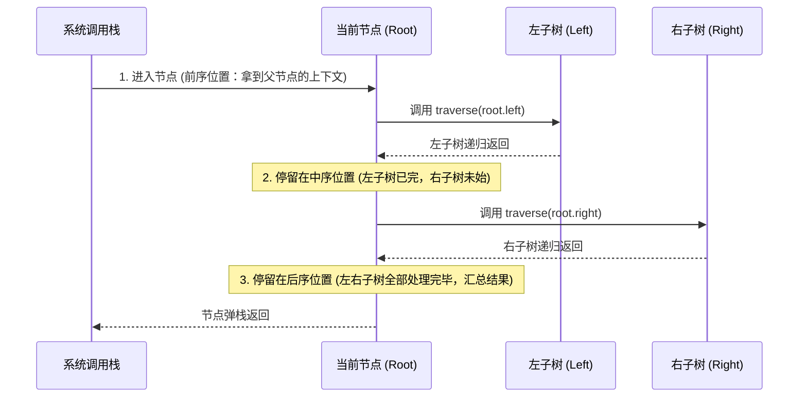

# 05 · 二叉树与遍历：递归本质、迭代栈模拟与层序 BFS

> [!abstract] 一句话第一性原理
> **二叉树是单链表在二维维度的自然延伸，是分治与递归的物理实体**。理解二叉树遍历的本质不是背诵"根左右"，而是看懂**函数调用栈在进入节点、离开左子树、离开右子树三个关键时钟周期的状态行为**。

---

## 一、 递归三时态：二叉树的核心心智模型

绝大多数初学者死记硬背"前序是根左右、中序是左根右、后序是左右根"，一旦面对变种题便无从下手。要真正理解二叉树，必须看懂递归函数在系统调用栈中的物理过程。

### 同一个节点必然被访问 3 次

```java
void traverse(TreeNode root) {
    if (root == null) return;
    
    // 【时刻 1：刚进入节点，压栈】 -> 前序位置 (Pre-order)
    
    traverse(root.left);
    
    // 【时刻 2：左子树刚遍历完成，刚回到当前节点】 -> 中序位置 (In-order)
    
    traverse(root.right);
    
    // 【时刻 3：左右子树全部遍历完成，准备弹栈】 -> 后序位置 (Post-order)
}
```



### 前序 vs 后序的本质区别

| 遍历视角 | 对应位置 | 数据流向 | 适用场景 |
| :--- | :--- | :--- | :--- |
| **自顶向下**（Top-Down） | **前序位置** | **父 $\to$ 子**（通过参数向下透传） | 沿路径累积信息、树的克隆与序列化 |
| **自底向上**（Bottom-Up） | **后序位置** | **子 $\to$ 父**（通过返回值向上汇报） | 子树信息汇总（深度、直径、平衡校验、LCA） |

> [!TIP] 后序遍历是二叉树最强大的位置
> 因为在后序位置，当前节点**已经完整拿到了左子树和右子树的全部统计结果**，可以合并计算以当前节点为根的全局答案，再向父节点汇报。绝大多数"树形 DP"类题目都在这个位置完成核心逻辑。

---

## 二、 深度优先遍历（DFS）：递归与显式栈迭代

### 1. 递归模板（标准三序合一）

```java
public void dfs(TreeNode root, List<Integer> res) {
    if (root == null) return;
    
    // res.add(root.val); // 前序位置放这里
    dfs(root.left, res);
    // res.add(root.val); // 中序位置放这里
    dfs(root.right, res);
    // res.add(root.val); // 后序位置放这里
}
```

---

### 2. 显式栈迭代模板

面试常要求不使用系统递归栈，改用显式栈实现。

#### ① 前序遍历（根 $\to$ 左 $\to$ 右）

弹出根节点后，**先压右孩子、再压左孩子**。利用栈"后进先出"特性，保证左孩子先弹出访问。

```java
public List<Integer> preorderTraversal(TreeNode root) {
    List<Integer> res = new ArrayList<>();
    if (root == null) return res;
    Deque<TreeNode> stack = new ArrayDeque<>();
    stack.push(root);
    while (!stack.isEmpty()) {
        TreeNode curr = stack.pop();
        res.add(curr.val);
        if (curr.right != null) stack.push(curr.right); // 先压右
        if (curr.left != null) stack.push(curr.left);   // 再压左
    }
    return res;
}
```

#### ② 中序遍历（左 $\to$ 根 $\to$ 右）

指针一路**向左钻到底**，沿途全部入栈；碰壁后弹栈访问，再将指针转向右子树。

```java
public List<Integer> inorderTraversal(TreeNode root) {
    List<Integer> res = new ArrayList<>();
    Deque<TreeNode> stack = new ArrayDeque<>();
    TreeNode curr = root;
    while (curr != null || !stack.isEmpty()) {
        while (curr != null) {   // 一路向左钻到底
            stack.push(curr);
            curr = curr.left;
        }
        curr = stack.pop();      // 弹出最左节点访问
        res.add(curr.val);
        curr = curr.right;       // 转向右子树
    }
    return res;
}
```

#### ③ 后序遍历（左 $\to$ 右 $\to$ 根）

**双栈逆序法（最易写）**：前序遍历改成"根 $\to$ 右 $\to$ 左"的弹出顺序，逆序插入结果链表，最终就是"左 $\to$ 右 $\to$ 根"。

```java
public List<Integer> postorderTraversal(TreeNode root) {
    LinkedList<Integer> res = new LinkedList<>();
    if (root == null) return res;
    Deque<TreeNode> stack = new ArrayDeque<>();
    stack.push(root);
    while (!stack.isEmpty()) {
        TreeNode curr = stack.pop();
        res.addFirst(curr.val);  // 头部插入 = 逆序
        if (curr.left != null) stack.push(curr.left);   // 先左
        if (curr.right != null) stack.push(curr.right);  // 后右
    }
    return res;
}
```

> [!example]- 后序遍历的单栈 + prev 指针法（进阶，可选）
> 核心要点：只有当节点的**右孩子为空**，或**右孩子刚被访问过**（`curr.right == prev`），当前节点才能弹栈访问，否则先去处理右子树。
> ```java
> public List<Integer> postorderSingleStack(TreeNode root) {
>     List<Integer> res = new ArrayList<>();
>     Deque<TreeNode> stack = new ArrayDeque<>();
>     TreeNode curr = root, prev = null;
>     while (curr != null || !stack.isEmpty()) {
>         while (curr != null) { stack.push(curr); curr = curr.left; }
>         curr = stack.peek();
>         if (curr.right == null || curr.right == prev) {
>             res.add(curr.val);
>             stack.pop();
>             prev = curr;
>             curr = null;
>         } else {
>             curr = curr.right;
>         }
>     }
>     return res;
> }
> ```

---

## 三、 广度优先遍历（BFS）：层序遍历

层序遍历的核心是**队列（Queue）**。

> [!IMPORTANT] 分层核心：固定当前层的 size
> 每次外层循环开始时，必须**提前记录 `int levelSize = queue.size()`**。因为内层循环中 `offer` 子节点会让 `queue.size()` 动态增长；只有固定快照值，才能精确按"层"切分。

```java
public List<List<Integer>> levelOrder(TreeNode root) {
    List<List<Integer>> result = new ArrayList<>();
    if (root == null) return result;
    
    Queue<TreeNode> queue = new ArrayDeque<>();
    queue.offer(root);
    
    while (!queue.isEmpty()) {
        int levelSize = queue.size(); // 固定当前层节点个数
        List<Integer> level = new ArrayList<>(levelSize);
        for (int i = 0; i < levelSize; i++) {
            TreeNode node = queue.poll();
            level.add(node.val);
            if (node.left != null) queue.offer(node.left);
            if (node.right != null) queue.offer(node.right);
        }
        result.add(level);
    }
    return result;
}
```

**常见变种**：锯齿形层序遍历（奇数层头部插入）、二叉树右视图（每层只取最后一个节点）。

---

## 四、 复杂度总结

| 操作 | 时间复杂度 | 空间复杂度 |
| :--- | :--- | :--- |
| DFS（递归/迭代） | $O(N)$（每个节点访问一次） | $O(H)$（$H$ 为树的高度，最坏 $O(N)$） |
| BFS 层序遍历 | $O(N)$ | $O(W)$（$W$ 为树的最大宽度，最宽一层的节点数） |

---

## 五、 典型算法应用速览

以下是二叉树遍历技术在算法题中的主要应用方向，核心思路标注在表中，详细解法可在刷题时再展开：

| 应用方向 | 代表题 | 核心思路一句话 |
| :--- | :--- | :--- |
| **最近公共祖先 (LCA)** | LC 236 | 后序自底向上：左右子树各找一遍，分叉点即为 LCA |
| **前序+中序还原二叉树** | LC 105 | 前序首元素是根，在中序中定位后切分左右子树区间递归 |
| **最大路径和** | LC 124 (Hard) | 后序收集左右单向最大贡献，当前节点作拐点更新全局最大 |
| **最大深度** | LC 104 | 后序：`1 + max(左深度, 右深度)` |
| **平衡二叉树校验** | LC 110 | 后序：拿到左右子树高度，高度差 > 1 即不平衡 |
| **二叉树直径** | LC 543 | 后序：每个节点的直径 = 左深度 + 右深度，全局取最大 |
| **序列化与反序列化** | LC 297 | 前序遍历序列化 + 递归反序列化还原 |

> [!example]- 展开查看：最近公共祖先（LCA，LC 236）完整代码
> ```java
> public TreeNode lowestCommonAncestor(TreeNode root, TreeNode p, TreeNode q) {
>     if (root == null || root == p || root == q) return root;
>     TreeNode left = lowestCommonAncestor(root.left, p, q);
>     TreeNode right = lowestCommonAncestor(root.right, p, q);
>     if (left != null && right != null) return root; // 分叉点
>     return (left != null) ? left : right;
> }
> ```

> [!example]- 展开查看：前序+中序构造二叉树（LC 105）完整代码
> ```java
> public TreeNode buildTree(int[] preorder, int[] inorder) {
>     Map<Integer, Integer> map = new HashMap<>();
>     for (int i = 0; i < inorder.length; i++) map.put(inorder[i], i);
>     return build(preorder, 0, preorder.length - 1, 0, inorder.length - 1, map);
> }
> private TreeNode build(int[] pre, int ps, int pe, int is, int ie, Map<Integer, Integer> map) {
>     if (ps > pe) return null;
>     TreeNode root = new TreeNode(pre[ps]);
>     int mid = map.get(pre[ps]);
>     int leftSize = mid - is;
>     root.left = build(pre, ps + 1, ps + leftSize, is, mid - 1, map);
>     root.right = build(pre, ps + leftSize + 1, pe, mid + 1, ie, map);
>     return root;
> }
> ```

---

## 关联

- [[06-二叉搜索树]] —— 依托中序遍历升序特性的有序树
- [[07-平衡树-AVL-红黑树]] —— 解决树形高度退化的旋转技术

## 📚 参考资料

- 《算法导论》（Introduction to Algorithms）第 10 章：基本数据结构之树
