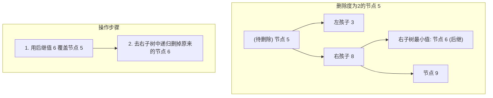
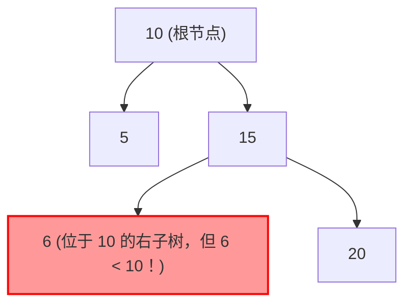
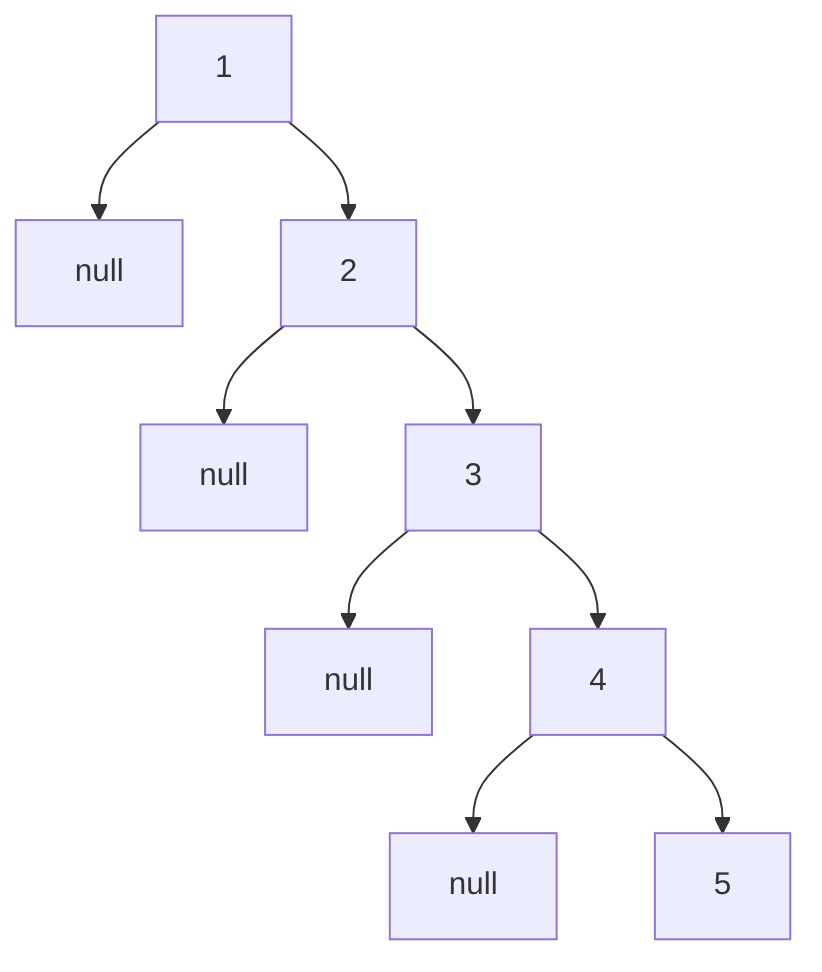

# 06 · 二叉搜索树：二分固化、节点增删与有序性

> [!abstract] 一句话第一性原理
> **二叉搜索树（Binary Search Tree, BST）** 的本质是**将静态数组的"二分查找逻辑"物理固化为动态链式树形结构**。其核心生命线是：**任意节点左子树全小、右子树全大，中序遍历结果恒为严格单调递增序列**。

---

## 一、 为什么设计二叉搜索树？

| 数据结构 | 查找 | 插入 / 删除 | 核心痛点 |
| :--- | :--- | :--- | :--- |
| **有序数组** | $O(\log N)$ 二分查找 | $O(N)$ 需搬移元素 | 增删代价高 |
| **链表** | $O(N)$ 线性遍历 | $O(1)$（已知位置） | 无法随机访问 |
| **BST** | $O(H)$，平衡时 $O(\log N)$ | $O(H)$，平衡时 $O(\log N)$ | 兼顾两者，但可能退化 |

BST 让数组的二分查找和链表的灵活指针操作**合二为一**。

---

## 二、 BST 的三条铁律

1. 左子树上**所有节点**的值严格小于根节点的值；
2. 右子树上**所有节点**的值严格大于根节点的值；
3. 左右子树本身也各是一棵 BST。

> [!IMPORTANT] 黄金法则：中序遍历 = 严格升序
> 凡是 BST 相关的题目，只要提到"第 K 小"、"众数"、"递增序列"、"最小绝对差"，**第一反应是中序遍历**。因为中序遍历展开的结果就是一个有序数组。

---

本文采用不允许重复键的严格 BST；允许重复值的题目需另行规定重复值位置或节点计数，此时中序通常是非递减而非严格递增。

## 三、 BST 核心操作：查找、插入、删除

### 1. 查找（Search）

从根节点出发，比当前值小往左拐，比当前值大往右拐，等于则命中：

```java
public TreeNode searchBST(TreeNode root, int val) {
    TreeNode curr = root;
    while (curr != null) {
        if (val == curr.val) return curr;
        else if (val < curr.val) curr = curr.left;
        else curr = curr.right;
    }
    return null;
}
```

### 2. 插入（Insert）

沿着搜索路径向下探查，遇到空槽位就是新节点合法的落脚点。整棵树的已有拓扑结构不会被破坏：

```java
public TreeNode insertIntoBST(TreeNode root, int val) {
    if (root == null) return new TreeNode(val);
    if (val < root.val) root.left = insertIntoBST(root.left, val);
    else if (val > root.val) root.right = insertIntoBST(root.right, val);
    return root;
}
```

### 3. 删除（Delete）

删除是 BST 最具技巧性的操作。根据待删除节点的子节点数量（度），分为三种情况：

| 情况 | 描述 | 操作 |
| :--- | :--- | :--- |
| **度为 0**（叶子） | 没有子节点 | 直接删除，返回 `null` |
| **度为 1** | 只有一个孩子 | 让唯一的孩子顶替自己的位置 |
| **度为 2** | 有左右两个孩子 | 找**右子树的最小节点（后继）** 覆盖当前值，再递归删掉后继 |

**度为 2 为什么这样做？** 后继节点（右子树最小值）是所有比当前节点大的节点中最小的那个，用它替换后，整棵树的 BST 性质依然成立。而后继节点一定没有左孩子（否则它就不是最小的了），因此删除后继节点会退化为简单的度 0 或度 1 情况。



```java
public TreeNode deleteNode(TreeNode root, int key) {
    if (root == null) return null;

    if (key < root.val) {
        root.left = deleteNode(root.left, key);
    } else if (key > root.val) {
        root.right = deleteNode(root.right, key);
    } else {
        // 度为 0 或 1
        if (root.left == null) return root.right;
        if (root.right == null) return root.left;
        // 度为 2：找右子树最小节点（后继）
        TreeNode successor = root.right;
        while (successor.left != null) successor = successor.left;
        root.val = successor.val;
        root.right = deleteNode(root.right, successor.val);
    }
    return root;
}
```

---

## 四、 验证 BST：一个非常经典的坑

### 致命错误：只跟直接子节点比较

```java
// 错误写法！
if (root.left != null && root.left.val >= root.val) return false;
if (root.right != null && root.right.val <= root.val) return false;
```

**反例**：`[10, 5, 15, null, null, 6, 20]`，节点 6 虽然小于父节点 15（局部合法），但它位于根节点 10 的右子树，出现了 `6 < 10`，**整棵树非法**。



### 正确思路：自顶向下传递开区间 $(min, max)$

- 进入左子树：上界更新为当前节点值；
- 进入右子树：下界更新为当前节点值；
- 上下界用 `long` 防止 `Integer.MIN_VALUE` 溢出。

```java
public boolean isValidBST(TreeNode root) {
    return validate(root, Long.MIN_VALUE, Long.MAX_VALUE);
}

private boolean validate(TreeNode node, long min, long max) {
    if (node == null) return true;
    if (node.val <= min || node.val >= max) return false;
    return validate(node.left, min, node.val)
        && validate(node.right, node.val, max);
}
```

另一种等价方法是利用**中序遍历严格递增**的性质，遍历中维护一个 `prev` 前驱值，出现 `curr <= prev` 则判伪。

---

## 五、 BST 的致命缺陷：单调输入退化

BST 的一切优势建立在树大致平衡的前提上。如果依次插入有序数据 `1, 2, 3, 4, 5`：



整棵树退化成了**单链表**！树高从 $\log_2 N$ 恶化为 $N$，所有操作从 $O(\log N)$ 跌落为 $O(N)$。

为此，计算机科学家发明了**自平衡二叉搜索树**：
- **AVL 树**：严格保证任意节点左右子树高度差 $\le 1$，通过左旋/右旋维持平衡；
- **红黑树**：放宽平衡约束，保证最长路径不超过最短路径的 2 倍，成为 Java `TreeMap`/`TreeSet`、C++ `std::map` 的底层实现。

详见 → [[07-平衡树-AVL-红黑树]]

---

## 六、 典型算法应用速览

| 应用方向 | 代表题 | 核心思路一句话 |
| :--- | :--- | :--- |
| **BST 的 LCA** | LC 235 | 利用数值大小分流：都小向左，都大向右，分叉即为答案 |
| **第 K 小元素** | LC 230 | 中序遍历计数到第 K 个即停 |
| **BST 转有序双向链表** | LC 426 | 中序遍历中用 `prev` 指针将左右串起来 |
| **有序数组构造平衡 BST** | LC 108 | 取中间元素为根，左右两半递归构建 |

> [!example]- 展开查看：BST 的 LCA（LC 235）完整代码
> 对于 BST，p 和 q 都小于当前节点则 LCA 在左，都大于则在右，出现分叉则当前节点就是 LCA：
> ```java
> public TreeNode lowestCommonAncestor(TreeNode root, TreeNode p, TreeNode q) {
>     TreeNode curr = root;
>     while (curr != null) {
>         if (p.val < curr.val && q.val < curr.val) curr = curr.left;
>         else if (p.val > curr.val && q.val > curr.val) curr = curr.right;
>         else return curr;
>     }
>     return null;
> }
> ```

> [!example]- 展开查看：第 K 小元素（LC 230）完整代码
> ```java
> class Solution {
>     private int count = 0, result = -1;
>     public int kthSmallest(TreeNode root, int k) {
>         count = 0;
>         result = -1;
>         inorder(root, k);
>         return result;
>     }
>     private void inorder(TreeNode root, int k) {
>         if (root == null || count >= k) return;
>         inorder(root.left, k);
>         if (count >= k) return; // 左子树已找到答案，停止向上继续计数
>         if (++count == k) { result = root.val; return; }
>         inorder(root.right, k);
>     }
> }
> ```

---

## 关联

- [[05-二叉树与遍历]] —— 前中后序遍历与递归基础
- [[07-平衡树-AVL-红黑树]] —— 解决 BST 退化的左右旋转机制

## 📚 参考资料

- 《算法导论》（Introduction to Algorithms）第 12 章：二叉搜索树
- Java SE 标准库源码：`java.util.TreeMap`（红黑树工业级实现）
