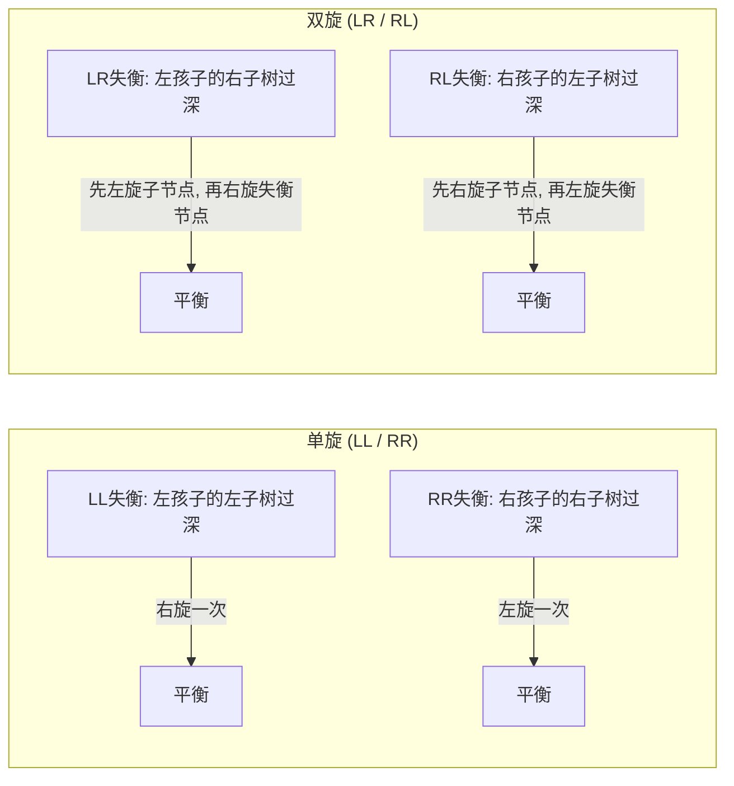
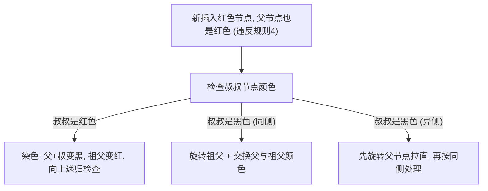

# 07 · 平衡树：AVL 旋转原理与红黑树工程实战

> [!abstract] 一句话第一性原理
> **平衡树在每次插入或删除后，通过旋转操作自动调整树的结构，将树高始终压制在 $O(\log N)$，从而消除普通 BST 因单调输入退化为链表的致命缺陷。**

---

## 一、 为什么需要平衡？

上一节讲过，普通 BST 依次插入 `1, 2, 3, 4, 5` 会退化成单链表，树高为 $N$，所有操作变成 $O(N)$。平衡树的目标就是：**无论输入顺序如何，都通过旋转保证树高不超过 $O(\log N)$**。

| BST 状态 | 树高 | 查找/插入/删除 |
| :--- | :--- | :--- |
| 理想平衡（满二叉树） | $\log_2 N$ | $O(\log N)$ |
| 普通 BST 最坏（单链表） | $N$ | $O(N)$ |
| AVL 树 | $\le 1.44 \log_2 N$ | 严格 $O(\log N)$ |
| 红黑树 | $\le 2 \log_2 (N+1)$ | 严格 $O(\log N)$ |

---

## 二、 旋转：维持有序性的局部结构调整

旋转是 AVL、红黑树、Splay、Treap 等树的基础操作；不是所有平衡搜索结构都依靠旋转，B 树还使用分裂与合并。Splay 的单次操作可能为 $O(N)$，其保证是均摊复杂度。它**只改变节点之间的父子指向关系，不改变中序遍历的顺序**（因此 BST 的有序性不会被破坏）。

### 左旋（Left Rotation）

当**右子树过高**时，把当前节点"拉下来"作为其右孩子的左孩子：

```
    X                Y
   / \     左旋X    / \
  A   Y   ----→   X   C
     / \          / \
    B   C        A   B
```

指针变化只有 3 步：
1. `X.right = Y.left`（B 从 Y 的左孩子变成 X 的右孩子）
2. `Y.left = X`（X 变成 Y 的左孩子）
3. 将 X 原来的父节点指向 Y

### 右旋（Right Rotation）

当**左子树过高**时，把当前节点"拉下来"作为其左孩子的右孩子：

```
      Y              X
     / \    右旋Y    / \
    X   C  ----→   A   Y
   / \                 / \
  A   B               B   C
```

> [!NOTE] 旋转的本质
> 旋转不是"移动数据"，而是**改变 3 根指针的指向**。时间复杂度恒为 $O(1)$。旋转后中序遍历的结果不变（A < X < B < Y < C），所以 BST 性质不会被破坏。

---

## 三、 AVL 树：严格高度平衡

### 核心规则

AVL 树要求每个节点的**平衡因子**（Balance Factor = 左子树高度 − 右子树高度）的绝对值 $\le 1$。

一旦插入或删除导致某个节点的平衡因子变为 $\pm 2$，就必须通过旋转修复。

### 四种失衡与对应旋转

| 失衡类型 | 形状描述 | 修复操作 |
| :--- | :--- | :--- |
| **LL（左左）** | 新节点插入到失衡节点的**左孩子的左子树** | 对失衡节点**右旋**一次 |
| **RR（右右）** | 新节点插入到失衡节点的**右孩子的右子树** | 对失衡节点**左旋**一次 |
| **LR（左右）** | 新节点插入到失衡节点的**左孩子的右子树** | 先对左孩子**左旋**，再对失衡节点**右旋** |
| **RL（右左）** | 新节点插入到失衡节点的**右孩子的左子树** | 先对右孩子**右旋**，再对失衡节点**左旋** |



**双旋的直觉**：LR 和 RL 的失衡呈"折线"形状，单次旋转无法拉平。所以先做一次旋转把"折线"拉直成"直线"（退化为 LL 或 RR），再做第二次旋转拉平。

### AVL 的优劣

- **优势**：树高严格控制在 $1.44 \log_2 N$ 以内，查询路径极短，读密集场景中可优先评估，但实际性能仍取决于实现和负载。
- **劣势**：插入只需在首个失衡祖先处做至多两次旋转，但仍需更新沿途高度；删除可能需要**沿回溯路径向上旋转多次**才能恢复所有祖先节点的平衡，写操作代价较高。

---

## 四、 红黑树：工程界的平衡树王者

### 为什么标准库都选红黑树而不是 AVL？

AVL 的严格平衡缩短了最坏查询路径，删除可能需要逐层修复。红黑树放宽了平衡约束（允许局部"不那么平衡"），换来了**每次插入最多 2 次旋转、每次删除最多 3 次旋转**的上界保证。对于读写混合的通用集合场景（如 `TreeMap`），红黑树的综合吞吐量更稳定。

### 红黑树的五条规则

| 编号 | 规则 | 作用 |
| :--- | :--- | :--- |
| 1 | 每个节点要么**红色**，要么**黑色** | 基础着色约束 |
| 2 | **根节点**必须是黑色 | 保证树根稳定 |
| 3 | 所有叶子节点（NIL 空节点）视为黑色 | 统一边界处理 |
| 4 | **红色节点的两个孩子必须是黑色**（即不允许连续两个红节点） | 限制红色节点的密度，间接限制树高 |
| 5 | 从任意节点到其所有后代叶子节点的路径上，**黑色节点数量相同**（称为"黑高"） | 核心约束：保证最长路径 $\le$ 最短路径的 $2$ 倍 |

> [!IMPORTANT] 为什么这五条规则能保证 $O(\log N)$？
> 规则 4 + 规则 5 合力推导：
> - 最短路径：全是黑色节点，长度为黑高 $h$；
> - 最长路径：黑红交替排列，长度为 $2h$（每个黑节点之间最多夹一个红节点）；
> - 因此最长路径 $\le 2 \times$ 最短路径，树高被压制在 $2 \log_2(N+1)$ 以内。

### 插入修复：旋转 + 重新染色

红黑树新插入的节点**默认染为红色**（因为插入黑色节点一定破坏规则 5 的黑高平衡，而插入红色节点只在父节点也是红色时才违规，修复概率更低）。

当出现**连续两个红节点**（违反规则 4）时，根据"叔叔节点"的颜色决定修复策略：

| 场景 | 叔叔节点颜色 | 修复方式 |
| :--- | :--- | :--- |
| 叔叔是**红色** | 红色 | **只染色不旋转**：父节点和叔叔变黑，祖父变红，然后向上继续检查祖父 |
| 叔叔是**黑色**且当前节点与父节点同侧（LL / RR） | 黑色 | 对祖父**旋转一次** + 交换父节点与祖父的颜色 |
| 叔叔是**黑色**且当前节点与父节点异侧（LR / RL） | 黑色 | 先对父节点旋转使之变成同侧，再按上一行处理 |



> [!TIP] 面试要掌握到什么程度？
> **不需要手写完整的红黑树插入/删除代码。** 但需要能说清楚：
> 1. 旋转的目的是调整树形结构降低高度；
> 2. 重新染色的目的是维护五条规则（尤其是规则 4 和规则 5）；
> 3. 新节点默认红色是因为插红色只可能破坏规则 4，修复代价比插黑色小。

---

## 五、 Java 标准库中的红黑树落地

### TreeMap vs HashMap vs LinkedHashMap

| 对比维度 | `HashMap` | `TreeMap` | `LinkedHashMap` |
| :--- | :--- | :--- | :--- |
| **底层结构** | 数组 + 链表/红黑树 | 纯红黑树 | HashMap + 双向链表 |
| **Key 顺序** | **无序** | **按 Key 自然排序或自定义 Comparator** | **按插入顺序或访问顺序** |
| **查找时间** | 平均 $O(1)$；极端冲突仍可能 $O(N)$ | $O(\log N)$ | 平均 $O(1)$ |
| **是否支持范围查询** | 不支持 | `subMap`、`headMap`、`tailMap`、`floorKey`、`ceilingKey` | 不支持 |
| **是否允许 null Key** | 允许 1 个 | 自然排序不允许；自定义 Comparator 允许时可支持 | 允许 1 个 |
| **典型场景** | 通用高速 KV 存储 | 需要有序遍历、范围查询、最近邻查找 | 需要保持插入顺序或实现 LRU 缓存 |

### TreeMap 核心 API 速查

```java
TreeMap<Integer, String> map = new TreeMap<>();
map.put(10, "a");
map.put(20, "b");
map.put(30, "c");

map.firstKey();        // 10  最小 Key
map.lastKey();         // 30  最大 Key
map.floorKey(25);      // 20  <= 25 的最大 Key
map.ceilingKey(25);    // 30  >= 25 的最小 Key
map.subMap(10, 30);    // {10=a, 20=b}  左闭右开区间
```

### HashMap 桶内的红黑树化

`HashMap` 使用树化阈值 8、最小树化容量 64，容量不足时优先扩容；扩容拆分后的退化阈值为 6，普通删除还检查树形。树桶可改善冲突查询，但相同 hash 且无法按 Comparable 区分的键，仍可能搜索两侧而退化到 $O(N)$，不能承诺所有键的最坏查找都是 $O(\log N)$。详见 [[04-哈希表]]。

---

## 六、 AVL vs 红黑树总结对比

| 对比维度 | AVL 树 | 红黑树 |
| :--- | :--- | :--- |
| **平衡标准** | 每个节点左右子树高度差 $\le 1$ | 最长路径 $\le$ 最短路径的 $2$ 倍（黑高平衡） |
| **树高上界** | $1.44 \log_2 N$（更矮） | $2 \log_2(N+1)$（略高） |
| **查询性能** | 略优（路径更短） | 略逊 |
| **插入旋转次数** | 最多 $2$ 次，但可能需要回溯更新多个祖先高度 | 最多 $2$ 次旋转 + 若干次染色 |
| **删除旋转次数** | 可能 $O(\log N)$ 次（逐层回溯修复） | 最多 $3$ 次旋转 |
| **工程选型** | 数据库索引等**读远多于写**的场景 | 通用标准库集合（Java `TreeMap`、C++ `std::map`、Linux CFS 调度器） |

---

## 关联

- [[06-二叉搜索树]] —— BST 退化问题的源头
- [[04-哈希表]] —— HashMap 桶内链表树化为红黑树
- [[08-堆与优先队列]] —— 另一种不追求全局有序的树形结构

## 📚 参考资料

- 《算法导论》（Introduction to Algorithms）第 13 章：红黑树
- [Java SE 21 TreeMap 文档](https://docs.oracle.com/en/java/javase/21/docs/api/java.base/java/util/TreeMap.html)
- [OpenJDK 21 HashMap 树桶查找源码](https://github.com/openjdk/jdk/blob/jdk-21-ga/src/java.base/share/classes/java/util/HashMap.java)
- 《算法》（Sedgewick）第 3.3 节：左偏红黑树（2-3 树的二叉化视角）
