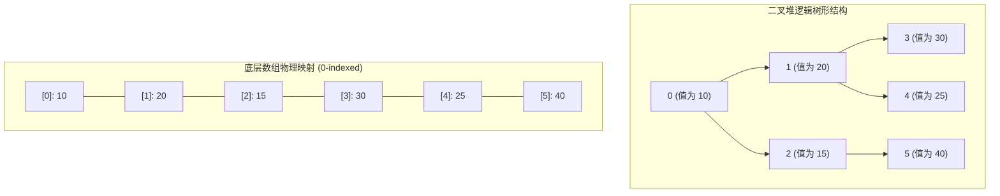
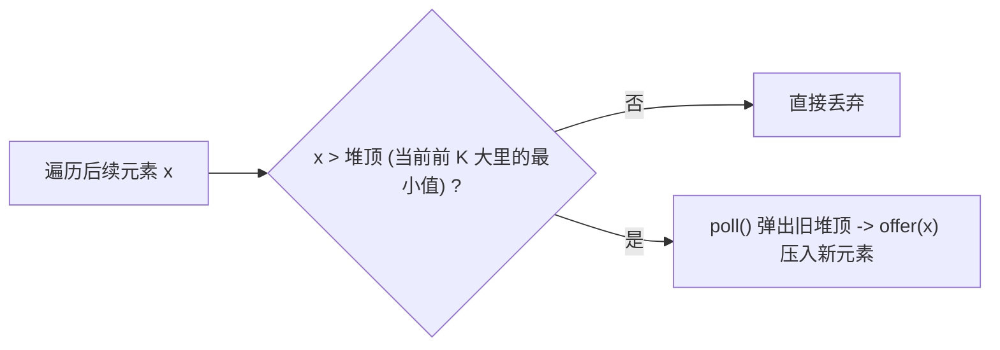

# 堆与优先队列

> [!abstract] 一句话总结
> 堆（Heap）是一种满足“堆序性”的完全二叉树。底层使用连续数组扁平化存储，能在 $O(1)$ 时间获取极值，以 $O(\log N)$ 时间完成插入和删除。核心算法由上浮（`siftUp`）与下沉（`siftDown`）驱动，自底向上原地建堆的时间复杂度为极其优异的 $O(N)$。

---

## 1. 结构本质与数组线性映射

堆在逻辑上是**完全二叉树**（除了最后一层外，其余层全满，且最后一层的叶子节点从左到右紧密排列）。这种结构保证了树不会退化，且树高严格为 $\lfloor \log_2 N \rfloor$。

因为没有空缺节点，完全二叉树可以直接映射到一维连续数组中，省去了所有子节点指针的内存开销与寻址损耗。



### 索引计算映射公式

完全二叉树的父子节点索引映射有两种设计方式：一种是 Java 标准库采用的**从 0 开始（0-indexed）**，另一种是**从 1 开始（1-indexed，下标 0 空置不用）**。

| 节点关系 | 0-indexed（从 0 开始，Java 标准库采用） | 1-indexed（从 1 开始，下标 0 空置不用） | 换算差异解析 |
| :--- | :--- | :--- | :--- |
| **父节点（Parent）** | `(i - 1) / 2`（即 `(i - 1) >> 1`） | `i / 2`（即 `i >> 1`） | 1-indexed 无需减 1 偏移 |
| **左子节点（Left Child）** | `2 * i + 1`（即 `(i << 1) + 1`） | `2 * i`（即 `i << 1`） | 1-indexed 乘 2 直接等价于左移 1 位 |
| **右子节点（Right Child）** | `2 * i + 2`（即 `(i + 1) << 1`） | `2 * i + 1`（即 `(i << 1) \| 1`） | 1-indexed 奇数位直接用位或 `\| 1` |
| **最后一个非叶子节点** | `N / 2 - 1`（N<2 时为 -1，不需下沉） | `N / 2`（即 `N >> 1`） | 自底向上建堆（`heapify`）的遍历起点 |

> [!NOTE] 两种索引设计的工程权衡
> 父节点公式仅用于非根节点。0-based 根下标 0、1-based 根下标 1 都没有父节点；Java 的负数除法与右移结果不同，不能用根下标验证该等价关系。
> - **0-indexed（Java `PriorityQueue` 默认）**：数组空间利用率 100%（下标 0 不浪费空间），计算时需要带上 `+1` / `-1` 偏置项；
> - **1-indexed（根节点位于下标 1）**：牺牲数组第 0 位空间，换取完全消除 `+1` / `-1` 偏移。乘除 2 与二进制左右移位完美统一，逻辑极为直观。

---

## 2. 手写二叉堆核心算法（完整 Java 实现）

二叉堆所有动态维持堆序的操作，底层均归结为两个操作：
1. **上浮（`siftUp`）**：新节点加入末尾，若比父节点更优（如小顶堆中更小），则与父节点交换，不断向上挺进，直到满足堆序或成为根节点。
2. **下沉（`siftDown`）**：堆顶元素被移除后，将末尾元素移至堆顶。若当前节点比孩子节点差，则与较优的孩子交换，不断向下沉降，直到满足堆序或到达叶子节点。

```java
import java.util.Arrays;
import java.util.NoSuchElementException;

/**
 * 手写通用小顶堆（Min-Heap）
 * 核心哲学：用最直观的【两两交换 swap】实现上浮与下沉，逻辑清晰易记
 */
public class MyMinHeap {
    private int[] data;
    private int size;
    private static final int DEFAULT_CAPACITY = 16;

    public MyMinHeap() {
        this(DEFAULT_CAPACITY);
    }

    public MyMinHeap(int capacity) {
        this.data = new int[capacity];
        this.size = 0;
    }

    /**
     * 自底向上原地建堆（Heapify）
     * 从最后一个非叶子节点开始，依次执行下沉
     */
    public MyMinHeap(int[] arr) {
        this.data = Arrays.copyOf(arr, arr.length);
        this.size = arr.length;
        for (int i = (size - 2) / 2; i >= 0; i--) {
            siftDown(i);
        }
    }

    public int size() {
        return size;
    }

    public boolean isEmpty() {
        return size == 0;
    }

    public int peek() {
        if (isEmpty()) throw new NoSuchElementException("堆为空");
        return data[0];
    }

    /**
     * 插入元素：放入末尾 -> 向上冒泡上浮
     * 时间复杂度: O(log N)
     */
    public void offer(int val) {
        ensureCapacity();
        data[size] = val; // 1. 放入末尾
        siftUp(size);     // 2. 向上冒泡上浮归位
        size++;
    }

    /**
     * 弹出堆顶：堆顶与末尾交换 -> 删掉末尾 -> 新堆顶下沉
     * 时间复杂度: O(log N)
     */
    public int poll() {
        if (isEmpty()) throw new NoSuchElementException("堆为空");
        int minVal = data[0];

        swap(0, size - 1); // 1. 堆顶和末尾元素对调
        size--;            // 2. 移除末尾（即原堆顶）
        siftDown(0);       // 3. 新换上来的堆顶向下沉降归位

        return minVal;
    }

    /**
     * 核心操作 1：上浮（siftUp）
     * 逻辑：只要比父节点小，就与父节点交换，一路往树根方向冒泡
     */
    private void siftUp(int i) {
        while (i > 0) {
            int parent = (i - 1) / 2;
            if (data[i] < data[parent]) {
                swap(i, parent);
                i = parent; // 向上追踪
            } else {
                break;      // 已经 >= 父节点，堆序满足，停止上浮
            }
        }
    }

    /**
     * 核心操作 2：下沉（siftDown）
     * 逻辑：比较当前节点与左右孩子，谁最小谁当老大（交换），一路向下沉降
     */
    private void siftDown(int i) {
        // 只要还有左孩子（还有后代需要比较）
        while (2 * i + 1 < size) {
            int left = 2 * i + 1;
            int right = 2 * i + 2;
            int smallest = i;

            // 选出当前节点、左孩子、右孩子三者中的最小值下标
            if (left < size && data[left] < data[smallest]) {
                smallest = left;
            }
            if (right < size && data[right] < data[smallest]) {
                smallest = right;
            }

            // 若当前节点就是最小的，说明堆序已满足，无需继续下沉
            if (smallest == i) {
                break;
            }

            swap(i, smallest); // 把较小的孩子换上来
            i = smallest;      // 继续向下追踪
        }
    }

    /**
     * 基础交换辅助函数
     */
    private void swap(int i, int j) {
        int temp = data[i];
        data[i] = data[j];
        data[j] = temp;
    }

    private void ensureCapacity() {
        if (size == data.length) {
            data = Arrays.copyOf(data, data.length * 2);
        }
    }
}
```

> [!TIP] 为什么基于 `swap` 的实现最好理解？
> 堆的物理本质就是**元素在树形路径上的位置对调**：
> - **上浮**：后生可畏，只要我比爹小，我就跟爹**交换（swap）**，一路冒泡上去；
> - **下沉**：三方比对，左右两个儿子谁更小，我就跟谁**交换（swap）**，一路沉底下去；
> - **弹出**：堆顶跟最后一个元素**对调（swap）**，尾巴一刀切掉，新上来的堆顶开始下沉。
> 虽然 JDK 源码（`PriorityQueue`）内部为了节省临时变量采用了类似插入排序的“单向覆盖”优化，但两者算法思想完全相同，而基于 `swap` 的写法直观清晰、符合人类直觉，面试手撕绝不会记错。


---

## 3. 面试核心推导：为什么自底向上建堆是 $O(N)$ 而不是 $O(N \log N)$

许多人误以为给 $N$ 个节点建堆需要调用 $N$ 次插入，因此复杂度为 $O(N \log N)$。
但通过从最后一个非叶子节点自底向上执行 `siftDown` 建堆（`heapify`），其实际时间复杂度是严谨的 **$O(N)$**。

### 严谨错位相减法推导

设完全二叉树高度为 $H = \lfloor \log_2 N \rfloor$。定义叶子节点的高度 $h = 0$，根节点高度为 $H$。
- 高度为 $h$ 的节点最大下沉距离为 $h$。
- 高度为 $h$ 的节点数最多为 $\lceil \frac{N}{2^{h+1}} \rceil$。

总操作比较与移动次数 $S$ 满足：
$$S \le \sum_{h=0}^H \left\lceil\frac{N}{2^{h+1}}\right\rceil h \le \frac{N}{2}\sum_{h=1}^H\frac{h}{2^h} + \sum_{h=1}^H h$$

令级数 $T = \sum_{h=1}^H \frac{h}{2^h} = \frac{1}{2^1} + \frac{2}{2^2} + \frac{3}{2^3} + \dots + \frac{H}{2^H}$。

两边同乘 $\frac{1}{2}$：
$$\frac{1}{2} T = \frac{1}{2^2} + \frac{2}{2^3} + \dots + \frac{H-1}{2^H} + \frac{H}{2^{H+1}}$$

两式相减（错位相减法）：
$$T - \frac{1}{2} T = \frac{1}{2^1} + \frac{1}{2^2} + \frac{1}{2^3} + \dots + \frac{1}{2^H} - \frac{H}{2^{H+1}}$$

利用等比数列求和公式：
$$\frac{1}{2} T = \left( 1 - \frac{1}{2^H} \right) - \frac{H}{2^{H+1}} = 1 - \frac{H+2}{2^{H+1}} < 1$$

两边同乘以 2，得：
$$T < 2$$

将 $T < 2$ 代回总开销 $S$：
$$S < N + \frac{H(H+1)}{2} = O(N)$$

**结论**：以上界估算下沉层数，再计入每层常数次比较与移动，可得自底向上建堆的时间复杂度为 **$O(N)$**。

> [!TIP] 第一性原理直觉
> 树中**绝大部分节点分布在最底层**：高度为 0 的叶子节点占了整棵树节点的 $\approx 50\%$，它们根本无需下沉（$h=0$）；高度为 1 的节点占了 $\approx 25\%$，最多下沉 1 层。只有根节点需要下沉 $H$ 层，但根节点只有 1 个。**基数巨大的节点负担极轻，负担重的节点数量指数级稀少**，综合平摊后总代价呈线性 $O(N)$。

---

## 4. Top K 问题（求最大 K 个数）

#### 代表母题：LeetCode 215. 数组中的第 K 个最大元素
> **题目描述**：
> 给定整数数组 `nums` 和整数 `k`，请返回数组中第 `k` 个最大的元素。
> 请注意，你需要找的是数组排序后的第 `k` 个最大的元素，而不是第 `k` 个不同的元素。
>
> **输入输出示例**：
> - 示例 1：
>   - 输入：`nums = [3,2,1,5,6,4], k = 2`
>   - 输出：`5`
> - 示例 2：
>   - 输入：`nums = [3,2,3,1,2,4,5,5,6], k = 4`
>   - 输出：`4`

### 核心机制：小顶堆淘汰制

求集合中**最大的 $K$ 个元素**（或**第 $K$ 个最大元素**），维护大小为 $K$ 的**小顶堆**：
- **阶段一（建堆）**：取前 $K$ 个元素入堆，建立大小为 $K$ 的小顶堆（注意：`new PriorityQueue<>(k)` 仅指定底层数组初始容量，堆初始为空，必须通过插入建堆）。此时堆顶即为当前这 $K$ 个数中的最小值（及格线）。
- **阶段二（动态淘汰）**：遍历后续元素，与堆顶比较：
  - 若当前元素 $\le$ 堆顶：必不在前 $K$ 大中，直接丢弃（$O(1)$ 判定）；
  - 若当前元素 $>$ 堆顶：弹出堆顶（淘汰最小值），插入新元素并下沉调整（$O(\log K)$）。
- **为什么不用大顶堆**：大顶堆堆顶为当前最大值，无法在 $O(1)$ 时间内定位并淘汰堆内的最小值。



### 标准代码实现

```java
import java.util.PriorityQueue;

public class TopKDemo {

    /**
     * 求数组中第 K 个最大的元素 (LeetCode 215)
     * 时间复杂度: O(N log K)，空间复杂度: O(K)
     */
    public int findKthLargest(int[] nums, int k) {
        // 1. 初始化小顶堆（容量为 k，此时为空）
        PriorityQueue<Integer> minHeap = new PriorityQueue<>(k);

        // 2. 阶段一：前 k 个元素建堆（逐一插入并自动上浮）
        for (int i = 0; i < k; i++) {
            minHeap.offer(nums[i]);
        }

        // 3. 阶段二：后续元素与堆顶比较并动态淘汰
        for (int i = k; i < nums.length; i++) {
            if (nums[i] > minHeap.peek()) {
                minHeap.poll();         // 淘汰当前最小值
                minHeap.offer(nums[i]); // 插入新元素并调整堆顶
            }
        }

        // 堆顶即为第 k 大元素（这 k 个最大值中的最小值）
        return minHeap.peek();
    }
}
```

---

## 5. 典型算法应用速览

| 方向 | 代表题号 | 一句话核心思路 |
| :--- | :--- | :--- |
| Top K 最值 | LeetCode 215. 数组中第K个最大元素 | 维护大小为 $K$ 的小顶堆，遍历完后堆顶即为第 $K$ 大。 |
| Top K 频次 | LeetCode 347. 前 K 个高频元素 | 哈希表统计词频，用小顶堆根据频次维护前 $K$ 个高频项。 |
| 多路归并 | LeetCode 23. 合并 K 个升序链表 | 小顶堆维护 $K$ 个链表的当前头节点，每次弹出最小节点并推入其 `next`。 |
| 数据流动态中位数 | LeetCode 295. 数据流的中位数 | 对顶堆：大顶堆存较小的一半，小顶堆存较大的一半，动态平衡两堆大小。 |
| 最短路径优化 | Dijkstra 算法 | 优先队列存储 `(距离, 节点)`，每次弹出当前距离最小的候选点松弛邻边。 |

---

### 代表性题目实现

> [!example]- 展开查看：LeetCode 295. 数据流的中位数（对顶堆架构）
> **题目描述**：中位数是有序整数列表中的中间值。如果列表的大小是偶数，则没有中间值，中位数是两个中间值的平均值。设计一个支持以下两种操作的数据结构：
> - `void addNum(int num)` - 从数据流中添加一个整数到数据结构中。
> - `double findMedian()` - 返回目前所有元素的中位数。
> **示例**：依次 `addNum(1)`，`addNum(2)`，`findMedian()` 返回 `1.5`；再 `addNum(3)`，`findMedian()` 返回 `2.0`。
> **思路**：利用对顶堆。大顶堆维护较小的一半元素，小顶堆维护较大的一半元素，始终保持大顶堆数量与小顶堆相等（或比小顶堆多 1）。查找中位数仅需 $O(1)$ 访问堆顶，插入时间复杂度为 $O(\log N)$。
> ```java
> import java.util.PriorityQueue;
> 
> class MedianFinder {
>     // maxHeap 维护较小的一半（大顶堆）
>     private PriorityQueue<Integer> maxHeap;
>     // minHeap 维护较大的一半（小顶堆）
>     private PriorityQueue<Integer> minHeap;
> 
>     public MedianFinder() {
>         maxHeap = new PriorityQueue<>((a, b) -> Integer.compare(b, a));
>         minHeap = new PriorityQueue<>();
>     }
>     
>     public void addNum(int num) {
>         // 规范：新元素先入 maxHeap，再倒腾其最大值到 minHeap
>         maxHeap.offer(num);
>         minHeap.offer(maxHeap.poll());
>         // 维持平衡：maxHeap 容量允许比 minHeap 多 1，但不能少
>         if (maxHeap.size() < minHeap.size()) {
>             maxHeap.offer(minHeap.poll());
>         }
>     }
>     
>     public double findMedian() {
>         if (maxHeap.size() > minHeap.size()) {
>             return maxHeap.peek();
>         }
>         return ((long) maxHeap.peek() + minHeap.peek()) / 2.0; // 先提升类型再相加
>     }
> }
> ```

---

## 6. 工程实践与避坑指南

1. **比较器整型溢出陷阱**：
   - 错误写法：`new PriorityQueue<>((a, b) -> a - b);`。当 `a = Integer.MIN_VALUE` 且 `b = 1` 时，减法产生下溢变正数，导致堆序彻底颠倒。
   - 正确写法：`new PriorityQueue<>(Integer::compare);` 或 `new PriorityQueue<>((a, b) -> Integer.compare(a, b));`。
2. **堆中可变对象的幽灵错误**：
   - 如果向 `PriorityQueue` 插入对象后，修改了对象的排序字段，**堆不会自动重新排序**！它只有在 `offer()` 或 `poll()` 时根据现有结构调整。修改字段会导致堆序破坏，产生极难排查的逻辑 Bug。
3. **全局有序性误区**：
   - 堆的数组底层**只保证局部堆序，不保证全局有序**。直接通过 `for-each` 遍历 `PriorityQueue` 得到的不是排序序列；若需有序输出，必须连续 `poll()`。

---

## 关联知识
- [[../02-算法思想/04-排序算法]]
- [[../04-模板与技巧/08-模板-Dijkstra]]
- [[../03-刷题记录/17-LC0215-数组中的第K个最大元素]]

## 📚 参考资料
- 《算法导论》（Introduction to Algorithms）- 第 6 章：堆排序与优先队列
- OpenJDK 源码解析：`java.util.PriorityQueue`
- MIT 6.006: Introduction to Algorithms - Lecture 4: Heaps and Heap Sort
