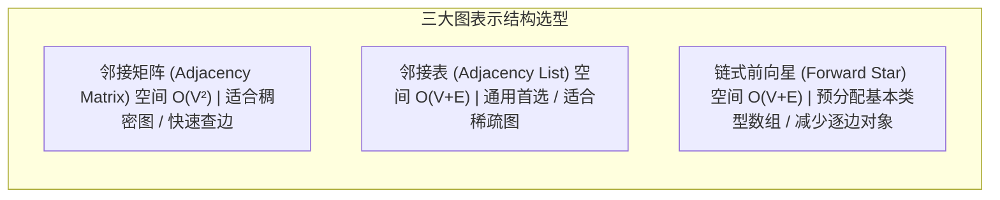
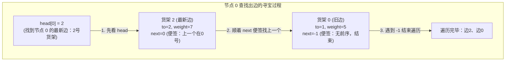
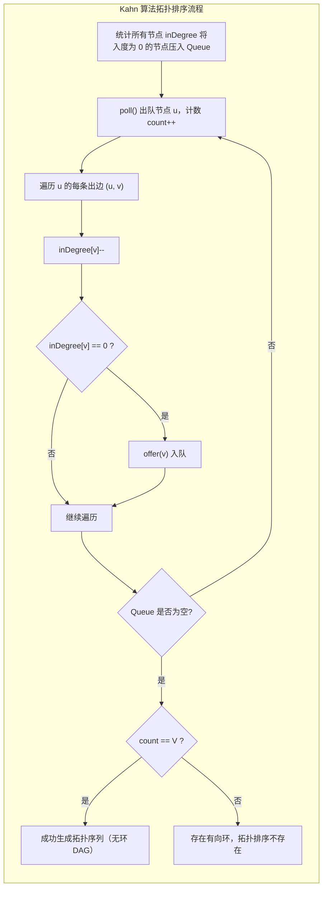

# 图的表示

> [!abstract] 一句话总结
> 图的底层表示直接决定了算法的时空开销与实现复杂度。稀疏图优先使用邻接表（工程通用）或链式前向星（极致性能与防 GC），稠密图使用邻接矩阵。入度与出度是有向图拓扑特征的核心刻画，Kahn 算法结合入度表可优雅实现拓扑排序与有向环检测。

---

## 1. 三大图存储结构对比



| 特性维度 | 邻接矩阵（Adjacency Matrix） | 邻接表（Adjacency List） | 链式前向星（Forward Star） |
| :--- | :--- | :--- | :--- |
| **空间复杂度** | $O(V^2)$ | $O(V + E)$ | $O(V + E)$ |
| **加边时间** | $O(1)$ | $O(1)$ 均摊 | $O(1)$ 严格 |
| **判断 $(u, v)$ 是否有边** | $O(1)$ | $O(\text{deg}(u))$ | $O(\text{deg}(u))$ |
| **遍历 $u$ 的所有出边** | $O(V)$ | $O(\text{deg}(u))$ | $O(\text{deg}(u))$ |
| **Java 内存与 GC 开销** | Java 二维数组是行数组的引用集合，并非整张矩阵连续 | 大量 `ArrayList` 和对象指针，**GC 压力大** | 基本类型数组，减少逐边对象分配和 GC 压力 |
| **适用场景** | 稠密图（$E \approx V^2$）、$V \le 1000$ | 绝大多数业务工程通用场景 | 大数据量竞赛、频繁图构建、消除 GC 停顿 |

---

## 2. 核心结构标准代码实现

### 2.1 邻接矩阵（Adjacency Matrix）

适合节点规模较小且频繁查询两点间是否有直接边或该边权重的场景；矩阵单个单元不能直接判断经过多条边的可达性。下例以 INF 表示无边，边权须小于 INF，重边保留最小权重；若求最短路，距离数组中起点到自身的 0 应单独初始化。

```java
public class AdjacencyMatrixGraph {
    private final int[][] matrix;
    private final int vertices;
    private static final int INF = Integer.MAX_VALUE / 2; // 防止加法溢出

    public AdjacencyMatrixGraph(int vertices) {
        this.vertices = vertices;
        this.matrix = new int[vertices][vertices];
        for (int i = 0; i < vertices; i++) {
            for (int j = 0; j < vertices; j++) {
                matrix[i][j] = INF; // 尚无边，包括尚未添加的自环
            }
        }
    }

    // 添加有向带权边
    public void addEdge(int u, int v, int weight) {
        matrix[u][v] = Math.min(matrix[u][v], weight); // 重边保留最小权重
    }

    // 添加无向带权边
    public void addUndirectedEdge(int u, int v, int weight) {
        addEdge(u, v, weight);
        addEdge(v, u, weight);
    }

    public boolean hasEdge(int u, int v) {
        return matrix[u][v] != INF;
    }
}
```

---

### 2.2 邻接表（Adjacency List）

工业界最通用的图结构。使用泛型对象封装边属性，逻辑清晰直观。

```java
import java.util.ArrayList;
import java.util.List;

public class AdjacencyListGraph {
    public static class Edge {
        public int to;
        public int weight;

        public Edge(int to, int weight) {
            this.to = to;
            this.weight = weight;
        }
    }

    private final List<List<Edge>> adj;
    private final int vertices;

    @SuppressWarnings("unchecked")
    public AdjacencyListGraph(int vertices) {
        this.vertices = vertices;
        this.adj = new ArrayList<>(vertices);
        for (int i = 0; i < vertices; i++) {
            adj.add(new ArrayList<>());
        }
    }

    // 添加有向带权边
    public void addEdge(int u, int v, int weight) {
        adj.get(u).add(new Edge(v, weight));
    }

    // 添加无向带权边
    public void addUndirectedEdge(int u, int v, int weight) {
        addEdge(u, v, weight);
        addEdge(v, u, weight);
    }

    public List<Edge> getNeighbors(int u) {
        return adj.get(u);
    }
}
```

---

### 2.3 链式前向星（Forward Star with Static Arrays）

#### （1）直观心智模型：为什么要叫“链式前向星”？
很多初学者第一次看链式前向星会觉得极度晦涩，核心原因是**它把全图所有的边塞进了同一个扁平的一维大数组里**。

- **普通邻接表的做法（按户发收纳盒）**：
  给每个节点专门 `new` 一个独立的动态列表（如 `ArrayList`）。节点 0 的边放进盒子 0，节点 1 的边放进盒子 1。
  - **痛点**：若图有数十万个节点，Java 会产生数百万个零散的小对象与指针，造成严重的内存碎片和垃圾回收（GC）压力。
- **链式前向星的做法（全国共用一个货架大仓库，用“便签纸条”串联）**：
  全图所有节点共用一个连续的大数组 `edges`。每来一条新边，不管是谁的，统统按顺序往大数组的末尾塞（编号为 `0, 1, 2, ...`）。
  - **核心问题**：所有边都混在一个大仓库里，**你怎么知道哪几条边属于节点 0？哪几条属于节点 1？**
  - **解法（寻宝便签 / 链表头插法）**：
    1. 每个节点只维护一个数字：**“我最后存进仓库的那条边的编号是几”**（这就是 `head[u]` 数组）；
    2. 每条边在放进仓库时，身上自带一张便签：**“在我之前、同起点的上一个兄弟在几号货架”**（这就是 `next[e]` 数组）；
    3. 这样一来，同一个起点的所有边，就通过 `next` 便签像“穿糖葫芦”一样倒序串成了一条单向链表！



---

#### （2）手把手单步推演示例

假设有 3 个节点（0, 1, 2），我们依次加入以下 3 条有向边：
- 第 1 条边：`0 -> 1`，权值 5
- 第 2 条边：`1 -> 2`，权值 3
- 第 3 条边：`0 -> 2`，权值 7（**注意：这是起点 0 的第 2 条边！**）

##### 初始状态：
- `head` 数组全部填 `-1`：`head = [-1, -1, -1]`（表示所有节点目前都没有出边）
- 边计数器 `edgeCount = 0`

##### 第 1 步：加入边 `0 -> 1`（权值 5）
1. 边存入 `0` 号货架：`to[0] = 1`, `weight[0] = 5`；
2. 贴便签：起点 0 之前存过的边是 `head[0]`（当前是 `-1`），所以 `next[0] = -1`；
3. 更新起点 0 的最新边：`head[0] = 0`；
4. `edgeCount` 自增变为 `1`。

##### 第 2 步：加入边 `1 -> 2`（权值 3）
1. 边存入 `1` 号货架：`to[1] = 2`, `weight[1] = 3`；
2. 贴便签：起点 1 之前存过的边是 `head[1]`（当前是 `-1`），所以 `next[1] = -1`；
3. 更新起点 1 的最新边：`head[1] = 1`；
4. `edgeCount` 自增变为 `2`。

##### 第 3 步：加入边 `0 -> 2`（权值 7，高潮来了！）
1. 边存入 `2` 号货架：`to[2] = 2`, `weight[2] = 7`；
2. 贴便签：起点 0 之前存过的边是 `head[0]`（**当时记录的是 0 号边**），所以 `next[2] = head[0] = 0`！
3. 更新起点 0 的最新边：`head[0] = 2`；
4. `edgeCount` 自增变为 `3`。

##### 最终数组内部状态全景表：

| 数组名称 | 索引 0 | 索引 1 | 索引 2 | 含义解释 |
| :--- | :---: | :---: | :---: | :--- |
| **`head[u]`** | **2** | **1** | **-1** | 节点 0 最新边在货架 2；节点 1 最新边在货架 1；节点 2 无出边 |
| **`to[e]`** | 1 | 2 | 2 | 边目标终点 |
| **`weight[e]`** | 5 | 3 | 7 | 边权重 |
| **`next[e]`** | **-1** | **-1** | **0** | **货架 2 记录下一个在 0 号；货架 0 记录下一个为 -1（链表尾）** |

##### 怎么遍历节点 0 的所有出边？
```java
for (int e = head[0]; e != -1; e = next[e])
```
1. 初始 `e = head[0] = 2`：拿到第 2 号边（`to[2] = 2, weight = 7`）；
2. 循环迭代 `e = next[2] = 0`：拿到第 0 号边（`to[0] = 1, weight = 5`）；
3. 循环迭代 `e = next[0] = -1`：检测到 `-1`，循环退出。
**成功且仅访问了节点 0 的全部出边（2号边、0号边），没有任何多余扫描！**

---

#### （3）为什么工业界与竞赛极度推崇链式前向星？
1. **减少逐边对象分配**：邻接表在大图（如 $10^6$ 条边）中会创建数百万个对象，链式前向星全部使用基本类型一维数组，一次性预分配，加边阶段不额外创建边对象；数组本身仍是堆对象，不能保证整个程序没有 GC。
2. **CPU 缓存极度友好（Cache Friendly）**：连续的一维数组在物理内存中紧密排列，CPU 缓存命中率远高于离散对象指针跳转。
3. **成对反向边位运算技巧**：在网络流（最大流/费用流）中，成对插入正反向边（从编号 0 开始分配），则任意边 $e$ 的反向边编号即为 $e \oplus 1$（0 与 1 互为反向，2 与 3 互为反向），操作为常数时间，具体指令耗时依硬件和编译结果而定。

```java
import java.util.Arrays;

public class ForwardStarGraph {
    private final int[] head;   // head[u]: 节点 u 的第一条出边在 edge 数组中的索引
    private final int[] to;     // to[e]: 边 e 指向的目标终点
    private final int[] next;   // next[e]: 与边 e 同起点的上一条边的索引（便签纸条）
    private final int[] weight; // weight[e]: 边 e 的权值
    private int edgeCount;      // 当前已分配的边编号

    /**
     * @param maxV 最大节点数
     * @param maxE 最大边数（注意：无向图需开 2 * maxE）
     */
    public ForwardStarGraph(int maxV, int maxE) {
        head = new int[maxV];
        Arrays.fill(head, -1); // 初始化为 -1 表示无出边
        to = new int[maxE];
        next = new int[maxE];
        weight = new int[maxE];
        edgeCount = 0;
    }

    // 头插法加边
    public void addEdge(int u, int v, int w) {
        to[edgeCount] = v;
        weight[edgeCount] = w;
        next[edgeCount] = head[u]; // 便签写上：当前起点上一次存的旧边索引
        head[u] = edgeCount;      // 当前起点的最新边更新为这只新边
        edgeCount++;
    }

    // 添加无向边
    public void addUndirectedEdge(int u, int v, int w) {
        addEdge(u, v, w);
        addEdge(v, u, w);
    }

    // 遍历节点 u 的所有出边
    public void traverse(int u) {
        for (int e = head[u]; e != -1; e = next[e]) {
            int v = to[e];
            int w = weight[e];
            // 访问终点 v 与权重 w
        }
    }
}
```

---

## 3. 入度表与出度表设计

在有向图 $G = (V, E)$ 中，每个节点具备两个关键拓扑属性：
- **入度（In-Degree）**：指向该节点的边数，表示当前节点被依赖的前置条件总数。
- **出度（Out-Degree）**：从该节点指出的边数，表示该节点直接触发的后继任务总数。

```java
int[] inDegree = new int[numCourses];
int[] outDegree = new int[numCourses];

for (int[] edge : prerequisites) {
    int dest = edge[0];
    int src = edge[1];
    inDegree[dest]++;
    outDegree[src]++;
}
```

- **拓扑意义**：
  - `inDegree[u] == 0`：当前节点没有任何前置依赖，属于整个系统的**拓扑源点**（可立即执行）。
  - `outDegree[u] == 0`：当前节点不再触发任何后继节点，属于系统的**汇点**。

---

## 4. 拓扑排序（Kahn 算法）标准实现

#### 代表母题：LeetCode 210. 课程表 II（求拓扑排序序列）
> **题目描述**：
> 现在你总共有 `numCourses` 门门课需要选，记为 `0` 到 `numCourses - 1`。给你一个数组 `prerequisites` ，其中 `prerequisites[i] = [ai, bi]` ，表示在选修课程 `ai` 前 **必须** 先选修 `bi` 。
> 返回你为了学完所有课程所安排的学习顺序。可能会有多个正确的顺序，你只要返回 **任意一种** 即可。如果不可能完成所有课程，返回 **一个空数组** 。
>
> **输入输出示例**：
> - 示例 1：
>   - 输入：`numCourses = 2, prerequisites = [[1,0]]`
>   - 输出：`[0,1]`（学 1 需先学 0，正确顺序是先 0 后 1）
> - 示例 2：
>   - 输入：`numCourses = 4, prerequisites = [[1,0],[2,0],[3,1],[3,2]]`
>   - 输出：`[0,2,1,3]`（或 `[0,1,2,3]`）
> - 示例 3：
>   - 输入：`numCourses = 2, prerequisites = [[1,0],[0,1]]`
>   - 输出：`[]`（存在循环依赖，无法完成）

Kahn 算法是一种基于广度优先搜索（BFS）的拓扑排序算法。它的核心思想是**贪心剥离**：不断剥离依赖已经归零的节点。

### 算法运行机制
1. 初始化统计所有节点的入度数组 `inDegree`；
2. 将所有 `inDegree == 0` 的源点放入队列；
3. 当队列不为空时：
   - 弹出队头节点 $u$，追加到拓扑序列中；
   - 遍历 $u$ 的所有出边 $(u, v)$，将终点 $v$ 的入度减 1（代表前置任务 $u$ 已完成）；
   - 若 $v$ 的入度减为 0，则将 $v$ 入队；
4. **判环定理**：遍历结束后，若加入拓扑序列的节点总数小于 $V$，说明**图中存在有向环**（环中的节点入度永远不可能归零）。



### 完整实现代码

> [!WARNING] 常见面试陷阱：输入边的方向千万别搞反！
> - **普通图论标准输入**：通常一条边格式为 `[起点, 终点]`，即 `[from, to]`。此时 `int from = edge[0], to = edge[1]`；
> - **LeetCode 课程表系列（207 / 210）特异输入**：题目描述是 *“想要学习课程 a，必须先修课程 b，记为 [a, b]”*。
>   注意！在图论中，任务必须从**前置课指向后置课（b -> a）**！因此数组里的 `edge[1]`（先修课 b）才是真正的**起点 from**，`edge[0]`（课程 a）反而是**终点 to**！

```java
import java.util.ArrayDeque;
import java.util.ArrayList;
import java.util.List;
import java.util.Queue;

public class KahnTopologicalSort {

    /**
     * 对有向图执行 Kahn 拓扑排序（以 LeetCode 课程表为例）
     * @param numCourses 课程总数（节点总数）
     * @param prerequisites 先修关系数组。每项为 [a, b]，表示要学 a 必须先修 b (即 b -> a) 
       int[][] prerequisites = {
         {2, 0},  // 第 0 行规则：想学 2，先修 0
         {2, 1},  // 第 1 行规则：想学 2，先修 1
         {3, 2}   // 第 2 行规则：想学 3，先修 2
       };
     * @return 拓扑序列数组；若存在环（无法修完所有课程）则返回空数组
     */
    public static int[] findOrder(int numCourses, int[][] prerequisites) {
        // 1. 初始化邻接表：每个节点维护一个指向后继节点的列表
        List<List<Integer>> graph = new ArrayList<>(numCourses);
        for (int i = 0; i < numCourses; i++) {
            graph.add(new ArrayList<>());
        }

        // 2. 统计每个节点的入度（即：还有几门前置课没修）
        int[] inDegree = new int[numCourses];
        for (int[] edge : prerequisites) {
            // 注意避坑：题目中 [a, b] 意为 "学 a 先修 b"，所以真实箭头是 b -> a
            int to = edge[0];   // 目标课（后置课 a），它的前置依赖数要 +1
            int from = edge[1]; // 先修课（前置课 b），它引出一条箭头指向 a
            
            graph.get(from).add(to); // 记录前置课 from 可以解锁后置课 to
            inDegree[to]++;          // 后置课 to 的前置依赖数（入度）+1
        }

        // 入度为 0 的节点入队
        Queue<Integer> queue = new ArrayDeque<>();
        for (int i = 0; i < numCourses; i++) {
            if (inDegree[i] == 0) {
                queue.offer(i);
            }
        }

        int[] order = new int[numCourses];
        int visitedCount = 0;

        while (!queue.isEmpty()) {
            int cur = queue.poll();
            order[visitedCount++] = cur;

            for (int neighbor : graph.get(cur)) {
                inDegree[neighbor]--;
                if (inDegree[neighbor] == 0) {
                    queue.offer(neighbor);
                }
            }
        }

        // 若收录节点数小于总结点数，说明存在有向环
        return visitedCount == numCourses ? order : new int[0];
    }
}
```

---

## 5. 有向图 vs 无向图 vs 带权图构建规范

在将题目给定的边集转化为内部图结构时，需遵循以下工业规范：

1. **无向图的本质**：无向图在计算机内部等价于**双向有向边**。
   - 邻接表加边：`graph.get(u).add(v)` 且 `graph.get(v).add(u)`。
   - 链式前向星：边数组大小必须开到 **$2 \times \text{最大边数}$**，每次加边消耗两个边下标。
2. **网格图（Grid Graph）隐式建图**：二维网格（如岛屿问题、迷宫问题）每个单元格本身就是节点，相邻移动就是边。**严禁在内存中显式构建大邻接表**，直接使用方向数组 `int[][] dirs = {{-1,0}, {1,0}, {0,-1}, {0,1}}` 进行隐式转移，将建图空间从 $O(R \times C)$ 降至 $O(1)$。
3. **坐标压缩扁平化**：二维网格坐标 $(r, c)$ 映射为一维节点编号：`id = r * cols + c`；反向恢复：`r = id / cols`, `c = id % cols`。

---

## 6. 典型算法应用速览

| 方向 | 代表题号 | 一句话核心思路 |
| :--- | :--- | :--- |
| 拓扑排序判环 | LeetCode 207. 课程表 | 统计入度构建邻接表，Kahn 算法出队计数，判断出队数是否等于总结点数。 |
| 拓扑排序序列 | LeetCode 210. 课程表 II | Kahn 算法出队依次填入结果数组，判环成功则返回数组，有环返回空。 |
| 最短路径 | LeetCode 743. 网络延迟时间 | 邻接表存有向带权边，小顶堆维护最小距离候选点跑 Dijkstra。 |
| 二分图检测 | LeetCode 785. 判断二分图 | 邻接表建无向图，BFS/DFS 染色法对相邻节点染相反颜色，出现冲突非二分图。 |
| 冗余连接 | LeetCode 684. 冗余连接 | 无向图加边判环，结合并查集检查边两端是否已处于同一连通分量。 |

---

### 代表性题目实现

> [!example]- 展开查看：LeetCode 207. 课程表（Kahn 算法拓扑判环）
> **题目描述**：你这个学期必须选修 `numCourses` 门课程，记为 `0` 到 `numCourses - 1`。在选修某些课程之前需要一些先修课程。先修课程按数组 `prerequisites` 给出，其中 `prerequisites[i] = [ai, bi]` ，表示如果要学习课程 `ai` 则必须先学习课程 `bi`。请你判断是否可能完成所有课程的学习？
> **示例**：输入 `numCourses = 2, prerequisites = [[1,0]]`，输出 `true`；输入 `numCourses = 2, prerequisites = [[1,0],[0,1]]`，输出 `false`（形成死锁环）。
> **思路**：统计所有课程入度。将入度为 0 的节点压入队列，BFS 出队并对其后继课程入度减 1。若最终出队课程总数等于 `numCourses`，说明无环可学完；否则存在循环依赖无法学完。
> ```java
> class Solution {
>     public boolean canFinish(int numCourses, int[][] prerequisites) {
>         List<List<Integer>> adj = new ArrayList<>(numCourses);
>         for (int i = 0; i < numCourses; i++) adj.add(new ArrayList<>());
>         int[] inDegree = new int[numCourses];
> 
>         for (int[] p : prerequisites) {
>             adj.get(p[1]).add(p[0]);
>             inDegree[p[0]]++;
>         }
> 
>         Queue<Integer> q = new ArrayDeque<>();
>         for (int i = 0; i < numCourses; i++) {
>             if (inDegree[i] == 0) q.offer(i);
>         }
> 
>         int learned = 0;
>         while (!q.isEmpty()) {
>             int course = q.poll();
>             learned++;
>             for (int next : adj.get(course)) {
>                 if (--inDegree[next] == 0) {
>                     q.offer(next);
>                 }
>             }
>         }
>         return learned == numCourses;
>     }
> }
> ```

---

## 7. 工程实践与避坑指南

1. **节点 1-indexed 与 0-indexed 偏移**：题目节点编号常为 $[1, N]$，开辟数组若为 `new int[N]` 会发生下标越界。推荐分配 `new int[N + 1]` 数组，保留 1-based 下标，避免在循环体内频繁 $+1 / -1$。
2. **多重边（Parallel Edges）与自环（Self Loops）**：
   - 邻接矩阵天然可以去重边（直接覆盖取最小值 `matrix[u][v] = Math.min(...)`）；
   - 邻接表和链式前向星会照单全收多重边，欧拉回路需要保留每条实际边，不能随意去重；割点/桥算法应按边编号区分父边与平行边。最短路矩阵可只保留同一对端点的最小权重。
3. **防止队列空指针**：`ArrayDeque` 做拓扑排序队列时禁止 `offer(null)`，拓扑排序只压入有效顶点索引。

---

## 关联知识
- [[10-并查集]]
- [[../02-算法思想/06-DFS深度优先]]
- [[../02-算法思想/07-BFS广度优先]]
- [[../04-模板与技巧/08-模板-Dijkstra]]

## 📚 参考资料
- 《算法导论》（Introduction to Algorithms）- 第 22 章：基本的图算法
- Algorithms, 4th Edition (Sedgewick) - Directed and Undirected Graphs
- Competitive Programmer's Handbook - Chapter 11: Basics of graphs
