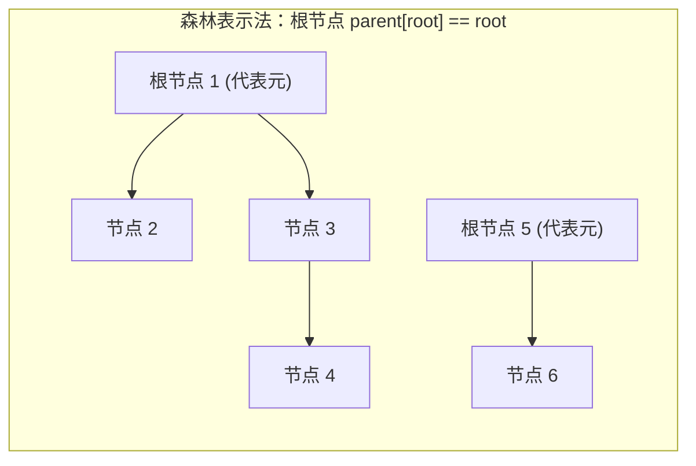
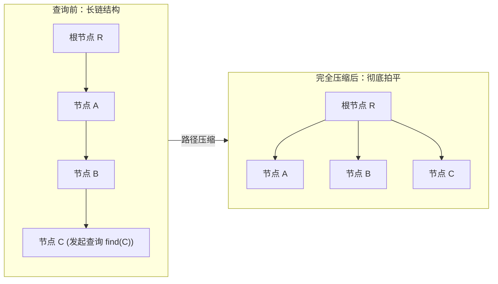

# 并查集（Disjoint Set Union）

> [!abstract] 一句话总结
> 并查集（DSU / Union-Find）是一种专门用于维护“动态连通性”与不相交集合合并的高效树形数据结构。通过“路径压缩”与“按秩合并”双剑合璧，单次查询与合并的均摊时间复杂度达到极其优异的 $O(\alpha(N))$，在实际工程与算法中表现为近乎绝对的 $O(1)$ 常数级响应。

---

## 1. 动态连通性模型

并查集用于解决图论与集合论中的**等价关系判定**问题。等价关系满足：
1. **自反性**：$p$ 与 $p$ 连通；
2. **对称性**：若 $p$ 与 $q$ 连通，则 $q$ 与 $p$ 连通；
3. **传递性**：若 $p$ 与 $q$ 连通且 $q$ 与 $r$ 连通，则 $p$ 与 $r$ 连通。

并查集抽象出三个核心操作：
- `find(x)`：查询节点 $x$ 所属集合的根节点（唯一代表元）；
- `union(x, y)`：将节点 $x$ 和节点 $y$ 所在的两个集合合并为一个连通分量；
- `isConnected(x, y)`：判断 $x$ 与 $y$ 是否属于同一集合（等价于 `find(x) == find(y)`）。



---

## 2. 两大优化杀招的第一性原理

若仅使用朴素的树状父指针存储，在连续将链状树合并时，树结构会退化为单向长链，导致单次 `find` 操作退化为灾难性的 $O(N)$。

### 2.1 优化一：路径压缩（Path Compression）

> **第一性原理**：并查集只关心某个节点最终从属于哪个“根”，中间父节点的层级深度对等价关系的判定毫无价值。因此在查询过程中，应尽可能将沿途所有节点直接挂载到根节点上。



并查集路径压缩主要有两种实现方式：

1. **完全压缩（递归回溯）**：
   ```java
   public int find(int x) {
       if (parent[x] != x) {
           parent[x] = find(parent[x]); // 递归回溯时，将沿途所有父指针全部指向最终根节点
       }
       return parent[x];
   }
   ```
2. **隔代压缩（两步一跳，迭代实现）**：
```java
   public int find(int x) {
       while (parent[x] != x) {
           parent[x] = parent[parent[x]]; // 将当前节点直接挂到爷爷节点上
           x = parent[x];
       }
       return x;
   }
```
   
   > [!TIP] 选型建议
   > 隔代压缩使用纯循环迭代，在超大规模数据（$N \ge 10^6$）下能彻底避免 JVM 因递归深度过大抛出 `StackOverflowError`，性能极其优异。

---

### 2.2 优化二：按秩合并（Union by Rank / Size）

> **第一性原理**：合并两棵树时，绝不能随意指定父子关系。必须将“矮树/小树”挂到“高树/大树”之下，从而严格遏制整棵树树高的增长。

- **按深度合并（Union by Rank）**：维护数组 `rank[i]` 记录以 $i$ 为根的树高深度。只有当两棵高度相同的树（`rank[rootX] == rank[rootY]`）合并时，合并后的新树高才会增加 1。在不进行路径压缩的情况下，可证明树高上界为 $O(\log N)$。
- **按集合大小合并（Union by Size）**：维护数组 `size[i]` 记录连通分量内的节点数，总是把节点数较少的树挂到节点数较多的树下，并累加节点计数：`size[rootX] += size[rootY]`。
  > [!NOTE] 工程推荐
  > 算法题中普遍推荐**按 Size 合并**，因为题目经常需要实时获取某个连通块的元素个数（如连通块大小最大值），`size` 数组可天然兼顾这一需求。

---

## 3. 阿克曼反函数 $\alpha(N)$ 的直觉认知

当同时开启**路径压缩**与**按秩合并**时，并查集单次操作的均摊时间复杂度为严格的 **$O(\alpha(N))$**。

### 什么是阿克曼反函数？
阿克曼函数 $A(m, n)$ 是数理逻辑中增长极度爆炸的非初等递归函数：
- $A(1, 1) = 3$
- $A(2, 2) = 7$
- $A(3, 3) = 61$
- $A(4, 2) = 2^{65536}$（这是一个拥有近两万位十进制数字的宇宙级巨数，已知全宇宙基本粒子总数仅约为 $10^{80}$）。

而 $\alpha(N)$ 是其反函数：只有当 $N$ 达到恐怖的 $A(4, 4)$ 时，$\alpha(N)$ 才会达到 5。
因此：
$$\text{对于现实世界及计算机科学中可表示的任意数据规模 } N \le 10^{80} \implies \alpha(N) \le 4$$
**结论**：在任何实际应用中，$\alpha(N)$ 都是一个不超过 4 的极小常数。并查集的单次操作时间复杂度在工程上**等价于严格的常数阶 $O(1)$**。

---

## 4. 工业级通用并查集实现（完整 Java 模板）

本模板封装了：按大小合并（Union by Size）、隔代路径压缩（防爆栈）、环检测（返回 boolean 标记是否成环）、动态连通分量计数器以及连通块大小查询。

```java
public class UnionFind {
    private final int[] parent; // parent[i] 存储父节点
    private final int[] size;   // size[i] 存储以 i 为根的连通分量大小
    private int count;          // 剩余连通分量总数

    public UnionFind(int n) {
        this.parent = new int[n];
        this.size = new int[n];
        this.count = n;
        for (int i = 0; i < n; i++) {
            parent[i] = i; // 初始每个节点的父节点是自己
            size[i] = 1;   // 每个集合初始大小为 1
        }
    }

    /**
     * 查找代表元（带隔代路径压缩，非递归迭代）
     * 时间复杂度: 均摊 O(α(N))
     */
    public int find(int x) {
        while (parent[x] != x) {
            parent[x] = parent[parent[x]]; // 路径压缩：两步一跳
            x = parent[x];
        }
        return x;
    }

    /**
     * 合并两个元素所在的集合
     * @return true: 原本不连通，合并成功; false: 原本已连通，产生环
     */
    public boolean union(int p, int q) {
        int rootP = find(p);
        int rootQ = find(q);

        if (rootP == rootQ) {
            return false; // 已在同一连通分量，说明在此两点间加边会形成环
        }

        // 按集合大小合并（小树挂在大树下）
        if (size[rootP] < size[rootQ]) {
            parent[rootP] = rootQ;
            size[rootQ] += size[rootP];
        } else {
            parent[rootQ] = rootP;
            size[rootP] += size[rootQ];
        }

        count--; // 合并成功，连通分量总数减 1
        return true;
    }

    /**
     * 判断两点是否连通
     */
    public boolean isConnected(int p, int q) {
        return find(p) == find(q);
    }

    /**
     * 获取当前剩余的连通分量数量
     */
    public int getCount() {
        return count;
    }

    /**
     * 获取某个元素所在连通分量的大小
     */
    public int getSize(int x) {
        return size[find(x)];
    }
}
```

---

## 5. 典型算法应用速览

| 方向 | 代表题号 | 一句话核心思路 |
| :--- | :--- | :--- |
| 连通分量计数 | LeetCode 547. 省份数量 | 遍历邻接矩阵，对所有相连城市执行 `union`，最终 `getCount()` 即为答案。 |
| 无向图环检测 | LeetCode 684. 冗余连接 | 遍历边集，若 `union(u, v)` 返回 `false`，说明两点已连通，当前边即为导致成环的冗余边。 |
| 网格连通性 | LeetCode 200. 岛屿数量 | 二维坐标扁平化 `r * C + c`，陆地与其右侧、下方陆地合并，统计非水域集合数。 |
| 最长连续序列 | LeetCode 128. 最长连续序列 | 每个数与其相差 1 的相邻数 `union`，查询集合 `size` 的最大值。 |
| 最小生成树 | Kruskal 算法 | 按边权升序排序所有边，贪心选取两端不连通的边加入生成树并 `union`。 |
| 带权并查集 | LeetCode 399. 除法求值 | 维护节点到根节点的权重倍率关系，在路径压缩与合并时动态计算相对比值。 |

---

### 代表性题目实现

> [!example]- 展开查看：LeetCode 684. 冗余连接（并查集环检测）
> ```java
> class Solution {
>     public int[] findRedundantConnection(int[][] edges) {
>         int n = edges.length;
>         UnionFind uf = new UnionFind(n + 1); // 1-indexed 节点
> 
>         for (int[] edge : edges) {
>             int u = edge[0];
>             int v = edge[1];
>             // 若两点已经在同一集合，则当前边必然成环
>             if (!uf.union(u, v)) {
>                 return edge;
>             }
>         }
>         return new int[0];
>     }
> }
> ```

> [!example]- 展开查看：LeetCode 547. 省份数量（连通分量计数）
> ```java
> class Solution {
>     public int findCircleNum(int[][] isConnected) {
>         int n = isConnected.length;
>         UnionFind uf = new UnionFind(n);
> 
>         for (int i = 0; i < n; i++) {
>             for (int j = i + 1; j < n; j++) {
>                 if (isConnected[i][j] == 1) {
>                     uf.union(i, j);
>                 }
>             }
>         }
>         return uf.getCount();
>     }
> }
> ```

---

## 6. 工程实践与避坑指南

1. **下标题号偏移（0-based 与 1-based）**：
   - 算法题中节点编号若从 1 到 $N$，初始化时务必传入 `n + 1`，否则在执行 `parent[n]` 时会直接产生数组下标越界（`ArrayIndexOutOfBoundsException`）。
2. **`size` 数组维护的必须是根节点**：
   - `size` 数组中只有**根节点**的值才有真实物理含义。合并时必须先通过 `find(x)` 找到根节点再更新 `size[root]`，切忌直接修改 `size[x]`。
3. **不能支持动态删边**：
   - 标准并查集仅支持“集合合并”（只加不减）。若业务场景需要频繁断开边或拆分集合，标准并查集无法胜任，需借助“可撤销并查集（基于栈回滚历史）”或“动态树（Link-Cut Tree）”。

---

## 关联知识
- [[09-图的表示]]
- [[../04-模板与技巧/05-模板-并查集]]
- [[../02-算法思想/06-DFS深度优先]]

## 📚 参考资料
- 《算法导论》（Introduction to Algorithms）- 第 21 章：用于不相交集合的数据结构
- Algorithms, 4th Edition (Sedgewick) - Case Study: Union-Find
- Robert Tarjan. "Efficiency of a Good But Not Linear Set Union Algorithm" (1975)
