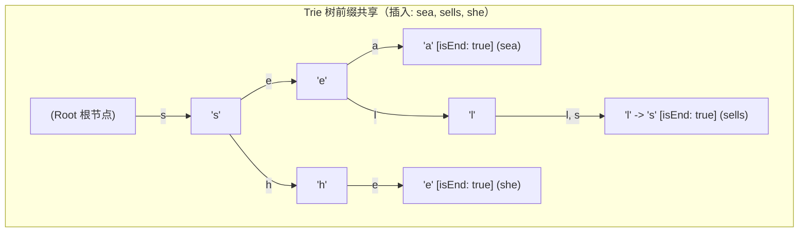
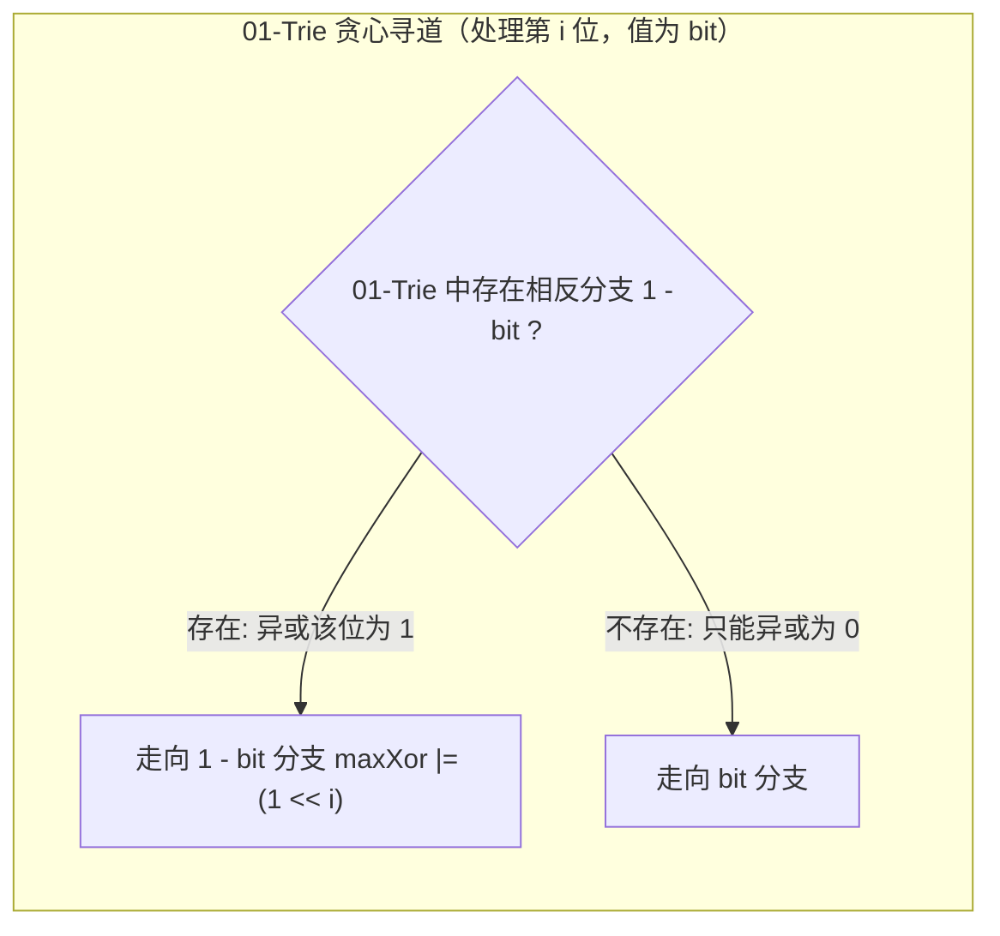

# 字典树（Trie / 前缀树）

> [!abstract] 一句话总结
> 字典树（Trie，源自 Retrieval）是一种利用字符串“公共前缀”实现高效检索的多叉树结构。通过空间换时间，它将前缀匹配、单词查找的时间复杂度降至严格的 $O(L)$（$L$ 为字符串长度），与词库中包含的词汇总量 $N$ 完全无关。

---

## 1. 结构模型与节点定义

### 1.1 核心设计原理

Trie 树的关键特征是：**字符并不直接保存在节点内部，而是保存在由父节点指向子节点的边（或数组下标映射）上**。从根节点出发沿着某条路径走到某个节点，沿途经过的字符序列即构成了该节点对应的前缀或完整单词。



### 1.2 工业级节点数据结构

一个生产可用的 Trie 节点通常包含子节点指针集合、单词终点标记以及前缀频次计数器：

```java
public class TrieNode {
    // 子节点指针映射（以小写英文字母 a-z 为例）
    public TrieNode[] children;
    // 标记是否有完整单词以此节点作为终点
    public boolean isEnd;
    // 统计有多少个单词经过此节点（以该路径为前缀的单词数量）
    public int passCount;
    // 统计完全匹配该节点的单词数量（处理重复插入）
    public int endCount;

    public TrieNode() {
        this.children = new TrieNode[26];
        this.isEnd = false;
        this.passCount = 0;
        this.endCount = 0;
    }
}
```

---

## 2. 三大核心操作手撕代码（Insert / Search / StartsWith）

#### 代表母题：LeetCode 208. 实现 Trie (前缀树)
> **题目描述**：
> 请你实现 `Trie` 类：
> - `Trie()` 初始化前缀树对象。
> - `void insert(String word)` 向前缀树中插入字符串 `word` 。
> - `boolean search(String word)` 如果字符串 `word` 在前缀树中，返回 `true`（即在此之前已经插入）；否则，返回 `false` 。
> - `boolean startsWith(String prefix)` 如果之前已经插入的字符串 `word` 的前缀之一为 `prefix` ，返回 `true` ；否则，返回 `false` 。
>
> **输入输出示例**：
> ```java
> Trie trie = new Trie();
> trie.insert("apple");
> trie.search("apple");   // 返回 True
> trie.search("app");     // 返回 False
> trie.startsWith("app"); // 返回 True
> trie.insert("app");
> trie.search("app");     // 返回 True
> ```

```java
public class Trie {
    private final TrieNode root;

    public Trie() {
        this.root = new TrieNode();
    }

    /**
     * 插入单词
     * 时间复杂度: O(L)，L 为单词长度
     * 空间复杂度: 最坏 O(L)，创建 L 个新节点
     */
    public void insert(String word) {
        if (word == null || word.isEmpty()) return;
        
        TrieNode cur = root;
        cur.passCount++;
        
        for (int i = 0; i < word.length(); i++) {
            int index = word.charAt(i) - 'a';
            if (cur.children[index] == null) {
                cur.children[index] = new TrieNode();
            }
            cur = cur.children[index];
            cur.passCount++;
        }
        cur.isEnd = true;
        cur.endCount++;
    }

    /**
     * 精确查询单词是否存在
     * 时间复杂度: O(L)
     */
    public boolean search(String word) {
        if (word == null || word.isEmpty()) return false;
        
        TrieNode node = findNode(word);
        return node != null && node.isEnd;
    }

    /**
     * 查询是否存在以 prefix 为前缀的单词
     * 时间复杂度: O(L)
     */
    public boolean startsWith(String prefix) {
        if (prefix == null || prefix.isEmpty()) return false;
        
        return findNode(prefix) != null;
    }

    /**
     * 统计有多少个单词以此 prefix 作为前缀
     * 时间复杂度: O(L)
     */
    public int countWordsStartingWith(String prefix) {
        if (prefix == null || prefix.isEmpty()) return 0;
        
        TrieNode node = findNode(prefix);
        return node == null ? 0 : node.passCount;
    }

    // 内部辅助方法：沿字符路径检索末端节点
    private TrieNode findNode(String str) {
        TrieNode cur = root;
        for (int i = 0; i < str.length(); i++) {
            int index = str.charAt(i) - 'a';
            if (cur.children[index] == null) {
                return null; // 路径中断，匹配失败
            }
            cur = cur.children[index];
        }
        return cur;
    }
}
```

---

## 3. 节点存储选型与空间优化策略

| 方案 | 存储结构 | 查找性能 | 空间利用率 | 适用场景 |
| :--- | :--- | :--- | :--- | :--- |
| **定长数组** | `TrieNode[26]` | 极快（直接数组索引） | 稀疏时严重浪费（每个指针占 4~8 字节） | 字符集固定且较小（如小写英文字母、DNA） |
| **哈希表** | `Map<Character, TrieNode>` | 稍慢（哈希计算与冲突解决） | 按需存分支，但每个 Map/Entry 仍有对象开销 | 字符集广且不可预知（如 Unicode、中文分词） |
| **双数组 Trie (DAT)** | `int[] base` 与 `int[] check` | 极快（数组寻址） | 极致压缩，空间利用率极高 | 离线只读超大规模词库（如 Lucene、HanLP） |
| **基数树 (Radix Tree)** | 单子节点链路合并为字符串 | 极快（减少深度遍历） | 避免单分支长链的节点膨胀 | 路由匹配（如 HTTP URL 路由框架、Linux 内核） |

---

## 4. 01-Trie 与最大异或极值

#### 代表母题：LeetCode 421. 数组中两个数的最大异或值
> **题目描述**：
> 给你一个整数数组 `nums` ，返回 `nums[i] XOR nums[j]` 的最大运算结果，其中 `0 <= i <= j < n` 。
> 以下按原题非负整数范围 `0 <= nums[i] <= 2^31 - 1`，处理第 30 到第 0 位；固定位宽下为 $O(N)$。若改为带符号整数最大异或，需要先明确比较的是有符号值还是无符号位模式。
>
> **输入输出示例**：
> - 示例 1：
>   - 输入：`nums = [3,10,5,25,2,8]`
>   - 输出：`28`（最大结果是 $5 \oplus 25 = 28$）
> - 示例 2：
>   - 输入：`nums = [14,70,53,83,49,91,36,80,92,51,66,70]`
>   - 输出：`127`

01-Trie 是将整数的二进制表示（如 32 位整型从高位到低位的每个 bit 位 0 或 1）作为字符构建的二叉字典树。每个节点仅有 `children[0]` 和 `children[1]` 两个分支。

### 4.1 贪心最大异或极值原理
异或运算满足：**相同为 0，不同为 1**。
若要寻找与整数 $x$ 异或结果最大的数 $y$：
1. 从最高有效位（第 30 位）到最低位（第 0 位）逐位检查 $x$ 的二进制位 $b$；
2. **贪心选择**：理想情况下希望 $y$ 在当前位为 $1 - b$（此时异或得 1）。因此在 01-Trie 中优先走与 $x$ 当前位**相反的分支**；
3. 若相反分支存在，则贪心成功，当前位结果贡献为 $1 \ll i$；
4. 若相反分支不存在，只能无奈走同向分支，当前位贡献为 0。
5. 因为高位的权重（$2^k$）严格大于低位全部权重之和（$\sum_{j=0}^{k-1} 2^j = 2^k - 1$），所以**高位优先贪心必然保证全局最大**！



### 4.2 01-Trie 核心实现

```java
public class BinaryTrie {
    private static class Node {
        Node[] next = new Node[2];
    }

    private final Node root = new Node();

    // 插入 31 位非负整数（高位到低位）
    public void insert(int val) {
        Node cur = root;
        for (int i = 30; i >= 0; i--) {
            int bit = (val >> i) & 1;
            if (cur.next[bit] == null) {
                cur.next[bit] = new Node();
            }
            cur = cur.next[bit];
        }
    }

    // 贪心检索与 val 异或的最大值
    public int findMaxXor(int val) {
        Node cur = root;
        int maxXor = 0;
        for (int i = 30; i >= 0; i--) {
            int bit = (val >> i) & 1;
            int wantBit = 1 - bit; // 期望相反位
            if (cur.next[wantBit] != null) {
                maxXor |= (1 << i);
                cur = cur.next[wantBit];
            } else {
                cur = cur.next[bit];
            }
        }
        return maxXor;
    }
}
```

---

## 5. 典型算法应用速览

| 方向 | 代表题号 | 一句话核心思路 |
| :--- | :--- | :--- |
| 基础实现 | LeetCode 208. 实现 Trie | 字符映射多叉树，维护 `isEnd` 标志完成插入、查询与前缀匹配。 |
| 通配符匹配 | LeetCode 211. 添加与搜索单词 | 遇到字符正常推进，遇到 `.` 通配符则 DFS 递归遍历当前节点的所有非空子分支。 |
| 异或极值 | LeetCode 421. 数组中两个数的最大异或值 | 构建 01-Trie，遍历每个数字贪心走相反二进制位，时间优化至 $O(31 \times N)$。 |
| 字典树+网格回溯 | LeetCode 212. 单词搜索 II | 将字典列表建成 Trie，在二维网格 DFS 回溯时结合 Trie 节点剪枝并利用 `passCount` 剪枝已匹配词。 |
| 最长公共前缀 | LeetCode 14. 最长公共前缀 | 将所有单词存入 Trie，从根向下追踪唯一的单分支链直到遇到分叉或 `isEnd`。 |

---

### 代表性题目实现

> [!example]- 展开查看：LeetCode 421. 数组中两个数的最大异或值（01-Trie 完整解答）
> **题目描述**：给你一个整数数组 `nums` ，返回 `nums[i] XOR nums[j]` 的最大运算结果，其中 `0 <= i <= j < n` 。
> **示例**：输入 `nums = [3,10,5,25,2,8]`，输出 `28`（$5 \oplus 25 = 28$）。
> **思路**：将所有数字的 31 位二进制从高位到低位存入 01-Trie。再次遍历每个数字，在 Trie 中优先向相反的 bit 走以贪心获取当前位异或为 1 的最大贡献。
> ```java
> class Solution {
>     static class TrieNode {
>         TrieNode[] children = new TrieNode[2];
>     }
>     
>     private TrieNode root = new TrieNode();
>     
>     private void insert(int num) {
>         TrieNode cur = root;
>         for (int i = 30; i >= 0; i--) {
>             int bit = (num >>> i) & 1;
>             if (cur.children[bit] == null) {
>                 cur.children[bit] = new TrieNode();
>             }
>             cur = cur.children[bit];
>         }
>     }
>     
>     private int getMaxXor(int num) {
>         TrieNode cur = root;
>         int res = 0;
>         for (int i = 30; i >= 0; i--) {
>             int bit = (num >>> i) & 1;
>             int target = 1 - bit; // 贪心期望相反位
>             if (cur.children[target] != null) {
>                 res |= (1 << i);
>                 cur = cur.children[target];
>             } else {
>                 cur = cur.children[bit];
>             }
>         }
>         return res;
>     }
>     
>     public int findMaximumXOR(int[] nums) {
>         for (int num : nums) {
>             insert(num);
>         }
>         int max = 0;
>         for (int num : nums) {
>             max = Math.max(max, getMaxXor(num));
>         }
>         return max;
>     }
> }
> ```

> [!example]- 展开查看：LeetCode 211. 添加与搜索单词（支持通配符 `.` 的 DFS）
> **题目描述**：请你设计一个词典数据结构，支持添加新单词，和查找字符串是否与任何此前添加的单词匹配。匹配时字符 `.` 可以表示任何一个字母。
> **示例**：依次 `addWord("bad")`，`addWord("dad")`，`search("pad")` 返回 `false`；`search("bad")` 返回 `true`；`search(".ad")` 返回 `true`；`search("b..")` 返回 `true`。
> **思路**：基于标准 Trie 树构建。普通字符顺着字母分支匹配；遇到 `.` 时，枚举当前节点的所有 26 个非空子节点进行 DFS 分支探索。
> ```java
> class WordDictionary {
>     private static class Node {
>         Node[] children = new Node[26];
>         boolean isEnd;
>     }
> 
>     private final Node root;
> 
>     public WordDictionary() {
>         root = new Node();
>     }
>     
>     public void addWord(String word) {
>         Node cur = root;
>         for (char c : word.toCharArray()) {
>             int idx = c - 'a';
>             if (cur.children[idx] == null) {
>                 cur.children[idx] = new Node();
>             }
>             cur = cur.children[idx];
>         }
>         cur.isEnd = true;
>     }
>     
>     public boolean search(String word) {
>         return dfs(word, 0, root);
>     }
> 
>     private boolean dfs(String word, int index, Node node) {
>         if (node == null) return false;
>         if (index == word.length()) return node.isEnd;
> 
>         char c = word.charAt(index);
>         if (c == '.') {
>             for (Node child : node.children) {
>                 if (child != null && dfs(word, index + 1, child)) {
>                     return true;
>                 }
>             }
>             return false;
>         } else {
>             return dfs(word, index + 1, node.children[c - 'a']);
>         }
>     }
> }
> ```

---

## 6. 工程实践与避坑指南

1. **内存爆炸预警**：
   - Trie 树是典型的“空间换时间”结构。若词库中单词的公共前缀较少且词汇量巨大，Trie 树会产生数以千万计的节点，每个节点的 `TrieNode[26]` 会占用大量引用内存。在工程中若内存受限，需评估字符集大小或采用 Double-Array Trie / 哈希前缀表替代。
2. **正确实现单词删除（Delete）操作**：
   - 仅取消单词存在性时可把 `isEnd` 置为 `false`，但这样保留了不再使用的路径节点，也不能粗暴切断整条分支（可能误伤具有相同前缀的其他单词）。
   - 若要回收路径节点，可利用 `passCount`；先确认单词存在，并明确重复插入算一次还是多次，再同步维护计数与终点状态。从根向下将沿途节点的 `passCount` 减 1。若某个子节点的 `passCount` 归零，说明该子树已无任何有效单词，直接将父节点的子引用置为 `null` 使无其他引用的子树可被垃圾回收。

---

## 关联知识
- [[09-图的表示]]
- [[../02-算法思想/06-DFS深度优先]]
- [[../04-模板与技巧/03-模板-回溯框架]]

## 📚 参考资料
- 《算法导论》（Introduction to Algorithms）- 高级数据结构章节
- Algorithms, 4th Edition (Sedgewick) - String Symbol Tables / Tries
- Fast Algorithms for Sorting and Searching Strings (Bentley and Sedgewick)
