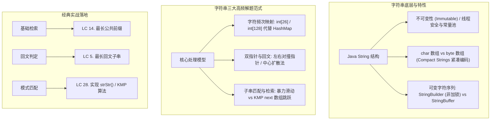

# 12 · 字符串与高性能处理：String底层机制、双指针与KMP匹配算法

> [!abstract] 一句话第一性原理
> **字符串（String）** 的本质是**连续字符数组的封装**。在算法求解中，字符串处理的核心是**利用字符集的有限性（如 ASCII 26 个字母）将空间检索降至 $O(1)$，并结合双指针（中心扩散/滑动窗口）与状态回退机制（KMP 前缀表）将高阶匹配复杂度从 $O(M \times N)$ 压缩至 $O(M + N)$**。

---

## 知识全景图



---

## 一、 底层核心机制：Java 字符串内存与性能

### 1. 为什么算法题中绝不可以在循环中用 `String +=`？
- Java 中的 `String` 是**不可变对象**（底层由 `final byte[] value` 实现）。
- 每次使用 `+` 拼接字符串，编译器底层都会创建新的 `StringBuilder` 并调用 `toString()` 拷贝数组。
- 如果在一个长度为 $N$ 的循环中频繁拼接：
  $$\text{时间复杂度} = 1 + 2 + 3 + \dots + N = O(N^2)$$
  这会直接引发 LeetCode 判题机 `Time Limit Exceeded (TLE)` 超时！
- **标准方案**：内部循环全部使用 `StringBuilder` 预设容量拼接，最终一次性 `.toString()`。

---

### 2. ASCII 字符计算的极速“哈希数组”
刷题遇到“字母异位词”、“字符出现频次”、“元音辅音”时，严禁使用 `HashMap<Character, Integer>`（其装箱拆箱开销大且常数大）：
- **纯小写英文字母**：`int[] count = new int[26];`，字符映射下标为 `c - 'a'`。
- **全 ASCII 字符（含标点与数字）**：`int[] count = new int[128];`，字符映射下标直接为 `(int) c`。

---

## 二、 核心算法骨架

### 1. 中心扩散法骨架（回文子串专用）
回文串具有“关于中心对称”的天然性质。中心可能是单个字符（奇数长度），也可能是两个字符之间的间隙（偶数长度）：

```java
public class PalindromeUtils {
    /**
     * 从 left 和 right 开始向两端扩散，返回最长回文子串的边界
     */
    private int expandAroundCenter(String s, int left, int right) {
        while (left >= 0 && right < s.length() && s.charAt(left) == s.charAt(right)) {
            left--;
            right++;
        }
        // 循环终止时 s[left] != s[right]，合法回文区间为 [left + 1, right - 1]
        // 长度为: (right - 1) - (left + 1) + 1 = right - left - 1
        return right - left - 1;
    }
}
```

---

### 2. KMP 模式匹配算法骨架（彻底搞懂前缀表）
当模式串 `needle` 与主串 `haystack` 发生字符不匹配时，KMP 利用已经匹配过的已知信息，**不回退主串指针，只移动模式串指针**。


#### KMP 的核心：构建 `next` 数组（最长相等前后缀长度）
```java
public class KMP {
    /**
     * 生成模式串 needle 的 next 数组
     * next[i] 表示 needle[0..i] 的最长相等前后缀的长度
     */
    public static int[] getNext(String needle) {
        int[] next = new int[needle.length()];
        int j = 0; // 前缀末尾下标，同时代表 [0..i] 的最长相等前后缀长度
        next[0] = 0;

        for (int i = 1; i < needle.length(); i++) {
            // 前后缀不匹配，向前回退 j
            while (j > 0 && needle.charAt(i) != needle.charAt(j)) {
                j = next[j - 1];
            }
            // 找到相同的字符，最长相等前后缀长度 + 1
            if (needle.charAt(i) == needle.charAt(j)) {
                j++;
            }
            next[i] = j;
        }
        return next;
    }
}
```

---

## 三、 经典题型实战

### 1. LC 14. 最长公共前缀（Longest Common Prefix）

> 🔗 **LeetCode 题目直通车**：[LeetCode 14. 最长公共前缀 ↗](https://leetcode.cn/problems/longest-common-prefix/)
- **题目描述**：编写一个函数来查找字符串数组中的最长公共前缀。如果不存在公共前缀，返回空字符串 `""`。
- **输入输出示例**：输入 `strs = ["flower","flow","flight"]` $\to$ 输出 `"fl"`；输入 `strs = ["dog","racecar","car"]` $\to$ 输出 `""`。
- **核心考点**：**纵向扫描**。以第 0 个字符串为基准，依次检查每个字符串同一列位置上的字符是否相同。若发生不匹配或已到达某字符串末尾，立即截断返回。

```java
class Solution14 {
    public String longestCommonPrefix(String[] strs) {
        if (strs == null || strs.length == 0) return "";

        // 以 strs[0] 的每一列为基准纵向扫描
        for (int col = 0; col < strs[0].length(); col++) {
            char c = strs[0].charAt(col);
            for (int row = 1; row < strs.length; row++) {
                // 如果当前字符串已到末尾，或者该列字符不相等，立即截取返回
                if (col == strs[row].length() || strs[row].charAt(col) != c) {
                    return strs[0].substring(0, col);
                }
            }
        }
        return strs[0];
    }
}
```

---

### 2. LC 5. 最长回文子串（Longest Palindromic Substring）

> 🔗 **LeetCode 题目直通车**：[LeetCode 5. 最长回文子串 ↗](https://leetcode.cn/problems/longest-palindromic-substring/)
- **题目描述**：给你一个字符串 `s`，找到 `s` 中最长的回文子串。
- **输入输出示例**：输入 `s = "babad"` $\to$ 输出 `"bab"`（或 `"aba"`）；输入 `s = "cbbd"` $\to$ 输出 `"bb"`。
- **核心考点**：中心扩散法。共有 $2n - 1$ 个可能的扩散中心（$n$ 个单字符中心与 $n - 1$ 个双字符间隙）。时间复杂度为稳定的 $O(N^2)$，空间复杂度仅为 $O(1)$，实战执行效率甚至超越动态规划。

```java
class Solution5 {
    public String longestPalindrome(String s) {
        if (s == null || s.length() < 2) return s;

        int start = 0, maxLen = 1;
        char[] cs = s.toCharArray(); // 转成字符数组提速

        for (int i = 0; i < cs.length; i++) {
            // 1. 以单个字符 i 为中心（奇数回文）
            int len1 = expand(cs, i, i);
            // 2. 以字符 i 和 i + 1 之间的间隙为中心（偶数回文）
            int len2 = expand(cs, i, i + 1);

            int len = Math.max(len1, len2);
            if (len > maxLen) {
                maxLen = len;
                // 计算当前回文串的起始下标
                start = i - (len - 1) / 2;
            }
        }
        return s.substring(start, start + maxLen);
    }

    private int expand(char[] cs, int l, int r) {
        while (l >= 0 && r < cs.length && cs[l] == cs[r]) {
            l--;
            r++;
        }
        return r - l - 1; // 真实回文长度
    }
}
```

---

### 3. LC 28. 找出字符串中第一个匹配项的下标（KMP 算法实战）

> 🔗 **LeetCode 题目直通车**：[LeetCode 28. 找出字符串中第一个匹配项的下标 ↗](https://leetcode.cn/problems/find-the-index-of-the-first-occurrence-in-a-string/)
- **题目描述**：给你两个字符串 `haystack` 和 `needle` ，请你在 `haystack` 字符串中找出 `needle` 字符串的第一个匹配项的下标（下标从 0 开始）。如果 `needle` 不是 `haystack` 的一部分，则返回 `-1`。
- **输入输出示例**：输入 `haystack = "sadbutsad", needle = "sad"` $\to$ 输出 `0`；输入 `haystack = "leetcode", needle = "leeto"` $\to$ 输出 `-1`。
- **核心考点**：KMP 算法。当主串字符不匹配时，主串指针 $i$ 不回头，模式串指针 $j$ 跳到 `next[j - 1]` 处继续比对。时间复杂度严格达到线性 $O(N + M)$。

```java
class Solution28 {
    public int strStr(String haystack, String needle) {
        if (needle.length() == 0) return 0;
        if (haystack.length() < needle.length()) return -1;

        // 1. 构建前缀表 next 数组
        int[] next = new int[needle.length()];
        int j = 0;
        for (int i = 1; i < needle.length(); i++) {
            while (j > 0 && needle.charAt(i) != needle.charAt(j)) {
                j = next[j - 1]; // 回退
            }
            if (needle.charAt(i) == needle.charAt(j)) {
                j++;
            }
            next[i] = j;
        }

        // 2. 主串与模式串比对
        j = 0;
        for (int i = 0; i < haystack.length(); i++) {
            while (j > 0 && haystack.charAt(i) != needle.charAt(j)) {
                j = next[j - 1]; // 模式串跳跃，主串 i 绝不回退
            }
            if (haystack.charAt(i) == needle.charAt(j)) {
                j++;
            }
            if (j == needle.length()) {
                // 完全匹配，返回匹配起始下标
                return i - needle.length() + 1;
            }
        }
        return -1;
    }
}
```

---

## 四、 工业级避坑与高频技巧清单

1. **`substring(start, end)` 左闭右开原则**：
   - 第二个参数是结束下标（不包含该下标）。如果提取到字符串末尾，直接使用单参数重载版本 `s.substring(start)` 即可。
2. **字符转小写/大写无开销技巧**：
   - 如果确定是字母，`c | 32` 可快速转为小写字母，`c & ~32` 可快速转为大写字母，位运算速度极快。
3. **判空与长度习惯**：
   - 先判断 `s == null || s.length() == 0`，避免空指针异常；不要写 `s.equals("")`。
