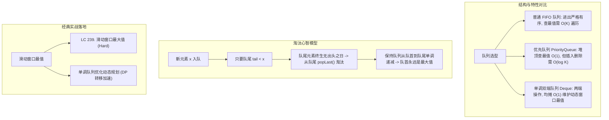

# 13 · 单调队列：滑动窗口最值的均摊 $O(1)$ 终结者

> [!abstract] 一句话第一性原理
> **单调队列（Monotonic Queue）** 是一种**内部元素严格保持单调递增或单调递减的双端队列**。其核心机制在于：**“当一个新元素入队时，凡是进入时间更早且价值更低的队尾元素，未来永远不可能成为窗口最大值，立即彻底淘汰”**，从而实现滑动窗口移动时最值查询的均摊 $O(1)$ 时间复杂度。

---

## 知识全景图



---

## 一、 底层核心机制：淘汰老弱病残

在动态维护一个大小为 $k$ 的滑动窗口时，为什么优先队列（大顶堆）不是最优解？
- 大顶堆虽然查最值是 $O(1)$，但每次滑动移出和移入元素需要 $O(\log k)$，总复杂度为 $O(N \log k)$；
- 而使用**双端队列（`Deque`）实现的单调队列**，每个元素最多进队一次、出队一次，**均摊时间复杂度为严格的 $O(1)$**！

> [!tip] 单调队列生存铁律
> 1. **队首永远是当前窗口的最大值**（`peekFirst()` 即是答案）；
> 2. **新元素入队（`push(x)`）**：只要队尾元素 $\le x$，队尾元素就“既比 $x$ 老，又比 $x$ 小”，未来绝无可能翻盘成为最大值，直接从队尾弹出；
> 3. **旧元素移出窗口（`pop(val)`）**：若要移出的元素刚好等于当前队首，才从队首弹出；若早就被淘汰了，则什么也不用做。

---

## 二、 通用单调队列代码骨架

使用面向对象思维封装一个通用的单调队列，写算法题时思路异常清晰：

```java
import java.util.ArrayDeque;
import java.util.Deque;

/**
 * 维护单调递减的双端队列（队首为最大值）
 */
class MonotonicQueue {
    private Deque<Integer> deque = new ArrayDeque<>();

    /**
     * 添加元素: 淘汰所有小于 val 的队尾元素，保持单调递减
     */
    public void push(int val) {
        while (!deque.isEmpty() && deque.peekLast() < val) {
            deque.pollLast(); // 队尾淘汰
        }
        deque.offerLast(val);
    }

    /**
     * 移出窗口元素: 仅当移出值与队首最大值相同时才弹出
     */
    public void pop(int val) {
        if (!deque.isEmpty() && deque.peekFirst() == val) {
            deque.pollFirst();
        }
    }

    /**
     * 获取当前窗口的最大值
     */
    public int max() {
        return deque.peekFirst();
    }
}
```

---

## 三、 经典真题实战

### LC 239. 滑动窗口最大值（Sliding Window Maximum）
- **题目描述**：给你一个整数数组 `nums`，有一个大小为 `k` 的滑动窗口从数组的最左侧移动到数组的最右侧。你只可以看到在滑动窗口内的 `k` 个数字。滑动窗口每次只向右移动一位。返回滑动窗口中的最大值。
- **输入输出示例**：
  - 输入：`nums = [1,3,-1,-3,5,3,6,7], k = 3`
  - 输出：`[3,3,5,5,6,7]`
  - 解释：
    ```text
    窗口位置                最大值
    [1  3  -1] -3  5  3  6  7       3
     1 [3  -1  -3] 5  3  6  7       3
     1  3 [-1  -3  5] 3  6  7       5
     1  3  -1 [-3  5  3] 6  7       5
     1  3  -1  -3 [5  3  6] 7       6
     1  3  -1  -3  5 [3  6  7]      7
    ```
- **核心考点**：单调队列。在双端队列中直接存**数组下标**（更省心，天然兼顾数值比较与过期下标判定）。

#### 工业级极致性能实现（存下标法）
```java
class Solution239 {
    public int[] maxSlidingWindow(int[] nums, int k) {
        if (nums == null || nums.length == 0 || k <= 0) return new int[0];

        int n = nums.length;
        int[] ans = new int[n - k + 1];
        int ansIdx = 0;

        // 双端队列中存储的是数组下标
        Deque<Integer> deque = new ArrayDeque<>();

        for (int i = 0; i < n; i++) {
            // 1. 入队检查：如果当前元素比队尾元素大，队尾元素绝不可能成为最大值，弹出
            while (!deque.isEmpty() && nums[deque.peekLast()] <= nums[i]) {
                deque.pollLast();
            }
            deque.offerLast(i);

            // 2. 窗口过期检查：如果队首下标已经滑出窗口范围 [i - k + 1, i]，弹出队首
            if (deque.peekFirst() < i - k + 1) {
                deque.pollFirst();
            }

            // 3. 记录答案：当窗口形成大小 k 时开始记录
            if (i >= k - 1) {
                ans[ansIdx++] = nums[deque.peekFirst()];
            }
        }
        return ans;
    }
}
```

- **复杂度分析**：
  - **时间复杂度**：$O(N)$。每个元素下标最多进队一次、出队一次，总操作步数不超过 $2N$。
  - **空间复杂度**：$O(k)$。双端队列中存储的有效下标最多为 $k$ 个。

---

## 四、 单调队列 vs 单调栈：一秒辨析不混淆

| 维度 | 单调队列（Monotonic Queue） | 单调栈（Monotonic Stack） |
| :--- | :--- | :--- |
| **底层数据结构** | 双端队列 `Deque`（两头均有操作） | 单端栈 `Stack` / `Deque`（仅在栈顶操作） |
| **解决的核心问题** | **固定或动态区间（滑动窗口）内的全局最值** | **寻找每个元素左右两侧“第一个比它大/小”的元素** |
| **典型代表题目** | LC 239 滑动窗口最大值 | LC 739 每日温度、LC 84 柱状图最大矩形 |
| **元素淘汰机制** | 队尾淘汰弱者，队首淘汰过期者 | 仅在栈顶弹出被突破的较小/较大者 |
