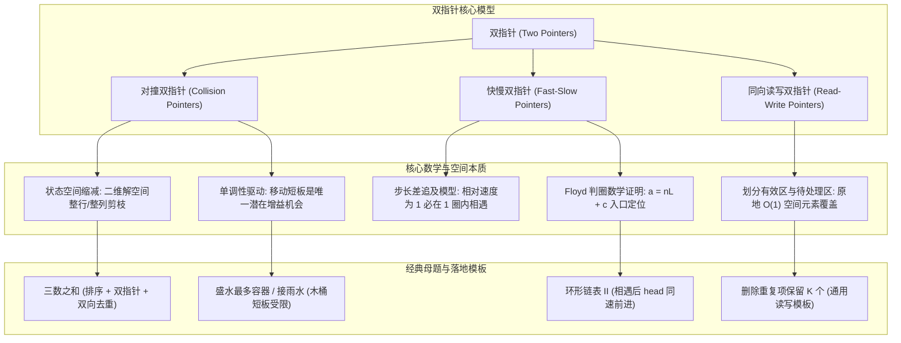
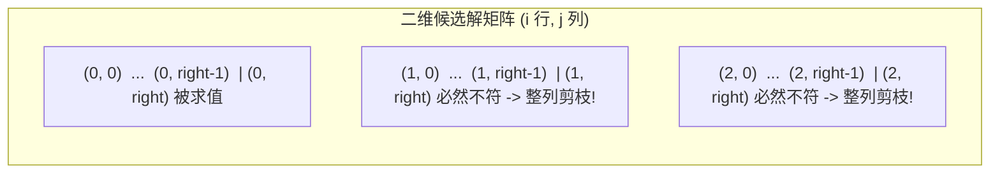
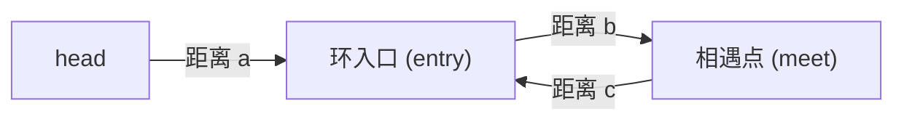

# 01 · 双指针：空间剪枝本质、Floyd判圈推导与高频解题模板

> [!abstract] 一句话第一性原理
> **双指针（Two Pointers）** 的本质不是简单的“定义两个下标”，而是**利用问题内在的单调性或拓扑特征，将暴力的二维搜索空间（$O(N^2)$ 候选集合）单向投影剪枝为一维线性扫描（$O(N)$），或利用固定步长差探测隐式状态环**。

---

## 知识全景图



---

## 一、 深入底层思维机制

### 1. 对撞指针的状态空间缩减本质（二维解空间剪枝）

面对“从长度为 $N$ 的数组中寻找满足条件的数对 $(i, j)$”问题，全部候选解构成了大小为 $N \times N$ 的笛卡尔积状态空间。暴力枚举复杂度为 $O(N^2)$。

对撞指针初始化于区间两端（$left = 0, right = N - 1$）。为什么每次指针移动能够跳过 $O(N)$ 个状态？



#### ① 有序数组求和剪枝
若数组升序排列，当前和 $S = nums[left] + nums[right]$：
- 若 $S > target$：由于数组升序，对于任意 $k \in [left, right]$，均有 $nums[k] \ge nums[left]$，从而 $nums[k] + nums[right] \ge S > target$。**这意味着下标 $right$ 与任何当前可选的左侧元素相加，结果必然全部超标**。因此，我们可以一次性安全排除整列以 $right$ 结尾的配对，直接执行 `right--`。
- 同理，若 $S < target$，可安全排除整行以 $left$ 起始的所有配对，直接执行 `left++`。
- **结论**：每一步判断都消除了矩阵的一整行或一整列，状态空间从 $N^2$ 缩减为 $2N$，时间复杂度严格为 $O(N)$。

#### ② 盛最多水的容器（为什么移动短板能安全排除一行解？）
在容积计算问题中，面积公式为：
$$V(i, j) = (j - i) \times \min(h[i], h[j])$$
设当前左右指针分别为 $l, r$，且左侧为短板（$h[l] \le h[r]$）：
- 如果我们**尝试移动长板**（保持 $l$ 不动，尝试某个 $r' < r$）：
  - 宽度变窄：$r' - l < r - l$；
  - 限制高度不可能增加：$\min(h[l], h[r']) \le h[l] = \min(h[l], h[r])$；
  - 因此必然有：$V(l, r') \le V(l, r)$，新面积不会更大；短板高度为 0 时两者可同为 0。
- **数学结论**：以 $l$ 为左边界与任何中间右边界 $r'$ 构成的容器，容积都绝不可能超过 $V(l, r)$！
- **剪枝安全性**：无需再计算 $(l, r-1), (l, r-2), \dots$，以 $l$ 为端点的全部候选解已被证明全都不优，安全淘汰左端点 `left++`。**移动短板是寻找更大面积的唯一必要条件**。

---

### 2. 快慢指针本质与 Floyd 判圈算法数学推导

快慢指针常用于探测链表环、寻找链表中点，或每个状态只有一个后继的函数图判环；一般有向图需用 DFS 三色标记或拓扑排序。

#### ① 为什么步长差为 1 一定不会错过（跳过）？
设 fast 步长为 2，slow 步长为 1。当两者都在环内时，以 slow 为相对参考系，fast 每次向前迈进 $2 - 1 = 1$ 步。
假设两指针在环内的初始距离为 $D$（$0 \le D < L$），则相对距离变化序列为：
$$D, D-1, D-2, \dots, 2, 1, 0$$
因为相对步长为 1，相对距离在模环长意义下离散减 1，必然严格归零，**绝不会发生“擦肩跳过”**。从 slow 入环起，至多再走 L 步就会相遇；当头节点本身在环上且先移动再比较时，slow 可能恰好走满一圈。

#### ② Floyd 判圈算法入口定位的严密数学证明



**参数定义**：
- 链表头 `head` 到环入口 `entry` 的边数为 $a$；
- 环入口 `entry` 顺时针到相遇点 `meet` 的最短边数为 $b$（$0 \le b < L$）；
- 相遇点 `meet` 继续沿环走到入口的边数记为 $c=L-b$；若相遇点就是入口，这里 c 按走完整一圈定义；
- 环的总周长为 $L = b + c$。

**推导过程**：
1. **记录步数**：
   - 慢指针 slow 到相遇点共走步数：$S_{slow} = a + b + mL$（$0 \le b < L$，$m \ge 0$；头节点即环入口时可能走满一圈）；
   - 快指针 fast 到相遇点共走步数：$S_{fast} = S_{slow} + nL$（$n \ge 1$ 表示 fast 比 slow 多走的圈数）。
2. **速度比例关系**：
   快指针速度是慢指针的 2 倍，所走总步数满足：
   $$S_{fast} = 2 \cdot S_{slow}$$
   $$a + b + mL + nL = 2(a + b + mL)$$
   $$a + b = (n-m)L$$
   $$a = (n-m)L - b$$
3. **恒等变形**：
   因为 $L = b + c \implies -b = c - L$，代入上式：
   $$a = (n-m)L - b = (n-m-1)L + c$$
   即：
   $$a \equiv -b \pmod L$$

**定理结论与物理意义**：
- 从链表起点 `head` 走 $a$ 步到达环入口；
- 从相遇点 `meet` 出发走 $a$ 步，在环上的位置为 $(b+a)\bmod L=0$，因此也回到环入口；a=0 时无需移动。
- **算法操作**：相遇后，将一个指针重置到 `head`，另一个指针停留在相遇点 `meet`；两个指针以**相同速度（每次 1 步）**同步前进，$a$ 步后两者**必然在环入口首次相遇**！

---

### 3. 同向读写双指针本质（原地 $O(1)$ 空间修改与保留至多 K 个元素）

#### ① 解决什么核心问题？（算法目的）
在数组题目中，经常遇到这类要求：
- **LeetCode 27 移除元素**：原地删除所有等于 `val` 的元素；
- **LeetCode 26 删除有序数组中的重复项**：每个元素最多只保留 1 个（即 $k = 1$）；
- **LeetCode 80 删除有序数组中的重复项 II**：每个元素最多保留 2 个（即 $k = 2$），多余的全部剔除；
- **核心约束**：必须在 **$O(1)$ 额外空间（严禁 `new` 新数组）** 的前提下，原地修改数组，并将合法元素紧凑排在数组前部，返回最终有效长度。

#### ② 心智模型：质检员与合格品区
我们把同一个数组划分成三个区域：
- **`write`（写指针 / 质检员）**：区间 `[0, write)` 永远代表**已经通过质检的合格品区**；`write` 指针所在的位置，就是**下一个合格品该放的位置**。
- **`read`（读指针 / 巡检员）**：负责从左到右巡视每一个原始元素 `nums[read]`。
- **区间 `[write, read)`**：已经被淘汰抛弃的废品垃圾区。

```text
  [ 1,  1,  1,  2,  2,  3 ]    (目标：每个数字最多保留 k=2 个)
    └─┬─┘   ▲       ▲
  合格品区  write    read
 [0, write) (待写入) (巡检中)
```

#### ③ 核心条件破解：为什么是 `nums[read] != nums[write - k]`？
很多初学者卡在这里：新来的元素 `nums[read]`，到底凭什么决定它“能不能放进合格区”？
1. **前 $k$ 个元素无条件放行**：当 `write < k` 时，合格区里总共还没凑齐 $k$ 个数，根本不可能超标，直接放入；
2. **后来的元素如何检查是否超标？**
   - 因为原数组是**升序排列（有序）**的！如果有相同的数字，它们在合格区中必定是**紧挨在一起**的。
   - 既然一个数字最多只能出现 $k$ 次，那么只要看**合格区里倒数第 $k$ 个位置的数字是谁**（即 `nums[write - k]`）。
   - **如果 `nums[read] == nums[write - k]`**：说明合格区里已经堆满了 $k$ 个与它相同的数字了（若再放进来，该数字就会变成 $k+1$ 个，违规！），因此这个 `nums[read]` 必须**直接丢弃**！
   - **如果 `nums[read] != nums[write - k]`**：说明合格区里该数字还没满 $k$ 个，可以安全写入 `nums[write] = nums[read]`，然后 `write++`！

---

## 二、 核心通用代码模板

### 1. 对撞双指针标准模板

> **代表母题**：两数之和 II - 输入有序数组（LeetCode 167）
> - **题目描述**：给你一个下标从 0 开始且已按**升序排列**的整数数组 `numbers` ，和一个目标值 `target`。请你从数组中找出相加之和等于 `target` 的两个数，返回这两个数的下标。
> - **输入输出示例**：
>   - 输入：`numbers = [2, 7, 11, 15], target = 9`
>   - 输出：`[0, 1]`（解释：`numbers[0] + numbers[1] = 2 + 7 = 9`）。
> - **核心思路**：左右端点对撞。因为数组有序，和偏小必须右移左指针放大数值，和偏大必须左移右指针缩小数值，步步剪枝。

```java
public int[] twoSumSorted(int[] numbers, int target) {
    int left = 0, right = numbers.length - 1;
    while (left < right) {
        int sum = numbers[left] + numbers[right];
        if (sum == target) {
            return new int[]{left, right};
        } else if (sum < target) {
            left++;  // 和偏小，左指针右移放大
        } else {
            right--; // 和偏大，右指针左移缩小
        }
    }
    return new int[]{-1, -1};
}
```

---

### 2. 快慢指针 Floyd 判圈与入口定位模板

> **代表母题**：环形链表 II（LeetCode 142）
> - **题目描述**：给定一个链表的头节点 `head`，判断链表中是否有环。如果链表中有环，则返回链表开始**入环的第一个节点**；如果链表无环，则返回 `null`。
> - **输入输出示例**：
>   - 输入：链表为 `3 -> 2 -> 0 -> -4`，其中尾节点 `-4` 重新指向节点 `2`（存在环）。
>   - 输出：返回节点值为 `2` 的节点。
> - **核心思路**：
>   - 阶段一：fast 走 2 步、slow 走 1 步，若相遇则证明有环；
>   - 阶段二：将一个指针拉回 `head`，另一个留在相遇点，两者同速前进（每次 1 步），相遇位置必定是入环点。

```java
public ListNode detectCycle(ListNode head) {
    if (head == null || head.next == null) return null;
    
    ListNode slow = head, fast = head;
    // 阶段一：检测是否有环
    while (fast != null && fast.next != null) {
        slow = slow.next;
        fast = fast.next.next;
        if (slow == fast) {
            // 阶段二：相遇后定位入口（基于 a = (n-1)L + c 推导）
            ListNode ptr1 = head;
            ListNode ptr2 = slow;
            while (ptr1 != ptr2) {
                ptr1 = ptr1.next;
                ptr2 = ptr2.next;
            }
            return ptr1; // 返回环入口节点
        }
    }
    return null; // 无环
}
```

---

### 3. 原地读写双指针模板（保留至多 K 个重复元素）

> **代表母题**：删除有序数组中的重复项 II（LeetCode 80 / 泛化保留至多 K 个）
> - **题目描述**：给你一个有序数组 `nums` 和一个整数 `k`。请你**原地**删除重复出现的元素，使得出现次数超过 `k` 次的元素只保留 `k` 次。返回删除后数组的新长度。
> - **输入输出示例**：
>   - 输入：`nums = [1, 1, 1, 2, 2, 3], k = 2`
>   - 输出：`5`（解释：原数组前 5 个元素被原地修改为 `[1, 1, 2, 2, 3]`）。
> - **核心思路**：维护写指针 `write`（合格区）和读指针 `read`。只要当前数与合格区倒数第 $k$ 个数不同（`nums[read] != nums[write - k]`），说明还没堆满 $k$ 个，安全写入！

```java
public int removeDuplicatesK(int[] nums, int k) {
    int write = 0;
    for (int read = 0; read < nums.length; read++) {
        // 当前写入位置不足 k 个，或当前探测值与有效区倒数第 k 个值不同
        if (write < k || nums[read] != nums[write - k]) {
            nums[write++] = nums[read];
        }
    }
    return write; // 返回新数组有效长度
}
```

---

## 三、 核心母题深度解析

### 母题 1：三数之和（LeetCode 15）

> **题目描述**：给你一个整数数组 `nums`，判断是否存在三元组 `[nums[i], nums[j], nums[k]]` 满足 `i != j != k` 且 `nums[i] + nums[j] + nums[k] == 0`。请返回所有和为 0 且不重复的三元组。

#### 核心思路与去重细节剖析

**为什么想到排序 + 双指针？** 题目要找三个不同位置的数，直接枚举三元组需要 $O(N^3)$。固定一个数后，剩下的问题就是“两数之和”。原数组无序，指针移动不能指导和的变化；先排序，才能根据和偏大或偏小安全排除一个端点。题目按数值组合返回答案，不要求保留原下标，因此排序不会破坏所需信息。下面的步骤把三重枚举降为 $O(N^2)$，再处理“不重复”要求。

1. **排序预处理**：将数组升序排序，$O(N \log N)$ 排序开销低于后续双指针的 $O(N^2)$。
2. **固定基准数与单向探测（为什么 `left = i + 1` 绝不会漏解？）**：
   外层循环遍历基准数 $i \in [0, n - 3]$，内层双指针仅在右侧子区间 $[i+1, n-1]$ 内寻找剩余两数：
   - **疑问**：会不会存在某个合法三元组，其中一个数位于 $i$ 的左边（即下标小于 $i$），从而被漏掉？
   - **答案**：**绝不会！** 因为包含该左侧元素的所有合法三元组，早在外层循环遍历到那个左侧元素时，就**已经被全部找出并收集完毕了**！
   - **不重不漏原则**：人为规定三元组下标严格递增（$i < left < right$）。每个三元组**仅由其最左侧的龙头元素负责采集**。如果允许回头看左侧，只会搜出已经收集过的旧组合，导致结果集出现重复三元组。
3. **外层去重关键**：
   必须使用 `if (i > 0 && nums[i] == nums[i - 1]) continue;`。
   **为什么不能写 `nums[i] == nums[i + 1]`？**
   若写成 `nums[i] == nums[i + 1]`，会直接跳过三元组内部允许包含相同元素的情况（例如 `[-1, -1, 2]`，第一项和第二项允许相等；只有处理完前一个 `-1` 产生的所有结果后，遇到后一个 `-1` 才应跳过）。
4. **内层去重关键**：
   当找到合法组合后，`left` 和 `right` 必须跳过所有与当前数值相同的元素，再各自向内收缩一步，防止产生完全相同的三元组。

```java
class Solution {
    public List<List<Integer>> threeSum(int[] nums) {
        List<List<Integer>> ans = new ArrayList<>();
        Arrays.sort(nums);
        int n = nums.length;

        for (int i = 0; i < n - 2; i++) {
            // 剪枝 1：首数大于 0，后续元素均非负，不可能和为 0
            if (nums[i] > 0) break;
            
            // 外层去重：跳过重复的第一个数
            if (i > 0 && nums[i] == nums[i - 1]) continue;

            int left = i + 1, right = n - 1;
            int target = -nums[i];

            while (left < right) {
                int sum = nums[left] + nums[right];
                if (sum == target) {
                    ans.add(Arrays.asList(nums[i], nums[left], nums[right]));
                    // 内层去重：跳过相同的左、右候选值
                    while (left < right && nums[left] == nums[left + 1]) left++;
                    while (left < right && nums[right] == nums[right - 1]) right--;
                    left++;
                    right--;
                } else if (sum < target) {
                    left++;
                } else {
                    right--;
                }
            }
        }
        return ans;
    }
}
```

---

### 母题 2：接雨水（LeetCode 42）

> **题目描述**：给定 $n$ 个非负整数表示每个宽度为 1 的柱子的高度图，计算按此排列的柱子，下雨之后能接多少雨水。

#### 核心本质推导

**为什么想到双指针？** 题目求每个位置上方的积水量，而不是任选两根柱子围成的总面积。某位置的水位受左右最高柱中较低的一侧限制。直接逐位置寻找两侧最高柱会重复扫描；前后缀最大值数组能做到 $O(N)$，双指针则进一步只维护 `leftMax`、`rightMax`：较小的一侧已经有另一侧至少同高的边界，可以当场结算，额外空间降为 $O(1)$。

下标 $i$ 能接的水量仅由其**左侧最高柱子 $\max L$** 与**右侧最高柱子 $\max R$** 决定：$water[i] = \max(0, \min(\max L, \max R) - height[i])$。
- 双指针分别从两端向中间对撞，维护 `leftMax` 和 `rightMax`。
- 若 `leftMax < rightMax`：无论 `left` 与 `right` 之间存在多高的柱子，当前 `left` 位置的蓄水瓶颈**必定是 `leftMax`**（因为木桶短板在左侧已盖棺定论）。因此可以直接计算 `left` 处的雨水并推进 `left++`。
- 反之若 `leftMax >= rightMax`，右侧木桶短板确定为 `rightMax`，推进 `right--`。

```java
class Solution {
    public int trap(int[] height) {
        int left = 0, right = height.length - 1;
        int leftMax = 0, rightMax = 0;
        int totalWater = 0;

        while (left < right) {
            leftMax = Math.max(leftMax, height[left]);
            rightMax = Math.max(rightMax, height[right]);

            if (leftMax < rightMax) {
                totalWater += leftMax - height[left];
                left++;
            } else {
                totalWater += rightMax - height[right];
                right--;
            }
        }
        return totalWater;
    }
}
```

---

## 四、 典型算法应用速览

| 题目 | 核心模型 | 一句话破题思路 | 复杂度 |
| :--- | :--- | :--- | :--- |
| **LC 11. 盛最多水的容器** | 对撞双指针 | 面积由短板限制，每次必须移动短板才可能让面积增大。 | $O(N) / O(1)$ |
| **LC 283. 移动零** | 原地读写双指针 | 快指针找非零元素，慢指针维护非零区间终点，遍历中交换。 | $O(N) / O(1)$ |
| **LC 125. 验证回文串** | 对撞双指针 | 左右指针向内逼近，忽略非字母数字字符并忽略大小写比较。 | $O(N) / O(1)$ |
| **LC 26. 删除有序数组中的重复项** | 读写双指针 | 保留 $K=1$ 的通用读写模板，比较 `nums[read]` 与 `nums[write - 1]`。 | $O(N) / O(1)$ |
| **LC 167. 两数之和 II - 输入有序数组** | 对撞双指针 | 利用数组单调性，两数之和与目标比对，每次安全剔除一行/列。 | $O(N) / O(1)$ |

### 从题目描述判断算法

#### LC 11：盛最多水的容器
> 🔗 **LeetCode 题目直通车**：[LeetCode 11. 盛最多水的容器 ↗](https://leetcode.cn/problems/container-with-most-water/)

- **题目线索**：任选两条竖线，面积是“间距 × 较短高度”，要求最大值。
- **为什么用对撞双指针**：从最宽的两端开始。若左边更短，固定左端而把右端向内移，宽度变小且有效高度不可能超过左端高度，面积不会更大；因此可以安全舍弃左端。右边更短时同理。
- **解题步骤**：计算当前面积并更新最大值，再移动较短的一端。移动短板不保证下一次面积增加，但保证不会漏掉更优答案。

#### LC 283：移动零
> 🔗 **LeetCode 题目直通车**：[LeetCode 283. 移动零 ↗](https://leetcode.cn/problems/move-zeroes/)

- **题目线索**：原地把零移到末尾，同时保持非零元素的相对顺序。
- **为什么用读写双指针**：需要按原顺序筛选非零数，新数组会占额外空间，逐个删除又会反复搬移。读指针扫描，写指针指向下一个非零数应放的位置，能一次完成压紧。
- **解题步骤**：遇到非零数就与写位置交换并推进写指针；读指针始终前进。已保留的非零前缀有序，末尾自然留下零。

#### LC 125：验证回文串
> 🔗 **LeetCode 题目直通车**：[LeetCode 125. 验证回文串 ↗](https://leetcode.cn/problems/valid-palindrome/)

- **题目线索**：忽略非字母数字字符及大小写后，判断字符串是否左右对称。
- **为什么用对撞双指针**：回文直接要求首尾对应字符相同；比较成功后，只需继续检查内部区间，无需生成清洗后的新字符串。
- **解题步骤**：两端跳过无效字符，统一大小写后比较；不同立即返回 `false`，相同则同时向内移动，直到相遇。

#### LC 26：删除有序数组中的重复项
> 🔗 **LeetCode 题目直通车**：[LeetCode 26. 删除有序数组中的重复项 ↗](https://leetcode.cn/problems/remove-duplicates-from-sorted-array/)

- **题目线索**：数组有序、原地去重、每个值只保留一次，并返回有效长度。
- **为什么用读写双指针**：有序保证相同值连续出现，当前数只需与最后一个保留值比较。无需哈希表，也不必真的缩短数组。
- **解题步骤**：读指针遇到新值时写入有效前缀并推进写指针；重复值跳过。写指针的最终位置就是新长度。

#### LC 167：两数之和 II
> 🔗 **LeetCode 题目直通车**：[LeetCode 167. 两数之和 II - 输入有序数组 ↗](https://leetcode.cn/problems/two-sum-ii-input-array-is-sorted/)

- **题目线索**：数组升序、寻找两个不同位置的数、要求常数额外空间。
- **为什么用对撞双指针**：当前两端之和偏小时，左端与当前范围内任何更小的右端都不可能达标，可以舍弃左端；偏大时可对称地舍弃右端。无序数组不具备这条排除依据。
- **解题步骤**：两端求和，和偏小时推进左指针，偏大时后退右指针，相等则返回原题要求的下标；每次至少排除一个候选位置。

> [!example]- 展开查看：典型应用标准代码
>
> **LC 11. 盛最多水的容器**
> ```java
> public int maxArea(int[] height) {
>     int left = 0, right = height.length - 1;
>     int maxWater = 0;
>     while (left < right) {
>         int cur = Math.min(height[left], height[right]) * (right - left);
>         maxWater = Math.max(maxWater, cur);
>         if (height[left] <= height[right]) {
>             left++;
>         } else {
>             right--;
>         }
>     }
>     return maxWater;
> }
> ```
>
> **LC 283. 移动零**
> ```java
> public void moveZeroes(int[] nums) {
>     int write = 0;
>     for (int read = 0; read < nums.length; read++) {
>         if (nums[read] != 0) {
>             int temp = nums[write];
>             nums[write] = nums[read];
>             nums[read] = temp;
>             write++;
>         }
>     }
> }
> ```
>
> **LC 125. 验证回文串**
> ```java
> public boolean isPalindrome(String s) {
>     int left = 0, right = s.length() - 1;
>     while (left < right) {
>         while (left < right && !Character.isLetterOrDigit(s.charAt(left))) left++;
>         while (left < right && !Character.isLetterOrDigit(s.charAt(right))) right--;
>         if (Character.toLowerCase(s.charAt(left)) != Character.toLowerCase(s.charAt(right))) {
>             return false;
>         }
>         left++;
>         right--;
>     }
>     return true;
> }
> ```

---

## 五、 工程避坑指南

1. **防死循环与空指针**：
   - 链表快慢指针必须检查 `while (fast != null && fast.next != null)`。若只检查 `fast.next != null`，当链表节点数为偶数时，`fast.next.next` 将抛出 `NullPointerException`。
2. **两数之和大数防溢出**：
   - 当数组元素接近 `Integer.MAX_VALUE` 时，`int sum = nums[left] + nums[right]` 会发生正溢出变为负数，导致错误的指针移动逻辑。防御写法：使用 `long sum = (long) nums[left] + nums[right]`。
3. **去重与步进同步**：
   - 在三数之和、四数之和中，跳过重复元素后，指针依然要**显式向前再推一步**（即 `while (l < r && nums[l] == nums[l+1]) l++; l++;`），否则指针会停留在最后一个重复值处引发死循环或重复统计。

---

## 关联与实战刷题路线

- [[02-滑动窗口]] —— 双指针在连续区间的拓展形式
- [[03-二分查找]] —— 单调性在随机寻址结构下的折半剪枝
- [[../03-刷题记录/02-LC0015-三数之和]] —— 三数之和实战
- [[../03-刷题记录/01-LC0001-两数之和]] —— 哈希与对撞双指针对比

## 📚 参考资料

- 《算法导论》（Introduction to Algorithms）第 3 版：双指针与贪心状态消解
- LeetCode 官方题解：Floyd's Tortoise and Hare (Cycle Detection) 算法证明
- LeetCode 题解精选：双指针在二维状态空间剪枝中的几何诠释
