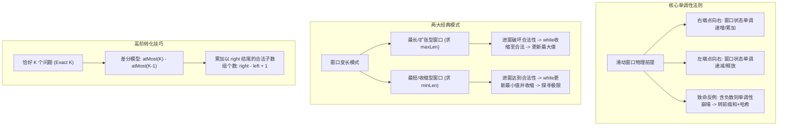

# 02 · 滑动窗口：单调性前提、双模板范式与差分计数技巧

> [!abstract] 一句话第一性原理
> **滑动窗口（Sliding Window）** 的本质是**利用区间端点移动的单调性，将两个同向指针维护的连续区间状态进行常数级增量转移，从而把枚举所有连续子数组的 $O(N^2)$ 复杂度降维至 $O(N)$**。

---

## 知识全景图



---

## 一、 滑动窗口的物理前提与适用边界

### 1. 窗口单调性定理
滑动窗口能将双层循环压至单层循环的前提是：**窗口内维护的约束对扩张、收缩具有可用于安全排除端点的单调关系；状态可以保持不变，并不要求严格单调**。
- **右指针 `right` 右移（进窗）**：状态只增不减（如非负数组的和、元素频次、字符种类）。
- **左指针 `left` 右移（出窗）**：状态只减不增。

若具备此单调性，当窗口状态超出限制时，我们**只需右移左指针一次或多次即可必定恢复合法性**，且之前跳过的左指针位置永无再次成为更优解的可能。每个元素进窗一次、出窗一次，均摊时间复杂度为 $O(N)$。

### 2. 边界：含负数为何会破坏按窗口和收缩的规则？

> [!CAUTION] 边界陷阱警告
> 若数组中**存在负数**，以“连续子数组和等于或大于 $K$”为例：
> - 右移 `right` 加入一个负数，窗口和反而**减小**；
> - 右移 `left` 移出一个负数，窗口和反而**增大**。
> 此时指针移动的方向丧失了单调性指导：当当前和偏小时，你无法判断应该继续扩张 `right` 还是收缩 `left`。

| 场景特点 | 能否使用滑动窗口？ | 标准正确解法 |
| :--- | :--- | :--- |
| **非负数求和**，且目标为正 | 可按和维护最短达标窗口 | 非负数保证扩张和不减、收缩和不增 |
| **数组包含负数**，求“和为 $K$ 的子数组” | 不能直接用按和收缩的普通窗口 | **前缀和 + 哈希表**（如 LC 560） |
| **数组包含负数**，求“和至少为 $K$ 的最短子数组” | **严禁使用普通滑窗** | **前缀和 + 单调双端队列**（如 LC 862） |

---

负数并不影响按字符/数值种类维护窗口，也不影响固定长度窗口；例如含负数数组的“至多 K 种数”仍可滑窗。乘积约束还需另查元素范围：正整数至少为 1 时扩张乘积才不减，零或小于 1 的数不能直接套同一结论。

## 二、 两大经典模式与真实可落地模板

滑动窗口没有复杂的伪代码，解题的核心区别在于：**答案是在“窗口非法收缩后更新”，还是在“窗口合法时边收缩边更新”**。

### 1. 模式一：最长 / 扩张型窗口标准模板（寻找满足约束的最长区间）

> **代表母题**：至多包含 K 个不同字符的最长子串（LeetCode 340 / LeetCode 3 无重复最长子串变体）
> - **题目描述**：给定一个字符串 `s` 和一个整数 `k`，找出至多包含 `k` 个不同字符的最长连续子串的长度。
> - **输入输出示例**：输入 `s = "eceba", k = 2`；输出 `3`（解释：子串 `"ece"` 包含 2 个不同字符 'e' 和 'c'，长度为 3）。
> - **核心目标**：窗口越大越好，只要内部字符种类不超标（$\le k$），就不断往右扩张；一旦超标，才被动收缩左边。

**执行逻辑**：
1. `right` 指针主动向前，将元素纳入窗口并更新统计信息；
2. 若当前窗口状态**违反约束（Invalid，种类 > k）**，启动 `while` 循环将 `left` 元素移出窗口，直到重新恢复合法；
3. 退出收缩循环后，当前区间 `[left, right]` 必为以 `right` 为右端点的最大合法区间，在 `while` 外部更新：`maxLen = Math.max(maxLen, right - left + 1)`。

```java
public int lengthOfLongestSubstringKDistinct(String s, int k) {
    int[] count = new int[128]; // 字符频次统计（以 ASCII 为例）
    int distinct = 0;           // 窗口内不同字符种类数
    int left = 0;
    int maxLen = 0;

    for (int right = 0; right < s.length(); right++) {
        char inChar = s.charAt(right);
        if (count[inChar] == 0) {
            distinct++;
        }
        count[inChar]++;

        // 窗口非法状态：字符种类超过 k，收缩 left 恢复合法
        while (distinct > k) {
            char outChar = s.charAt(left);
            count[outChar]--;
            if (count[outChar] == 0) {
                distinct--;
            }
            left++;
        }

        // 此时窗口 [left, right] 必然合法，在 while 外结算最长长度
        maxLen = Math.max(maxLen, right - left + 1);
    }
    return maxLen;
}
```

---

### 2. 模式二：最短 / 收缩型窗口标准模板（寻找满足约束的最短区间）

> **代表母题**：长度最小的子数组（LeetCode 209）
> - **题目描述**：给定一个含有 `n` 个正整数的数组 `nums` 和一个正整数 `target`。找出该数组中满足**其和 $\ge target$ 的长度最小的连续子数组**，并返回其长度。如果不存在符合条件的子数组，返回 0。
> - **输入输出示例**：
>   - 输入：`target = 7, nums = [2, 3, 1, 2, 4, 3]`
>   - 输出：`2`（解释：子数组 `[4, 3]` 是和 $\ge 7$ 的最短连续区间，长度为 2）。
> - **核心目标**：窗口越短越好，一旦当前元素和累加达标（$\ge target$），就迫不及待地收缩左边去探寻更短的极限！

**执行逻辑**：
1. `right` 指针主动扩张，累加元素进窗；
2. 一旦窗口状态**达到题目要求（Valid，sum >= target）**，说明找到了一个合法解，立即进入 `while` 循环：
   - **在 `while` 内部当场更新答案**：`minLen = Math.min(minLen, right - left + 1)`；
   - 尝试收缩左边界：移出 `left` 对应元素，执行 `left++`，探寻在依然满足 $\ge target$ 的条件下窗口能否缩得更短；
3. 直到窗口因过度收缩使得 `sum < target`（变回不合法），跳出 `while`，让 `right` 继续前行。

```java
public int minSubArrayLen(int target, int[] nums) {
    int left = 0;
    int sum = 0;
    int minLen = Integer.MAX_VALUE;

    for (int right = 0; right < nums.length; right++) {
        sum += nums[right]; // 元素入窗

        // 满足条件时持续收缩 left 寻找最短可能
        // 关键：必须在 while 内部当场记录，因为出循环时 sum 已经 < target 不合法了！
        while (sum >= target) {
            minLen = Math.min(minLen, right - left + 1); // 记录当前可行解
            sum -= nums[left]; // 元素出窗
            left++;
        }
    }
    return minLen == Integer.MAX_VALUE ? 0 : minLen;
}
```

---

## 三、 高阶破局技法：“恰好 K 个”转“最多 K 个”差分技巧

### 1. 为什么“恰好含 K 个”难以直接单调滑动？
例如 LeetCode 992“K 个不同整数的子数组”或 LeetCode 930“和相同的二元子数组”：
当当前窗口内刚好包含 $K$ 个不同元素时：
- 如果扩张 `right`，新加的元素若是已有元素，种类数仍是 $K$（合法）；
- 如果收缩 `left`，被移除的元素若有重复副本，种类数仍是 $K$（合法）。
难点在于：一个满足“恰好 K”的窗口，其所有后缀不一定也满足，不能直接用窗口长度结算数量。直接计数并非不可行，但需要额外处理重复前缀；下面的差分转化更便于复用模板。

### 2. 差分转化模型
利用集合容斥与差分思想：
$$\text{Exact}(K) = \text{atMost}(K) - \text{atMost}(K - 1)$$
- $\text{Exact}(K)$：窗口内恰好包含 $K$ 个特征元素的连续子数组个数；
- $\text{atMost}(K)$：窗口内**至多包含 $K$ 个**特征元素的连续子数组个数。

### 3. 为什么 $\text{atMost}(K)$ 极其简单？
当窗口滑动维护“至多 $K$ 个”时，单调性完全成立！
当固定右端点 `right`，收缩 `left` 直到窗口内状态满足 $\le K$ 时：
**以 `right` 为右端点、左端点在 $[left, right]$ 范围内的所有连续子数组，其包含的特征元素个数必定均 $\le K$！**
因此，以 `right` 结尾的合法子数组个数为：
$$\Delta = right - left + 1$$
遍历一次累加求和即可在 $O(N)$ 内算出 $\text{atMost}(K)$。

---

## 四、 核心母题深度解析

### 母题 1：最小覆盖子串（LeetCode 76）

> **题目描述**：给你一个字符串 `s` 、一个字符串 `t` 。返回 `s` 中涵盖 `t` 所有字符的最小子串。如果不存在，返回空字符串。

#### 破题设计

**为什么想到最短滑动窗口？** “子串”要求连续，可以用左右端点表示；“涵盖 `t` 所有字符”要求连重复次数也满足，例如 `t = "AAB"` 必须有两个 `A`。向右加入字符不会破坏已有覆盖，向左移除字符则可能使覆盖失效。因此先扩张到覆盖，再在仍覆盖时不断收缩，正好对应最短窗口模板。代码中的 `matchCount` 表示**尚缺的字符总数**，为 0 才能更新答案。

- **频次管理**：用 `int[128] need` 记录 `t` 中各字符的需求频次。正数表示仍缺少的字符数，负数或 0 表示已满足或富余。
- **待匹配计数器 `matchCount`**：记录尚缺的字符总量（初值为 `t.length()`），当 `matchCount == 0` 时代表当前窗口已完全覆盖 `t`，无需 $O(128)$ 全量遍历检查。

```java
class Solution {
    public String minWindow(String s, String t) {
        if (s.length() < t.length()) return "";

        int[] need = new int[128];
        for (char c : t.toCharArray()) {
            need[c]++;
        }

        int matchCount = t.length(); // 尚需匹配的字符总数
        int left = 0;
        int minLen = Integer.MAX_VALUE;
        int start = 0;

        for (int right = 0; right < s.length(); right++) {
            char inChar = s.charAt(right);
            // 如果进窗字符是所需字符，有效匹配数减 1
            if (need[inChar] > 0) {
                matchCount--;
            }
            need[inChar]--; // 无论是否为 t 中的字符，频次计数均减 1

            // 窗口已满足完全覆盖条件，开始尝试左边界收缩
            while (matchCount == 0) {
                int curLen = right - left + 1;
                if (curLen < minLen) {
                    minLen = curLen;
                    start = left;
                }

                char outChar = s.charAt(left);
                // 如果出窗字符刚好是所需字符（即将变为正数），有效匹配数增加
                if (need[outChar] == 0) {
                    matchCount++;
                }
                need[outChar]++;
                left++;
            }
        }

        return minLen == Integer.MAX_VALUE ? "" : s.substring(start, start + minLen);
    }
}
```

---

### 母题 2：K 个不同整数的子数组（LeetCode 992）

> **题目描述**：
> 给定一个正整数数组 `nums` 和一个整数 `k`，返回 `nums` 中好子数组的数目。如果 `nums` 的某个子数组中不同整数的个数恰好为 `k`，则称其为好子数组。
>
> **约束条件（重要前提）**：
> - `1 <= nums.length <= 2 * 10^4`
> - `1 <= nums[i] <= nums.length`（**核心关键：原题明确保证了每个元素值最大不超过数组长度 $N$！**）
> - `1 <= k <= nums.length`
>
> **输入输出示例**：
> - 示例 1：
>   - 输入：`nums = [1,2,1,2,3], k = 2`
>   - 输出：`7`（恰好含 2 个不同整数的好子数组有：`[1,2]`, `[2,1]`, `[1,2]`, `[2,3]`, `[1,2,1]`, `[2,1,2]`, `[1,2,1,2]`）
> - 示例 2：
>   - 输入：`nums = [1,2,1,3,4], k = 3`
>   - 输出：`3`（好子数组为：`[1,2,1,3]`, `[2,1,3]`, `[1,3,4]`）

#### 解题思路

1. **为什么用滑动窗口？** 子数组要求连续；加入元素不会减少种类，移除元素不会增加种类。种类超标就收缩左端，已超标的起点继续延长也不会合法，所以指针不用回头。
2. **为什么先数“至多 K 种”？** 合法窗口的所有后缀都不会超过 K 种，因此可以一次数出 `right-left+1` 个起点。“恰好 K 种”没有这个性质：删掉元素可能只剩 K−1 种。
3. **为什么做减法？** 例如 `[1,2,1]`，固定最右边的 1 为终点，候选是 `[1,2,1]`、`[2,1]`、`[1]`。至多 2 种有 3 个，至多 1 种有 1 个，扣掉后恰好 2 种有 `3−1=2` 个。因此答案是 `atMost(K)−atMost(K−1)`。

**对应代码**：右端进窗 → 种类超标时移出左端 → 累加 `right-left+1`。`freq[x]` 是 x 在窗口内的出现次数；频次从 0 变 1 才增加种类，从 1 变 0 才减少种类。每个元素最多进出一次，两次扫描仍为 $O(N)$。

#### 核心代码实现（两套方案对比）

##### 方案一：原题最优解（利用原题 $nums[i] \le N$ 特性，数组计数极速版）

```java
class Solution {
    public int subarraysWithKDistinct(int[] nums, int k) {
        return atMostK(nums, k) - atMostK(nums, k - 1);
    }

    // 求不同整数个数至多为 k 的子数组总数
    private int atMostK(int[] nums, int k) {
        if (k <= 0) return 0;
        
        int n = nums.length;
        // 原题约束保证 nums[i] <= n，因此开 n + 1 大小足以涵盖所有可能值
        int[] freq = new int[n + 1];
        int distinct = 0; // 当前窗口内的不同整数种类数
        int left = 0;
        int ans = 0;

        for (int right = 0; right < n; right++) {
            // 首次出现，种类 +1
            if (freq[nums[right]] == 0) {
                distinct++;
            }
            freq[nums[right]]++; // 频次 +1

                // 种类超过 k，收缩 left
            while (distinct > k) {
                freq[nums[left]]--; // 频次 -1
                if (freq[nums[left]] == 0) {
                    distinct--; // 彻底出窗，种类 -1
                }
                left++;
            }

            // 以 right 结尾的合法子数组个数为 right - left + 1
            ans += (right - left + 1);
        }
        return ans;
    }
}
```

##### 方案二：通用场景解（当数值很大或含负数时，无惧大数的 HashMap 版）

```java
class SolutionGeneral {
    public int subarraysWithKDistinct(int[] nums, int k) {
        return atMostK(nums, k) - atMostK(nums, k - 1);
    }

    private int atMostK(int[] nums, int k) {
        if (k <= 0) return 0;

        Map<Integer, Integer> freq = new HashMap<>();
        int left = 0;
        int ans = 0;

        for (int right = 0; right < nums.length; right++) {
            // 元素进窗，频次 +1
            freq.put(nums[right], freq.getOrDefault(nums[right], 0) + 1);

            // 种类数等于 freq.size()，超过 k 则收缩 left
            while (freq.size() > k) {
                int outNum = nums[left];
                freq.put(outNum, freq.get(outNum) - 1);
                if (freq.get(outNum) == 0) {
                    freq.remove(outNum); // 彻底移除，种类数自动减 1
                }
                left++;
            }

            ans += (right - left + 1);
        }
        return ans;
    }
}
```

---

## 五、 典型算法应用速览

| 题目 | 核心模型 | 一句话破题思路 | 复杂度 |
| :--- | :--- | :--- | :--- |
| **LC 3. 无重复字符的最长子串** | 最长/扩张型 | 字符进窗频次大于 1 则收缩 `left` 直至无重复，更新 `maxLen`。 | $O(N) / O(\Sigma)$ |
| **LC 209. 长度最小的子数组** | 最短/收缩型 | 窗口元素和 $\ge target$ 时记录最小长度并收缩 `left`。 | $O(N) / O(1)$ |
| **LC 1004. 最大连续1的个数 III** | 最长/扩张型 | 允许至多翻转 $K$ 个 0，即窗口内 0 的个数 $> K$ 时收缩 `left`。 | $O(N) / O(1)$ |
| **LC 438. 找到字符串中所有字母异位词** | 固定长度窗口 | 维护长度恒为 `p.length()` 的定长窗口，对比字符频次差值。 | $O(N) / O(\Sigma)$ |
| **LC 904. 水果成篮** | 最长/扩张型 | 转化为求至多包含 2 种元素的最长连续子数组长度。 | $O(N) / O(1)$ |

### 从题目描述判断算法

#### LC 3：无重复字符的最长子串
> 🔗 **LeetCode 题目直通车**：[LeetCode 3. 无重复字符的最长子串 ↗](https://leetcode.cn/problems/longest-substring-without-repeating-characters/)

- **题目线索**：寻找连续子串、不能重复、长度最大。
- **为什么用最长窗口**：加入字符可能产生重复；移除左端字符能消除重复，而且包含重复的区间继续扩张也不会重新合法，因此舍弃的左端无需回头检查。
- **解题步骤**：记录字符上次出现位置。若它仍在窗口内，直接把 `left` 跳到该位置之后；更新最近位置与最长长度。例如 `"abba"` 最后一个 `a` 的旧位置已在窗外，不能让 `left` 倒退。

#### LC 209：长度最小的子数组
> 🔗 **LeetCode 题目直通车**：[LeetCode 209. 长度最小的子数组 ↗](https://leetcode.cn/problems/minimum-size-subarray-sum/)

- **题目线索**：正整数数组、连续区间、和至少为 `target`、长度最小。
- **为什么用最短窗口**：正数保证扩张使和增加、收缩使和减少，移动方向有依据；达到目标后可以尝试缩短。若允许负数，这套按窗口和决定收缩的规则就失去依据。
- **解题步骤**：右端累加；在 `sum >= target` 时先记录长度再移除左端，直到不达标。答案必须在收缩循环内记录。

#### LC 1004：最大连续 1 的个数 III
> 🔗 **LeetCode 题目直通车**：[LeetCode 1004. 最大连续1的个数 III ↗](https://leetcode.cn/problems/max-consecutive-ones-iii/)

- **题目线索**：二元数组、最多把 K 个 0 翻成 1、求最长连续段。
- **为什么用最长窗口**：一段区间能全变为 1，当且仅当其中 0 的数量不超过 K。把“翻转选择”转成“窗口内零的预算”，就无需枚举具体翻哪些位置。
- **解题步骤**：右端进窗时统计零；零数超 K 就收缩左端；合法后更新长度。例如 K=2 时 `[1,0,1,0]` 整段都可保留。

#### LC 438：找到字符串中所有字母异位词
> 🔗 **LeetCode 题目直通车**：[LeetCode 438. 找到字符串中所有字母异位词 ↗](https://leetcode.cn/problems/find-all-anagrams-in-a-string/)

- **题目线索**：找与 `p` 字符频次相同的连续子串，字符顺序不限。
- **为什么用定长窗口**：异位词的长度必为 `p.length()`；相邻候选区间只差一个进窗字符和一个出窗字符，可以复用频次，无需对每段重新排序。
- **解题步骤**：统计 `p` 和第一个等长窗口的频次；之后每次加入右端、移除旧左端，频次数组相等时记录起点。原题小写字母可用 26 个计数槽。

#### LC 904：水果成篮
> 🔗 **LeetCode 题目直通车**：[LeetCode 904. 水果成篮 ↗](https://leetcode.cn/problems/fruit-into-baskets/)

- **题目线索**：从任意位置开始连续采摘，两只篮子各只能装一种水果，数量不限。
- **为什么用最长窗口**：篮子限制的是种类，不是水果总数，题意等价于“至多两种数的最长连续子数组”。加入第三种时需要缩窗，移除元素不会增加种类。
- **解题步骤**：维护频次和种类数；种类超过 2 就从左移除，频次归零才减少种类；恢复合法后更新最大长度。

> [!example]- 展开查看：典型应用标准代码
>
> **LC 3. 无重复字符的最长子串**
> ```java
> public int lengthOfLongestSubstring(String s) {
>     int[] lastPos = new int[128];
>     Arrays.fill(lastPos, -1);
>     int left = 0, maxLen = 0;
>     for (int right = 0; right < s.length(); right++) {
>         char c = s.charAt(right);
>         if (lastPos[c] >= left) {
>             left = lastPos[c] + 1; // 直接跳跃收缩
>         }
>         lastPos[c] = right;
>         maxLen = Math.max(maxLen, right - left + 1);
>     }
>     return maxLen;
> }
> ```
>
> **LC 1004. 最大连续1的个数 III**
> ```java
> public int longestOnes(int[] nums, int k) {
>     int left = 0, zeroCount = 0, maxLen = 0;
>     for (int right = 0; right < nums.length; right++) {
>         if (nums[right] == 0) zeroCount++;
>         while (zeroCount > k) {
>             if (nums[left] == 0) zeroCount--;
>             left++;
>         }
>         maxLen = Math.max(maxLen, right - left + 1);
>     }
>     return maxLen;
> }
> ```
>
> **LC 438. 找到字符串中所有字母异位词**
> ```java
> public List<Integer> findAnagrams(String s, String p) {
>     List<Integer> ans = new ArrayList<>();
>     if (s.length() < p.length()) return ans;
>     int[] pCount = new int[26];
>     int[] sCount = new int[26];
>     for (int i = 0; i < p.length(); i++) {
>         pCount[p.charAt(i) - 'a']++;
>         sCount[s.charAt(i) - 'a']++;
>     }
>     if (Arrays.equals(sCount, pCount)) ans.add(0);
>     int k = p.length();
>     for (int right = k; right < s.length(); right++) {
>         sCount[s.charAt(right) - 'a']++;
>         sCount[s.charAt(right - k) - 'a']--;
>         if (Arrays.equals(sCount, pCount)) {
>             ans.add(right - k + 1);
>         }
>     }
>     return ans;
> }
> ```

---

## 六、 工程避坑指南

1. **容器选型性能断层**：
   - 处理字符频次时，优先使用定长原生数组（如 `int[128]` 或 `int[26]`），千万不要无脑使用 `HashMap<Character, Integer>`。原生数组缓存局部性极高且无自动装箱拆箱开销，通常减少常数开销；不能不经基准测试就承诺固定倍数。
2. **定长窗口与边界初始化**：
   - 定长窗口务必注意 `right < k` 时的预热阶段，防止在预热期直接执行 `right - k` 导致负下标越界。
3. **收缩条件与循环顺序**：
   - 务必分清“先收缩后计算”与“先计算后收缩”。求最长时收缩是为了“恢复合法”，因此收缩后计算；求最短时收缩是为了“压榨极值”，因此在合法循环内先更新后收缩。

---

## 关联与实战刷题路线

- [[01-双指针]] —— 滑动窗口的基础双指针雏形
- [[../03-刷题记录/21-LC0560-和为K的子数组]] —— 存在负数时的前缀和替代方案
- [[../04-模板与技巧/02-模板-滑动窗口]] —— 滑动窗口核心模板速查

## 📚 参考资料

- 《算法导论》（Introduction to Algorithms）第 3 版：摊还分析与双指针线性扫描
- LeetCode 官方题解：Sliding Window Maximum and Exact-K Differential Trick
