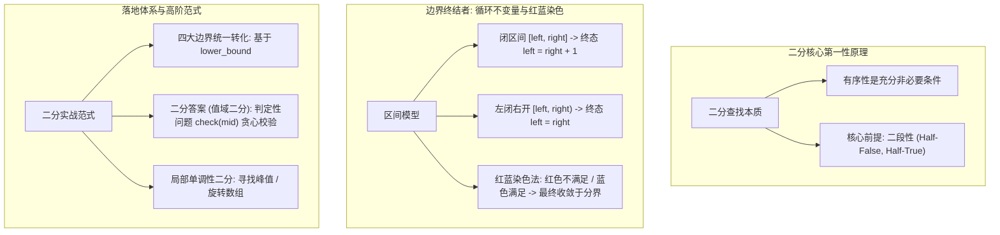

# 03 · 二分查找：二段性本质、红蓝染色模型与二分答案范式

> [!abstract] 一句话第一性原理
> **二分查找（Binary Search）** 的本质不是“数组有序”，而是**状态空间的“二段性（Two-Segment Property）”——即存在一个判定性质 $P$，使得整个定义域被划分为前半段不满足 $P$、后半段满足 $P$，从而每次通过中点求值将解空间折半剪枝**。

---

## 知识全景图



---

## 一、 深入底层思维机制

### 1. 为什么“二段性”才是二分的灵魂？
传统认知认为“数组升序排好才能二分”，这是狭隘的。
- 在 **LeetCode 162（寻找峰值）** 中，数组完全无序，但只要比较 `nums[mid]` 与 `nums[mid + 1]`，如果处于“上坡”，则右半段必存在峰值；如果处于“下坡”，左半段必存在峰值。
- 在 **LeetCode 33（搜索旋转排序数组）** 中，数组被切分成两段有序区间，但通过中点与端点比对，依然能断定哪一半是单调区间。
- **定理**：只要能构造出一个判定函数 $P(x) \in \{0, 1\}$，使解空间呈现 $[0, 0, \dots, 0, 1, 1, \dots, 1]$ 分布，即可在 $O(\log N)$ 时间内锁定两区间的临界分割点。

---

### 2. 区间模型与循环不变量（彻底终结死循环与越界）

写二分最常出现的两个 Bug：**死循环**与**边界错位（差 1）**。本质原因在于没有确立严格的**循环不变量（Loop Invariant）**。

#### ① 闭区间模型 `[left, right]`（强烈推荐，对称优雅）
- **初始化**：`left = 0, right = n - 1`。搜索区间包含两端点。
- **循环条件**：`while (left <= right)`。
  - 当 `left == right` 时，区间内仍有一个元素未被检验，**必须进入循环检验**。
- **指针移动**：
  - 确定左半段不符合：`left = mid + 1`；
  - 确定右半段不符合：`right = mid - 1`；
  - **绝不能写 `left = mid` 或 `right = mid`**，否则区间长度无法严格递减，在两数相邻时必陷入死循环。
- **退出状态**：循环因 `left > right` 终止，终态严格满足 `left = right + 1`。

#### ② 左闭右开模型 `[left, right)`
- **初始化**：`left = 0, right = n`。
- **循环条件**：`while (left < right)`。
- **指针移动**：
  - 确定左半段不符合：`left = mid + 1`；
  - 确定右半段不符合：`right = mid`（因为开区间本就不包含 `mid`）；
- **退出状态**：`left == right`。

---

### 3. 红蓝染色法直觉模型（心智负担归零）

红蓝染色法（Red-Blue Partitioning）能彻底消除二分边界的困惑：


- **约定**：
  - **红色（Red）**：确定**不满足**条件的目标区域（例如 $< target$）；
  - **蓝色（Blue）**：确定**满足**条件的目标区域（例如 $\ge target$）。
- **初始化**：
  - 虚拟状态：`left - 1` 为红色，`right + 1` 为蓝色；
  - 实际指针：`left = 0, right = n - 1`。
- **推进规则**：
  - 取 `mid = left + (right - left) / 2`；
  - 若 `nums[mid]` 满足条件（染蓝），说明答案在 `mid` 或其左侧，蓝色区域左推：`right = mid - 1`；
  - 若 `nums[mid]` 不满足条件（染红），说明答案必定在 `mid` 右侧，红色区域右推：`left = mid + 1`。
- **循环终态**：
  - 当 `left <= right` 结束时，必然是 `left = right + 1`；
  - 此时 **`right` 是最后一个红色元素（不满足条件的最大位置）**；
  - 此时 **`left` 是第一个蓝色元素（满足条件的最小位置，即 `lower_bound`）**！

---

## 二、 核心通用代码模板

### 1. 先分清 `lower_bound` 与 `upper_bound`

两者都在**升序数组（允许重复）中找分界下标**，区别是等于 target 的数放在哪一边：

- **lowerBound**：左边 `< target`，右边 `>= target`。遇到相等也继续向左找，因此目标存在时，返回它的第一个位置。
- **upperBound**：左边 `<= target`，右边 `> target`。遇到相等就继续向右找，越过全部相等元素，返回第一个更大值的位置。

例如 `nums=[1,2,2,2,4]，target=2`（下标从 0 开始）：

| 要找的位置 | 写法 | 示例下标 |
| :--- | :--- | :--- |
| 第一个 `>= target` | `lowerBound(nums, target)` | 1：第一个 2 |
| 第一个 `> target` | `upperBound(nums, target)` | 4：数值 4 |
| 最后一个 `< target` | `lowerBound(nums, target) - 1` | 0：数值 1 |
| 最后一个 `<= target` | `upperBound(nums, target) - 1` | 3：最后一个 2 |

下面两段代码只有判定条件不同。循环结束时 `left=right+1`：`left` 是右边的第一个位置，`left-1` 是左边的最后一个位置。未找到右侧元素时返回 n，减一后的结果也可能是 -1，访问数组前要检查边界。

```java
// 第一个 >= target 的位置：相等时也向左找
private int lowerBound(int[] nums, long target) {
    int left = 0, right = nums.length - 1;
    while (left <= right) {
        int mid = left + (right - left) / 2;
        if (nums[mid] >= target) {
            right = mid - 1;
        } else {
            left = mid + 1;
        }
    }
    return left;
}

// 第一个 > target 的位置：相等时也跳过
private int upperBound(int[] nums, long target) {
    int left = 0, right = nums.length - 1;
    while (left <= right) {
        int mid = left + (right - left) / 2;
        if (nums[mid] > target) {
            right = mid - 1;
        } else {
            left = mid + 1;
        }
    }
    return left;
}
```

#### 应用：搜索插入位置（LeetCode 35）

> **代表母题**：搜索插入位置 / 首个不小于目标值的元素（LeetCode 35）
> - **题目描述**：给定一个排序数组 `nums` 和一个目标值 `target`。如果目标值存在于数组中，返回其索引；如果不存在，返回它将会被按顺序插入的位置（即**第一个 $\ge target$ 的位置**）。
> - **输入输出示例**：
>   - 输入：`nums = [1, 3, 5, 6], target = 5`，输出 `2`（存在于下标 2）；
>   - 输入：`nums = [1, 3, 5, 6], target = 2`，输出 `1`（插入在 1 和 3 之间，即下标 1）。
> - **核心逻辑**：若当前中点 `nums[mid] >= target`，说明目标解在 `mid` 或其左边，收缩右边界 `right = mid - 1`；否则答案在右侧 `left = mid + 1`。

---

### 2. 二分答案（值域二分）通用框架

二分不仅用于数组下标查找，更广泛应用于**最优化问题**。
- **典型题型标志**：“求满足条件的最小值（最小化最大值）”或“求满足条件的最大值（最大化最小值）”。
- **单调性假设**：若承载能力为 $X$ 时能够满足要求，则任何 $> X$ 的容量必然都能满足要求（具有单向可行性）。

> **代表母题**：爱吃香蕉的珂珂（LeetCode 875）/ 在 D 天内送达包裹的容量（LeetCode 1011）
> - **题目描述**：有 `n` 堆香蕉，第 `i` 堆有 `piles[i]` 根。警卫将在 `h` 小时后回来。珂珂希望以每小时 `k` 根的速度吃香蕉。请返回她能在 `h` 小时内吃完所有香蕉的**最小速度 `k`**。
> - **输入输出示例**：
>   - 输入：`piles = [3, 6, 7, 11], h = 8`
>   - 输出：`4`（速度为 4 时，各堆吃完耗时为 1+2+2+3 = 8 小时，正好在 8 小时内吃完；若速度为 3 则需要 10 小时超时）。
> - **核心逻辑**：速度 `k` 越快耗时不增，可行性具有单调性。在速度区间 `[1, max(piles)]` 上二分查找，用 `check(k)` 检验当前速度能否在 `h` 小时内吃完。

```java
public int minEatingSpeed(int[] piles, int h) {
    int left = 1, right = 1_000_000_000; // 速度范围 [1, 最大可能速度]
    int ans = right;

    while (left <= right) {
        int mid = left + (right - left) / 2;
        if (canFinish(piles, h, mid)) {
            ans = mid;        // 当前速度可行，记录解
            right = mid - 1;  // 尝试探寻更小的极限速度（求最小值）
        } else {
            left = mid + 1;   // 当前速度太慢吃不完，必须提速
        }
    }
    return ans;
}

// 贪心检验函数：以 speed 速度吃香蕉，总耗时是否 <= h 小时
private boolean canFinish(int[] piles, int h, int speed) {
    long totalHours = 0;
    for (int p : piles) {
        totalHours += (p + speed - 1) / speed; // 向上取整计算耗时
    }
    return totalHours <= h;
}
```

---

## 三、 核心母题深度解析

### 母题 1：在排序数组中查找元素的第一个和最后一个位置（LeetCode 34）

> **题目描述**：给你一个按照非递减顺序排列的整数数组 `nums`，和一个目标值 `target`。请你找出给定目标值在数组中的开始位置和结束位置。如果数组中不存在目标值 `target`，返回 `[-1, -1]`。要求时间复杂度为 $O(\log N)$。

#### 破题设计

**为什么想到两次边界二分？** “非递减顺序”保证目标值的所有出现位置连续，“第一个和最后一个位置”要求找边界，而不是找到任意一个就停。`nums[i] >= target` 与 `nums[i] > target` 都在有序数组中呈现先假后真的分布，因此分别找第一个满足的位置，就能得到左边界和右边界后一位。若找到目标后向两边线性扩张，全数组相等时会退化到 $O(N)$，不满足题目的 $O(\log N)$ 要求。

- 开始位置：即第一个 $\ge target$ 的位置 `start = lowerBound(nums, target)`。必须校验 `start < nums.length && nums[start] == target`。
- 结束位置：即最后一个 $\le target$ 的位置，等价于“第一个 $\ge target + 1$ 的位置减去 1”，即 `end = lowerBound(nums, (long) target + 1) - 1`。先提升为 long 可避免 target 为 int 最大值时加一溢出；也可直接用 upperBound 找第一个大于 target 的位置。

```java
class Solution {
    public int[] searchRange(int[] nums, int target) {
        int start = lowerBound(nums, target);
        // 校验目标值是否存在
        if (start == nums.length || nums[start] != target) {
            return new int[]{-1, -1};
        }
        int end = lowerBound(nums, (long) target + 1) - 1;
        return new int[]{start, end};
    }

    private int lowerBound(int[] nums, long target) {
        int left = 0, right = nums.length - 1;
        while (left <= right) {
            int mid = left + (right - left) / 2;
            if (nums[mid] >= target) {
                right = mid - 1;
            } else {
                left = mid + 1;
            }
        }
        return left;
    }
}
```

---

### 母题 2：爱吃香蕉的珂珂（LeetCode 875）——二分答案标准范式

> **题目描述**：珂珂喜欢吃香蕉。这里有 `piles` 堆香蕉，第 $i$ 堆中有 `piles[i]` 根。警卫将在 $h$ 小时后返回。珂珂决定她吃香蕉的速度 $k$（根/小时）。每个小时，她选择一堆香蕉吃掉其中的 $k$ 根，如果这堆不足 $k$ 根，她也只吃完本堆，本小时内不会再吃其他堆。返回她可以在 $h$ 小时内吃掉所有香蕉的**最小速度** $k$。

#### 破题设计

**为什么没有排序数组也能二分？** 要找的是“满足时限的最小速度”，可搜索的对象是速度值域。固定速度 `k` 后，每堆耗时为向上取整的 `piles[i] / k`，可以直接判断总耗时是否不超过 `h`。提高速度只会使耗时不增，因此可行速度形成连续后缀，答案就是第一个可行值。例如一堆 3 根时，速度 3 和 4 都耗时 1 小时，所以这里只要求单调不增，不要求严格递减。

1. **确定二分值域**：
   - 最小速度：$1$（不可能为 0）；
   - 最大速度：$\max(piles)$（一小时吃完最多的一堆，再大没有任何边际收益）。
2. **单调性证明**：速度 $k$ 越快，所需总耗时 $\sum \lceil piles[i] / k \rceil$ 单调不增；可行性从“不满足”变为“满足”后不会再变回去。
3. **`check(k)` 检验函数**：$O(N)$ 扫描计算总时间，向上取整技巧：$\lceil a / b \rceil = (a + b - 1) / b$。

```java
class Solution {
    public int minEatingSpeed(int[] piles, int h) {
        int left = 1;
        int right = 1;
        for (int pile : piles) {
            right = Math.max(right, pile);
        }

        int ans = right;
        while (left <= right) {
            int mid = left + (right - left) / 2;
            if (canFinish(piles, h, mid)) {
                ans = mid;       // 当前速度 mid 可行，记录答案
                right = mid - 1; // 尝试寻找更小的可行速度
            } else {
                left = mid + 1;  // 速度太慢超时，必须提速
            }
        }
        return ans;
    }

    private boolean canFinish(int[] piles, int h, int speed) {
        long totalHours = 0; // 防止堆数过多累加溢出
        for (int pile : piles) {
            totalHours += (pile + speed - 1) / speed;
            if (totalHours > h) return false; // 提前剪枝
        }
        return totalHours <= h;
    }
}
```

---

## 四、 典型算法应用速览

| 题目 | 核心模型 | 一句话破题思路 | 复杂度 |
| :--- | :--- | :--- | :--- |
| **LC 33. 搜索旋转排序数组** | 局部单调二分 | `mid` 必将数组分成一半有序、一半可能包含旋转点，先判断哪半有序再缩小范围。 | $O(\log N) / O(1)$ |
| **LC 162. 寻找峰值** | 峰值存在性二分 | 比较 `nums[mid]` 与 `nums[mid+1]`，上坡时右半必有峰，下坡时保留中点与左半。 | $O(\log N) / O(1)$ |
| **LC 153. 寻找旋转排序数组中的最小值** | 局部单调二分 | 将 `nums[mid]` 与右边界 `nums[right]` 比较，确定最小值落在左半段还是右半段。 | $O(\log N) / O(1)$ |
| **LC 69. x 的平方根** | 值域二分 | 在 `[0, x]` 值域二分，用 `(long) mid * mid <= x` 防止乘法溢出。 | $O(\log x) / O(1)$ |
| **LC 410. 分割数组的最大值** | 二分答案 + 贪心 | 二分子数组和的上限 `mid`，贪心检验能否将数组划分为 $\le k$ 个子数组。 | $O(N \log S) / O(1)$ |

### 从题目描述判断算法

#### LC 33：搜索旋转排序数组
> 🔗 **LeetCode 题目直通车**：[LeetCode 33. 搜索旋转排序数组 ↗](https://leetcode.cn/problems/search-in-rotated-sorted-array/)

- **题目线索**：互不相同的元素，升序数组旋转后寻找目标，要求 $O(\log N)$。
- **为什么仍能二分**：整体无序，但旋转点最多一个，中点两侧至少有一侧有序。可以先确认这侧的值域，再判断目标是否在其中，从而安全排除半边。
- **解题步骤**：先检查中点，再判断哪侧有序，按目标是否落在该侧收缩区间。无重复值是快速判定的关键；含重复值的变体可能退化为线性扫描。

#### LC 162：寻找峰值
> 🔗 **LeetCode 题目直通车**：[LeetCode 162. 寻找峰值 ↗](https://leetcode.cn/problems/find-peak-element/)

- **题目线索**：只需任意一个峰，相邻值不等，数组两端外侧视为负无穷，要求对数时间。
- **为什么能二分**：若 `nums[mid] < nums[mid+1]`，右侧沿上坡走，之后要么遇到下坡形成峰，要么在右端形成峰，因此右半必有一个解；下坡时左半同理。这里依据的是“某半边必有峰”，斜率本身不必全局单调。
- **解题步骤**：上坡令 `left = mid + 1`，下坡令 `right = mid`；下坡时中点可能就是峰，不能把它排除。

#### LC 153：寻找旋转排序数组中的最小值
> 🔗 **LeetCode 题目直通车**：[LeetCode 153. 寻找旋转排序数组中的最小值 ↗](https://leetcode.cn/problems/find-minimum-in-rotated-sorted-array/)

- **题目线索**：互不相同的升序元素经过旋转，求最小值。
- **为什么用二分**：比较中点和右端；中点更大表示旋转断点在中点右侧，最小值也在那里。中点更小时，右段有序，最小值在中点或左侧。
- **解题步骤**：`nums[mid] > nums[right]` 时舍弃中点及左侧，否则保留中点收缩右侧，直到只剩一个位置。

#### LC 69：x 的平方根
> 🔗 **LeetCode 题目直通车**：[LeetCode 69. x 的平方根 ↗](https://leetcode.cn/problems/sqrtx/)

- **题目线索**：返回非负整数平方根的整数部分，不能依赖现成幂函数。
- **为什么用值域二分**：候选整数 `m` 的平方随 `m` 增大而增大，`m*m <= x` 的真值形成连续前缀；答案是最后一个满足条件的整数。
- **解题步骤**：在 `[0,x]` 上测试中点，平方不超 `x` 时继续找更大的，否则缩小上界；乘法先转 `long` 防止溢出。

#### LC 410：分割数组的最大值
> 🔗 **LeetCode 题目直通车**：[LeetCode 410. 分割数组的最大值 ↗](https://leetcode.cn/problems/split-array-largest-sum/)

- **题目线索**：非负数组分成 K 个非空连续段，希望各段和中的最大值尽量小。
- **为什么用二分答案 + 贪心**：猜一个上限 `S`，问题变成“每段和不超过 S，至少需要几段”。非负数允许当前段尽量装满再切分，得到最少段数；上限放大只会更容易，所以可二分第一个可行上限。
- **解题步骤**：搜索范围为最大元素到总和；扫描统计所需段数，若不超过 K 就降低上限。因为元素非负且 K 不超过数组长度，少于 K 段时还能继续拆分而不超限；含负数时该贪心检查不成立。

> [!example]- 展开查看：典型应用标准代码
>
> **LC 33. 搜索旋转排序数组**
> ```java
> public int search(int[] nums, int target) {
>     int left = 0, right = nums.length - 1;
>     while (left <= right) {
>         int mid = left + (right - left) / 2;
>         if (nums[mid] == target) return mid;
> 
>         if (nums[left] <= nums[mid]) { // 左半段严格有序
>             if (nums[left] <= target && target < nums[mid]) {
>                 right = mid - 1;
>             } else {
>                 left = mid + 1;
>             }
>         } else { // 右半段严格有序
>             if (nums[mid] < target && target <= nums[right]) {
>                 left = mid + 1;
>             } else {
>                 right = mid - 1;
>             }
>         }
>     }
>     return -1;
> }
> ```
>
> **LC 162. 寻找峰值**
> ```java
> public int findPeakElement(int[] nums) {
>     int left = 0, right = nums.length - 1;
>     while (left < right) {
>         int mid = left + (right - left) / 2;
>         if (nums[mid] < nums[mid + 1]) {
>             left = mid + 1; // 处于上坡阶段，右侧必有峰值
>         } else {
>             right = mid;     // 处于下坡阶段，mid 自身或左侧必有峰值
>         }
>     }
>     return left;
> }
> ```
>
> **LC 153. 寻找旋转排序数组中的最小值**
> ```java
> public int findMin(int[] nums) {
>     int left = 0, right = nums.length - 1;
>     while (left < right) {
>         int mid = left + (right - left) / 2;
>         if (nums[mid] > nums[right]) {
>             left = mid + 1; // 最小值必在 mid 右侧
>         } else {
>             right = mid;     // mid 可能是最小值
>         }
>     }
>     return nums[left];
> }
> ```

---

## 五、 工程避坑指南

1. **防整数整型溢出（Integer Overflow）**：
   - 计算中点严禁使用 `mid = (left + right) / 2`。当 `left` 和 `right` 均接近 $2^{31}-1$ 时，相加产生整型负溢出。必须写成：
     ```java
     int mid = left + (right - left) / 2;
     ```
   - 在二分答案的值域乘法（如平方根求值、耗时累加）中，计算 `mid * mid` 必须强制提升为 `(long) mid * mid`，否则溢出会造成静默死循环。
2. **除法向上取整的安全写法**：
   - 算法中常见 $\lceil a / b \rceil$。如果写成 `(a + b - 1) / b`，注意当 $a + b$ 接近 `Integer.MAX_VALUE` 时同样可能溢出。更健壮的写法是：
     ```java
     int ceil = (a / b) + (a % b == 0 ? 0 : 1);
     ```
3. **返回值越界后处理**：
   - `lowerBound` 返回的下标范围是 $[0, N]$。若整个数组的所有元素均 $< target$，则返回 $N$。读取结果前必须校验 `left < nums.length`，严防 `ArrayIndexOutOfBoundsException`。

---

## 关联与实战刷题路线

- [[01-双指针]] —— 线性单调夹逼与对数折半剪枝的联系
- [[04-排序算法]] —— 二分查找前序预处理基石
- [[../03-刷题记录/05-LC0033-搜索旋转排序数组]] —— 旋转数组二段性实战
- [[../04-模板与技巧/01-模板-二分查找]] —— 常用二分模板速查

## 📚 参考资料

- 《算法导论》（Introduction to Algorithms）第 3 版：分治法与二分检索不变式
- LeetCode 官方题解：Binary Search: Invariants and Range Search
