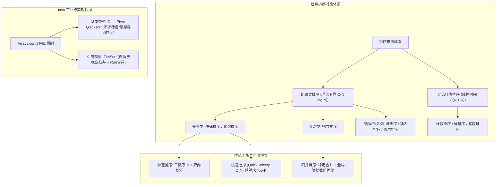
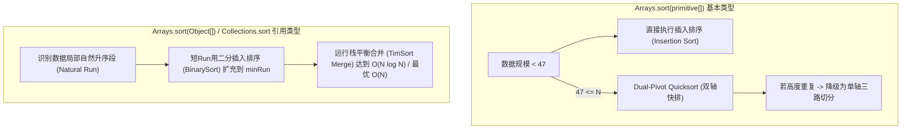

# 04 · 排序算法：复杂度全景、手撕快排归并与Java工业级取舍

> [!abstract] 一句话第一性原理
> **排序（Sorting）** 的本质是**重组无序数据流以建立全局拓扑有序性，消除搜索与聚合的熵增；其底层演进是在比较代价、交换开销、空间驻留与数据局部性之间的工程权衡**。

---

## 知识全景图



---

## 一、 十大经典排序算法核心对比大表

| 排序算法 | 最好时间 | 平均时间 | 最坏时间 | 空间复杂度 | 稳定性 | 原地排序 | 核心思想 / 典型适用场景 |
| :--- | :--- | :--- | :--- | :--- | :--- | :--- | :--- |
| **冒泡排序** | $O(N)$ | $O(N^2)$ | $O(N^2)$ | $O(1)$ | **稳定** | 是 | 相邻元素两两交换，教学演示 |
| **选择排序** | $O(N^2)$ | $O(N^2)$ | $O(N^2)$ | $O(1)$ | 不稳定 | 是 | 每轮寻找全局最小值，跨距离交换 |
| **插入排序** | $O(N)$ | $O(N^2)$ | $O(N^2)$ | $O(1)$ | **稳定** | 是 | 适合**小规模数据**（$N < 47$）或基本有序序列 |
| **希尔排序** | $O(N)$ | $O(N^{1.3})$ | $O(N^2)$ | $O(1)$ | 不稳定 | 是 | 缩小增量插入排序，突破 $O(N^2)$ |
| **快速排序** | $O(N \log N)$ | $O(N \log N)$ | $O(N^2)$ | $O(\log N)$ | 不稳定 | 是 | 分治基准划分，通用内存排序首选 |
| **归并排序** | $O(N \log N)$ | $O(N \log N)$ | $O(N \log N)$ | $O(N)$ | **稳定** | 否 | 分治合并，链表排序、外排序、求逆序对 |
| **堆排序** | $O(N \log N)$ | $O(N \log N)$ | $O(N \log N)$ | $O(1)$ | 不稳定 | 是 | 动态流数据维护、Top-K 优先队列 |
| **计数排序** | $O(N + K)$ | $O(N + K)$ | $O(N + K)$ | $O(K)$ | **稳定** | 否 | 数据范围 $K$ 极小的密集整型排序 |
| **桶排序** | $O(N + K)$ | $O(N + K)$ | $O(N^2)$ | $O(N + K)$ | **稳定** | 否 | 外部均匀分布数据分片 |
| **基数排序** | $O(N \times d)$ | $O(N \times d)$ | $O(N \times d)$ | $O(N + K)$ | **稳定** | 否 | 定长整型、手机号或字符串多轮分配 |

> [!NOTE] 稳定性（Stability）的工业价值
> 稳定性指：如果 $A = B$ 且排序前 $A$ 在 $B$ 前面，排序后 $A$ **依然严格保持在 $B$ 前面**。
> 在业务系统多字段组合排序（例如：“先按时间升序，再按金额降序”）中，若金额排序不稳定，就会破坏此前排好的时间顺序。

---

## 二、 核心手撕代码模板（面试级标准实现）

### 1. 快速排序（三数取中 + 双向双指针划分）

快速排序的核心是 `partition`。如果遇到已排序数组且基准点固定选第一个，划分树将极度倾斜退化为链表，时间复杂度跌至 $O(N^2)$。
防退化标准策略：**三数取中法（Median of Three）**，在 `left`、`mid`、`right` 中选出中位数换至起点作为基准。

```java
public class QuickSort {

    public static void sort(int[] nums) {
        if (nums == null || nums.length <= 1) return;
        quickSort(nums, 0, nums.length - 1);
    }

    private static void quickSort(int[] nums, int left, int right) {
        if (left >= right) return;

        // 三数取中防退化，并将中位数交换至 left 槽位
        medianOfThree(nums, left, right);

        int pivotIndex = partition(nums, left, right);
        quickSort(nums, left, pivotIndex - 1);
        quickSort(nums, pivotIndex + 1, right);
    }

    private static int partition(int[] nums, int left, int right) {
        int pivot = nums[left];
        int i = left + 1;
        int j = right;

        while (true) {
            // 向右找到首个大于等于 pivot 的元素
            while (i <= right && nums[i] < pivot) i++;
            // 向左找到首个小于等于 pivot 的元素
            while (j > left && nums[j] > pivot) j--;

            if (i >= j) break;
            swap(nums, i, j);
            i++;
            j--;
        }
        // 将基准元素归位至分界点 j
        swap(nums, left, j);
        return j;
    }

    private static void medianOfThree(int[] nums, int left, int right) {
        int mid = left + (right - left) / 2;
        if (nums[left] > nums[mid]) swap(nums, left, mid);
        if (nums[left] > nums[right]) swap(nums, left, right);
        if (nums[mid] > nums[right]) swap(nums, mid, right);
        // 此时 nums[mid] 为中位数，交换到 left 位置作为 pivot
        swap(nums, left, mid);
    }

    private static void swap(int[] nums, int i, int j) {
        int temp = nums[i];
        nums[i] = nums[j];
        nums[j] = temp;
    }
}
```

---

### 2. 归并排序（稳定合并 + 全局辅助数组复用）

归并排序（Merge Sort）基于分治思想。
**性能关键**：绝对不能在每次递归调用的 `merge` 方法内 `new int[len]`，否则会在堆上高频创建 $O(N \log N)$ 空间的对象并造成剧烈的垃圾回收（GC）停顿。必须**在最外层分配一个全局唯一的 `temp` 辅助数组并在递归中传递复用**。

```java
public class MergeSort {

    public static void sort(int[] nums) {
        if (nums == null || nums.length <= 1) return;
        int[] temp = new int[nums.length]; // 全局复用，辅助空间 O(N)
        mergeSort(nums, 0, nums.length - 1, temp);
    }

    private static void mergeSort(int[] nums, int left, int right, int[] temp) {
        if (left >= right) return;

        int mid = left + (right - left) / 2;
        mergeSort(nums, left, mid, temp);
        mergeSort(nums, mid + 1, right, temp);

        // 剪枝优化：如果左半段最大值 <= 右半段最小值，说明整体已有序，跳过 merge
        if (nums[mid] <= nums[mid + 1]) return;

        merge(nums, left, mid, right, temp);
    }

    private static void merge(int[] nums, int left, int mid, int right, int[] temp) {
        int i = left;      // 左子区间指针
        int j = mid + 1;   // 右子区间指针
        int t = left;      // temp 写入指针

        // 双指针归并：nums[i] <= nums[j] 保证了等值时优先取左边，维持算法稳定性
        while (i <= mid && j <= right) {
            if (nums[i] <= nums[j]) {
                temp[t++] = nums[i++];
            } else {
                temp[t++] = nums[j++];
            }
        }

        while (i <= mid) temp[t++] = nums[i++];
        while (j <= right) temp[t++] = nums[j++];

        // 将合并结果从辅助数组拷贝回原数组
        System.arraycopy(temp, left, nums, left, right - left + 1);
    }
}
```

---

### 3. 快速选择（QuickSelect）：$O(N)$ 期望寻找第 K 大元素

Top-K 问题若采用全量排序需要 $O(N \log N)$，大根堆需要 $O(N \log K)$。而**快速选择算法（QuickSelect）**能在**平均 $O(N)$** 期望时间内锁定目标。

#### 数学复杂度推导
快排递归两侧：
$$T(N) = 2T(N/2) + O(N) = O(N \log N)$$
快速选择每次通过 `partition` 确定基准位置后，根据基准下标与目标下标的大小关系，**仅进入单侧子问题进行递归**：
$$T(N) = T(N/2) + O(N) = N + \frac{N}{2} + \frac{N}{4} + \dots \le 2N = O(N)$$

```java
public class QuickSelect {

    public static int findKthLargest(int[] nums, int k) {
        // 第 k 个最大元素，即升序排序后的下标 targetIndex = n - k
        int targetIndex = nums.length - k;
        int left = 0, right = nums.length - 1;
        Random random = new Random();

        while (left <= right) {
            // 随机化 Pivot 防止退化
            int pivotIdx = left + random.nextInt(right - left + 1);
            swap(nums, left, pivotIdx);

            int p = partition(nums, left, right);
            if (p == targetIndex) {
                return nums[p];
            } else if (p < targetIndex) {
                left = p + 1;  // 目标在右半段，剪掉左半段
            } else {
                right = p - 1; // 目标在左半段，剪掉右半段
            }
        }
        return -1;
    }

    private static int partition(int[] nums, int left, int right) {
        int pivot = nums[left];
        int i = left + 1, j = right;
        while (true) {
            while (i <= right && nums[i] < pivot) i++;
            while (j > left && nums[j] > pivot) j--;
            if (i >= j) break;
            swap(nums, i, j);
            i++;
            j--;
        }
        swap(nums, left, j);
        return j;
    }

    private static void swap(int[] nums, int i, int j) {
        int t = nums[i]; nums[i] = nums[j]; nums[j] = t;
    }
}
```

---

## 三、 Java 源码工程机制与工业级取舍

在 JDK 底层，`Arrays.sort()` 绝非简单套用单一排序算法，而是针对不同数据形态进行深度的工程权衡：



### 1. 基本类型：Dual-Pivot Quicksort（双轴快排）
- **核心动机**：基本类型（如 `int[]`, `double[]`）在内存中没有“引用标识”，值相同的两个 `3` 无论谁前谁后没有任何语义差别，**无需保证稳定性**。
- **算法精髓**：采用 Vladimir Yaroslavskiy 设计的双轴快速排序。选取两个基准点 $P_1, P_2$（且 $P_1 \le P_2$），将数组一次性切分成 3 个区间：$< P_1$、$[P_1, P_2]$、$> P_2$。
- **性能优势**：相较于传统单轴快排，双轴快排大幅减少了扫描比较的内存缓存未命中（Cache Miss），极大提升了现代 CPU L1/L2 缓存命中率。

### 2. 引用类型：TimSort（工业级自适应稳定排序）
- **核心动机**：Java 对象往往具有多属性复合含义，用户业务对排序的**稳定性有强约束**。
- **算法精髓**：
  - 真实世界的业务数据很少是完全均匀随机的，往往包含大量“部分已经有序”的子片段（Run）；
  - TimSort 会扫描识别这些自然递增段；若子段太短，使用**二分插入排序（BinarySort）**扩展填充至 `minRun`；
  - 使用严格的栈结构维护 Run 的长度，遵循 $Run_{i-1} > Run_i + Run_{i+1}$ 约束进行按需稳定归并，杜绝递归栈溢出，在接近有序的数据集上退化为惊人的 **$O(N)$ 线性表现**。

---

## 四、 核心母题深度解析

### 母题 1：合并区间（LeetCode 56）

> **题目描述**：以数组 `intervals` 表示若干个区间的集合，其中单个区间为 `intervals[i] = [starti, endi]`。请你合并所有重叠的区间，并返回一个不重叠的区间数组。

#### 破题设计
1. **排序打破混乱**：按照区间的起始端点 `a[0]` 升序排列。一旦起始点有序，能够合并的区间必定在空间上**紧密相邻**！
2. **贪心扫描合并**：维护当前区间的 `[curL, curR]`。遍历后续区间 `[nextL, nextR]`：
   - 若 `nextL <= curR`，说明重叠，贪心延展右边界 `curR = Math.max(curR, nextR)`；
   - 若 `nextL > curR`，说明断裂，将当前区间归档，并以新区间开启下一轮。

```java
class Solution {
    public int[][] merge(int[][] intervals) {
        if (intervals.length <= 1) return intervals;

        // 严格使用 Integer.compare，严禁 (a, b) -> a[0] - b[0] 防溢出
        Arrays.sort(intervals, (a, b) -> Integer.compare(a[0], b[0]));

        List<int[]> merged = new ArrayList<>();
        int curL = intervals[0][0];
        int curR = intervals[0][1];

        for (int i = 1; i < intervals.length; i++) {
            if (intervals[i][0] <= curR) {
                curR = Math.max(curR, intervals[i][1]); // 延展合并右边界
            } else {
                merged.add(new int[]{curL, curR});     // 结清旧区间
                curL = intervals[i][0];
                curR = intervals[i][1];
            }
        }
        merged.add(new int[]{curL, curR}); // 加入最后一段

        return merged.toArray(new int[merged.size()][]);
    }
}
```

---

## 五、 典型算法应用速览

| 题目 | 核心模型 | 一句话破题思路 | 复杂度 |
| :--- | :--- | :--- | :--- |
| **剑指 51. 数组中的逆序对** | 归并排序变形 | 在 `merge` 时，当右半段元素先落位时，左半段剩余的全部元素均与其构成逆序对。 | $O(N \log N) / O(N)$ |
| **LC 75. 颜色分类 (荷兰国旗)** | 三路划分快排 | 维护 `p0`, `curr`, `p2` 三指针，一次线性扫描将 0, 1, 2 划分为三段。 | $O(N) / O(1)$ |
| **LC 179. 最大数** | 自定义排序 | 转化为字符串排序，根据贪心拼接规则 `(b + a).compareTo(a + b)` 降序排。 | $O(N \log N) / O(N)$ |
| **LC 347. 前 K 个高频元素** | 哈希 + QuickSelect | 哈希表统计频次后，利用快速选择对频次数组进行 $O(M)$ 划分筛选。 | $O(N) / O(N)$ |

> [!example]- 展开查看：典型应用标准代码
>
> **剑指 51. 数组中的逆序对**
> ```java
> public class ReversePairs {
>     private int count = 0;
>     public int reversePairs(int[] nums) {
>         if (nums.length < 2) return 0;
>         int[] temp = new int[nums.length];
>         mergeSort(nums, 0, nums.length - 1, temp);
>         return count;
>     }
>     private void mergeSort(int[] nums, int l, int r, int[] temp) {
>         if (l >= r) return;
>         int mid = l + (r - l) / 2;
>         mergeSort(nums, l, mid, temp);
>         mergeSort(nums, mid + 1, r, temp);
>         merge(nums, l, mid, r, temp);
>     }
>     private void merge(int[] nums, int l, int mid, int r, int[] temp) {
>         int i = l, j = mid + 1, t = l;
>         while (i <= mid && j <= r) {
>             if (nums[i] <= nums[j]) {
>                 temp[t++] = nums[i++];
>             } else {
>                 temp[t++] = nums[j++];
>                 count += (mid - i + 1); // 统计逆序对增量贡献
>             }
>         }
>         while (i <= mid) temp[t++] = nums[i++];
>         while (j <= r) temp[t++] = nums[j++];
>         System.arraycopy(temp, l, nums, l, r - l + 1);
>     }
> }
> ```
>
> **LC 75. 颜色分类**
> ```java
> public void sortColors(int[] nums) {
>     int p0 = 0, curr = 0, p2 = nums.length - 1;
>     while (curr <= p2) {
>         if (nums[curr] == 0) {
>             int t = nums[p0]; nums[p0] = nums[curr]; nums[curr] = t;
>             p0++;
>             curr++;
>         } else if (nums[curr] == 2) {
>             int t = nums[curr]; nums[curr] = nums[p2]; nums[p2] = t;
>             p2--;
>             // 注意此处 curr 不自增，需再次检验换回来的元素
>         } else {
>             curr++;
>         }
>     }
> }
> ```

---

## 六、 工程避坑指南

1. **Comparator 减法溢出致命陷阱**：
   - 严禁书写 `(a, b) -> a - b`。若 $a = -2147483648, b = 1$，相减得 $2147483647 > 0$，比较关系完全颠倒。
   - 更严重的是：溢出会破坏**严格弱序（Strict Weak Ordering）**（即违反自反性、反对称性或传递性），在 JDK 7+ 的 TimSort 检验中会直接抛出不可恢复的运行时异常：
     `IllegalArgumentException: Comparison method violates its general contract!`。
   - **正确防御写法**：一律使用 `Integer.compare(a, b)` 或 `Long.compare(a, b)`。
2. **归并排序内存泄漏与 GC 压力**：
   - 严防在递归单层内部创建数组。必须在最外层分配全局缓存，否则百万级数据量排序会触发频繁的 JVM Young GC 乃至 Full GC 造成卡顿。
3. **快速排序极端情况死循环**：
   - 在双指针双向扫描 partition 中，遇到等值元素时指针若不停止（只写 `<` 而不写 `<=`），在全是重复元素的数组中 `i` 会直接滑到最右端造成单侧极度倾斜；而双向均在遇到等值元素时停下并交换，能将全等数组完美劈成两半，维持 $O(N \log N)$ 复杂度。

---

## 关联与实战刷题路线

- [[01-双指针]] —— 快速排序分区与归并合并的核心手段
- [[03-二分查找]] —— 排序后获得单调性进而二分加速
- [[../03-刷题记录/08-LC0056-合并区间]] —— 排序预处理实战
- [[08-堆与优先队列]] —— 堆排序与 Top-K 模式对比

## 📚 参考资料

- 《算法导论》（Introduction to Algorithms）第 7 章：快速排序；第 8 章：线性时间排序
- OpenJDK 源码：`java.util.DualPivotQuicksort` 与 `java.util.TimSort` 实现细节
- Tim Peters: *A fast, stable, in-place sorting algorithm* (TimSort 原始论文)
