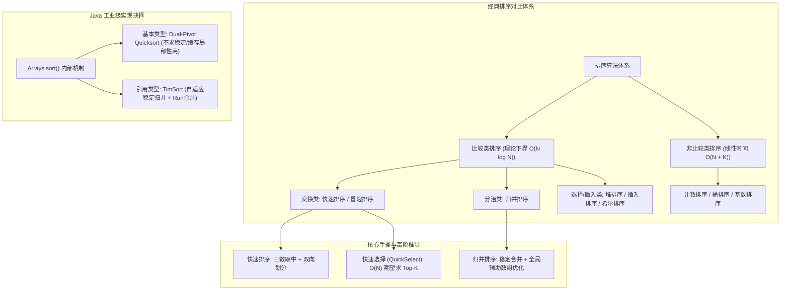
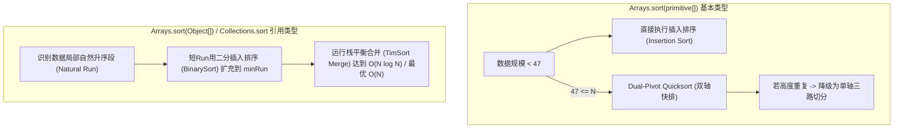

# 04 · 排序算法：复杂度全景、手撕快排归并与Java工业级取舍

> [!abstract] 一句话第一性原理
> **排序（Sorting）** 的本质是**重组无序数据流以建立全局拓扑有序性，消除搜索与聚合的熵增；其底层演进是在比较代价、交换开销、空间驻留与数据局部性之间的工程权衡**。

---

## 知识全景图



---

## 一、 十大经典排序算法核心对比大表

| 排序算法 | 最好时间 | 平均时间 | 最坏时间 | 空间复杂度 | 稳定性 | 原地排序 | 核心思想 / 典型适用场景 |
| :--- | :--- | :--- | :--- | :--- | :--- | :--- | :--- |
| **冒泡排序** | $O(N)$ | $O(N^2)$ | $O(N^2)$ | $O(1)$ | **稳定** | 是 | 相邻元素两两交换，教学演示 |
| **选择排序** | $O(N^2)$ | $O(N^2)$ | $O(N^2)$ | $O(1)$ | 不稳定 | 是 | 每轮寻找全局最小值，跨距离交换 |
| **插入排序** | $O(N)$ | $O(N^2)$ | $O(N^2)$ | $O(1)$ | **稳定** | 是 | 适合**小规模数据**（具体阈值依实现而定）或基本有序序列 |
| **希尔排序** | 依增量序列而定 | 依增量序列而定 | 依增量序列而定（常见版本可达 $O(N^2)$） | $O(1)$ | 不稳定 | 是 | 缩小增量插入排序，复杂度依增量序列而定 |
| **快速排序** | $O(N \log N)$ | $O(N \log N)$ | $O(N^2)$ | 平均 $O(\log N)$，最坏 $O(N)$ | 不稳定 | 是 | 分治基准划分，通用内存排序首选 |
| **归并排序** | $O(N \log N)$ | $O(N \log N)$ | $O(N \log N)$ | $O(N)$ | **稳定** | 否 | 分治合并，链表排序、外排序、求逆序对 |
| **堆排序** | $O(N \log N)$ | $O(N \log N)$ | $O(N \log N)$ | $O(1)$ | 不稳定 | 是 | 动态流数据维护、Top-K 优先队列 |
| **计数排序** | $O(N + K)$ | $O(N + K)$ | $O(N + K)$ | $O(N + K)$（稳定输出实现） | **稳定** | 否 | 数据范围 $K$ 极小的密集整型排序 |
| **桶排序** | $O(N + K)$ | $O(N + K)$（均匀分布等前提） | $O(N^2)$（桶内用插入排序时） | $O(N + K)$ | 取决于桶内排序及放入顺序 | 否 | 外部均匀分布数据分片 |
| **基数排序** | $O(d(N+K))$ | $O(d(N+K))$ | $O(d(N+K))$ | $O(N + K)$ | **稳定** | 否 | 定长整型、手机号或字符串多轮分配 |

> [!NOTE] 稳定性（Stability）的工业价值
> 稳定性指：如果 $A = B$ 且排序前 $A$ 在 $B$ 前面，排序后 $A$ **依然严格保持在 $B$ 前面**。
> 在业务系统多字段组合排序（例如：“先按时间升序，再按金额降序”）中，若金额排序不稳定，就会破坏此前排好的时间顺序。

---

表中的归并排序按每层实际归并的常规版本计算；下方代码若左右边界已整体有序就跳过归并，最好可降至 $O(N)$。稳定性依赖具体实现：计数排序需稳定地写入辅助输出，基数排序各位排序需稳定。K 为值域或桶数，d 为位数。

## 二、 核心手撕代码模板（面试级标准实现）

### 1. 快速排序（三数取中 + 双向双指针划分）

> **代表母题**：排序数组（LeetCode 912）
> - **题目描述**：给你一个整数数组 `nums`，请你将该数组升序排列。原题要求不用内置排序、时间 $O(N \log N)$，并尽量减少空间。下方快排是教学实现，平均时间 $O(N \log N)$，最坏仍为 $O(N^2)$，不是严格最坏界保证。
> - **输入输出示例**：
>   - 输入：`nums = [5, 2, 3, 1]`
>   - 输出：`[1, 2, 3, 5]`
> - **核心逻辑**：分治思想。选一个基准元素（Pivot），通过双指针把小于基准的扔左边、大于基准的扔右边，然后递归处理左右两半。

快速排序的核心是 `partition`。如果遇到已排序数组且基准点固定选第一个，划分树将极度倾斜退化为链表，时间复杂度跌至 $O(N^2)$。
降低部分退化风险的策略：**三数取中法（Median of Three）**，在 `left`、`mid`、`right` 中选出中位数换至起点作为基准。

```java
public class QuickSort {

    public static void sort(int[] nums) {
        if (nums == null || nums.length <= 1) return;
        quickSort(nums, 0, nums.length - 1);
    }

    private static void quickSort(int[] nums, int left, int right) {
        if (left >= right) return;

        // 三数取中防退化，并将中位数交换至 left 槽位
        medianOfThree(nums, left, right);

        int pivotIndex = partition(nums, left, right);
        quickSort(nums, left, pivotIndex - 1);
        quickSort(nums, pivotIndex + 1, right);
    }

    private static int partition(int[] nums, int left, int right) {
        int pivot = nums[left];
        int i = left + 1;
        int j = right;

        while (true) {
            // 向右找到首个大于等于 pivot 的元素
            while (i <= right && nums[i] < pivot) i++;
            // 向左找到首个小于等于 pivot 的元素
            while (j > left && nums[j] > pivot) j--;

            if (i >= j) break;
            swap(nums, i, j);
            i++;
            j--;
        }

        // 将基准元素归位至分界点 j
        swap(nums, left, j);
        return j;
    }

    private static void medianOfThree(int[] nums, int left, int right) {
        int mid = left + (right - left) / 2;
        if (nums[left] > nums[mid]) swap(nums, left, mid);
        if (nums[left] > nums[right]) swap(nums, left, right);
        if (nums[mid] > nums[right]) swap(nums, mid, right);
        // 此时 nums[mid] 为中位数，交换到 left 位置作为 pivot
        swap(nums, left, mid);
    }

    private static void swap(int[] nums, int i, int j) {
        int temp = nums[i];
        nums[i] = nums[j];
        nums[j] = temp;
    }
}
```

> [!example]- 面试速写：双指针快速排序
> 记住：**两端找错边的数 → 交换并移动 → 递归剩余两段**。pivot 保存中间元素的值；遇到相等值也移动指针，避免卡住。
>
> ```java
> // 调用：quickSort(nums, 0, nums.length - 1);
> private void quickSort(int[] nums, int left, int right) {
>     if (left >= right) return;
>     int i = left, j = right;
>     int pivot = nums[left + (right - left) / 2];
>
>     while (i <= j) {
>         while (nums[i] < pivot) i++;
>         while (nums[j] > pivot) j--;
>         if (i <= j) {
>             int temp = nums[i];
>             nums[i] = nums[j];
>             nums[j] = temp;
>             i++;
>             j--;
>         }
>     }
>     quickSort(nums, left, j);
>     quickSort(nums, i, right);
> }
> ```
>
> 平均时间 $O(N\log N)$，最坏 $O(N^2)$；递归栈平均 $O(\log N)$，最坏 $O(N)$。这里划分后递归 `[left,j]` 与 `[i,right]`，不是按一个已归位的 pivot 下标划分。

---

### 2. 归并排序（稳定合并 + 全局辅助数组复用）

> **代表母题**：排序数组（LeetCode 912） / 链表排序（LeetCode 148）
> - **题目描述**：将数组或链表按升序排列，以下选择稳定的归并排序实现，时间为 $O(N \log N)$；稳定性是该实现的性质，LC 912/148 原题并未要求相等值必须保持原相对顺序。数组版需 $O(N)$ 辅助数组；链表版可通过改链接合并，递归栈为 $O(\log N)$。
> - **输入输出示例**：
>   - 输入：`nums = [4, 2, 1, 3]`
>   - 输出：`[1, 2, 3, 4]`
> - **核心逻辑**：先递归把左右两半排好序，再用双指针把两个有序序列合并为一个完整有序序列。

归并排序（Merge Sort）基于分治思想。
**性能关键**：若在每次 `merge` 内 `new int[len]`，累计分配量可达 $O(N \log N)$，增加分配和 GC 压力；这不是内存泄漏，峰值可达空间也不能直接记成累计分配量。建议**在最外层分配一个 `temp` 辅助数组并在递归中传递复用**。

```java
public class MergeSort {

    public static void sort(int[] nums) {
        if (nums == null || nums.length <= 1) return;
        int[] temp = new int[nums.length]; // 全局复用，辅助空间 O(N)
        mergeSort(nums, 0, nums.length - 1, temp);
    }

    private static void mergeSort(int[] nums, int left, int right, int[] temp) {
        if (left >= right) return;

        int mid = left + (right - left) / 2;
        mergeSort(nums, left, mid, temp);
        mergeSort(nums, mid + 1, right, temp);

        // 剪枝优化：如果左半段最大值 <= 右半段最小值，说明整体已有序，跳过 merge
        if (nums[mid] <= nums[mid + 1]) return;

        merge(nums, left, mid, right, temp);
    }

    private static void merge(int[] nums, int left, int mid, int right, int[] temp) {
        int i = left;      // 左子区间指针
        int j = mid + 1;   // 右子区间指针
        int t = left;      // temp 写入指针

        // 双指针归并：nums[i] <= nums[j] 保证了等值时优先取左边，维持算法稳定性
        while (i <= mid && j <= right) {
            if (nums[i] <= nums[j]) {
                temp[t++] = nums[i++];
            } else {
                temp[t++] = nums[j++];
            }
        }

        while (i <= mid) temp[t++] = nums[i++];
        while (j <= right) temp[t++] = nums[j++];

        // 将合并结果从辅助数组拷贝回原数组
        System.arraycopy(temp, left, nums, left, right - left + 1);
    }
}
```

---

### 3. 快速选择（QuickSelect）：$O(N)$ 期望寻找第 K 大元素

#### 代表母题：LeetCode 215. 数组中的第 K 个最大元素
> **题目描述**：
> 给定整数数组 `nums` 和整数 `k`，请返回数组中第 `k` 个最大的元素。
> 请注意，你需要找的是数组排序后的第 `k` 个最大的元素，而不是第 `k` 个不同的元素。
> 题目要求设计时间复杂度为 $O(N)$ 的算法解决此问题。
>
> **输入输出示例**：
> - 示例 1：
>   - 输入：`nums = [3,2,1,5,6,4], k = 2`
>   - 输出：`5`（降序第 2 大为 5；若升序排列 `[1,2,3,4,5,6]`，对应升序下标为 `6 - 2 = 4` 的元素 `5`）
> - 示例 2：
>   - 输入：`nums = [3,2,3,1,2,4,5,5,6], k = 4`
>   - 输出：`4`（排序后为 `[1,2,2,3,3,4,5,5,6]`，第 4 大元素是 `4`）

#### 核心思路与目标转换
Top-K 问题若采用全量排序需要 $O(N \log N)$，容量 K 的小顶堆需要 $O(N \log(K+1))$。而**快速选择算法（QuickSelect）**能在**平均 $O(N)$** 期望时间内锁定目标。
- **下标转换**：在一个长度为 $N$ 的数组中，找**第 $k$ 个最大元素**，等价于找升序排序后下标为 `targetIndex = nums.length - k` 的元素。
- **减治思想**：通过一次双指针 `partition` 切分，基准点最终落位在索引 `p`。
  - 若 `p == targetIndex`：恰好命中，直接返回 `nums[p]`；
  - 若 `p < targetIndex`：说明目标在右半区间，左半边已被排除，仅需递归/迭代右半边 `[p + 1, right]`；
  - 若 `p > targetIndex`：说明目标在左半区间，仅需递归/迭代左半边 `[left, p - 1]`。

#### 数学复杂度推导
快排递归两侧：
$$T(N) = 2T(N/2) + O(N) = O(N \log N)$$
若每次划分近似均衡，快速选择只进入单侧，下面的递推可说明线性量级。随机化快选的 $O(N)$ 是期望界，不能假设每次一定对半；最坏连续不均衡划分仍可达 $O(N^2)$：
$$T(N) = T(N/2) + O(N) = N + \frac{N}{2} + \frac{N}{4} + \dots \le 2N = O(N)$$

```java
public class QuickSelect {

    public static int findKthLargest(int[] nums, int k) {
        // 第 k 个最大元素，即升序排序后的下标 targetIndex = n - k
        int targetIndex = nums.length - k;
        int left = 0, right = nums.length - 1;
        Random random = new Random();

        while (left <= right) {
            // 随机化 Pivot 防止退化
            int pivotIdx = left + random.nextInt(right - left + 1);
            swap(nums, left, pivotIdx);

            int p = partition(nums, left, right);
            if (p == targetIndex) {
                return nums[p];
            } else if (p < targetIndex) {
                left = p + 1;  // 目标在右半段，剪掉左半段
            } else {
                right = p - 1; // 目标在左半段，剪掉右半段
            }
        }
        return -1;
    }

    private static int partition(int[] nums, int left, int right) {
        int pivot = nums[left];
        int i = left + 1, j = right;
        while (true) {
            while (i <= right && nums[i] < pivot) i++;
            while (j > left && nums[j] > pivot) j--;
            if (i >= j) break;
            swap(nums, i, j);
            i++;
            j--;
        }
        swap(nums, left, j);
        return j;
    }

    private static void swap(int[] nums, int i, int j) {
        int t = nums[i]; nums[i] = nums[j]; nums[j] = t;
    }
}
```

---

## 三、 Java 源码工程机制与工业级取舍

`Arrays.sort()` 的算法和阈值属于版本相关的实现细节。下图是部分早期 OpenJDK 分支的简化示意，不能把 N=47 当作所有基本类型、所有 JDK 的通用分界；查源码时应注明版本和重载。对象数组排序的稳定性则是 API 保证。



### 1. 基本类型：Dual-Pivot Quicksort（双轴快排）
- **核心动机**：基本类型（如 `int[]`, `double[]`）在内存中没有“引用标识”，值相同的两个 `3` 无论谁前谁后没有任何语义差别，**无需保证稳定性**。
- **算法精髓**：采用 Vladimir Yaroslavskiy 设计的双轴快速排序。选取两个基准点 $P_1, P_2$（且 $P_1 \le P_2$），将数组一次性切分成 3 个区间：$< P_1$、$[P_1, P_2]$、$> P_2$。
- **性能优势**：相较于传统单轴快排，双轴划分可能改善扫描和交换成本，具体性能依赖采样、输入分布与硬件，不能仅凭双轴结构就断言缓存命中率必然提高。

### 2. 引用类型：TimSort（工业级自适应稳定排序）
- **核心动机**：Java 对象往往具有多属性复合含义，用户业务对排序的**稳定性有强约束**。
- **算法精髓**：
  - 真实世界的业务数据很少是完全均匀随机的，往往包含大量“部分已经有序”的子片段（Run）；
  - TimSort 会扫描识别这些自然递增段；若子段太短，使用**二分插入排序（BinarySort）**扩展填充至 `minRun`；
  - 使用严格的栈结构维护 Run 的长度，遵循 $Run_{i-1} > Run_i + Run_{i+1}$ 约束进行按需稳定归并，杜绝递归栈溢出，在接近有序的数据集上退化为惊人的 **$O(N)$ 线性表现**。

---

## 四、 核心母题深度解析

### 母题 1：合并区间（LeetCode 56）

> **题目描述**：以数组 `intervals` 表示若干个区间的集合，其中单个区间为 `intervals[i] = [starti, endi]`。请你合并所有重叠的区间，并返回一个不重叠的区间数组。

#### 破题设计

**为什么先排序，而不是逐对比较？** 输入区间没有顺序，逐对寻找重叠需要反复比较，还要处理“合并后又与第三个区间相交”。按左端点排序后，若下一个左端点已经超过当前合并块的右边界，后面所有区间也不可能再接上它，可以直接输出当前块。排序建立这个一次扫描可用的排除条件，随后只需维护当前块的两个端点。

1. **排序打破混乱**：按照区间的起始端点 `a[0]` 升序排列。一旦起始点有序，能够合并的区间必定在空间上**紧密相邻**！
2. **贪心扫描合并**：维护当前区间的 `[curL, curR]`。遍历后续区间 `[nextL, nextR]`：
   - 若 `nextL <= curR`，说明重叠，贪心延展右边界 `curR = Math.max(curR, nextR)`；
   - 若 `nextL > curR`，说明断裂，将当前区间归档，并以新区间开启下一轮。

```java
class Solution {
    public int[][] merge(int[][] intervals) {
        if (intervals.length <= 1) return intervals;

        // 严格使用 Integer.compare，严禁 (a, b) -> a[0] - b[0] 防溢出
        Arrays.sort(intervals, (a, b) -> Integer.compare(a[0], b[0]));

        List<int[]> merged = new ArrayList<>();
        int curL = intervals[0][0];
        int curR = intervals[0][1];

        for (int i = 1; i < intervals.length; i++) {
            if (intervals[i][0] <= curR) {
                curR = Math.max(curR, intervals[i][1]); // 延展合并右边界
            } else {
                merged.add(new int[]{curL, curR});     // 结清旧区间
                curL = intervals[i][0];
                curR = intervals[i][1];
            }
        }
        merged.add(new int[]{curL, curR}); // 加入最后一段

        return merged.toArray(new int[merged.size()][]);
    }
}
```

---

## 五、 典型算法应用速览

| 题目 | 核心模型 | 一句话破题思路 | 复杂度 |
| :--- | :--- | :--- | :--- |
| **剑指 51. 数组中的逆序对** | 归并排序变形 | 在 `merge` 时，当右半段元素先落位时，左半段剩余的全部元素均与其构成逆序对。 | $O(N \log N) / O(N)$ |
| **LC 75. 颜色分类 (荷兰国旗)** | 三路划分快排 | 维护 `p0`, `curr`, `p2` 三指针，一次线性扫描将 0, 1, 2 划分为三段。 | $O(N) / O(1)$ |
| **LC 179. 最大数** | 自定义排序 | 转化为字符串排序，根据贪心拼接规则 `(b + a).compareTo(a + b)` 降序排。 | $O(N \log N) / O(N)$ |
| **LC 347. 前 K 个高频元素** | 哈希 + QuickSelect | 哈希表统计频次后，利用快速选择对频次数组进行 $O(M)$ 划分筛选。 | $O(N) / O(N)$ |

### 从题目描述判断算法

#### 剑指 51：数组中的逆序对

- **题目线索**：统计 `i < j` 且 `nums[i] > nums[j]` 的数对，直接两重循环需要 $O(N^2)$。
- **为什么用归并排序**：按原下标拆成左右区间，跨区间的左元素天然在右元素之前。两侧排好序后，如果右元素小于当前左元素，它就小于左侧全部剩余元素，可以一次计数而不再逐对比较。
- **解题步骤**：递归统计两侧内部逆序对，归并时额外累加跨区间贡献 `mid - i + 1`。相等不算逆序，比较时优先取左侧相等元素。

#### LC 75：颜色分类
> 🔗 **LeetCode 题目直通车**：[LeetCode 75. 颜色分类 ↗](https://leetcode.cn/problems/sort-colors/)

- **题目线索**：只有 0、1、2 三种值，要求原地排序，可进一步做到一次遍历。
- **为什么用三路划分**：目标只是把三类分开，不需要通用比较排序。维护左侧 0 区、中间 1 区和右侧 2 区，对未知区逐个分类即可。
- **解题步骤**：当前为 0 时交换到左区并前进；为 2 时交换到右区但不前进，因为换回的值尚未检查；为 1 时直接前进。例如 `[2,0,1]` 首次换回 1 后仍需检查当前位置。

#### LC 179：最大数
> 🔗 **LeetCode 题目直通车**：[LeetCode 179. 最大数 ↗](https://leetcode.cn/problems/largest-number/)

- **题目线索**：非负整数作为完整字符串重排拼接，求结果最大。
- **为什么用自定义排序**：数值大小不能决定拼接顺序，例如数值上 `30 > 3`，但 `"330" > "303"`，应把 3 放在 30 前面。对于两个字符串 `a,b`，应比较 `a+b` 和 `b+a`；把相邻的逆序对交换会使完整结果不减，该比较规则可形成一致的排序次序。
- **解题步骤**：按 `(b+a).compareTo(a+b)` 排序后拼接；若首项为 `"0"`，说明全部为零，返回单个 `"0"`。

#### LC 347：前 K 个高频元素
> 🔗 **LeetCode 题目直通车**：[LeetCode 347. 前 K 个高频元素 ↗](https://leetcode.cn/problems/top-k-frequent-elements/)

- **题目线索**：按出现次数取前 K 个值，答案顺序任意，要求优于全量排序的 $O(N\log N)$。
- **为什么用哈希 + 快速选择**：先把“值”转成“值与频次”的记录，真正比较的是频次。只需前 K 名的集合，无需把所有记录内部排序，因此可以用一次次划分排除不含目标排名的半侧。
- **解题步骤**：哈希统计后对 M 个不同值按频次做随机化快速选择，再取高频一侧的 K 个值。期望总时间为 $O(N+M)=O(N)$，最坏划分仍可能退化；若采用堆方案，应使用容量 K 的小顶堆保留高频值。

> [!example]- 展开查看：典型应用标准代码
>
> **剑指 51. 数组中的逆序对**
> ```java
> public class ReversePairs {
>     private int count = 0;
>     public int reversePairs(int[] nums) {
>         count = 0; // 每次调用重新计数，避免同一实例的历史结果累积
>         if (nums.length < 2) return 0;
>         int[] temp = new int[nums.length];
>         mergeSort(nums, 0, nums.length - 1, temp);
>         return count;
>     }
>     private void mergeSort(int[] nums, int l, int r, int[] temp) {
>         if (l >= r) return;
>         int mid = l + (r - l) / 2;
>         mergeSort(nums, l, mid, temp);
>         mergeSort(nums, mid + 1, r, temp);
>         merge(nums, l, mid, r, temp);
>     }
>     private void merge(int[] nums, int l, int mid, int r, int[] temp) {
>         int i = l, j = mid + 1, t = l;
>         while (i <= mid && j <= r) {
>             if (nums[i] <= nums[j]) {
>                 temp[t++] = nums[i++];
>             } else {
>                 temp[t++] = nums[j++];
>                 count += (mid - i + 1); // 统计逆序对增量贡献
>             }
>         }
>         while (i <= mid) temp[t++] = nums[i++];
>         while (j <= r) temp[t++] = nums[j++];
>         System.arraycopy(temp, l, nums, l, r - l + 1);
>     }
> }
> ```
>
> **LC 75. 颜色分类**
> ```java
> public void sortColors(int[] nums) {
>     int p0 = 0, curr = 0, p2 = nums.length - 1;
>     while (curr <= p2) {
>         if (nums[curr] == 0) {
>             int t = nums[p0]; nums[p0] = nums[curr]; nums[curr] = t;
>             p0++;
>             curr++;
>         } else if (nums[curr] == 2) {
>             int t = nums[curr]; nums[curr] = nums[p2]; nums[p2] = t;
>             p2--;
>             // 注意此处 curr 不自增，需再次检验换回来的元素
>         } else {
>             curr++;
>         }
>     }
> }
> ```

---

## 六、 工程避坑指南

1. **Comparator 减法溢出致命陷阱**：
   - 严禁书写 `(a, b) -> a - b`。若 $a = -2147483648, b = 1$，相减得 $2147483647 > 0$，比较关系完全颠倒。
   - 更严重的是：溢出可能破坏比较器符号的反对称性或传递性。排序可能产生错误结果，TimSort 在部分情况下会检测到并抛出异常，但不是每次都必然检测到：
     `IllegalArgumentException: Comparison method violates its general contract!`。
   - **正确防御写法**：一律使用 `Integer.compare(a, b)` 或 `Long.compare(a, b)`。
2. **归并排序累计分配与 GC 压力**：
   - 优先复用最外层辅助数组，减少递归合并中的重复分配。临时数组能被 GC 回收，不应称为内存泄漏；具体 GC 行为需按堆大小与运行参数测量。
3. **快速排序重复元素与指针推进**：
   - 在双指针双向扫描 partition 中，扫描条件若写成 `<= pivot` 而不停在等值元素上，在全是重复元素的数组中 `i` 会直接滑到最右端造成单侧极度倾斜；而双向均在遇到等值元素时停下并交换，能将全等数组完美劈成两半，维持 $O(N \log N)$ 复杂度。

---

## 关联与实战刷题路线

- [[01-双指针]] —— 快速排序分区与归并合并的核心手段
- [[03-二分查找]] —— 排序后获得单调性进而二分加速
- [[../03-刷题记录/08-LC0056-合并区间]] —— 排序预处理实战
- [[08-堆与优先队列]] —— 堆排序与 Top-K 模式对比

## 📚 参考资料

- 《算法导论》（Introduction to Algorithms）第 7 章：快速排序；第 8 章：线性时间排序
- [Java SE 21 Arrays 文档：排序契约与实现说明](https://docs.oracle.com/en/java/javase/21/docs/api/java.base/java/util/Arrays.html)
- [LeetCode 912 原题要求](https://leetcode.com/problems/sort-an-array/)
- [CPython TimSort 设计说明](https://github.com/python/cpython/blob/main/Objects/listsort.txt)
