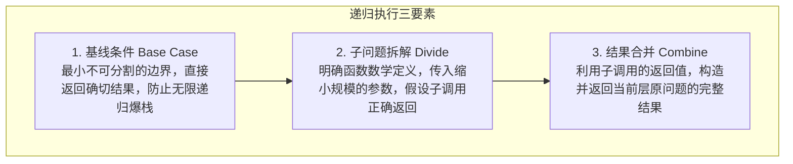
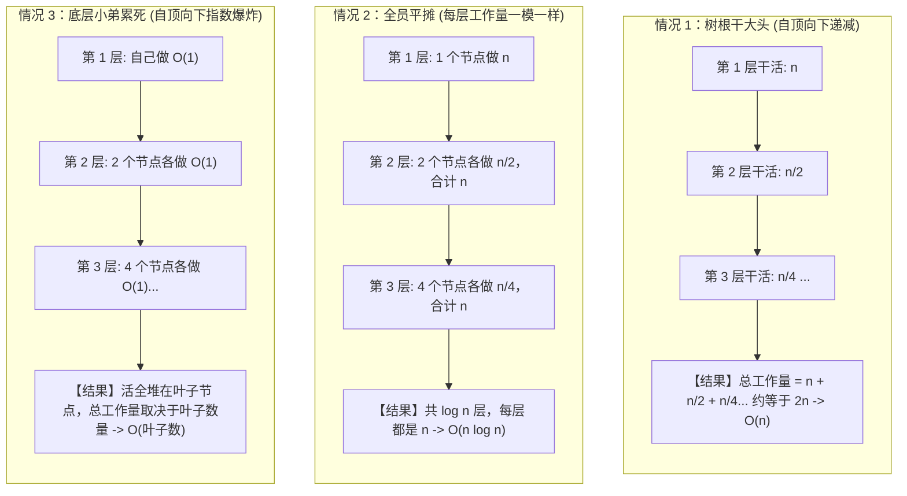
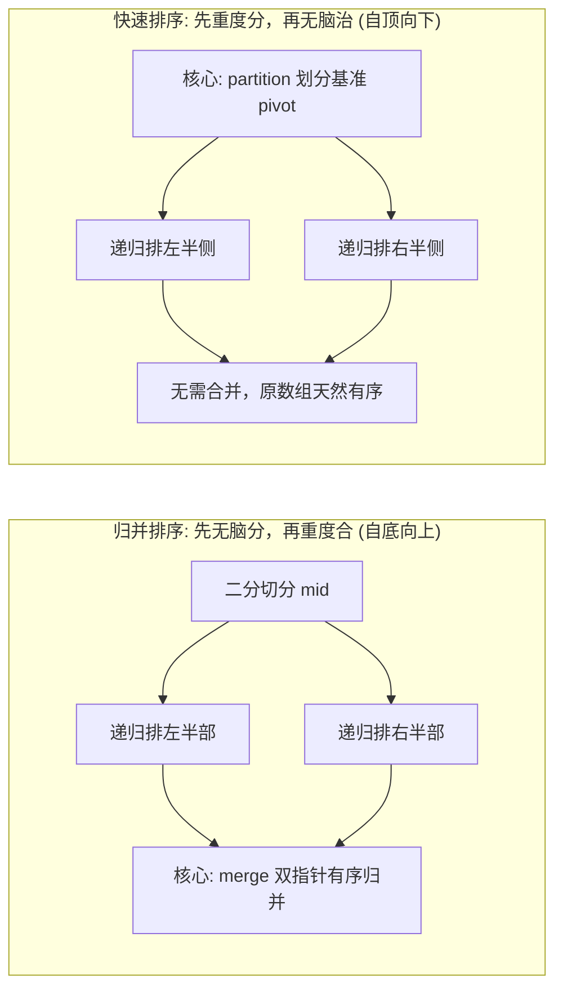

# 递归与分治思想

> **核心定义**：
> - **递归（Recursion）** 是一种控制流范式：函数通过直接或间接调用自身，将原问题转化为更小规模的同类子问题来求解。
> - **分治（Divide and Conquer）** 是一种算法设计思想：将一个规模为 $N$ 的大问题，分解为若干更小、可独立求解的同类子问题；均匀划分的常见模型是 $a$ 个规模为 $N/b$ 的子问题，递归求解各子问题，最后将子问题的解合并为原问题的解。

---

## 1. 递归三要素与底层调用机制

递归严禁通过脑内“人肉压栈”跟踪执行流。编写递归时，必须依据**数学归纳法**确立以下三要素：



### 1.1 递归三要素落地准则
1. **基线条件（Base Case）**：识别递归终点。若递归无出口或基线条件覆盖不全，会导致 Java 抛出 `StackOverflowError`。
2. **子问题拆解（Divide）**：只关注“当前这一层”如何调用缩小规模的子问题。相信“递归假设”，严禁深入跟踪每一层递归细节。
3. **状态合并（Combine）**：自底向上组装子问题解，或者自顶向下传递累加状态并回退。

### 1.2 递归的底层 JVM 栈机制与代价
- **执行栈与栈帧**：每一次递归调用，JVM 会在 Java 虚拟机栈中为该函数分配一个独立的**栈帧（Stack Frame）**，包含局部变量表、操作数栈、动态链接、方法返回地址等。
- **内存与时间开销**：函数压栈与弹栈存在 CPU 指令开销（寄存器保存与恢复）。空间复杂度严格取决于**递归调用树的最大深度**。可用递归深度取决于线程栈大小、方法栈帧和 JIT，JVM 没有统一默认递归层数，超深递归必须通过迭代加显式栈重构。

---

## 2. 递归与分治的时间复杂度：不用死记公式，看懂“递归树”即可

> [!TIP] 给学习者的一颗定心丸
> **面试和刷题绝对不需要死记硬背数学公式（什么 $\epsilon$、$\Omega$、正则条件统统不用背）！**
> 无论是力扣刷题还是大厂后端面试，考察的本质是**直觉与心智模型**。只要你把递归想象成一棵**“递归任务树”**，看一眼**“到底哪一层的活最多”**，就能 3 秒钟报出时间复杂度。

---

### 2.1 第一性原理：递归树的心智模型（三态比大小）

一个分治递归函数 $T(n) = aT(n/b) + f(n)$，在物理本质上就是一家公司分配任务：
- **树的深度**：每次把问题除以 $b$，一共砍 $\log_b n$ 次到底，树高就是 $\log n$ 层。
- **分支数量**：每个节点把任务拆解给 $a$ 个小弟。
- **节点开销 $f(n)$**：当前节点自己干的活（比如切分、比较、合并）。

把整棵树所有节点干的活加起来，只有**三种极度直观的物理情况**：



- **情况 1：领导把大头干了（根节点主导）**
  - 上面干得重，越往下活越少，呈等比数列断崖式暴跌（$n + n/2 + n/4 + \dots \approx 2n$）。
  - **总耗时**：直接由第一层决定 $\to O(n)$。
  - **代表算法**：快速选择算法（QuickSelect，求第 K 大数）。
- **情况 2：每层均摊干活（全层并重）**
  - 每一层虽然节点越来越多，但每个节点活变小了，一乘起来**每层的总开销一模一样**。
  - **总耗时**：单层开销 $\times$ 树的高度 $\to n \times \log n = O(n \log n)$。
  - **代表算法**：归并排序（Merge Sort）。
- **情况 3：底层小弟堆死（叶子主导）**
  - 上层节点基本不干活（每层只做 $O(1)$ 的分发），但节点数量以几何级数裂变，所有活全堆在最底层的叶子节点上。
  - **总耗时**：完全由叶子节点数量决定 $\to O(\text{叶子节点总数})$。
  - **代表算法**：二叉树遍历（访问每个叶子节点 $O(n)$）、斐波那契暴力递归（叶子数 $2^n \to O(2^n)$）。

---

### 2.2 面试必考：分治四大金刚反射弧（直接套用）

在 99% 的面试和笔试中，分治算法只会出现以下 4 种形态，请直接形成条件反射：

| 递归特征与递推式 | 通俗人话解释 | 最终时间复杂度 | 典型经典算法 |
| :--- | :--- | :---: | :--- |
| **$T(n) = T(n/2) + O(1)$** | 每次砍半，**只进一边**，当前层只做常数次判断。 | **$O(\log n)$** | **二分查找**、**快速幂** |
| **$T(n) = 2T(n/2) + O(n)$** | 每次砍半，**两边都做**，当前层需要花费 $O(n)$ 合并左右结果。 | **$O(n \log n)$** | **归并排序** |
| **$T(n) = T(n/2) + O(n)$** | 每次砍半，**只进一边**，但当前层需要花费 $O(n)$ 扫描划分（切分）。 | **$O(n)$** | **快速选择算法（求第 K 大）** |
| **$T(n) = 2T(n/2) + O(1)$** | 每次砍半，**两边都做**，但当前层只做 $O(1)$ 的访问，无复杂合并。 | **$O(n)$** | **二叉树前序/后序遍历**（每个节点访问一次） |

---

### 2.3 进阶参考：主定理严格数学定义（供学术查阅，无需死记）

> [!note]- 点击展开：主定理（Master Theorem）严格数学推导与边界条件
> 对于递推关系式：
> 
> $T(n) = aT\left(\frac{n}{b}\right) + f(n)$
> 
> 其中 $a \ge 1$ 为子问题数，$b > 1$ 为问题缩减比率，$f(n)$ 为拆分与合并开销。临界指数为 $c_{\text{crit}} = \log_b a$。本质比较的是叶子节点开销 $n^{\log_b a}$ 与 $f(n)$ 的多项式阶数：
> 
> 1. **Case 1（叶子占主导）**：若存在 $\epsilon > 0$ 使得 $f(n) = O(n^{\log_b a - \epsilon})$，则 $T(n) = \Theta(n^{\log_b a})$。
>    - 例：Karatsuba 乘法 $T(n) = 3T(n/2) + O(n) \to \log_2 3 \approx 1.585 > 1 \to O(n^{1.585})$。
> 2. **Case 2（各层均衡）**：若存在 $k \ge 0$ 使得 $f(n) = \Theta(n^{\log_b a} \log^k n)$，则 $T(n) = \Theta(n^{\log_b a} \log^{k+1} n)$。
>    - 例：归并排序 $T(n) = 2T(n/2) + O(n) \to \log_2 2 = 1$，属于 $k=0$ 的情况 $\to O(n \log n)$。
> 3. **Case 3（顶层占主导）**：若存在 $\epsilon > 0$ 使得 $f(n) = \Omega(n^{\log_b a + \epsilon})$ 且满足正则条件 $a f(n/b) \le c f(n) (c < 1)$，则 $T(n) = \Theta(f(n))$。
> 
> **主定理失效场景**：
> 1. 子问题规模不均匀：如斐波那契 $T(n) = T(n-1) + T(n-2)$；
> 2. $f(n)$ 与 $n^{\log_b a}$ 之间不是多项式差异，而是仅差对数因子（如 $f(n) = n / \log n$）。此时需展开递归树逐层几何求和。

---

## 3. 分治两大基石对比：归并排序 vs 快速排序

归并排序与快速排序是分治思想最具代表性的两座丰碑，两者体现了完全相反的分治哲学：



| 维度 | 归并排序（Merge Sort） | 快速排序（Quick Sort） |
| :--- | :--- | :--- |
| **分治重心** | **重在合并（Combine）**：划分操作极简（$O(1)$ 取中点），核心复杂度在合并阶段的双指针扫描 | **重在划分（Divide）**：核心复杂度在 `partition`（$O(n)$ 双向扫描定位 pivot），后续子问题解天然有序，无需 Combine |
| **时间复杂度** | 严格稳定 $\Theta(n \log n)$（无论最好、最坏还是平均） | 平均 $O(n \log n)$，最坏为 $O(n^2)$（划分持续不均衡；随机化改善期望表现但不消除最坏情况） |
| **空间复杂度** | $O(n)$（需要开辟临时辅助数组存放合并结果） | $O(\log n) \sim O(n)$（原地排序，仅消耗递归栈空间） |
| **稳定性** | **稳定**（合并时遇到相等元素优先取左半侧） | **不稳定**（`partition` 交换过程会打破相等元素的原始相对顺序） |
| **核心衍生题型** | 逆序对计数、翻转对、多链表合并 | 快速选择算法（$O(n)$ 求第 K 大/小元素）、颜色分类三路划分 |

---

## 4. 分治算法标准实现模板

以下为概念骨架，`Problem`、`Result` 和拆分/合并规则需按具体问题实现，不能原样编译或把占位的 null 返回当成可用算法。

```java
public class DivideAndConquerTemplate {

    public Result solve(Problem problem) {
        // 1. 基线条件：问题足够小，直接计算返回
        if (problem.isBaseCase()) {
            return problem.resolveBase();
        }

        // 2. 划分阶段：分解为若干个互不相交的同类子问题
        List<Problem> subProblems = problem.split();

        // 3. 递归求解子问题
        List<Result> subResults = new ArrayList<>();
        for (Problem sub : subProblems) {
            subResults.add(solve(sub));
        }

        // 4. 合并阶段：拼装子问题解返回全局解
        return merge(subResults);
    }

    private Result merge(List<Result> subResults) {
        // 依据题目约束合成当前问题结果
        return null;
    }
}
```

---

## 5. 经典母题手撕：LeetCode 50. Pow(x, n)（快速幂分治）

> **题目描述**：
> 实现 `pow(x, n)`，即计算 `x` 的整数 `n` 次幂函数（即 $x^n$）。
> 约束条件：`-100.0 < x < 100.0`，`n` 是 32 位有符号整数，范围为 $[-2^{31}, 2^{31} - 1]$。
>
> **输入输出示例**：
> - 示例 1：
>   - 输入：`x = 2.00000, n = 10`
>   - 输出：`1024.00000`
> - 示例 2：
>   - 输入：`x = 2.10000, n = 3`
>   - 输出：`9.26100`
> - 示例 3：
>   - 输入：`x = 2.00000, n = -2`
>   - 输出：`0.25000`（解释：$2^{-2} = \frac{1}{2^2} = \frac{1}{4} = 0.25$）

### 5.1 算法思路与边界陷阱

**从题目到算法**：指数是 32 位整数，逐次连乘可能需要数十亿次操作。幂满足 $x^{2m}=(x^m)^2$，因此只需把同一结果计算一次再平方；奇数指数额外乘一个 `x`。这个恒等式把原问题变成指数减半的同类子问题，且每层只做常数次乘法，所以选择快速幂，而不是直接递归执行 N 次乘法。例如 $2^{10}$ 先求 $2^5$，再平方即可。负指数转成倒数后使用同一过程。

- **分治拆解**：计算 $x^n$。若直接连乘耗时 $O(n)$。利用分治二分折半：
  $$x^n = \begin{cases} (x^{n/2})^2 & n \text{ 为偶数} \\ x \cdot (x^{(n-1)/2})^2 & n \text{ 为奇数} \end{cases}$$
- **复杂度**：每次问题规模缩半，$a=1, b=2, f(n)=O(1)$，由主定理判定为 $O(\log n)$。
- **边界防坑（高频扣分点）**：$n$ 的取值范围为 $[-2^{31}, 2^{31}-1]$。当 $n = -2^{31}$（`Integer.MIN_VALUE`）时，直接执行 `-n` 会发生**整型溢出**，其值依旧为 $-2^{31}$。必须先将指数转为 `long` 类型再取负数。

### 5.2 标准 Java 实现（递归与迭代双版本）

```java
public class SolutionPow {

    // 分治递归实现：时间 O(log n)，空间 O(log n)
    public double myPowRecursive(double x, int n) {
        long N = n;
        return N >= 0 ? quickPow(x, N) : 1.0 / quickPow(x, -N);
    }

    private double quickPow(double x, long n) {
        if (n == 0) return 1.0;
        double half = quickPow(x, n / 2);
        return (n % 2 == 0) ? half * half : half * half * x;
    }

    // 迭代二进制快速幂：时间 O(log n)，空间 O(1)
    public double myPowIterative(double x, int n) {
        long N = n;
        if (N < 0) {
            x = 1.0 / x;
            N = -N;
        }
        double ans = 1.0;
        double currentProduct = x;
        while (N > 0) {
            if ((N & 1) == 1) { // 当前二进制最低位为 1
                ans *= currentProduct;
            }
            currentProduct *= currentProduct; // 基底自乘平方
            N >>= 1;                          // 指数右移一位
        }
        return ans;
    }
}
```

---

## 6. 典型算法应用速览

| 题目 | 难度 | 核心分治思路 |
| :--- | :--- | :--- |
| **LC 53. 最大子数组和** | 中等 | 区间拆为左右两部分，最大子序和要么在左半部，要么在右半部，要么横跨中点（线段树区间维护模型） |
| **LC 169. 多数元素** | 简单 | 二分左右区间分别求众数，若左右众数一致直接返回；若不同则在当前区间统计两众数频次决出胜者 |
| **LC 215. 数组中的第 K 个最大元素** | 中等 | 基于快速排序 partition 划分：每次锁定 pivot 绝对索引，根据位置只向其中一边单侧递归（$O(n)$ 快速选择） |
| **LC 23. 合并 K 个升序链表** | 困难 | 两两二分配对合并：将 $k$ 个链表拆分为前 $k/2$ 和后 $k/2$，递归到底后自底向上双路归并 |
| **剑指 Offer 51. 数组中的逆序对** | 困难 | 归并排序 merge 阶段计数：当左半指针指向元素大于右半指针时，左半指针及其后所有元素与当前右元素均构成逆序对 |

### 从题目描述判断算法

#### LC 53：最大子数组和

- **题目线索**：求非空连续区间的最大和，数组可能含负数。
- **为什么可以分治**：把区间从中点拆开，答案只有三种位置：全在左侧、全在右侧、跨越中点。跨中点的解必须由左侧最大后缀和右侧最大前缀拼成，三类覆盖全部候选。
- **解题步骤**：递归求两侧最优值并计算跨中点候选，三者取最大。逐层扫描前后缀时为 $O(N\log N)$；若每段返回总和、最大前缀、最大后缀、最大子数组和四项，合并可为 $O(1)$，总时间 $O(N)$。普通单次数组问题也可用更简洁的 Kadane 动态规划，不必强用分治。

#### LC 169：多数元素

- **题目线索**：保证存在出现次数超过数组长度一半的元素。
- **为什么可以分治**：若某值在整个区间超过一半，它必定在至少一半子区间中也超过一半，否则两侧次数相加仍不可能超半。因此整体答案一定在左右递归返回的两个候选中。
- **解题步骤**：两侧候选相同就直接返回；不同就在当前区间统计这两个候选的次数，取更多者。分治时间为 $O(N\log N)$；只需求一个保证存在的多数元素时，摩尔投票还可做到 $O(N)$ 时间、$O(1)$ 空间。

#### LC 215：数组中的第 K 个最大元素

- **题目线索**：只求一个排名对应的值，重复元素照常占排名，不要求完整排序。
- **为什么用快速选择**：一次 `partition` 已把基准放到其最终排序位置，只要比较该位置与 `N-K`，就能排除不含目标的另一侧；完整快排处理两侧会做多余工作。
- **解题步骤**：随机选基准、划分、只继续目标所在的一侧，命中即返回。随机化的期望时间为 $O(N)$，最坏为 $O(N^2)$，不能把期望复杂度说成无条件保证。

#### LC 23：合并 K 个升序链表

- **题目线索**：每个链表已经有序，要求得到一个整体有序的链表。
- **为什么用两两分治归并**：两个有序链表可以线性合并；如果总把新链表并入已增长的结果，早先节点会反复参与扫描。均衡地两两合并，让每个节点最多参与约 $\log K$ 轮。
- **解题步骤**：递归把链表数组分成两半，各自合并后再双指针合并结果。若所有链表共有 T 个节点，总时间为 $O(T\log K)$；也可以用最小堆每次取 K 个表头中的最小值。

#### 剑指 Offer 51：数组中的逆序对

- **题目线索**：统计前面的数大于后面的数的数对，既依赖数值，也依赖原位置先后。
- **为什么用归并分治**：按原下标拆开后，数对分成左侧内部、右侧内部、跨左右三类。前两类递归求解；合并有序子区间时，右侧较小的当前值与左侧所有剩余值都构成逆序对。
- **解题步骤**：递归计数并排序两侧，归并时右值先取就累加 `mid-i+1`。例如左侧 `[5,7]`、右侧当前值 4，一次增加两对；相等时不增加。

> [!example]- 展开查看：LC 23. 合并 K 个升序链表（分治实现）
> **题目描述**：给你一个链表数组 `lists`，每个链表都已经按升序排列。请你将所有链表合并到一个升序链表中，返回合并后的链表。
> **示例**：输入 `lists = [[1,4,5],[1,3,4],[2,6]]`，输出 `[1,1,2,3,4,4,5,6]`。
> **思路**：将 $K$ 个链表二分对半拆分递归合并，设全部链表共 T 个节点，分治合并时间为 $O(T\log K)$；顺序合并最坏可达 $O(TK)$。
> ```java
> class SolutionLC23 {
>     public ListNode mergeKLists(ListNode[] lists) {
>         if (lists == null || lists.length == 0) return null;
>         return divideAndConquer(lists, 0, lists.length - 1);
>     }
> 
>     private ListNode divideAndConquer(ListNode[] lists, int l, int r) {
>         if (l == r) return lists[l];
>         int mid = l + (r - l) / 2;
>         ListNode left = divideAndConquer(lists, l, mid);
>         ListNode right = divideAndConquer(lists, mid + 1, r);
>         return mergeTwoLists(left, right);
>     }
> 
>     private ListNode mergeTwoLists(ListNode l1, ListNode l2) {
>         ListNode dummy = new ListNode(0);
>         ListNode cur = dummy;
>         while (l1 != null && l2 != null) {
>             if (l1.val <= l2.val) {
>                 cur.next = l1;
>                 l1 = l1.next;
>             } else {
>                 cur.next = l2;
>                 l2 = l2.next;
>             }
>             cur = cur.next;
>         }
>         cur.next = (l1 != null) ? l1 : l2;
>         return dummy.next;
>     }
> }
> ```

> [!example]- 展开查看：剑指 Offer 51. 数组中的逆序对（归并排序分治实现）
> **题目描述**：在数组中的两个数字，如果前面一个数字大于后面的数字，则这两个数字组成一个逆序对。输入一个数组，求出这个数组中的逆序对的总数。
> **示例**：输入 `nums = [7,5,6,4]`，输出 `5`（逆序对为 (7,5), (7,6), (7,4), (5,4), (6,4)）。
> **思路**：归并排序在合并两个升序子区间时，当右边元素 `nums[j]` 先出队，说明左边当前剩余的 `mid - i + 1` 个元素全部大于 `nums[j]`，一次性累计贡献。
> ```java
> class SolutionOffer51 {
>     private int count = 0;
>     private int[] temp;
> 
>     public int reversePairs(int[] nums) {
>         count = 0; // 每次调用重新统计
>         if (nums == null || nums.length < 2) return 0;
>         temp = new int[nums.length];
>         mergeSort(nums, 0, nums.length - 1);
>         return count;
>     }
> 
>     private void mergeSort(int[] nums, int l, int r) {
>         if (l >= r) return;
>         int mid = l + (r - l) / 2;
>         mergeSort(nums, l, mid);
>         mergeSort(nums, mid + 1, r);
>         merge(nums, l, mid, r);
>     }
> 
>     private void merge(int[] nums, int l, int mid, int r) {
>         int i = l, j = mid + 1, k = l;
>         while (i <= mid && j <= r) {
>             if (nums[i] <= nums[j]) {
>                 temp[k++] = nums[i++];
>             } else {
>                 // nums[i] > nums[j]，则 i 到 mid 之间的所有数均大于 nums[j]
>                 count += (mid - i + 1);
>                 temp[k++] = nums[j++];
>             }
>         }
>         while (i <= mid) temp[k++] = nums[i++];
>         while (j <= r) temp[k++] = nums[j++];
>         for (int p = l; p <= r; p++) nums[p] = temp[p];
>     }
> }
> ```

---

## 7. 避坑清单与面试答题技巧

1. **二分切分溢出**：计算中点严格使用 `mid = l + (r - l) / 2`，严禁使用 `(l + r) / 2`，避免大整数相加溢出为负数。
2. **区分“递归定义”与“递归调用”**：
   - 面试陈述时，第一句话必须给出函数的**严格语义**：“此函数 `merge(l, r)` 的返回值代表区间 $[l, r]$ 排序完成后的链表头节点”。
   - 绝不要用“我先进去这一层，再进去下一层”流水账式描述。
3. **避免无效子问题重复计算**：分治的前提是子问题**相互独立**。若子问题存在大量重叠（如直接递归算斐波那契数列），分治退化为指数爆炸，必须转用动态规划或记忆化搜索。
