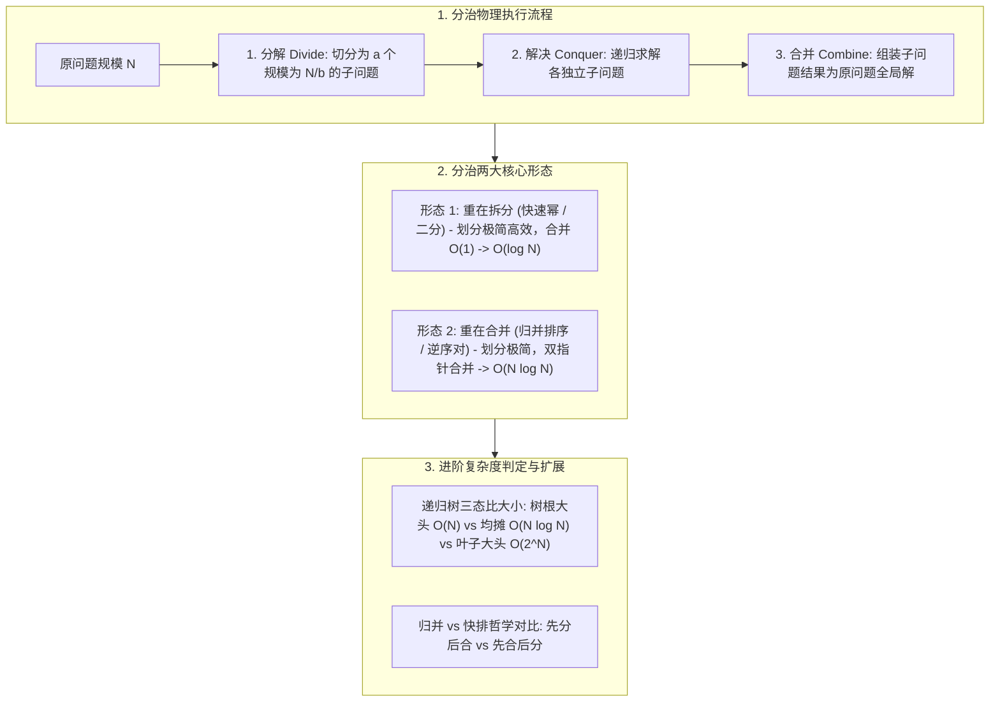

# 05 · 递归与分治：递归三要素、分治三步曲与高频解题范式

> [!abstract] 一句话第一性原理
> **分治（Divide and Conquer）** 的本质不是盲目切分子问题，而是**基于数学归纳法将规模为 $N$ 的原问题分解为若干同类的独立子问题，通过缩小规模递归求解，最终将子结果合并为全局解**。

---

## 知识全景图



---

## 一、 破除玄学：递归与分治的底层心智模型

### 1.1 递归的最高心法：数学归纳法（拒绝“人肉压栈”）
初学递归最大的误区，是在脑子里试图人肉追踪每一层递归调用，结果把自己绕晕。
**编写递归必须立足数学归纳法，只关注当前层的三要素**：
1. **基线条件（Base Case）**：递归的终点与出口。当问题规模缩小到最简单时，直接返回确切答案，防止无限递归导致 JVM 栈溢出（`StackOverflowError`）；
2. **递推工作（Divide & Conquer）**：相信递归函数已经正确实现了数学定义。只传入规模缩小的参数，假设子调用能正确返回结果；
3. **结果组装（Combine）**：利用子调用的返回值，构造并返回当前层原问题的完整解。

> [!tip] 心智法则
> **永远不要跳进下一层递归去肉眼调试！只要基线条件正确，当前层的递推和合并逻辑正确，整棵递归树就必然正确。**

---

### 1.2 分治法的三步曲
分治算法就是在递归基础上的系统化分工：
- **分（Divide）**：将大问题切分成若干个互不相交的同类子问题；
- **治（Conquer）**：递归调用自身求解各个子问题；若子问题已足够小，直接由 Base Case 解决；
- **合（Combine）**：将子问题的解汇总拼装成大问题的最终解。

---

## 二、 分治算法通用代码骨架

绝大多数分治问题都可以套用以下标准抽象模板：

```java
public Result divideAndConquer(Problem problem) {
    // 1. 基线条件 (Base Case)：规模足够小，直接返回结果
    if (problem.isBaseCase()) {
        return problem.resolveBase();
    }

    // 2. 分解阶段 (Divide)：将原问题切分为多个同类子问题
    List<Problem> subProblems = problem.split();

    // 3. 解决阶段 (Conquer)：递归求解各个子问题
    List<Result> subResults = new ArrayList<>();
    for (Problem sub : subProblems) {
        subResults.add(divideAndConquer(sub));
    }

    // 4. 合并阶段 (Combine)：将各子结果拼装为当前问题的解
    return merge(subResults);
}
```

---

## 三、 经典场景入门题（由浅入深两大经典范式）

### 场景 1：重在“拆分”的快速幂（LC 50. Pow(x, n)）

> **题目描述**：实现 `pow(x, n)`，即计算 $x$ 的整数 $n$ 次幂函数（$x^n$）。其中 $n$ 可为负数。
> **输入输出示例**：输入 `x = 2.0, n = 10`，输出 `1024.0`。

#### 1. 思路与分治建模
- **暴力计算**：连乘 $n$ 次，时间复杂度为 $O(n)$，当 $n = 2^{31}-1$ 时必然超时；
- **分治折半**：利用数学性质 $x^n = (x^{n/2})^2$：
  - 若 $n$ 为偶数：计算一次 $half = x^{n/2}$，直接返回 $half \times half$；
  - 若 $n$ 为奇数：多乘一个基底 $x$ 即可，返回 $half \times half \times x$；
- **合并代价**：仅仅是一次乘法运算，合并复杂度为 $O(1)$；整体时间复杂度直接降维至 **$O(\log n)$**。

#### 2. 标准实现（含边界防坑）
```java
class Solution50 {
    public double myPow(double x, int n) {
        long N = n; // 防止 n = -2^31 时取负数整型溢出
        return N >= 0 ? quickPow(x, N) : 1.0 / quickPow(x, -N);
    }

    private double quickPow(double x, long n) {
        // 1. Base Case
        if (n == 0) return 1.0;

        // 2 & 3. Divide & Conquer：只算一次子问题，杜绝重复计算
        double half = quickPow(x, n / 2);

        // 4. Combine：合并结果
        return (n % 2 == 0) ? half * half : half * half * x;
    }
}
```

#### 3. 进阶速写：更简洁的二进制拆分迭代法（空间 $O(1)$）
> [!tip] 极简迭代写法（面试推荐）
> 递归写法存在 $O(\log n)$ 的调用栈空间。若采用**二进制拆分迭代法**，不仅代码仅有 4 行核心循环，而且空间复杂度压缩到 $O(1)$：

```java
public double myPow(double x, int n) {
    long exp = n; // 关键防坑：防止 -Integer.MIN_VALUE 取反溢出
    if (exp < 0) {
        x = 1.0 / x;
        exp = -exp;
    }
    double ans = 1.0;
    while (exp > 0) {
        if ((exp & 1) == 1) ans *= x;
        x *= x;
        exp >>= 1;
    }
    return ans;
}
```

> [!note] 深入学习
> 更多数论运算（大数取模快速幂、辗转相除法 GCD/LCM、质数筛法等），请参考专属指南：[[../04-模板与技巧/12-技巧-数论与数学运算极简速查|12 · 技巧-数论与数学运算极简速查]]。

---

### 场景 2：重在“合并”的归并排序（Merge Sort）

> **题目描述**：给你一个整数数组 `nums`，请你将该数组升序排列。
> **分治本质**：把数组从中点分成左右两半，两边分别递归排好序，再通过双指针有序拉链式合并。

#### 1. 核心代码片段
```java
public void mergeSort(int[] nums, int left, int right, int[] temp) {
    // 1. Base Case
    if (left >= right) return;

    // 2. Divide：寻找中点对半切分
    int mid = left + (right - left) / 2;

    // 3. Conquer：递归排序左半段与右半段
    mergeSort(nums, left, mid, temp);
    mergeSort(nums, mid + 1, right, temp);

    // 4. Combine：双指针合并两个有序数组 (耗时 O(N))
    int i = left, j = mid + 1, k = 0;
    while (i <= mid && j <= right) {
        temp[k++] = (nums[i] <= nums[j]) ? nums[i++] : nums[j++];
    }
    while (i <= mid) temp[k++] = nums[i++];
    while (j <= right) temp[k++] = nums[j++];
    System.arraycopy(temp, 0, nums, left, k);
}
```

- **衍生考点**：**剑指 Offer 51. 数组中的逆序对**。在双指针合并时，当发现 `nums[i] > nums[j]`，由于左半段有序，说明从 `i` 到 `mid` 的所有元素都大于 `nums[j]`，直接累加计数 `mid - i + 1` 即可在线性时间内统计出跨区间的逆序对。

---

## 四、 高阶攻坚与拓展知识（进阶查阅）

### 4.1 分治时间复杂度判定：递归树心智模型（秒杀公式）

面对形如 $T(n) = aT(n/b) + f(n)$ 的分治递推式，**无需死记复杂的数学主定理公式**，只需在脑海中比较**“递归树哪层活最多”**：

| 物理场景 | 树形工作量特征 | 最终时间复杂度 | 典型算法代表 |
| :--- | :--- | :---: | :--- |
| **树根干大头** | 第一层做 $O(N)$，随后以等比数列锐减（$N + N/2 + N/4 \dots$） | **$O(N)$** | **快速选择算法（求第 K 大数）** |
| **各层全均摊** | 树高 $\log N$ 层，每一层节点加起来总工作量都等于 $N$ | **$O(N \log N)$** | **归并排序** |
| **底层堆满活** | 节点几何级数裂变，大部分活堆在最底层叶子 | **$O(\text{叶子数})$** | **二叉树全遍历 $O(N)$ / 斐波那契 $O(2^N)$** |
| **单路折半** | 每次砍一半，只走一条分支，每层开销 $O(1)$ | **$O(\log N)$** | **二分查找 / 快速幂** |

> [!note]- 点击展开：主定理（Master Theorem）严格数学定义
> 对于递推式 $T(n) = aT(n/b) + f(n)$，临界指数 $c_{\text{crit}} = \log_b a$：
> 1. $f(n) = O(n^{c})$ 且 $c < \log_b a$（叶子占主导）$\implies T(n) = \Theta(n^{\log_b a})$；
> 2. $f(n) = \Theta(n^{\log_b a} \log^k n)$（各层均衡）$\implies T(n) = \Theta(n^{\log_b a} \log^{k+1} n)$；
> 3. $f(n) = \Omega(n^{c})$ 且 $c > \log_b a$ 且满足正则条件（顶层占主导）$\implies T(n) = \Theta(f(n))$。

---

### 4.2 归并排序 vs 快速排序的分治哲学对比

| 维度 | 归并排序（Merge Sort） | 快速排序（Quick Sort） |
| :--- | :--- | :--- |
| **分治哲学** | **先分后合（自底向上）** | **先合后分（自顶向下）** |
| **重心所在** | **重在合并 Combine**：划分只需取中点 $O(1)$，核心在两路归并双指针 | **重在划分 Divide**：核心在 `partition` 双向扫描，排完后无需合并 |
| **稳定性** | **稳定**（相等元素优先取左侧） | **不稳定**（`partition` 元素交换打破相对顺序） |
| **空间开销** | $O(N)$（需辅助数组存合并数据） | $O(\log N) \sim O(N)$（原地排序，仅占递归栈） |

---

## 五、 常见避坑清单与自测过关

1. **递归栈溢出（StackOverflowError）**：
   - 检查基线条件是否覆盖所有边界；
   - 空间复杂度严格取决于**递归树的最大深度**，而非总调用次数。
2. **快速幂边界溢出**：
   - 输入 `n = -2147483648`（`Integer.MIN_VALUE`）时，直接 `-n` 依然溢出为负数，必须先转成 `long`。
3. **分治子问题必须独立**：
   - 子问题之间若存在大量重叠（如斐波那契数列直接递归），会导致指数级重复计算，必须引入备忘录（记忆化搜索）或转为动态规划。
