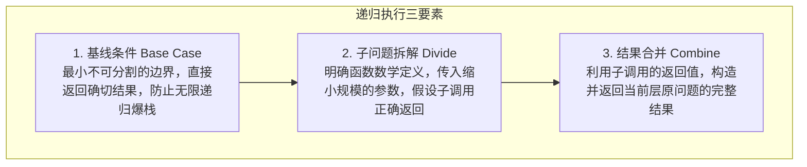
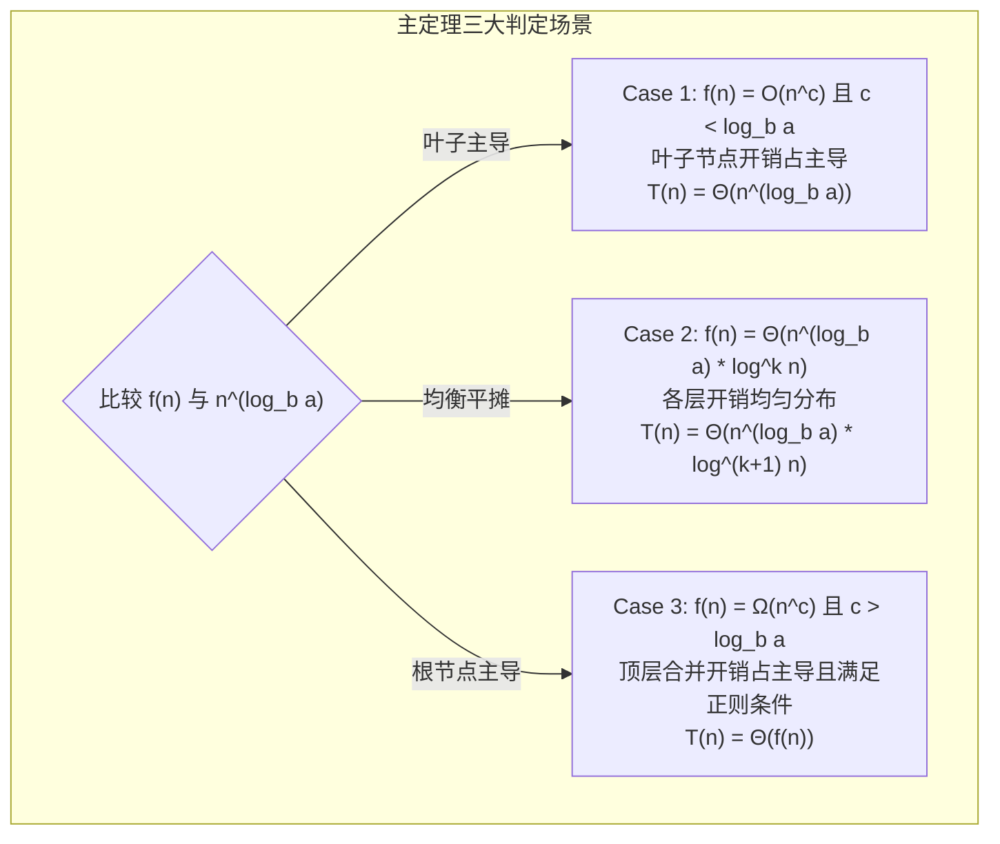
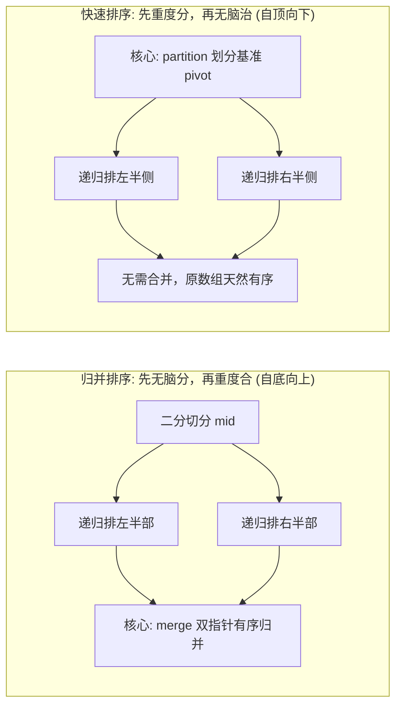

# 递归与分治思想

> **核心定义**：
> - **递归（Recursion）** 是一种控制流范式：函数通过直接或间接调用自身，将原问题转化为更小规模的同类子问题来求解。
> - **分治（Divide and Conquer）** 是一种算法设计思想：将一个规模为 $N$ 的大问题，分解为 $a$ 个规模为 $N/b$、相互独立且与原问题形式相同的子问题，递归求解各子问题，最后将子问题的解合并为原问题的解。

---

## 1. 递归三要素与底层调用机制

递归严禁通过脑内“人肉压栈”跟踪执行流。编写递归时，必须依据**数学归纳法**确立以下三要素：



### 1.1 递归三要素落地准则
1. **基线条件（Base Case）**：识别递归终点。若递归无出口或基线条件覆盖不全，会导致 Java 抛出 `StackOverflowError`。
2. **子问题拆解（Divide）**：只关注“当前这一层”如何调用缩小规模的子问题。相信“递归假设”，严禁深入跟踪每一层递归细节。
3. **状态合并（Combine）**：自底向上组装子问题解，或者自顶向下传递累加状态并回退。

### 1.2 递归的底层 JVM 栈机制与代价
- **执行栈与栈帧**：每一次递归调用，JVM 会在 Java 虚拟机栈中为该函数分配一个独立的**栈帧（Stack Frame）**，包含局部变量表、操作数栈、动态链接、方法返回地址等。
- **内存与时间开销**：函数压栈与弹栈存在 CPU 指令开销（寄存器保存与恢复）。空间复杂度严格取决于**递归调用树的最大深度**。JVM 默认栈深度通常在 $10^4 \sim 10^5$ 级别，超深递归必须通过迭代加显式栈重构。

---

## 2. 主定理（Master Theorem）与复杂度判定

对于绝大部分分治算法，其递推关系式可以形式化为：

$$T(n) = aT\left(\frac{n}{b}\right) + f(n)$$

- $a \ge 1$：子问题数量；
- $b > 1$：子问题规模缩减因子（原问题缩小为原来的 $1/b$）；
- $f(n)$：将原问题拆解为子问题，以及合并子问题结果所需的非递归操作开销；
- **临界指数（Critical Exponent）**：$c_{\text{crit}} = \log_b a$。本质比较的是“**叶子节点的总开销 $O(n^{\log_b a})$**”与“**根节点拆分合并开销 $f(n)$**”谁占主导地位。



### 2.1 三大判定分支详解

| 分支 | 条件关系 | 渐进时间复杂度 $T(n)$ | 典型经典算法 |
| :--- | :--- | :--- | :--- |
| **Case 1（叶子占主导）** | 存在 $\epsilon > 0$ 使得 $f(n) = O(n^{\log_b a - \epsilon})$ | $\Theta(n^{\log_b a})$ | Karatsuba 大整数乘法 ($a=3, b=2 \to O(n^{1.585})$)、Strassen 矩阵乘法 |
| **Case 2（各层均衡）** | 存在 $k \ge 0$ 使得 $f(n) = \Theta(n^{\log_b a} \log^k n)$ | $\Theta(n^{\log_b a} \log^{k+1} n)$ | 归并排序 ($a=2, b=2, k=0 \to O(n \log n)$)、二分查找 ($a=1, b=2 \to O(\log n)$) |
| **Case 3（顶层占主导）** | 存在 $\epsilon > 0$ 使得 $f(n) = \Omega(n^{\log_b a + \epsilon})$，且满足正则条件 $a f(n/b) \le c f(n)$ ($c < 1$) | $\Theta(f(n))$ | 某些快速选择分治算法变体 |

> [!WARNING] 主定理不可用场景
> 1. 子问题规模不均匀：如 $T(n) = T(n - 1) + O(1)$（退化为单链线性递归）；
> 2. $a$ 不是常数：如 $T(n) = n T(n/2) + O(n)$；
> 3. $f(n)$ 与 $n^{\log_b a}$ 之间的差距不是多项式级别：例如 $f(n) = n^{\log_b a} / \log n$，二者之间仅差对数因子，不能用 Case 1，此时需使用递归树法展开逐层求和。

---

## 3. 分治两大基石对比：归并排序 vs 快速排序

归并排序与快速排序是分治思想最具代表性的两座丰碑，两者体现了完全相反的分治哲学：



| 维度 | 归并排序（Merge Sort） | 快速排序（Quick Sort） |
| :--- | :--- | :--- |
| **分治重心** | **重在合并（Combine）**：划分操作极简（$O(1)$ 取中点），核心复杂度在合并阶段的双指针扫描 | **重在划分（Divide）**：核心复杂度在 `partition`（$O(n)$ 双向扫描定位 pivot），后续子问题解天然有序，无需 Combine |
| **时间复杂度** | 严格稳定 $\Theta(n \log n)$（无论最好、最坏还是平均） | 平均 $O(n \log n)$，最坏退化为 $O(n^2)$（未做随机化选主元且数组已有序） |
| **空间复杂度** | $O(n)$（需要开辟临时辅助数组存放合并结果） | $O(\log n) \sim O(n)$（原地排序，仅消耗递归栈空间） |
| **稳定性** | **稳定**（合并时遇到相等元素优先取左半侧） | **不稳定**（`partition` 交换过程会打破相等元素的原始相对顺序） |
| **核心衍生题型** | 逆序对计数、翻转对、多链表合并 | 快速选择算法（$O(n)$ 求第 K 大/小元素）、颜色分类三路划分 |

---

## 4. 分治算法标准实现模板

```java
public class DivideAndConquerTemplate {

    public Result solve(Problem problem) {
        // 1. 基线条件：问题足够小，直接计算返回
        if (problem.isBaseCase()) {
            return problem.resolveBase();
        }

        // 2. 划分阶段：分解为若干个互不相交的同类子问题
        List<Problem> subProblems = problem.split();

        // 3. 递归求解子问题
        List<Result> subResults = new ArrayList<>();
        for (Problem sub : subProblems) {
            subResults.add(solve(sub));
        }

        // 4. 合并阶段：拼装子问题解返回全局解
        return merge(subResults);
    }

    private Result merge(List<Result> subResults) {
        // 依据题目约束合成当前问题结果
        return null;
    }
}
```

---

## 5. 经典母题手撕：LeetCode 50. Pow(x, n)（快速幂分治）

### 5.1 算法思路与边界陷阱
- **分治拆解**：计算 $x^n$。若直接连乘耗时 $O(n)$。利用分治二分折半：
  $$x^n = \begin{cases} (x^{n/2})^2 & n \text{ 为偶数} \\ x \cdot (x^{(n-1)/2})^2 & n \text{ 为奇数} \end{cases}$$
- **复杂度**：每次问题规模缩半，$a=1, b=2, f(n)=O(1)$，由主定理判定为 $O(\log n)$。
- **边界防坑（高频扣分点）**：$n$ 的取值范围为 $[-2^{31}, 2^{31}-1]$。当 $n = -2^{31}$（`Integer.MIN_VALUE`）时，直接执行 `-n` 会发生**整型溢出**，其值依旧为 $-2^{31}$。必须先将指数转为 `long` 类型再取负数。

### 5.2 标准 Java 实现（递归与迭代双版本）

```java
public class SolutionPow {

    // 分治递归实现：时间 O(log n)，空间 O(log n)
    public double myPowRecursive(double x, int n) {
        long N = n;
        return N >= 0 ? quickPow(x, N) : 1.0 / quickPow(x, -N);
    }

    private double quickPow(double x, long n) {
        if (n == 0) return 1.0;
        double half = quickPow(x, n / 2);
        return (n % 2 == 0) ? half * half : half * half * x;
    }

    // 迭代二进制快速幂：时间 O(log n)，空间 O(1)
    public double myPowIterative(double x, int n) {
        long N = n;
        if (N < 0) {
            x = 1.0 / x;
            N = -N;
        }
        double ans = 1.0;
        double currentProduct = x;
        while (N > 0) {
            if ((N & 1) == 1) { // 当前二进制最低位为 1
                ans *= currentProduct;
            }
            currentProduct *= currentProduct; // 基底自乘平方
            N >>= 1;                          // 指数右移一位
        }
        return ans;
    }
}
```

---

## 6. 典型算法应用速览

| 题目 | 难度 | 核心分治思路 |
| :--- | :--- | :--- |
| **LC 53. 最大子数组和** | 中等 | 区间拆为左右两部分，最大子序和要么在左半部，要么在右半部，要么横跨中点（线段树区间维护模型） |
| **LC 169. 多数元素** | 简单 | 二分左右区间分别求众数，若左右众数一致直接返回；若不同则在当前区间统计两众数频次决出胜者 |
| **LC 215. 数组中的第 K 个最大元素** | 中等 | 基于快速排序 partition 划分：每次锁定 pivot 绝对索引，根据位置只向其中一边单侧递归（$O(n)$ 快速选择） |
| **LC 23. 合并 K 个升序链表** | 困难 | 两两二分配对合并：将 $k$ 个链表拆分为前 $k/2$ 和后 $k/2$，递归到底后自底向上双路归并 |
| **剑指 Offer 51. 数组中的逆序对** | 困难 | 归并排序 merge 阶段计数：当左半指针指向元素大于右半指针时，左半指针及其后所有元素与当前右元素均构成逆序对 |

> [!example]- 展开查看：LC 23. 合并 K 个升序链表（分治实现）
> ```java
> class SolutionLC23 {
>     public ListNode mergeKLists(ListNode[] lists) {
>         if (lists == null || lists.length == 0) return null;
>         return divideAndConquer(lists, 0, lists.length - 1);
>     }
> 
>     private ListNode divideAndConquer(ListNode[] lists, int l, int r) {
>         if (l == r) return lists[l];
>         int mid = l + (r - l) / 2;
>         ListNode left = divideAndConquer(lists, l, mid);
>         ListNode right = divideAndConquer(lists, mid + 1, r);
>         return mergeTwoLists(left, right);
>     }
> 
>     private ListNode mergeTwoLists(ListNode l1, ListNode l2) {
>         ListNode dummy = new ListNode(0);
>         ListNode cur = dummy;
>         while (l1 != null && l2 != null) {
>             if (l1.val <= l2.val) {
>                 cur.next = l1;
>                 l1 = l1.next;
>             } else {
>                 cur.next = l2;
>                 l2 = l2.next;
>             }
>             cur = cur.next;
>         }
>         cur.next = (l1 != null) ? l1 : l2;
>         return dummy.next;
>     }
> }
> ```

> [!example]- 展开查看：剑指 Offer 51. 数组中的逆序对（归并排序分治实现）
> ```java
> class SolutionOffer51 {
>     private int count = 0;
>     private int[] temp;
> 
>     public int reversePairs(int[] nums) {
>         if (nums == null || nums.length < 2) return 0;
>         temp = new int[nums.length];
>         mergeSort(nums, 0, nums.length - 1);
>         return count;
>     }
> 
>     private void mergeSort(int[] nums, int l, int r) {
>         if (l >= r) return;
>         int mid = l + (r - l) / 2;
>         mergeSort(nums, l, mid);
>         mergeSort(nums, mid + 1, r);
>         merge(nums, l, mid, r);
>     }
> 
>     private void merge(int[] nums, int l, int mid, int r) {
>         int i = l, j = mid + 1, k = l;
>         while (i <= mid && j <= r) {
>             if (nums[i] <= nums[j]) {
>                 temp[k++] = nums[i++];
>             } else {
>                 // nums[i] > nums[j]，则 i 到 mid 之间的所有数均大于 nums[j]
>                 count += (mid - i + 1);
>                 temp[k++] = nums[j++];
>             }
>         }
>         while (i <= mid) temp[k++] = nums[i++];
>         while (j <= r) temp[k++] = nums[j++];
>         for (int p = l; p <= r; p++) nums[p] = temp[p];
>     }
> }
> ```

---

## 7. 避坑清单与面试答题技巧

1. **二分切分溢出**：计算中点严格使用 `mid = l + (r - l) / 2`，严禁使用 `(l + r) / 2`，避免大整数相加溢出为负数。
2. **区分“递归定义”与“递归调用”**：
   - 面试陈述时，第一句话必须给出函数的**严格语义**：“此函数 `merge(l, r)` 的返回值代表区间 $[l, r]$ 排序完成后的链表头节点”。
   - 绝不要用“我先进去这一层，再进去下一层”流水账式描述。
3. **避免无效子问题重复计算**：分治的前提是子问题**相互独立**。若子问题存在大量重叠（如直接递归算斐波那契数列），分治退化为指数爆炸，必须转用动态规划或记忆化搜索。
