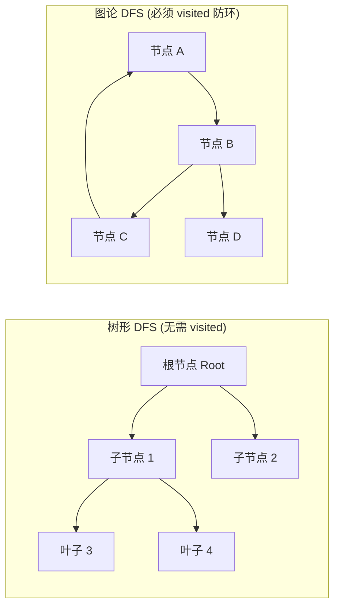
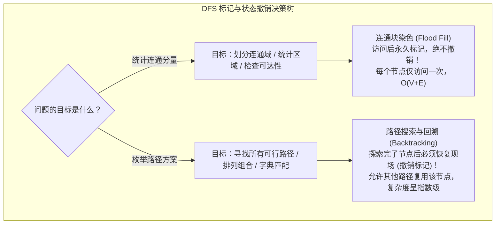
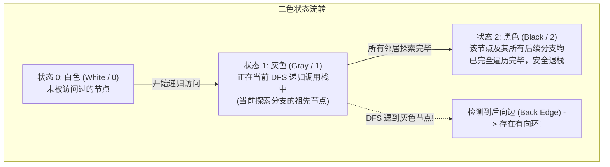
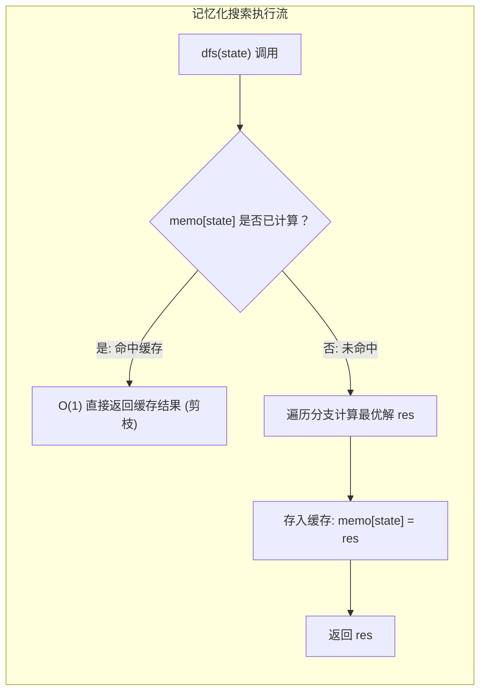

# DFS 深度优先搜索

> **核心定义**：
> 深度优先搜索（Depth-First Search, DFS）是一种图与状态空间的系统性遍历策略。其核心原则是**“不撞南墙不回头”**：沿着当前分支不断深入递归，直到遭遇叶子节点、非法状态或无路可走时，才回溯到最近的分岔路口探索其他分支。DFS 在底层依赖于**函数调用栈（隐式栈）**或**显式数据栈**维护遍历路径。

---

## 1. 图论 DFS vs 树形 DFS 的本质区别

树是特殊的图（无向无环连通图），因此树的 DFS 与通用图的 DFS 存在本质的控制差异：



| 维度 | 树形 DFS（Tree DFS） | 通用图 DFS（Graph DFS） |
| :--- | :--- | :--- |
| **拓扑结构** | 天然无环，父子层次方向明确 | 可能存在环路（Cycle）、交叉边与重边 |
| **访问标记** | **通常不需要 `visited` 数组**（对于无向树，仅需传入 `parent` 参数防止反向倒流） | **必须维护访问状态标记**（如布尔数组或哈希表），否则会陷入无限环路导致调用栈溢出 |
| **状态回退** | 单向向下递归探索，天然只访问每个节点一次 | 若不限制访问，同一节点可被多条路径重复到达 |
| **复杂度** | $O(V)$，每个节点仅且仅访问一次 | 邻接表时间复杂度为 $O(V + E)$，邻接矩阵为 $O(V^2)$ |

---

## 2. 状态标记的两大分水岭：连通块染色 vs 路径回溯

在解决网格和图搜索问题时，绝大多数错误源于**混淆了“是否需要恢复现场”**：



### 2.1 模式 A：连通块染色（不恢复现场，永久标记）
- **核心逻辑**：一旦访问某节点，该节点属于当前连通分量的事实已确定，后续路径绝不需要重新将其作为新起点计算。
- **代表题型**：岛屿数量、被围绕的区域、省份数量。
- **状态维护**：直接就地修改原数组（如把 `'1'` 变成 `'0'`）或将 `visited[i] = true` 永久置位，递归退出时**严禁重置为未访问**。

### 2.2 模式 B：路径搜索（必须恢复现场，对称撤销）
- **核心逻辑**：当前节点只是“当前这一条路径”上的一个步骤。从另一个前驱节点出发可能还会经过该节点。
- **代表题型**：单词搜索（LC 79）、矩阵中的黄金路径。
- **状态维护**：必须成对出现——`visited[u] = true` $\to$ 深入探索 $\to$ `visited[u] = false`。

---

## 3. 有向图环检测神技：三色标记法（Three-Color Marking）

普通布尔类型的 `visited[u]` 只能表达“访问过”与“未访问”，无法区分节点是“正在当前路径探索中”还是“已经探索完毕安全返回”。因此无法准确判定有向图中的环。**三色标记法**是解决有向图环检测与拓扑排序的标准方案：



### 三色状态判断法则
1. 邻居节点状态为 `0`：未探索，递归进入探索。若子调用发现环，直接向上抛出有环信号。
2. 邻居节点状态为 `1`：**发生回路！** 当前节点指向了自己递归栈中的祖先节点，必定存在有向环。
3. 邻居节点状态为 `2`：该分支早已被完全验证过，无环且安全，直接跳过（剪枝）。

---

## 4. 从暴力递归到记忆化搜索（Memoization）的标准演进

当 DFS 探索的状态空间存在大量**重叠子问题**时，暴搜会退化为指数级复杂度。此时通过引入备忘录，将 DFS 升级为**自顶向下的动态规划**。



### 记忆化搜索四步重构法
1. **状态抽象**：提炼决定函数结果的最小参数元组 `(i, j, ...)`。
2. **定义备忘录**：声明与状态维度匹配的缓存数组或哈希表（如 `int[][] memo`），统一初始化为非法值（如 `-1` 或 `0`）。
3. **入口查表**：函数第一行检查 `if (memo[i][j] != INVALID) return memo[i][j];`。
4. **出口存表**：在所有 `return` 之前，将计算结果写入 `memo[i][j]`。

---

## 5. 经典母题手撕：LeetCode 207. 课程表（三色标记法环检测）

> **题目描述**：
> 你这个学期必须选修 `numCourses` 门课程，记为 `0` 到 `numCourses - 1`。
> 在选修某些课程之前需要一些先修课程。先修课程按数组 `prerequisites` 给出，其中 `prerequisites[i] = [ai, bi]` ，表示如果要学习课程 `ai` 则**必须**先学习课程 `bi`。
> 请你判断是否可能完成所有课程的学习？如果可以，返回 `true`；否则，返回 `false`。
>
> **输入输出示例**：
> - 示例 1：
>   - 输入：`numCourses = 2, prerequisites = [[1,0]]`
>   - 输出：`true`（总共 2 门课程。学习课程 1 之前需要先修课程 0。先学 0 再学 1，可行）
> - 示例 2：
>   - 输入：`numCourses = 2, prerequisites = [[1,0],[0,1]]`
>   - 输出：`false`（学习 1 需先学 0，学习 0 又需先学 1，构成循环死锁依赖）

### 5.1 算法模型与建图本质
- **图论建模**：将每门课程视为有向图中的一个顶点。先修关系 `[ai, bi]` 代表一条有向边 $bi \to ai$（必须先完成 $bi$，才能流向 $ai$）。
- **问题等价转换**：课程表能否修完，等价于**该有向图是否存在有向环（Cycle）**。若图为有向无环图（DAG），则必然存在拓扑排序，返回 `true`；若存在环，则形成死锁互锁，返回 `false`。
- **三色标记法执行流**：
  - `0 (白色)`：未探索；
  - `1 (灰色)`：正在当前递归调用路径中（祖先节点），若 DFS 过程中再次遇到灰色节点，说明碰到了回向边，判定存在环；
  - `2 (黑色)`：以该节点为根的子树已被完整探索且证实无环，后续遇上直接跳过剪枝。

### 5.2 标准 Java 实现

```java
public class SolutionCourseSchedule {

    private static final int UNVISITED = 0; // 白色：未访问
    private static final int VISITING = 1;  // 灰色：当前调用栈中
    private static final int VISITED = 2;   // 黑色：已完成探索且无环

    public boolean canFinish(int numCourses, int[][] prerequisites) {
        // 1. 构建邻接表
        List<List<Integer>> graph = new ArrayList<>();
        for (int i = 0; i < numCourses; i++) {
            graph.add(new ArrayList<>());
        }
        for (int[] pre : prerequisites) {
            graph.get(pre[1]).add(pre[0]); // pre[1] -> pre[0]
        }

        // 2. 三色标记数组
        int[] color = new int[numCourses];

        // 3. 遍历每个节点作为源点进行 DFS
        for (int i = 0; i < numCourses; i++) {
            if (color[i] == UNVISITED) {
                if (hasCycle(graph, color, i)) {
                    return false; // 存在环，无法完成
                }
            }
        }
        return true;
    }

    private boolean hasCycle(List<List<Integer>> graph, int[] color, int u) {
        color[u] = VISITING; // 标记为灰色：入栈中

        for (int v : graph.get(u)) {
            if (color[v] == VISITING) {
                return true; // 发现后向边，存在环
            }
            if (color[v] == UNVISITED) {
                if (hasCycle(graph, color, v)) {
                    return true;
                }
            }
            // 若 color[v] == VISITED (黑色)，说明已被验证无环，安全跳过
        }

        color[u] = VISITED; // 标记为黑色：出栈，子树全安全
        return false;
    }
}
```

---

## 6. 典型算法应用速览

| 题目 | 难度 | 核心 DFS 策略 |
| :--- | :--- | :--- |
| **LC 200. 岛屿数量** | 中等 | 连通块染色：遇 `'1'` 触发 DFS，将当前岛屿连通的所有陆地全部就地置 `'0'`（沉岛法），无需回溯 |
| **LC 79. 单词搜索** | 中等 | 路径回溯：矩阵四向探索，进入前标记 `visited[r][c] = true`，递归返回必须撤销 `visited[r][c] = false` |
| **LC 329. 矩阵中的最长递增路径** | 困难 | 记忆化搜索：有向无环图最长路，维护 `memo[r][c]` 记录从该格子出发的最长链，每个单元格仅计算一次 |
| **LC 130. 被围绕的区域** | 中等 | 逆向边界染色：从矩阵四条边缘的 `'O'` 开始向内 DFS 染色为 `'#'`，遍历完后把剩余 `'O'` 变 `'X'`，`'#'` 还原为 `'O'` |
| **LC 547. 省份数量** | 中等 | 无向图连通分量：维护一维 `visited` 数组，对每个未访问节点启动 DFS 遍历完整连通块 |

> [!example]- 展开查看：LC 200. 岛屿数量（沉岛法极简实现）
> **题目描述**：给你一个由 `'1'`（陆地）和 `'0'`（水）组成的的二维网格 `grid`，请你计算网格中岛屿的数量。岛屿总是被水包围，并且每座岛屿只能由水平方向和/或竖直方向上相邻的陆地连接形成。
> **示例**：输入 `grid = [["1","1","0"],["1","1","0"],["0","0","1"]]`，输出 `2`。
> **思路**：双重循环扫描，遇到 `'1'` 岛屿计数器加 1，并立刻触发 DFS 将该连通块的所有 `'1'` 就地修改为 `'0'`（沉岛法），无需额外 `visited` 空间，也不需要回溯。
> ```java
> class SolutionLC200 {
>     public int numIslands(char[][] grid) {
>         if (grid == null || grid.length == 0) return 0;
>         int count = 0;
>         for (int i = 0; i < grid.length; i++) {
>             for (int j = 0; j < grid[0].length; j++) {
>                 if (grid[i][j] == '1') {
>                     count++;
>                     dfsSink(grid, i, j);
>                 }
>             }
>         }
>         return count;
>     }
> 
>     private void dfsSink(char[][] grid, int r, int c) {
>         if (r < 0 || r >= grid.length || c < 0 || c >= grid[0].length || grid[r][c] != '1') {
>             return;
>         }
>         grid[r][c] = '0'; // 沉岛：永久沉没，无需恢复
>         dfsSink(grid, r + 1, c);
>         dfsSink(grid, r - 1, c);
>         dfsSink(grid, r, c + 1);
>         dfsSink(grid, r, c - 1);
>     }
> }
> ```

> [!example]- 展开查看：LC 329. 矩阵中的最长递增路径（记忆化搜索实现）
> **题目描述**：给定一个 `m x n` 整数矩阵 `matrix` ，找出其中最长严格递增路径的长度。对于每个单元格，你可以向上下左右四个方向移动，不能对角线移动或移出边界。
> **示例**：输入 `matrix = [[9,9,4],[6,6,8],[2,1,1]]`，输出 `4`（最长递增路径为 `[1, 2, 6, 9]`）。
> **思路**：严格递增天然形成有向无环图（DAG），不存在回路。采用记忆化搜索，用 `memo[r][c]` 记录从该格子出发能走出的最长路径长度，每个单元格仅被计算一次，时间复杂度为 $O(M \times N)$。
> ```java
> class SolutionLC329 {
>     private int[][] memo;
>     private int[][] dirs = {{0, 1}, {1, 0}, {0, -1}, {-1, 0}};
>     private int m, n;
> 
>     public int longestIncreasingPath(int[][] matrix) {
>         if (matrix == null || matrix.length == 0) return 0;
>         m = matrix.length;
>         n = matrix[0].length;
>         memo = new int[m][n];
>         int maxPath = 0;
> 
>         for (int i = 0; i < m; i++) {
>             for (int j = 0; j < n; j++) {
>                 maxPath = Math.max(maxPath, dfs(matrix, i, j));
>             }
>         }
>         return maxPath;
>     }
> 
>     private int dfs(int[][] matrix, int r, int c) {
>         if (memo[r][c] != 0) return memo[r][c]; // 查表剪枝
> 
>         int maxLen = 1;
>         for (int[] d : dirs) {
>             int nr = r + d[0], nc = c + d[1];
>             if (nr >= 0 && nr < m && nc >= 0 && nc < n && matrix[nr][nc] > matrix[r][c]) {
>                 maxLen = Math.max(maxLen, 1 + dfs(matrix, nr, nc));
>             }
>         }
>         memo[r][c] = maxLen; // 写入备忘录
>         return maxLen;
>     }
> }
> ```

---

## 7. 工业级避坑与面试答题要点

1. **显式栈与爆栈规避**：若图退化为单链且节点规模 $V \ge 10^5$，JVM 递归将直接触发 `StackOverflowError`。对于此类超深图遍历，需通过显式 `Deque<Integer> stack = new ArrayDeque<>()` 配合循环改写。
2. **入栈即标记 vs 出栈再标记**：
   - 在图遍历中，为防止节点被多次重复压入队列或栈，**必须在发现邻居且决定将其加入时立即打上标记**，严禁在弹出时才标记。
3. **坐标越界检验顺序**：在网格 DFS 中，数组越界检查 `r < 0 || r >= m || c < 0 || c >= n` 必须放在访问 `grid[r][c]` 之前，利用 Java 的逻辑短路特性防止 `ArrayIndexOutOfBoundsException`。
